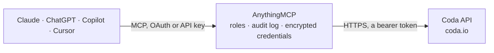

<!-- Generated by scripts/export-github-catalog.mjs in the anythingmcp-website repository. Do not edit by hand. -->

# Coda MCP connector

Drive Coda (docs + tables + formulas) from any AI agent: docs, tables, rows, columns, formulas, packs, controls. 13 tools, Bearer token auth. The AnythingMCP connector gives Claude, ChatGPT, Microsoft Copilot, Cursor and Gemini 13 MCP tools for Coda: 9 read and 4 can change data.

**Category:** [Project Management](../project-management.md) · **Tools:** 13 · **Setup guide:** [anythingmcp.com](https://anythingmcp.com/guides/coda-to-mcp) · [Deutsch](https://anythingmcp.com/de/guides/coda-to-mcp) · [Italiano](https://anythingmcp.com/it/guides/coda-to-mcp) · [Español](https://anythingmcp.com/es/guides/coda-to-mcp) · [日本語](https://anythingmcp.com/ja/guides/coda-to-mcp) · [Русский](https://anythingmcp.com/ru/guides/coda-to-mcp) · [中文](https://anythingmcp.com/zh/guides/coda-to-mcp)

## Start without code

No installation and no terminal: AnythingMCP Cloud runs the Coda connector for you, operated by helpcode.ai in Frankfurt, Germany.

1. **Click the button above** and create an account or sign in. The Coda connector opens, ready to install.
2. **Paste the API key or token from your Coda account.** Every click is in the [step-by-step guide](https://anythingmcp.com/guides/coda-to-mcp).
3. **Click Install.** AnythingMCP shows the address of your MCP server.
4. **Add that address to your assistant:** [Claude](https://anythingmcp.com/guides/connect-coda-to-claude) · [ChatGPT](https://anythingmcp.com/guides/connect-coda-to-chatgpt) · [Microsoft Copilot](https://anythingmcp.com/guides/connect-coda-to-copilot) · [Cursor](https://anythingmcp.com/guides/connect-coda-to-cursor) · [Gemini CLI](https://anythingmcp.com/guides/connect-coda-to-gemini) · [Meta Muse](https://anythingmcp.com/guides/connect-coda-to-muse).
5. **Ask your first question**, for example: *Show invoice INV-2026-114 for customer Marlin Gears GmbH — what's its status, due date and amount?*

Prefer help with the setup? [Talk to us](https://anythingmcp.com/contact).

## How it works

- **The AI client** speaks MCP (Streamable HTTP) to AnythingMCP and only sees tool names, descriptions and results. It never gets the Coda credentials.
- **AnythingMCP** checks the client's role, builds the call from the tool definition, adds the credentials (a bearer token), calls Coda, logs the call and returns the result.
- **Coda** sees an ordinary API client with the rights of the account the credentials belong to.

## Tools

| Tool | What it does | Access |
|---|---|---|
| [`coda_whoami`](#coda_whoami) | Return the user the token belongs to. | read |
| [`coda_list_docs`](#coda_list_docs) | List docs the user can access. | read |
| [`coda_get_doc`](#coda_get_doc) | Fetch a single doc by ID. | read |
| [`coda_list_tables`](#coda_list_tables) | List tables in a doc. | read |
| [`coda_list_columns`](#coda_list_columns) | List columns in a table. | read |
| [`coda_list_rows`](#coda_list_rows) | List rows in a table or view. | read |
| [`coda_get_row`](#coda_get_row) | Fetch a single row by ID. | read |
| [`coda_insert_rows`](#coda_insert_rows) | Insert (or upsert with keyColumns) rows into a table. | write |
| [`coda_update_row`](#coda_update_row) | Update a specific row by ID. | write |
| [`coda_delete_row`](#coda_delete_row) | Delete a single row by ID. | write |
| [`coda_delete_rows`](#coda_delete_rows) | Bulk-delete rows by IDs (more efficient than per-row). | write |
| [`coda_get_formula_result`](#coda_get_formula_result) | Evaluate a named formula on a doc. | read |
| [`coda_get_mutation_status`](#coda_get_mutation_status) | Check the status of an async mutation (insert/update/delete) by its requestId returned from those calls. | read |

## Tool reference

Every parameter as the AI client sees it in `tools/list`. Source: [`packages/backend/src/adapters/intl/coda.json`](../../../packages/backend/src/adapters/intl/coda.json).

### `coda_whoami`

Return the user the token belongs to. Returns name, loginId (email), pictureLink, type, tokenName, workspace.

**Access:** read · **Call:** `GET /whoami`

No parameters.

### `coda_list_docs`

List docs the user can access. Filter by owner, query, workspace. Pagination via pageToken.

**Access:** read · **Call:** `GET /docs`

| Parameter | Type | Required | Description |
|---|---|---|---|
| `isOwner` | boolean | no | Only docs the user owns. |
| `isPublished` | boolean | no | Only published docs. |
| `query` | string | no | Substring search across doc names. |
| `sourceDoc` | string | no | Filter to copies of this doc ID. |
| `isStarred` | boolean | no | Only starred. |
| `inGallery` | boolean | no | Only gallery docs. |
| `workspaceId` | string | no | Filter by workspace. |
| `folderId` | string | no | Filter by folder. |
| `limit` | integer | no | Max per page (default 25, max 100). |
| `pageToken` | string | no | Pagination cursor. |

### `coda_get_doc`

Fetch a single doc by ID. Returns metadata: name, owner, ownerName, browserLink, icon, workspace.

**Access:** read · **Call:** `GET /docs/{docId}`

| Parameter | Type | Required | Description |
|---|---|---|---|
| `docId` | string | yes | Doc ID (e.g. 'dXXXXXXXXXX'). |

### `coda_list_tables`

List tables in a doc. Each table has id (e.g. 'grid-XXXXX'), name, tableType (table/view), rowCount, displayColumn, sorts, layout.

**Access:** read · **Call:** `GET /docs/{docId}/tables`

| Parameter | Type | Required | Description |
|---|---|---|---|
| `docId` | string | yes | Doc ID. |
| `limit` | integer | no | Per page. |
| `pageToken` | string | no | Pagination cursor. |
| `sortBy` | string | no | name. |
| `tableTypes` | string | no | Comma-separated: table,view. |

### `coda_list_columns`

List columns in a table. Each column has id (e.g. 'c-XXXX'), name, display (true if it's the display column), calculated, formula, format (type info).

**Access:** read · **Call:** `GET /docs/{docId}/tables/{tableId}/columns`

| Parameter | Type | Required | Description |
|---|---|---|---|
| `docId` | string | yes | Doc ID. |
| `tableId` | string | yes | Table ID. |
| `limit` | integer | no | Per page. |
| `pageToken` | string | no | Cursor. |

### `coda_list_rows`

List rows in a table or view. Supports filtering by a query like 'Status="Active"' (uses Coda formula syntax with column IDs or names).

**Access:** read · **Call:** `GET /docs/{docId}/tables/{tableId}/rows`

| Parameter | Type | Required | Description |
|---|---|---|---|
| `docId` | string | yes | Doc ID. |
| `tableId` | string | yes | Table ID. |
| `query` | string | no | Filter formula, e.g. 'c-XXXX:"Active"' or 'Status="Active"'. |
| `useColumnNames` | boolean | no | If true, returned cells are keyed by column name. Default false (keyed by ID). |
| `valueFormat` | string | no | Output format: simple, simpleWithArrays, rich. |
| `sortBy` | string | no | natural (default table order) or createdAt. |
| `visibleOnly` | boolean | no | Skip hidden columns. |
| `limit` | integer | no | Per page (default 25, max 200). |
| `pageToken` | string | no | Cursor. |

### `coda_get_row`

Fetch a single row by ID. Returns cells keyed by column ID (or name if useColumnNames=true).

**Access:** read · **Call:** `GET /docs/{docId}/tables/{tableId}/rows/{rowId}`

| Parameter | Type | Required | Description |
|---|---|---|---|
| `docId` | string | yes | Doc ID. |
| `tableId` | string | yes | Table ID. |
| `rowId` | string | yes | Row ID (e.g. 'i-XXXX'). |
| `useColumnNames` | boolean | no | Key cells by name vs ID. |
| `valueFormat` | string | no | simple, simpleWithArrays, rich. |

### `coda_insert_rows`

Insert (or upsert with keyColumns) rows into a table. Returns a requestId for tracking the async ingest job.

**Access:** write · **Call:** `POST /docs/{docId}/tables/{tableId}/rows`

| Parameter | Type | Required | Description |
|---|---|---|---|
| `docId` | string | yes | Doc ID. |
| `tableId` | string | yes | Table ID. |
| `rows` | any[] | yes | Array of row objects: [{cells: [{column: 'c-XXXX' or column-name, value: ...}, ...]}, ...]. value can be string/number/boolean OR object for person ({email}) / row link (rowId string). |
| `keyColumns` | any[] | no | Array of column IDs/names to match for upsert. Omit for pure insert. |
| `disableParsing` | boolean | no | If true, send raw values without Coda parsing. |

### `coda_update_row`

Update a specific row by ID. Returns a requestId for tracking async update.

**Access:** write · **Call:** `PUT /docs/{docId}/tables/{tableId}/rows/{rowId}`

| Parameter | Type | Required | Description |
|---|---|---|---|
| `docId` | string | yes | Doc ID. |
| `tableId` | string | yes | Table ID. |
| `rowId` | string | yes | Row ID. |
| `row` | object | yes | {cells: [{column: 'c-XXXX' or name, value: ...}, ...]}. |
| `disableParsing` | boolean | no | Skip parsing. |

### `coda_delete_row`

Delete a single row by ID.

**Access:** write · **Call:** `DELETE /docs/{docId}/tables/{tableId}/rows/{rowId}`

| Parameter | Type | Required | Description |
|---|---|---|---|
| `docId` | string | yes | Doc ID. |
| `tableId` | string | yes | Table ID. |
| `rowId` | string | yes | Row ID. |

### `coda_delete_rows`

Bulk-delete rows by IDs (more efficient than per-row).

**Access:** write · **Call:** `DELETE /docs/{docId}/tables/{tableId}/rows`

| Parameter | Type | Required | Description |
|---|---|---|---|
| `docId` | string | yes | Doc ID. |
| `tableId` | string | yes | Table ID. |
| `rowIds` | any[] | yes | Array of row IDs to delete. |

### `coda_get_formula_result`

Evaluate a named formula on a doc. Returns the current value of a formula by name (defined in the doc via Add Formula).

**Access:** read · **Call:** `GET /docs/{docId}/formulas/{formulaIdOrName}`

| Parameter | Type | Required | Description |
|---|---|---|---|
| `docId` | string | yes | Doc ID. |
| `formulaIdOrName` | string | yes | Formula ID or name (URL-encoded). |

### `coda_get_mutation_status`

Check the status of an async mutation (insert/update/delete) by its requestId returned from those calls. Returns completed boolean.

**Access:** read · **Call:** `GET /mutationStatus/{requestId}`

| Parameter | Type | Required | Description |
|---|---|---|---|
| `requestId` | string | yes | RequestId from a prior mutation call. |

## Run it yourself

AnythingMCP is open source (AGPL-3.0). [Run it with Docker](../../../README.md#run-it-yourself), open **Connectors → Store**, pick **Coda** and enter `CODA_API_TOKEN`, then add your MCP server URL to the AI client.

[← Project Management connectors](../project-management.md) · [All categories](../README.md)
