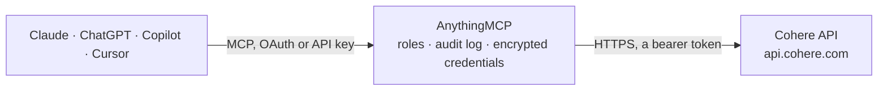

<!-- Generated by scripts/export-github-catalog.mjs in the anythingmcp-website repository. Do not edit by hand. -->

# Cohere MCP connector

Let your AI use Cohere with your own API key: chat with Command models (with citations from your documents), create embeddings, rerank search results, transcribe audio, parse document images, count … The AnythingMCP connector gives Claude, ChatGPT, Microsoft Copilot, Cursor and Gemini 17 MCP tools for Cohere, all read-only.

**Category:** [Public Data](../data.md) · **Tools:** 17 · **Setup guide:** [anythingmcp.com](https://anythingmcp.com/guides/cohere-to-mcp) · [Deutsch](https://anythingmcp.com/de/guides/cohere-to-mcp) · [Italiano](https://anythingmcp.com/it/guides/cohere-to-mcp) · [Español](https://anythingmcp.com/es/guides/cohere-to-mcp) · [日本語](https://anythingmcp.com/ja/guides/cohere-to-mcp) · [Русский](https://anythingmcp.com/ru/guides/cohere-to-mcp) · [中文](https://anythingmcp.com/zh/guides/cohere-to-mcp)

## Start without code

No installation and no terminal: AnythingMCP Cloud runs the Cohere connector for you, operated by helpcode.ai in Frankfurt, Germany.

1. **Click the button above** and create an account or sign in. The Cohere connector opens, ready to install.
2. **Paste the API key or token from your Cohere account.** Every click is in the [step-by-step guide](https://anythingmcp.com/guides/cohere-to-mcp).
3. **Click Install.** AnythingMCP shows the address of your MCP server.
4. **Add that address to your assistant:** [Claude](https://anythingmcp.com/guides/connect-cohere-to-claude) · [ChatGPT](https://anythingmcp.com/guides/connect-cohere-to-chatgpt) · [Microsoft Copilot](https://anythingmcp.com/guides/connect-cohere-to-copilot) · [Cursor](https://anythingmcp.com/guides/connect-cohere-to-cursor) · [Gemini CLI](https://anythingmcp.com/guides/connect-cohere-to-gemini) · [Meta Muse](https://anythingmcp.com/guides/connect-cohere-to-muse).
5. **Ask your first question**, for example: *Show me dataset named "invoices-2026-Q3" and its validation status and size.*

Prefer help with the setup? [Talk to us](https://anythingmcp.com/contact).

## How it works

- **The AI client** speaks MCP (Streamable HTTP) to AnythingMCP and only sees tool names, descriptions and results. It never gets the Cohere credentials.
- **AnythingMCP** checks the client's role, builds the call from the tool definition, adds the credentials (a bearer token), calls Cohere, logs the call and returns the result.
- **Cohere** sees an ordinary API client with the rights of the account the credentials belong to.

## Tools

| Tool | What it does | Access |
|---|---|---|
| [`cohere_list_models`](#cohere_list_models) | List the Cohere models available to this key, with endpoints they serve (chat, embed, rerank), context length, features and whether they are deprecated. | read |
| [`cohere_get_model`](#cohere_get_model) | Read one Cohere model by name: endpoints, default endpoints, context length, features (e.g. tools, vision, reasoning), tokenizer URL and whether it is… | read |
| [`cohere_check_api_key`](#cohere_check_api_key) | Check that the Cohere API key is valid and active; returns valid plus the organization and owner ids. | read |
| [`cohere_chat`](#cohere_chat) | Ask a Cohere Command model and get its reply (Chat API v2, non-streaming). | read |
| [`cohere_embed`](#cohere_embed) | Turn up to 96 texts (or images as data URIs) into embedding vectors for semantic search, clustering or classification (Embed API v2). | read |
| [`cohere_rerank`](#cohere_rerank) | Order a list of documents by relevance to a query (Rerank API v2) and return the top results with their index in the list and a relevance_score from 0 to 1. | read |
| [`cohere_transcribe_audio`](#cohere_transcribe_audio) | Transcribe speech in an audio file to text with Cohere Transcribe. | read |
| [`cohere_parse_document`](#cohere_parse_document) | Parse an image of a document page (scan, photo, screenshot) into markdown, with tables inlined, or into layout blocks (Parse API v2). | read |
| [`cohere_tokenize`](#cohere_tokenize) | Split a text into tokens with the tokenizer of a Cohere model and return the token ids and token strings, e.g. to count tokens before a chat call. | read |
| [`cohere_detokenize`](#cohere_detokenize) | Turn a list of token ids back into text with the tokenizer of a Cohere model. | read |
| [`cohere_list_datasets`](#cohere_list_datasets) | List the datasets of the Cohere account (inputs for embed jobs, batches and fine-tuning) with id, name, type, validation status and creation time. | read |
| [`cohere_get_dataset`](#cohere_get_dataset) | Read one Cohere dataset: name, type, validation status and error, schema, size and its parts. | read |
| [`cohere_get_dataset_usage`](#cohere_get_dataset_usage) | Read how much dataset storage the Cohere organization uses, in bytes (the limit is 10 GB per organization). | read |
| [`cohere_list_batches`](#cohere_list_batches) | List the Batch API jobs of the Cohere account with id, name, model, status, input and output dataset ids and request counts. | read |
| [`cohere_get_batch`](#cohere_get_batch) | Read one Cohere batch job: status, model, input and output dataset ids, request counts (succeeded, failed) and timestamps. | read |
| [`cohere_list_embed_jobs`](#cohere_list_embed_jobs) | List the embed jobs of the Cohere account with job id, name, status, model, input and output dataset ids and creation time. | read |
| [`cohere_get_embed_job`](#cohere_get_embed_job) | Read one Cohere embed job: status (processing, complete, cancelling, cancelled, failed), model, truncate setting, input dataset and the output dataset with… | read |

## Tool reference

Every parameter as the AI client sees it in `tools/list`. Source: [`packages/backend/src/adapters/intl/cohere.json`](../../../packages/backend/src/adapters/intl/cohere.json).

### `cohere_list_models`

List the Cohere models available to this key, with endpoints they serve (chat, embed, rerank), context length, features and whether they are deprecated. Filter by endpoint; page with page_token = next_page_token. Free.

**Access:** read · **Call:** `GET /v1/models`

| Parameter | Type | Required | Description |
|---|---|---|---|
| `endpoint` | `chat` \| `embed` \| `rerank` | no | Only models that serve this endpoint. |
| `default_only` | boolean | no | With endpoint: only the default model of that endpoint. |
| `page_size` | integer | no | Models per page, default 50. |
| `page_token` | string | no | next_page_token of the previous page. |

### `cohere_get_model`

Read one Cohere model by name: endpoints, default endpoints, context length, features (e.g. tools, vision, reasoning), tokenizer URL and whether it is deprecated or fine-tuned. Free.

**Access:** read · **Call:** `GET /v1/models/{model}`

| Parameter | Type | Required | Description |
|---|---|---|---|
| `model` | string | yes | Model name, e.g. command-a-03-2025 or embed-v4.0. |

### `cohere_check_api_key`

Check that the Cohere API key is valid and active; returns valid plus the organization and owner ids. Free.

**Access:** read · **Call:** `POST /v1/check-api-key`

No parameters.

### `cohere_chat`

Ask a Cohere Command model and get its reply (Chat API v2, non-streaming). Pass documents for a grounded answer with citations. COSTS MONEY with a production key: billed per input and output token (trial keys are free but rate limited). Confirm with the user before larger or repeated calls and set max_tokens to cap the cost.

**Access:** read · **Call:** `POST /v2/chat`

| Parameter | Type | Required | Description |
|---|---|---|---|
| `model` | string | yes | Chat model, e.g. command-a-03-2025, command-a-reasoning-08-2025, command-a-vision-07-2025, command-r7b-12-2024 (cheapest). |
| `messages` | object[] | yes | The conversation, oldest first: [{"role": "system", "content": "..."}, {"role": "user", "content": "..."}]. Roles: system, user, assistant, tool. Vision models take content as a list of parts such as {"type": "image_url", "image_url": {"url": "https://..."}}. |
| `documents` | any[] | no | Documents the model may cite: strings, or {"id": "doc1", "data": {"title": "...", "snippet": "..."}}. The reply then has message.citations. |
| `citation_options` | object | no | {"mode": "ACCURATE" \| "FAST" \| "OFF"}: citation quality versus speed. |
| `max_tokens` | integer | no | Upper bound on output tokens. Set it to cap cost. |
| `temperature` | number | no | Randomness, default 0.3; lower is more deterministic. |
| `p` | number | no | Nucleus sampling, default 0.75. |
| `k` | integer | no | Top-k sampling; 0 (default) switches it off. |
| `seed` | integer | no | Seed for best-effort repeatable sampling. |
| `stop_sequences` | string[] | no | Up to 5 strings where generation stops. |
| `response_format` | object | no | Structured output: {"type": "json_object"}, optionally with "json_schema": {...}. |
| `tools` | object[] | no | Function definitions: [{"type": "function", "function": {"name": "...", "description": "...", "parameters": {...}}}]. The reply then has message.tool_calls; run them and send role tool messages back. |
| `tool_choice` | `REQUIRED` \| `NONE` | no | REQUIRED forces a tool call, NONE forbids one. Omit to let the model decide. |
| `safety_mode` | `CONTEXTUAL` \| `STRICT` \| `OFF` | no | Safety instruction added to the prompt, default CONTEXTUAL. |
| `thinking` | object | no | Reasoning models: {"type": "disabled"} turns reasoning off, {"type": "enabled", "token_budget": 2000} caps it. |

### `cohere_embed`

Turn up to 96 texts (or images as data URIs) into embedding vectors for semantic search, clustering or classification (Embed API v2). Default embed-v4.0 with 256 float dimensions. COSTS MONEY with a production key: billed per token or image. Confirm with the user before embedding large collections.

**Access:** read · **Call:** `POST /v2/embed`

| Parameter | Type | Required | Description |
|---|---|---|---|
| `texts` | string[] | no | Texts to embed, at most 96. |
| `images` | string[] | no | Images as data URIs (data:image/png;base64,...) for image embeddings, with input_type image. |
| `model` | string | no | Embedding model, default embed-v4.0; also embed-v5.0-pro, embed-v5.0-fast, embed-multilingual-v3.0. |
| `input_type` | `search_document` \| `search_query` \| `classification` \| `clustering` \| `image` | no | search_document for stored texts, search_query for the query, classification, clustering, or image. |
| `output_dimension` | `256` \| `512` \| `1024` \| `1536` | no | Vector size for embed-v4.0 and newer, default 256 here to keep answers small. |
| `embedding_types` | `float` \| `int8` \| `uint8` \| `binary` \| `ubinary` \| `base64`[] | no | Vector encodings to return, default ["float"]. |
| `truncate` | `NONE` \| `START` \| `END` | no | How to cut inputs longer than the model allows: END (default), START, or NONE to get an error instead. |

### `cohere_rerank`

Order a list of documents by relevance to a query (Rerank API v2) and return the top results with their index in the list and a relevance_score from 0 to 1. COSTS MONEY with a production key: billed per search of up to 100 documents (longer documents count as several). Confirm with the user before large or repeated calls.

**Access:** read · **Call:** `POST /v2/rerank`

| Parameter | Type | Required | Description |
|---|---|---|---|
| `query` | string | yes | The search query. |
| `documents` | string[] | yes | Texts to rank, at most 1,000 (fewer is cheaper). Structured records can be passed as YAML strings. |
| `model` | string | no | Rerank model, default rerank-v5.0-fast; rerank-v5.0-pro is more accurate. |
| `top_n` | integer | no | Return only the best n results. Omit for all. |
| `max_tokens_per_doc` | integer | no | Truncate each document to this many tokens, default 4096. |

### `cohere_transcribe_audio`

Transcribe speech in an audio file to text with Cohere Transcribe. Pass a public link: the connector downloads the file (up to 10 MB; flac, mp3, mpeg, mpga, ogg, wav) and uploads it. COSTS MONEY with a production key. Confirm with the user before transcribing their recordings.

**Access:** read · **Call:** `POST /v2/audio/transcriptions`

| Parameter | Type | Required | Description |
|---|---|---|---|
| `audio_url` | string | yes | Public HTTPS link to the audio file. |
| `language` | string | yes | Language of the audio as an ISO-639-1 code, e.g. en, de, ja. Required by Cohere. |
| `model` | string | no | Transcription model, default cohere-transcribe-03-2026 (cohere-transcribe-arabic-07-2026 for Arabic). |
| `temperature` | number | no | Sampling temperature 0-1. |

### `cohere_parse_document`

Parse an image of a document page (scan, photo, screenshot) into markdown, with tables inlined, or into layout blocks (Parse API v2). Takes a public image link or a data URI up to 20 MB; PDFs are not supported yet. COSTS MONEY with a production key. Confirm with the user before parsing many pages.

**Access:** read · **Call:** `POST /v2/parse`

| Parameter | Type | Required | Description |
|---|---|---|---|
| `image_url` | string | yes | Public HTTPS link to the image, or a data URI (data:image/png;base64,...). |
| `model` | string | no | Parse model, default parse-v5.0. |
| `output_format` | `markdown` \| `blocks` | no | markdown (default): markdown per page; blocks: typed layout blocks. |

### `cohere_tokenize`

Split a text into tokens with the tokenizer of a Cohere model and return the token ids and token strings, e.g. to count tokens before a chat call. Free.

**Access:** read · **Call:** `POST /v1/tokenize`

| Parameter | Type | Required | Description |
|---|---|---|---|
| `text` | string | yes | Text to tokenize, 1 to 65,536 characters. |
| `model` | string | no | Model whose tokenizer is used, default command-a-03-2025. |

### `cohere_detokenize`

Turn a list of token ids back into text with the tokenizer of a Cohere model. Free.

**Access:** read · **Call:** `POST /v1/detokenize`

| Parameter | Type | Required | Description |
|---|---|---|---|
| `tokens` | integer[] | yes | Token ids, e.g. from cohere_tokenize. |
| `model` | string | no | Model whose tokenizer is used, default command-a-03-2025. |

### `cohere_list_datasets`

List the datasets of the Cohere account (inputs for embed jobs, batches and fine-tuning) with id, name, type, validation status and creation time. Free.

**Access:** read · **Call:** `GET /v1/datasets`

| Parameter | Type | Required | Description |
|---|---|---|---|
| `dataset_type` | string | no | Only this type, e.g. embed-input, embed-result, batch-chat-v2-input, batch-embed-v2-input, chat-finetune-input. |
| `validation_status` | `unknown` \| `queued` \| `processing` \| `failed` \| `validated` \| `skipped` | no | Only datasets with this validation status. |
| `before` | string | no | Only datasets created before this ISO 8601 date-time. |
| `after` | string | no | Only datasets created after this ISO 8601 date-time. |
| `limit` | integer | no | Datasets per page, default 25. |
| `offset` | integer | no | Number of datasets to skip. |

### `cohere_get_dataset`

Read one Cohere dataset: name, type, validation status and error, schema, size and its parts. Free.

**Access:** read · **Call:** `GET /v1/datasets/{dataset_id}`

| Parameter | Type | Required | Description |
|---|---|---|---|
| `dataset_id` | string | yes | Dataset id from cohere_list_datasets. |

### `cohere_get_dataset_usage`

Read how much dataset storage the Cohere organization uses, in bytes (the limit is 10 GB per organization). Free.

**Access:** read · **Call:** `GET /v1/datasets/usage`

No parameters.

### `cohere_list_batches`

List the Batch API jobs of the Cohere account with id, name, model, status, input and output dataset ids and request counts. Page with page_token = next_page_token. Free.

**Access:** read · **Call:** `GET /v2/batches`

| Parameter | Type | Required | Description |
|---|---|---|---|
| `page_size` | integer | no | Batches per page, default 25. |
| `page_token` | string | no | next_page_token of the previous page. |
| `order_by` | string | no | Sort order, e.g. created_at desc or updated_at desc. |

### `cohere_get_batch`

Read one Cohere batch job: status, model, input and output dataset ids, request counts (succeeded, failed) and timestamps. Free.

**Access:** read · **Call:** `GET /v2/batches/{batch_id}`

| Parameter | Type | Required | Description |
|---|---|---|---|
| `batch_id` | string | yes | Batch id from cohere_list_batches. |

### `cohere_list_embed_jobs`

List the embed jobs of the Cohere account with job id, name, status, model, input and output dataset ids and creation time. Free.

**Access:** read · **Call:** `GET /v1/embed-jobs`

No parameters.

### `cohere_get_embed_job`

Read one Cohere embed job: status (processing, complete, cancelling, cancelled, failed), model, truncate setting, input dataset and the output dataset with the embeddings. Free.

**Access:** read · **Call:** `GET /v1/embed-jobs/{job_id}`

| Parameter | Type | Required | Description |
|---|---|---|---|
| `job_id` | string | yes | Embed job id from cohere_list_embed_jobs. |

## Run it yourself

AnythingMCP is open source (AGPL-3.0). [Run it with Docker](../../../README.md#run-it-yourself), open **Connectors → Store**, pick **Cohere** and enter `COHERE_API_KEY`, then add your MCP server URL to the AI client.

[← Public Data connectors](../data.md) · [All categories](../README.md)
