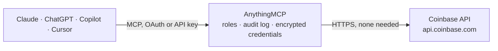

<!-- Generated by scripts/export-github-catalog.mjs in the anythingmcp-website repository. Do not edit by hand. -->

# Coinbase MCP connector

Let your AI read live crypto market data from Coinbase: prices and 24 hour changes of every trading pair, recent trades, best bid and ask, order book depth, price history as candles, and spot prices … The AnythingMCP connector gives Claude, ChatGPT, Microsoft Copilot, Cursor and Gemini 7 MCP tools for Coinbase, all read-only.

**Category:** [Finance](../finance.md) · **Tools:** 7 · **Setup guide:** [anythingmcp.com](https://anythingmcp.com/guides/coinbase-to-mcp) · [Deutsch](https://anythingmcp.com/de/guides/coinbase-to-mcp) · [Italiano](https://anythingmcp.com/it/guides/coinbase-to-mcp) · [Español](https://anythingmcp.com/es/guides/coinbase-to-mcp) · [日本語](https://anythingmcp.com/ja/guides/coinbase-to-mcp) · [Русский](https://anythingmcp.com/ru/guides/coinbase-to-mcp) · [中文](https://anythingmcp.com/zh/guides/coinbase-to-mcp)

## Start without code

No installation and no terminal: AnythingMCP Cloud runs the Coinbase connector for you, operated by helpcode.ai in Frankfurt, Germany.

1. **Click the button above** and create an account or sign in. The Coinbase connector opens, ready to install.
2. **Nothing to enter:** this connector needs no credentials. Every click is in the [step-by-step guide](https://anythingmcp.com/guides/coinbase-to-mcp).
3. **Click Install.** AnythingMCP shows the address of your MCP server.
4. **Add that address to your assistant:** [Claude](https://anythingmcp.com/guides/connect-coinbase-to-claude) · [ChatGPT](https://anythingmcp.com/guides/connect-coinbase-to-chatgpt) · [Microsoft Copilot](https://anythingmcp.com/guides/connect-coinbase-to-copilot) · [Cursor](https://anythingmcp.com/guides/connect-coinbase-to-cursor) · [Gemini CLI](https://anythingmcp.com/guides/connect-coinbase-to-gemini) · [Meta Muse](https://anythingmcp.com/guides/connect-coinbase-to-muse).
5. **Ask your first question**, for example: *What's the current order book for BTC-EUR — show best bid, best ask, last price and spread?*

Prefer help with the setup? [Talk to us](https://anythingmcp.com/contact).

## How it works

- **The AI client** speaks MCP (Streamable HTTP) to AnythingMCP and only sees tool names, descriptions and results. It never gets the Coinbase credentials.
- **AnythingMCP** checks the client's role, builds the call from the tool definition, adds the credentials (none needed), calls Coinbase, logs the call and returns the result.
- **Coinbase** sees an ordinary API client with the rights of the account the credentials belong to.

## Tools

| Tool | What it does | Access |
|---|---|---|
| [`coinbase_get_server_time`](#coinbase_get_server_time) | Read Coinbase's current server time as ISO 8601 and Unix seconds. | read |
| [`coinbase_list_products`](#coinbase_list_products) | List Coinbase trading pairs (products) with their last price, 24 hour change in percent, 24 hour volume, high and low, and status. | read |
| [`coinbase_get_product`](#coinbase_get_product) | Read one Coinbase trading pair: last price, 24 hour change, volume, high and low, base and quote currency, listing date, status and whether trading is… | read |
| [`coinbase_get_market_trades`](#coinbase_get_market_trades) | Read the most recent public trades of a Coinbase pair (price, size in the base currency, time, and side of the taker) together with the current best bid and… | read |
| [`coinbase_get_candles`](#coinbase_get_candles) | Read price history of a Coinbase pair as candles (open, high, low, close and volume per interval), newest first. | read |
| [`coinbase_get_product_book`](#coinbase_get_product_book) | Read the public order book of a Coinbase pair: the best bids and asks with price and size, the last price, the mid market price and the spread in basis… | read |
| [`coinbase_get_spot_price`](#coinbase_get_spot_price) | Read Coinbase's spot price of one unit of a currency in another, now or on a past day: e.g. BTC-EUR, ETH-USD, or USD-EUR for a fiat rate. | read |

## Tool reference

Every parameter as the AI client sees it in `tools/list`. Source: [`packages/backend/src/adapters/intl/coinbase.json`](../../../packages/backend/src/adapters/intl/coinbase.json).

### `coinbase_get_server_time`

Read Coinbase's current server time as ISO 8601 and Unix seconds. Free, needs nothing; use it to work out the Unix timestamps that coinbase_get_candles and coinbase_get_market_trades take for start and end.

**Access:** read · **Call:** `GET /api/v3/brokerage/time`

No parameters.

### `coinbase_list_products`

List Coinbase trading pairs (products) with their last price, 24 hour change in percent, 24 hour volume, high and low, and status. Spot pairs by default, sorted by 24 hour volume, most traded first. Pass product_ids to look up specific pairs in one call. Prices are strings in the quote currency. Market data is informational, not financial advice. More results: call again with offset raised by limit while hasNext is true.

**Access:** read · **Call:** `GET /api/v3/brokerage/market/products`

| Parameter | Type | Required | Description |
|---|---|---|---|
| `product_ids` | string[] | no | Only these pairs, e.g. ["BTC-USD", "ETH-EUR"]. Leave out to list all. |
| `product_type` | `SPOT` \| `FUTURE` | no | SPOT (default, crypto against fiat or stablecoins) or FUTURE (futures contracts, not available to every user). |
| `products_sort_order` | `PRODUCTS_SORT_ORDER_VOLUME_24H_DESCENDING` \| `PRODUCTS_SORT_ORDER_LIST_TIME_DESCENDING` | no | Most traded first (default) or newest listings first. |
| `limit` | integer | no | Products per page (default 25 here, at most 100). Without a limit Coinbase returns all of its several hundred pairs. |
| `offset` | integer | no | Number of products to skip, for the next page. |

### `coinbase_get_product`

Read one Coinbase trading pair: last price, 24 hour change, volume, high and low, base and quote currency, listing date, status and whether trading is limited (cancel only, limit only, post only, disabled). Market data is informational, not financial advice.

**Access:** read · **Call:** `GET /api/v3/brokerage/market/products/{product_id}`

| Parameter | Type | Required | Description |
|---|---|---|---|
| `product_id` | string | yes | Coinbase product id, the trading pair as BASE-QUOTE in capitals, e.g. BTC-USD, ETH-EUR or SOL-USDC. Find ids with coinbase_list_products. |

### `coinbase_get_market_trades`

Read the most recent public trades of a Coinbase pair (price, size in the base currency, time, and side of the taker) together with the current best bid and best ask. Use it for the live price and the spread. Optional start and end (Unix seconds) look at an earlier window. Market data is informational, not financial advice.

**Access:** read · **Call:** `GET /api/v3/brokerage/market/products/{product_id}/ticker`

| Parameter | Type | Required | Description |
|---|---|---|---|
| `product_id` | string | yes | Coinbase product id, the trading pair as BASE-QUOTE in capitals, e.g. BTC-USD, ETH-EUR or SOL-USDC. Find ids with coinbase_list_products. |
| `limit` | integer | no | Number of trades (default 20, at most 100). |
| `start` | string | no | Optional start of the window as Unix seconds, e.g. 1760000000. |
| `end` | string | no | Optional end of the window as Unix seconds. |

### `coinbase_get_candles`

Read price history of a Coinbase pair as candles (open, high, low, close and volume per interval), newest first. Pick the interval with granularity. start and end (Unix seconds; coinbase_get_server_time gives the current time) set the window, which must hold fewer than 350 candles: for the last 48 hours in ONE_HOUR candles, end = now and start = now minus 172800. start in each candle is Unix seconds. Market data is informational, not financial advice; past prices say nothing certain about future ones.

**Access:** read · **Call:** `GET /api/v3/brokerage/market/products/{product_id}/candles`

| Parameter | Type | Required | Description |
|---|---|---|---|
| `product_id` | string | yes | Coinbase product id, the trading pair as BASE-QUOTE in capitals, e.g. BTC-USD, ETH-EUR or SOL-USDC. Find ids with coinbase_list_products. |
| `granularity` | `ONE_MINUTE` \| `FIVE_MINUTE` \| `FIFTEEN_MINUTE` \| `THIRTY_MINUTE` \| `ONE_HOUR` \| `TWO_HOUR` \| `FOUR_HOUR` \| `SIX_HOUR` \| `ONE_DAY` | yes | Length of each candle. |
| `start` | string | yes | Start of the window as Unix seconds, e.g. 1760000000. |
| `end` | string | yes | End of the window as Unix seconds, after start. |
| `limit` | integer | no | Number of candles (default 60, at most 300 here). |

### `coinbase_get_product_book`

Read the public order book of a Coinbase pair: the best bids and asks with price and size, the last price, the mid market price and the spread in basis points and absolute. limit sets how many price levels per side (default 10). Market data is informational, not financial advice.

**Access:** read · **Call:** `GET /api/v3/brokerage/market/product_book`

| Parameter | Type | Required | Description |
|---|---|---|---|
| `product_id` | string | yes | Coinbase product id, the trading pair as BASE-QUOTE in capitals, e.g. BTC-USD, ETH-EUR or SOL-USDC. Find ids with coinbase_list_products. |
| `limit` | integer | no | Price levels per side (default 10, at most 50 here; Coinbase would send 1,000 without a limit). |
| `aggregation_price_increment` | string | no | Optional price step to group levels by, e.g. "10" to sum all bids and asks within each 10 units of the quote currency. |

### `coinbase_get_spot_price`

Read Coinbase's spot price of one unit of a currency in another, now or on a past day: e.g. BTC-EUR, ETH-USD, or USD-EUR for a fiat rate. Use it to value holdings the user tells you about (amount times price). date (YYYY-MM-DD, UTC) gives the price of that day. Market data is informational, not financial advice.

**Access:** read · **Call:** `GET /v2/prices/{currency_pair}/spot`

| Parameter | Type | Required | Description |
|---|---|---|---|
| `currency_pair` | string | yes | BASE-QUOTE, e.g. BTC-EUR, ETH-USD, USDC-EUR or USD-EUR. |
| `date` | string | no | Optional day in UTC as YYYY-MM-DD for a historical price; leave out for now. |

## Run it yourself

AnythingMCP is open source (AGPL-3.0). [Run it with Docker](../../../README.md#run-it-yourself), open **Connectors → Store**, pick **Coinbase**, then add your MCP server URL to the AI client.

[← Finance connectors](../finance.md) · [All categories](../README.md)
