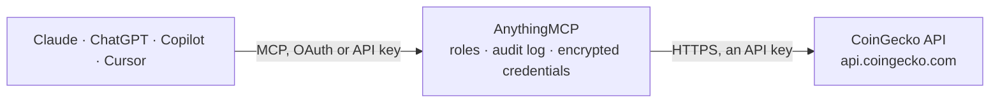

<!-- Generated by scripts/export-github-catalog.mjs in the anythingmcp-website repository. Do not edit by hand. -->

# CoinGecko MCP connector

Query CoinGecko (crypto prices, market data, historical, exchanges, NFT floor prices) from any AI agent. 8 tools, optional API-key auth. The AnythingMCP connector gives Claude, ChatGPT, Microsoft Copilot, Cursor and Gemini 8 MCP tools for CoinGecko, all read-only.

**Category:** [Public Data](../data.md) · **Tools:** 8 · **Setup guide:** [anythingmcp.com](https://anythingmcp.com/guides/coingecko-to-mcp) · [Deutsch](https://anythingmcp.com/de/guides/coingecko-to-mcp) · [Italiano](https://anythingmcp.com/it/guides/coingecko-to-mcp) · [Español](https://anythingmcp.com/es/guides/coingecko-to-mcp) · [日本語](https://anythingmcp.com/ja/guides/coingecko-to-mcp) · [Русский](https://anythingmcp.com/ru/guides/coingecko-to-mcp) · [中文](https://anythingmcp.com/zh/guides/coingecko-to-mcp)

## Start without code

No installation and no terminal: AnythingMCP Cloud runs the CoinGecko connector for you, operated by helpcode.ai in Frankfurt, Germany.

1. **Click the button above** and create an account or sign in. The CoinGecko connector opens, ready to install.
2. **Paste the API key or token from your CoinGecko account.** Every click is in the [step-by-step guide](https://anythingmcp.com/guides/coingecko-to-mcp).
3. **Click Install.** AnythingMCP shows the address of your MCP server.
4. **Add that address to your assistant:** [Claude](https://anythingmcp.com/guides/connect-coingecko-to-claude) · [ChatGPT](https://anythingmcp.com/guides/connect-coingecko-to-chatgpt) · [Microsoft Copilot](https://anythingmcp.com/guides/connect-coingecko-to-copilot) · [Cursor](https://anythingmcp.com/guides/connect-coingecko-to-cursor) · [Gemini CLI](https://anythingmcp.com/guides/connect-coingecko-to-gemini) · [Meta Muse](https://anythingmcp.com/guides/connect-coingecko-to-muse).
5. **Ask your first question**, for example: *Show current EUR price and 24h change for BTC and ETH right now.*

Prefer help with the setup? [Talk to us](https://anythingmcp.com/contact).

## How it works

- **The AI client** speaks MCP (Streamable HTTP) to AnythingMCP and only sees tool names, descriptions and results. It never gets the CoinGecko credentials.
- **AnythingMCP** checks the client's role, builds the call from the tool definition, adds the credentials (an API key), calls CoinGecko, logs the call and returns the result.
- **CoinGecko** sees an ordinary API client with the rights of the account the credentials belong to.

## Tools

| Tool | What it does | Access |
|---|---|---|
| [`coingecko_ping`](#coingecko_ping) | Sanity check — returns `{gecko_says: '(V3) To the Moon!'}` if the API is up. | read |
| [`coingecko_simple_price`](#coingecko_simple_price) | Cheapest way to get current price(s). | read |
| [`coingecko_search`](#coingecko_search) | Search coins, categories and markets by free-text query. | read |
| [`coingecko_list_coins`](#coingecko_list_coins) | Full list of every coin with id, symbol, name. | read |
| [`coingecko_coin_markets`](#coingecko_coin_markets) | Market data for top coins by market cap. | read |
| [`coingecko_coin_detail`](#coingecko_coin_detail) | Full profile of one coin: description in many languages, links, image URLs, market data, community + developer stats, public interest score. | read |
| [`coingecko_coin_market_chart`](#coingecko_coin_market_chart) | Historical price/marketcap/volume series for a coin over a window. | read |
| [`coingecko_trending`](#coingecko_trending) | Top-7 trending coins on CoinGecko in the last 24h (by search volume). | read |

## Tool reference

Every parameter as the AI client sees it in `tools/list`. Source: [`packages/backend/src/adapters/intl/coingecko.json`](../../../packages/backend/src/adapters/intl/coingecko.json).

### `coingecko_ping`

Sanity check — returns `{gecko_says: '(V3) To the Moon!'}` if the API is up. Useful as a connectivity probe.

**Access:** read · **Call:** `GET /ping`

No parameters.

### `coingecko_simple_price`

Cheapest way to get current price(s). Pass comma-separated coin IDs and currencies. Optionally include 24h volume, market cap, last-updated, 24h change. Use this for 'what's the price of X' — much faster than full market data.

**Access:** read · **Call:** `GET /simple/price`

| Parameter | Type | Required | Description |
|---|---|---|---|
| `ids` | string | yes | Comma-separated CoinGecko coin IDs, e.g. 'bitcoin,ethereum,solana'. |
| `vs_currencies` | string | yes | Comma-separated target currencies, e.g. 'usd,eur'. |
| `include_market_cap` | boolean | no | Include market cap. |
| `include_24hr_vol` | boolean | no | Include 24h volume. |
| `include_24hr_change` | boolean | no | Include 24h % change. |
| `include_last_updated_at` | boolean | no | Include last-updated UNIX timestamp. |

### `coingecko_search`

Search coins, categories and markets by free-text query. Returns matching CoinGecko IDs — use this when the user gives a ticker or partial name and you need the canonical ID for downstream calls.

**Access:** read · **Call:** `GET /search`

| Parameter | Type | Required | Description |
|---|---|---|---|
| `query` | string | yes | Search text, e.g. 'bitcoin' or 'BTC' or 'arbitr'. |

### `coingecko_list_coins`

Full list of every coin with id, symbol, name. Heavy (~13k entries) — prefer `coingecko_search` unless you really need the whole map.

**Access:** read · **Call:** `GET /coins/list`

| Parameter | Type | Required | Description |
|---|---|---|---|
| `include_platform` | boolean | no | Include contract address on each chain. |

### `coingecko_coin_markets`

Market data for top coins by market cap. Returns price, market cap, volume, supply, ATH/ATL, 24h/7d/30d % change. Sorted by market cap desc by default.

**Access:** read · **Call:** `GET /coins/markets`

| Parameter | Type | Required | Description |
|---|---|---|---|
| `vs_currency` | string | yes | Target currency, e.g. 'usd'. |
| `ids` | string | no | Optional comma-separated coin IDs to filter to. |
| `order` | string | no | market_cap_desc, market_cap_asc, volume_desc, volume_asc, id_asc, id_desc. |
| `per_page` | integer | no | 1-250. Default 100. |
| `page` | integer | no | 1-based page index. |
| `price_change_percentage` | string | no | Comma-separated windows: 1h,24h,7d,14d,30d,200d,1y. |

### `coingecko_coin_detail`

Full profile of one coin: description in many languages, links, image URLs, market data, community + developer stats, public interest score. Heavy payload — prefer simple_price for snippets.

**Access:** read · **Call:** `GET /coins/{id}`

| Parameter | Type | Required | Description |
|---|---|---|---|
| `id` | string | yes | CoinGecko coin ID (e.g. 'bitcoin'). |
| `localization` | boolean | no | Include localized descriptions (large response). |
| `tickers` | boolean | no | Include per-exchange tickers. |
| `market_data` | boolean | no | Include market data block. |
| `community_data` | boolean | no | Include Reddit / Twitter follower counts. |
| `developer_data` | boolean | no | Include GitHub stars/forks/PRs. |

### `coingecko_coin_market_chart`

Historical price/marketcap/volume series for a coin over a window. Granularity auto-selected by CoinGecko based on `days`: minutely for 1, hourly for 2-90, daily for >90.

**Access:** read · **Call:** `GET /coins/{id}/market_chart`

| Parameter | Type | Required | Description |
|---|---|---|---|
| `id` | string | yes | CoinGecko coin ID. |
| `vs_currency` | string | yes | Target currency. |
| `days` | string | yes | Window: '1', '7', '30', '90', '365', 'max'. |
| `interval` | string | no | Override granularity. Most users leave this empty. |

### `coingecko_trending`

Top-7 trending coins on CoinGecko in the last 24h (by search volume). Bonus payload: top NFT collections + categories trending.

**Access:** read · **Call:** `GET /search/trending`

No parameters.

## Run it yourself

AnythingMCP is open source (AGPL-3.0). [Run it with Docker](../../../README.md#run-it-yourself), open **Connectors → Store**, pick **CoinGecko**, then add your MCP server URL to the AI client.

[← Public Data connectors](../data.md) · [All categories](../README.md)
