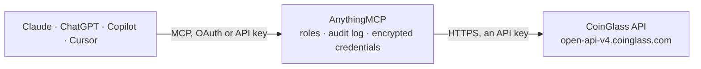

<!-- Generated by scripts/export-github-catalog.mjs in the anythingmcp-website repository. Do not edit by hand. -->

# CoinGlass MCP connector

Crypto derivatives data from CoinGlass: futures open interest across exchanges, funding rates (also open-interest weighted), long/short ratios of all and top traders, liquidations, options max pain, … The AnythingMCP connector gives Claude, ChatGPT, Microsoft Copilot, Cursor and Gemini 24 MCP tools for CoinGlass, all read-only.

**Category:** [Finance](../finance.md) · **Tools:** 24 · **Setup guide:** [anythingmcp.com](https://anythingmcp.com/guides/coinglass-to-mcp) · [Deutsch](https://anythingmcp.com/de/guides/coinglass-to-mcp) · [Italiano](https://anythingmcp.com/it/guides/coinglass-to-mcp) · [Español](https://anythingmcp.com/es/guides/coinglass-to-mcp) · [日本語](https://anythingmcp.com/ja/guides/coinglass-to-mcp) · [Русский](https://anythingmcp.com/ru/guides/coinglass-to-mcp) · [中文](https://anythingmcp.com/zh/guides/coinglass-to-mcp)

## Start without code

No installation and no terminal: AnythingMCP Cloud runs the CoinGlass connector for you, operated by helpcode.ai in Frankfurt, Germany.

1. **Click the button above** and create an account or sign in. The CoinGlass connector opens, ready to install.
2. **Paste the API key or token from your CoinGlass account.** Every click is in the [step-by-step guide](https://anythingmcp.com/guides/coinglass-to-mcp).
3. **Click Install.** AnythingMCP shows the address of your MCP server.
4. **Add that address to your assistant:** [Claude](https://anythingmcp.com/guides/connect-coinglass-to-claude) · [ChatGPT](https://anythingmcp.com/guides/connect-coinglass-to-chatgpt) · [Microsoft Copilot](https://anythingmcp.com/guides/connect-coinglass-to-copilot) · [Cursor](https://anythingmcp.com/guides/connect-coinglass-to-cursor) · [Gemini CLI](https://anythingmcp.com/guides/connect-coinglass-to-gemini) · [Meta Muse](https://anythingmcp.com/guides/connect-coinglass-to-muse).
5. **Ask your first question**, for example: *Show current open interest by exchange for BTC, I need where most OI sits now.*

Prefer help with the setup? [Talk to us](https://anythingmcp.com/contact).

## How it works

- **The AI client** speaks MCP (Streamable HTTP) to AnythingMCP and only sees tool names, descriptions and results. It never gets the CoinGlass credentials.
- **AnythingMCP** checks the client's role, builds the call from the tool definition, adds the credentials (an API key), calls CoinGlass, logs the call and returns the result.
- **CoinGlass** sees an ordinary API client with the rights of the account the credentials belong to.

## Tools

| Tool | What it does | Access |
|---|---|---|
| [`coinglass_get_account_subscription`](#coinglass_get_account_subscription) | Show the CoinGlass API plan of the key (level such as HOBBYIST, STARTUP, STANDARD, PROFESSIONAL), its expiry time and whether it has expired. | read |
| [`coinglass_list_supported_coins`](#coinglass_list_supported_coins) | List the coins CoinGlass covers for futures data (BTC, ETH, SOL, ...). | read |
| [`coinglass_list_supported_exchanges`](#coinglass_list_supported_exchanges) | List the futures exchanges CoinGlass covers (Binance, OKX, Bybit, Deribit, CME, Hyperliquid, ...), spelled as the exchange parameter expects. | read |
| [`coinglass_list_exchange_pairs`](#coinglass_list_exchange_pairs) | List the futures trading pairs per exchange: instrument_id (the pair the pair-level tools take as symbol, e.g. BTCUSDT), base and quote asset. | read |
| [`coinglass_get_pairs_markets`](#coinglass_get_pairs_markets) | Current market snapshot of every futures pair of a coin across exchanges: price, index price, 24 hour price change, volume, long and short volume, open… | read |
| [`coinglass_get_price_history`](#coinglass_get_price_history) | Price candles (open, high, low, close, volume_usd) of one futures pair on one exchange. | read |
| [`coinglass_get_open_interest_history`](#coinglass_get_open_interest_history) | Open interest candles (open, high, low, close) of one futures pair on one exchange. | read |
| [`coinglass_get_aggregated_open_interest_history`](#coinglass_get_aggregated_open_interest_history) | Open interest of a coin aggregated across all exchanges, as candles (open, high, low, close in USD). | read |
| [`coinglass_list_open_interest_by_exchange`](#coinglass_list_open_interest_by_exchange) | Current open interest of a coin per exchange (the first row, exchange All, is the total): USD value, quantity, split into stablecoin- and coin-margined, and… | read |
| [`coinglass_get_funding_rate_history`](#coinglass_get_funding_rate_history) | Funding rate candles (open, high, low, close) of one perpetual pair on one exchange. | read |
| [`coinglass_get_oi_weighted_funding_rate_history`](#coinglass_get_oi_weighted_funding_rate_history) | Funding rate of a coin across all exchanges, weighted by each exchange's open interest, as candles (open, high, low, close, in percent). | read |
| [`coinglass_list_funding_rates_by_exchange`](#coinglass_list_funding_rates_by_exchange) | Current funding rate of every coin on every exchange, split into stablecoin-margined and coin-margined contracts, with the funding interval in hours and the… | read |
| [`coinglass_get_global_long_short_account_ratio`](#coinglass_get_global_long_short_account_ratio) | Long/short ratio of all trader accounts on one exchange for one pair: percent of accounts long, percent short and the ratio. | read |
| [`coinglass_get_top_long_short_account_ratio`](#coinglass_get_top_long_short_account_ratio) | Long/short ratio of the top trader accounts on one exchange for one pair: percent of top accounts long and short and the ratio. | read |
| [`coinglass_get_top_long_short_position_ratio`](#coinglass_get_top_long_short_position_ratio) | Long/short ratio of the positions of top traders on one exchange for one pair, weighted by position size rather than by account. | read |
| [`coinglass_get_liquidation_history`](#coinglass_get_liquidation_history) | Liquidations of one futures pair on one exchange per interval: long_liquidation_usd and short_liquidation_usd. | read |
| [`coinglass_get_aggregated_liquidation_history`](#coinglass_get_aggregated_liquidation_history) | Liquidations of a coin summed over the exchanges you name, per interval: aggregated long and short liquidations in USD. | read |
| [`coinglass_get_option_max_pain`](#coinglass_get_option_max_pain) | Options max pain per expiry for a coin on one options exchange: max pain price, call and put open interest and their market value. | read |
| [`coinglass_get_bitcoin_etf_flows`](#coinglass_get_bitcoin_etf_flows) | Daily net flows of the US spot bitcoin ETFs: total flow_usd per day, the BTC price, and the flow of each ETF (IBIT, FBTC, GBTC, ...). | read |
| [`coinglass_get_ethereum_etf_flows`](#coinglass_get_ethereum_etf_flows) | Daily net flows of the US spot ether ETFs: total flow_usd per day, the ETH price, and the flow of each ETF (ETHA, FETH, ...). | read |
| [`coinglass_list_bitcoin_etfs`](#coinglass_list_bitcoin_etfs) | List the spot bitcoin ETFs with ticker, fund name, region, primary exchange, market status, assets under management, management fee, volume, BTC holdings… | read |
| [`coinglass_get_stablecoin_market_cap_history`](#coinglass_get_stablecoin_market_cap_history) | History of the total stablecoin market capitalisation with the BTC price alongside: parallel lists data_list (market cap, USD), price_list and time_list… | read |
| [`coinglass_get_fear_greed_history`](#coinglass_get_fear_greed_history) | History of the Crypto Fear & Greed Index (0 extreme fear to 100 extreme greed) with the BTC price alongside: parallel lists data_list, price_list and… | read |
| [`coinglass_get_coinbase_premium_index`](#coinglass_get_coinbase_premium_index) | Coinbase premium index: the gap between the BTC price on Coinbase (USD) and on Binance (USDT), as premium in USD and premium_rate (0.0261 = 2.61%). | read |

## Tool reference

Every parameter as the AI client sees it in `tools/list`. Source: [`packages/backend/src/adapters/intl/coinglass.json`](../../../packages/backend/src/adapters/intl/coinglass.json).

### `coinglass_get_account_subscription`

Show the CoinGlass API plan of the key (level such as HOBBYIST, STARTUP, STANDARD, PROFESSIONAL), its expiry time and whether it has expired. Use it to check the key and to know which intervals the plan allows.

**Access:** read · **Call:** `GET /api/user/account/subscription`

No parameters.

### `coinglass_list_supported_coins`

List the coins CoinGlass covers for futures data (BTC, ETH, SOL, ...). These are the values the coin-level tools take as symbol.

**Access:** read · **Call:** `GET /api/futures/supported-coins`

No parameters.

### `coinglass_list_supported_exchanges`

List the futures exchanges CoinGlass covers (Binance, OKX, Bybit, Deribit, CME, Hyperliquid, ...), spelled as the exchange parameter expects.

**Access:** read · **Call:** `GET /api/futures/supported-exchanges`

No parameters.

### `coinglass_list_exchange_pairs`

List the futures trading pairs per exchange: instrument_id (the pair the pair-level tools take as symbol, e.g. BTCUSDT), base and quote asset. Filter by one exchange to keep the answer short.

**Access:** read · **Call:** `GET /api/futures/supported-exchange-pairs`

| Parameter | Type | Required | Description |
|---|---|---|---|
| `exchange` | string | no | Only pairs of this exchange, e.g. Binance. |

### `coinglass_get_pairs_markets`

Current market snapshot of every futures pair of a coin across exchanges: price, index price, 24 hour price change, volume, long and short volume, open interest, funding rate and 24 hour liquidations per pair.

**Access:** read · **Call:** `GET /api/futures/pairs-markets`

| Parameter | Type | Required | Description |
|---|---|---|---|
| `symbol` | string | yes | Coin symbol, e.g. BTC or ETH. coinglass_list_supported_coins lists them. |

### `coinglass_get_price_history`

Price candles (open, high, low, close, volume_usd) of one futures pair on one exchange.

**Access:** read · **Call:** `GET /api/futures/price/history`

| Parameter | Type | Required | Description |
|---|---|---|---|
| `exchange` | string | yes | Futures exchange name as CoinGlass writes it, e.g. Binance, OKX, Bybit, Gate, HTX. coinglass_list_exchange_pairs lists the exchanges and their pairs. |
| `symbol` | string | yes | Trading pair on that exchange, e.g. BTCUSDT or ETHUSDT (instrument_id from coinglass_list_exchange_pairs). |
| `interval` | `1m` \| `3m` \| `5m` \| `15m` \| `30m` \| `1h` \| `4h` \| `6h` \| `8h` \| `12h` \| `1d` \| `1w` | yes | Candle interval: 1m, 3m, 5m, 15m, 30m, 1h, 4h, 6h, 8h, 12h, 1d or 1w. The Hobbyist plan only allows 4h and longer, Startup 30m and longer. |
| `limit` | integer | no | Number of candles; CoinGlass requires it, default here 100, maximum 1000. |
| `start_time` | integer | no | Start of the range, Unix milliseconds. |
| `end_time` | integer | no | End of the range, Unix milliseconds. |

### `coinglass_get_open_interest_history`

Open interest candles (open, high, low, close) of one futures pair on one exchange.

**Access:** read · **Call:** `GET /api/futures/open-interest/history`

| Parameter | Type | Required | Description |
|---|---|---|---|
| `exchange` | string | yes | Futures exchange name as CoinGlass writes it, e.g. Binance, OKX, Bybit, Gate, HTX. coinglass_list_exchange_pairs lists the exchanges and their pairs. |
| `symbol` | string | yes | Trading pair on that exchange, e.g. BTCUSDT or ETHUSDT (instrument_id from coinglass_list_exchange_pairs). |
| `interval` | `1m` \| `3m` \| `5m` \| `15m` \| `30m` \| `1h` \| `4h` \| `6h` \| `8h` \| `12h` \| `1d` \| `1w` | yes | Candle interval: 1m, 3m, 5m, 15m, 30m, 1h, 4h, 6h, 8h, 12h, 1d or 1w. The Hobbyist plan only allows 4h and longer, Startup 30m and longer. |
| `limit` | integer | no | Number of points, newest last; default and maximum 1000. Ask for what the question needs, e.g. 30. |
| `start_time` | integer | no | Start of the range, Unix milliseconds. |
| `end_time` | integer | no | End of the range, Unix milliseconds. |
| `unit` | `usd` \| `coin` | no | usd (default) for values in US dollars, coin for amounts in the coin. |

### `coinglass_get_aggregated_open_interest_history`

Open interest of a coin aggregated across all exchanges, as candles (open, high, low, close in USD). Rising open interest with rising price means new longs; with falling price, new shorts.

**Access:** read · **Call:** `GET /api/futures/open-interest/aggregated-history`

| Parameter | Type | Required | Description |
|---|---|---|---|
| `symbol` | string | yes | Coin symbol, e.g. BTC or ETH. coinglass_list_supported_coins lists them. |
| `interval` | `1m` \| `3m` \| `5m` \| `15m` \| `30m` \| `1h` \| `4h` \| `6h` \| `8h` \| `12h` \| `1d` \| `1w` | yes | Candle interval: 1m, 3m, 5m, 15m, 30m, 1h, 4h, 6h, 8h, 12h, 1d or 1w. The Hobbyist plan only allows 4h and longer, Startup 30m and longer. |
| `limit` | integer | no | Number of points, newest last; default and maximum 1000. Ask for what the question needs, e.g. 30. |
| `start_time` | integer | no | Start of the range, Unix milliseconds. |
| `end_time` | integer | no | End of the range, Unix milliseconds. |
| `unit` | `usd` \| `coin` | no | usd (default) for values in US dollars, coin for amounts in the coin. |

### `coinglass_list_open_interest_by_exchange`

Current open interest of a coin per exchange (the first row, exchange All, is the total): USD value, quantity, split into stablecoin- and coin-margined, and the change in percent over 5 minutes up to 24 hours.

**Access:** read · **Call:** `GET /api/futures/open-interest/exchange-list`

| Parameter | Type | Required | Description |
|---|---|---|---|
| `symbol` | string | yes | Coin symbol, e.g. BTC or ETH. coinglass_list_supported_coins lists them. |

### `coinglass_get_funding_rate_history`

Funding rate candles (open, high, low, close) of one perpetual pair on one exchange. Rates are in percent per funding interval (0.01 = 0.01%).

**Access:** read · **Call:** `GET /api/futures/funding-rate/history`

| Parameter | Type | Required | Description |
|---|---|---|---|
| `exchange` | string | yes | Futures exchange name as CoinGlass writes it, e.g. Binance, OKX, Bybit, Gate, HTX. coinglass_list_exchange_pairs lists the exchanges and their pairs. |
| `symbol` | string | yes | Trading pair on that exchange, e.g. BTCUSDT or ETHUSDT (instrument_id from coinglass_list_exchange_pairs). |
| `interval` | `1m` \| `3m` \| `5m` \| `15m` \| `30m` \| `1h` \| `4h` \| `6h` \| `8h` \| `12h` \| `1d` \| `1w` | yes | Candle interval: 1m, 3m, 5m, 15m, 30m, 1h, 4h, 6h, 8h, 12h, 1d or 1w. The Hobbyist plan only allows 4h and longer, Startup 30m and longer. |
| `limit` | integer | no | Number of points, newest last; default and maximum 1000. Ask for what the question needs, e.g. 30. |
| `start_time` | integer | no | Start of the range, Unix milliseconds. |
| `end_time` | integer | no | End of the range, Unix milliseconds. |

### `coinglass_get_oi_weighted_funding_rate_history`

Funding rate of a coin across all exchanges, weighted by each exchange's open interest, as candles (open, high, low, close, in percent). Persistently positive funding means longs pay shorts (crowded longs).

**Access:** read · **Call:** `GET /api/futures/funding-rate/oi-weight-history`

| Parameter | Type | Required | Description |
|---|---|---|---|
| `symbol` | string | yes | Coin symbol, e.g. BTC or ETH. coinglass_list_supported_coins lists them. |
| `interval` | `1m` \| `3m` \| `5m` \| `15m` \| `30m` \| `1h` \| `4h` \| `6h` \| `8h` \| `12h` \| `1d` \| `1w` | yes | Candle interval: 1m, 3m, 5m, 15m, 30m, 1h, 4h, 6h, 8h, 12h, 1d or 1w. The Hobbyist plan only allows 4h and longer, Startup 30m and longer. |
| `limit` | integer | no | Number of points, newest last; default and maximum 1000. Ask for what the question needs, e.g. 30. |
| `start_time` | integer | no | Start of the range, Unix milliseconds. |
| `end_time` | integer | no | End of the range, Unix milliseconds. |

### `coinglass_list_funding_rates_by_exchange`

Current funding rate of every coin on every exchange, split into stablecoin-margined and coin-margined contracts, with the funding interval in hours and the next funding time.

**Access:** read · **Call:** `GET /api/futures/funding-rate/exchange-list`

No parameters.

### `coinglass_get_global_long_short_account_ratio`

Long/short ratio of all trader accounts on one exchange for one pair: percent of accounts long, percent short and the ratio. Supported on Binance, OKX, Gate, HTX and Bybit.

**Access:** read · **Call:** `GET /api/futures/global-long-short-account-ratio/history`

| Parameter | Type | Required | Description |
|---|---|---|---|
| `exchange` | string | yes | Futures exchange name as CoinGlass writes it, e.g. Binance, OKX, Bybit, Gate, HTX. coinglass_list_exchange_pairs lists the exchanges and their pairs. |
| `symbol` | string | yes | Trading pair on that exchange, e.g. BTCUSDT or ETHUSDT (instrument_id from coinglass_list_exchange_pairs). |
| `interval` | `1m` \| `3m` \| `5m` \| `15m` \| `30m` \| `1h` \| `4h` \| `6h` \| `8h` \| `12h` \| `1d` \| `1w` | yes | Candle interval: 1m, 3m, 5m, 15m, 30m, 1h, 4h, 6h, 8h, 12h, 1d or 1w. The Hobbyist plan only allows 4h and longer, Startup 30m and longer. |
| `limit` | integer | no | Number of points, newest last; default and maximum 1000. Ask for what the question needs, e.g. 30. |
| `start_time` | integer | no | Start of the range, Unix milliseconds. |
| `end_time` | integer | no | End of the range, Unix milliseconds. |

### `coinglass_get_top_long_short_account_ratio`

Long/short ratio of the top trader accounts on one exchange for one pair: percent of top accounts long and short and the ratio.

**Access:** read · **Call:** `GET /api/futures/top-long-short-account-ratio/history`

| Parameter | Type | Required | Description |
|---|---|---|---|
| `exchange` | string | yes | Futures exchange name as CoinGlass writes it, e.g. Binance, OKX, Bybit, Gate, HTX. coinglass_list_exchange_pairs lists the exchanges and their pairs. |
| `symbol` | string | yes | Trading pair on that exchange, e.g. BTCUSDT or ETHUSDT (instrument_id from coinglass_list_exchange_pairs). |
| `interval` | `1m` \| `3m` \| `5m` \| `15m` \| `30m` \| `1h` \| `4h` \| `6h` \| `8h` \| `12h` \| `1d` \| `1w` | yes | Candle interval: 1m, 3m, 5m, 15m, 30m, 1h, 4h, 6h, 8h, 12h, 1d or 1w. The Hobbyist plan only allows 4h and longer, Startup 30m and longer. |
| `limit` | integer | no | Number of points, newest last; default and maximum 1000. Ask for what the question needs, e.g. 30. |
| `start_time` | integer | no | Start of the range, Unix milliseconds. |
| `end_time` | integer | no | End of the range, Unix milliseconds. |

### `coinglass_get_top_long_short_position_ratio`

Long/short ratio of the positions of top traders on one exchange for one pair, weighted by position size rather than by account.

**Access:** read · **Call:** `GET /api/futures/top-long-short-position-ratio/history`

| Parameter | Type | Required | Description |
|---|---|---|---|
| `exchange` | string | yes | Futures exchange name as CoinGlass writes it, e.g. Binance, OKX, Bybit, Gate, HTX. coinglass_list_exchange_pairs lists the exchanges and their pairs. |
| `symbol` | string | yes | Trading pair on that exchange, e.g. BTCUSDT or ETHUSDT (instrument_id from coinglass_list_exchange_pairs). |
| `interval` | `1m` \| `3m` \| `5m` \| `15m` \| `30m` \| `1h` \| `4h` \| `6h` \| `8h` \| `12h` \| `1d` \| `1w` | yes | Candle interval: 1m, 3m, 5m, 15m, 30m, 1h, 4h, 6h, 8h, 12h, 1d or 1w. The Hobbyist plan only allows 4h and longer, Startup 30m and longer. |
| `limit` | integer | no | Number of points, newest last; default and maximum 1000. Ask for what the question needs, e.g. 30. |
| `start_time` | integer | no | Start of the range, Unix milliseconds. |
| `end_time` | integer | no | End of the range, Unix milliseconds. |

### `coinglass_get_liquidation_history`

Liquidations of one futures pair on one exchange per interval: long_liquidation_usd and short_liquidation_usd.

**Access:** read · **Call:** `GET /api/futures/liquidation/history`

| Parameter | Type | Required | Description |
|---|---|---|---|
| `exchange` | string | yes | Futures exchange name as CoinGlass writes it, e.g. Binance, OKX, Bybit, Gate, HTX. coinglass_list_exchange_pairs lists the exchanges and their pairs. |
| `symbol` | string | yes | Trading pair on that exchange, e.g. BTCUSDT or ETHUSDT (instrument_id from coinglass_list_exchange_pairs). |
| `interval` | `1m` \| `3m` \| `5m` \| `15m` \| `30m` \| `1h` \| `4h` \| `6h` \| `8h` \| `12h` \| `1d` \| `1w` | yes | Candle interval: 1m, 3m, 5m, 15m, 30m, 1h, 4h, 6h, 8h, 12h, 1d or 1w. The Hobbyist plan only allows 4h and longer, Startup 30m and longer. |
| `limit` | integer | no | Number of points, newest last; default and maximum 1000. Ask for what the question needs, e.g. 30. |
| `start_time` | integer | no | Start of the range, Unix milliseconds. |
| `end_time` | integer | no | End of the range, Unix milliseconds. |

### `coinglass_get_aggregated_liquidation_history`

Liquidations of a coin summed over the exchanges you name, per interval: aggregated long and short liquidations in USD.

**Access:** read · **Call:** `GET /api/futures/liquidation/aggregated-history`

| Parameter | Type | Required | Description |
|---|---|---|---|
| `exchange_list` | string | yes | Comma-separated exchanges to sum, e.g. Binance,OKX,Bybit. |
| `symbol` | string | yes | Coin symbol, e.g. BTC or ETH. coinglass_list_supported_coins lists them. |
| `interval` | `1m` \| `3m` \| `5m` \| `15m` \| `30m` \| `1h` \| `4h` \| `6h` \| `8h` \| `12h` \| `1d` \| `1w` | yes | Candle interval: 1m, 3m, 5m, 15m, 30m, 1h, 4h, 6h, 8h, 12h, 1d or 1w. The Hobbyist plan only allows 4h and longer, Startup 30m and longer. |
| `limit` | integer | no | Number of points, newest last; default and maximum 1000. Ask for what the question needs, e.g. 30. |
| `start_time` | integer | no | Start of the range, Unix milliseconds. |
| `end_time` | integer | no | End of the range, Unix milliseconds. |

### `coinglass_get_option_max_pain`

Options max pain per expiry for a coin on one options exchange: max pain price, call and put open interest and their market value.

**Access:** read · **Call:** `GET /api/option/max-pain`

| Parameter | Type | Required | Description |
|---|---|---|---|
| `symbol` | string | yes | Coin, e.g. BTC or ETH. |
| `exchange` | string | yes | Options exchange, e.g. Deribit, Binance, OKX. |

### `coinglass_get_bitcoin_etf_flows`

Daily net flows of the US spot bitcoin ETFs: total flow_usd per day, the BTC price, and the flow of each ETF (IBIT, FBTC, GBTC, ...). Positive is inflow. Covers every day since the ETFs launched.

**Access:** read · **Call:** `GET /api/etf/bitcoin/flow-history`

No parameters.

### `coinglass_get_ethereum_etf_flows`

Daily net flows of the US spot ether ETFs: total flow_usd per day, the ETH price, and the flow of each ETF (ETHA, FETH, ...). Positive is inflow.

**Access:** read · **Call:** `GET /api/etf/ethereum/flow-history`

No parameters.

### `coinglass_list_bitcoin_etfs`

List the spot bitcoin ETFs with ticker, fund name, region, primary exchange, market status, assets under management, management fee, volume, BTC holdings with 24 hour and 7 day change, net asset value and premium or discount.

**Access:** read · **Call:** `GET /api/etf/bitcoin/list`

No parameters.

### `coinglass_get_stablecoin_market_cap_history`

History of the total stablecoin market capitalisation with the BTC price alongside: parallel lists data_list (market cap, USD), price_list and time_list (Unix seconds). A rising stablecoin supply means fresh cash entering crypto.

**Access:** read · **Call:** `GET /api/index/stableCoin-marketCap-history`

No parameters.

### `coinglass_get_fear_greed_history`

History of the Crypto Fear & Greed Index (0 extreme fear to 100 extreme greed) with the BTC price alongside: parallel lists data_list, price_list and time_list (Unix seconds).

**Access:** read · **Call:** `GET /api/index/fear-greed-history`

No parameters.

### `coinglass_get_coinbase_premium_index`

Coinbase premium index: the gap between the BTC price on Coinbase (USD) and on Binance (USDT), as premium in USD and premium_rate (0.0261 = 2.61%). Positive means US buyers pay more. time is in Unix seconds.

**Access:** read · **Call:** `GET /api/coinbase-premium-index`

| Parameter | Type | Required | Description |
|---|---|---|---|
| `interval` | `1m` \| `3m` \| `5m` \| `15m` \| `30m` \| `1h` \| `4h` \| `6h` \| `8h` \| `12h` \| `1d` \| `1w` | yes | Candle interval: 1m, 3m, 5m, 15m, 30m, 1h, 4h, 6h, 8h, 12h, 1d or 1w. The Hobbyist plan only allows 4h and longer, Startup 30m and longer. |
| `limit` | integer | no | Number of points, newest last; default and maximum 1000. Ask for what the question needs, e.g. 30. |
| `start_time` | integer | no | Start of the range, Unix milliseconds. |
| `end_time` | integer | no | End of the range, Unix milliseconds. |

## Run it yourself

AnythingMCP is open source (AGPL-3.0). [Run it with Docker](../../../README.md#run-it-yourself), open **Connectors → Store**, pick **CoinGlass** and enter `COINGLASS_API_KEY`, then add your MCP server URL to the AI client.

[← Finance connectors](../finance.md) · [All categories](../README.md)
