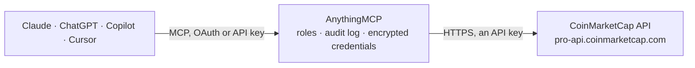

<!-- Generated by scripts/export-github-catalog.mjs in the anythingmcp-website repository. Do not edit by hand. -->

# CoinMarketCap MCP connector

Crypto market data from the CoinMarketCap Pro API: coin and exchange ids and metadata, latest and historical prices, rankings, categories, global market metrics, Fear and Greed, Altcoin Season and … The AnythingMCP connector gives Claude, ChatGPT, Microsoft Copilot, Cursor and Gemini 22 MCP tools for CoinMarketCap, all read-only.

**Category:** [Finance](../finance.md) · **Tools:** 22 · **Setup guide:** [anythingmcp.com](https://anythingmcp.com/guides/coinmarketcap-to-mcp) · [Deutsch](https://anythingmcp.com/de/guides/coinmarketcap-to-mcp) · [Italiano](https://anythingmcp.com/it/guides/coinmarketcap-to-mcp) · [Español](https://anythingmcp.com/es/guides/coinmarketcap-to-mcp) · [日本語](https://anythingmcp.com/ja/guides/coinmarketcap-to-mcp) · [Русский](https://anythingmcp.com/ru/guides/coinmarketcap-to-mcp) · [中文](https://anythingmcp.com/zh/guides/coinmarketcap-to-mcp)

## Start without code

No installation and no terminal: AnythingMCP Cloud runs the CoinMarketCap connector for you, operated by helpcode.ai in Frankfurt, Germany.

1. **Click the button above** and create an account or sign in. The CoinMarketCap connector opens, ready to install.
2. **Paste the API key or token from your CoinMarketCap account.** Every click is in the [step-by-step guide](https://anythingmcp.com/guides/coinmarketcap-to-mcp).
3. **Click Install.** AnythingMCP shows the address of your MCP server.
4. **Add that address to your assistant:** [Claude](https://anythingmcp.com/guides/connect-coinmarketcap-to-claude) · [ChatGPT](https://anythingmcp.com/guides/connect-coinmarketcap-to-chatgpt) · [Microsoft Copilot](https://anythingmcp.com/guides/connect-coinmarketcap-to-copilot) · [Cursor](https://anythingmcp.com/guides/connect-coinmarketcap-to-cursor) · [Gemini CLI](https://anythingmcp.com/guides/connect-coinmarketcap-to-gemini) · [Meta Muse](https://anythingmcp.com/guides/connect-coinmarketcap-to-muse).
5. **Ask your first question**, for example: *What's the latest USD quote for Ethereum (ETH) right now? I need price and last updated time.*

Prefer help with the setup? [Talk to us](https://anythingmcp.com/contact).

## How it works

- **The AI client** speaks MCP (Streamable HTTP) to AnythingMCP and only sees tool names, descriptions and results. It never gets the CoinMarketCap credentials.
- **AnythingMCP** checks the client's role, builds the call from the tool definition, adds the credentials (an API key), calls CoinMarketCap, logs the call and returns the result.
- **CoinMarketCap** sees an ordinary API client with the rights of the account the credentials belong to.

## Tools

| Tool | What it does | Access |
|---|---|---|
| [`coinmarketcap_get_key_info`](#coinmarketcap_get_key_info) | Plan and usage of the API key: monthly credit limit and reset date, rate limit per minute, credits used and left today and this month, requests made this… | read |
| [`coinmarketcap_map_cryptocurrencies`](#coinmarketcap_map_cryptocurrencies) | Map of cryptocurrencies to their CoinMarketCap ids: id, name, symbol, slug, rank, active flag, first and last data dates and, for tokens, the platform and… | read |
| [`coinmarketcap_get_cryptocurrency_info`](#coinmarketcap_get_cryptocurrency_info) | Static metadata of one or more cryptocurrencies: description, logo, website, whitepaper, explorers, source code, social links, tags, category, launch date,… | read |
| [`coinmarketcap_list_listings_latest`](#coinmarketcap_list_listings_latest) | Ranked list of active cryptocurrencies with latest market data: price, market cap, dominance, fully diluted market cap, 24 hour volume, percent change over… | read |
| [`coinmarketcap_get_quotes_latest`](#coinmarketcap_get_quotes_latest) | Latest market quote for specific cryptocurrencies: price, market cap, dominance, 24 hour volume and volume change, percent change over 1h to 90d, supply,… | read |
| [`coinmarketcap_get_simple_price`](#coinmarketcap_get_simple_price) | Fastest price lookup: the current price of one or more cryptocurrencies in one or more currencies, optionally with market cap, 24 hour volume, 24 hour… | read |
| [`coinmarketcap_get_quotes_historical`](#coinmarketcap_get_quotes_historical) | Historical quotes of one or more cryptocurrencies at regular intervals: price, volume, market cap and supply per point. | read |
| [`coinmarketcap_get_ohlcv_historical`](#coinmarketcap_get_ohlcv_historical) | Daily or hourly open, high, low, close and volume candles of one or more cryptocurrencies over a period. | read |
| [`coinmarketcap_list_gainers_losers`](#coinmarketcap_list_gainers_losers) | Biggest gainers and losers by price change over 1h, 24h, 7d or 30d, with full market data. | read |
| [`coinmarketcap_list_categories`](#coinmarketcap_list_categories) | Cryptocurrency categories (DeFi, Layer 1, Memes, AI, ...) with id, name, number of tokens, average price change, market cap and volume and their 24 hour change. | read |
| [`coinmarketcap_get_category`](#coinmarketcap_get_category) | One category with its aggregate figures and the coins in it, each with market data. | read |
| [`coinmarketcap_get_global_metrics`](#coinmarketcap_get_global_metrics) | Latest totals of the whole crypto market: total market cap and 24 hour volume, Bitcoin and Ethereum dominance with their change since yesterday, DeFi,… | read |
| [`coinmarketcap_get_global_metrics_historical`](#coinmarketcap_get_global_metrics_historical) | Total market cap, volume and dominance of the crypto market over time. | read |
| [`coinmarketcap_get_fear_and_greed_latest`](#coinmarketcap_get_fear_and_greed_latest) | Today's CMC Crypto Fear and Greed Index: a value from 0 (extreme fear) to 100 (extreme greed), its classification (Extreme fear, Fear, Neutral, Greed,… | read |
| [`coinmarketcap_get_fear_and_greed_historical`](#coinmarketcap_get_fear_and_greed_historical) | Past values of the CMC Crypto Fear and Greed Index, one per day, newest first, each with value, classification and timestamp. | read |
| [`coinmarketcap_get_altcoin_season_index`](#coinmarketcap_get_altcoin_season_index) | CMC Altcoin Season Index (0 to 100): above 75 means altcoin season, below 25 Bitcoin season. | read |
| [`coinmarketcap_get_cmc100_index`](#coinmarketcap_get_cmc100_index) | Latest value of the CoinMarketCap 100 index with its 24 hour change, the constituents and their weights in percent, and the next rebalance time. | read |
| [`coinmarketcap_map_exchanges`](#coinmarketcap_map_exchanges) | Map of exchanges to their CoinMarketCap ids: id, name, slug, active flag and first and last data dates. | read |
| [`coinmarketcap_get_exchange_info`](#coinmarketcap_get_exchange_info) | Static metadata of one or more exchanges: description, logo, website and fee links, launch date, countries, fiat currencies, maker and taker fees, weekly… | read |
| [`coinmarketcap_get_exchange_assets`](#coinmarketcap_get_exchange_assets) | Proof-of-reserves wallets of one exchange: each wallet address with its blockchain, the token held, the balance and its USD value. | read |
| [`coinmarketcap_convert_price`](#coinmarketcap_convert_price) | Convert an amount of one cryptocurrency or fiat currency into one or more others at the latest rate, or at a past time with the time parameter (the Basic… | read |
| [`coinmarketcap_map_fiat`](#coinmarketcap_map_fiat) | Fiat currencies (and optionally precious metals) with their CoinMarketCap ids, names, signs and symbols, for use in convert_id. | read |

## Tool reference

Every parameter as the AI client sees it in `tools/list`. Source: [`packages/backend/src/adapters/intl/coinmarketcap.json`](../../../packages/backend/src/adapters/intl/coinmarketcap.json).

### `coinmarketcap_get_key_info`

Plan and usage of the API key: monthly credit limit and reset date, rate limit per minute, credits used and left today and this month, requests made this minute. Costs no credit. Use it to check the key or before heavy use.

**Access:** read · **Call:** `GET /v1/key/info`

No parameters.

### `coinmarketcap_map_cryptocurrencies`

Map of cryptocurrencies to their CoinMarketCap ids: id, name, symbol, slug, rank, active flag, first and last data dates and, for tokens, the platform and contract address. Pass symbol to resolve tickers (BTC,ETH) to ids; the other filters are then ignored. Always counts as one credit.

**Access:** read · **Call:** `GET /v1/cryptocurrency/map`

| Parameter | Type | Required | Description |
|---|---|---|---|
| `symbol` | string | no | Tickers to resolve, comma-separated (BTC,ETH,SOL). A symbol can map to several coins; pick by rank. |
| `listing_status` | string | no | active (default), inactive, untracked, or several comma-separated. |
| `start` | integer | no | 1-based offset of the first item to return (default 1). |
| `limit` | integer | no | Number of items to return (default all; use with start to page). |
| `sort` | `id` \| `cmc_rank` | no | Sort field: id (default) or cmc_rank. |
| `aux` | string | no | Extra fields, comma-separated: platform,first_historical_data,last_historical_data,is_active,status. |

### `coinmarketcap_get_cryptocurrency_info`

Static metadata of one or more cryptocurrencies: description, logo, website, whitepaper, explorers, source code, social links, tags, category, launch date, platform and contract addresses. Look up by id, slug, symbol or a contract address. Data is keyed by id (by symbol or slug when you asked by those).

**Access:** read · **Call:** `GET /v2/cryptocurrency/info`

| Parameter | Type | Required | Description |
|---|---|---|---|
| `id` | string | no | CoinMarketCap cryptocurrency ids, comma-separated (1 = Bitcoin, 1027 = Ethereum). The most reliable identifier; get it from coinmarketcap_map_cryptocurrencies. |
| `slug` | string | no | Alternatively, slugs, comma-separated (bitcoin,ethereum). |
| `symbol` | string | no | Alternatively, ticker symbols, comma-separated (BTC,ETH). Symbols are not unique; prefer id. |
| `address` | string | no | Alternatively, a token contract address (0x...). |
| `aux` | string | no | Fields to include, comma-separated: urls,logo,description,tags,platform,date_added,notice,status. Leave description out to keep the answer short. |
| `skip_invalid` | boolean | no | true: skip ids or symbols that do not match instead of failing the whole request. |

### `coinmarketcap_list_listings_latest`

Ranked list of active cryptocurrencies with latest market data: price, market cap, dominance, fully diluted market cap, 24 hour volume, percent change over 1h, 24h, 7d, 30d, 60d and 90d, supply and rank. Sort and filter by price, market cap, volume, supply or 24 hour change; filter coins vs tokens or by tag. Page with start and limit.

**Access:** read · **Call:** `GET /v3/cryptocurrency/listings/latest`

| Parameter | Type | Required | Description |
|---|---|---|---|
| `start` | integer | no | 1-based offset of the first item to return (default 1). |
| `limit` | integer | no | Number of coins to return (default 100). Each 250 coins cost one credit. |
| `sort` | `market_cap` \| `market_cap_strict` \| `name` \| `symbol` \| `date_added` \| `price` \| `circulating_supply` \| `total_supply` \| `max_supply` \| `num_market_pairs` \| `market_cap_by_total_supply_strict` \| `volume_24h` \| `volume_7d` \| `volume_30d` \| `percent_change_1h` \| `percent_change_24h` \| `percent_change_7d` | no | Ranking field (default market_cap). |
| `sort_dir` | `asc` \| `desc` | no | asc or desc (default desc). |
| `cryptocurrency_type` | `all` \| `coins` \| `tokens` | no | all (default), coins or tokens. |
| `tag` | `all` \| `defi` \| `filesharing` | no | all (default), defi or filesharing. |
| `price_min` | number | no | Minimum price in USD. |
| `price_max` | number | no | Maximum price in USD. |
| `market_cap_min` | number | no | Minimum market cap in USD. |
| `market_cap_max` | number | no | Maximum market cap in USD. |
| `volume_24h_min` | number | no | Minimum 24 hour volume in USD. |
| `volume_24h_max` | number | no | Maximum 24 hour volume in USD. |
| `circulating_supply_min` | number | no | Minimum circulating supply (coin units). |
| `circulating_supply_max` | number | no | Maximum circulating supply (coin units). |
| `percent_change_24h_min` | number | no | Minimum 24 hour change in percent (-10 = -10%). |
| `percent_change_24h_max` | number | no | Maximum 24 hour change in percent. |
| `convert` | string | no | Currencies to price in, comma-separated symbols (USD, EUR, BTC, ...). Default USD. Each currency beyond the first costs one more credit. Do not combine with convert_id. |
| `convert_id` | string | no | Same as convert, but with CoinMarketCap currency ids (2781 = USD, 1 = BTC). Do not combine with convert. |
| `aux` | string | no | Extra fields, comma-separated, e.g. num_market_pairs,cmc_rank,date_added,tags,platform,max_supply,circulating_supply,total_supply,volume_7d,volume_30d. |

### `coinmarketcap_get_quotes_latest`

Latest market quote for specific cryptocurrencies: price, market cap, dominance, 24 hour volume and volume change, percent change over 1h to 90d, supply, rank and last update. Use it when you know which coins you want; coinmarketcap_list_listings_latest is for ranked lists.

**Access:** read · **Call:** `GET /v3/cryptocurrency/quotes/latest`

| Parameter | Type | Required | Description |
|---|---|---|---|
| `id` | string | no | CoinMarketCap cryptocurrency ids, comma-separated (1 = Bitcoin, 1027 = Ethereum). The most reliable identifier; get it from coinmarketcap_map_cryptocurrencies. |
| `slug` | string | no | Alternatively, slugs, comma-separated (bitcoin,ethereum). |
| `symbol` | string | no | Alternatively, ticker symbols, comma-separated (BTC,ETH). Symbols are not unique; prefer id. |
| `convert` | string | no | Currencies to price in, comma-separated symbols (USD, EUR, BTC, ...). Default USD. Each currency beyond the first costs one more credit. Do not combine with convert_id. |
| `convert_id` | string | no | Same as convert, but with CoinMarketCap currency ids (2781 = USD, 1 = BTC). Do not combine with convert. |
| `aux` | string | no | Extra fields, comma-separated, e.g. num_market_pairs,cmc_rank,date_added,tags,platform,max_supply,circulating_supply,total_supply,is_active. |
| `skip_invalid` | boolean | no | true: skip ids or symbols that do not match instead of failing the whole request. |

### `coinmarketcap_get_simple_price`

Fastest price lookup: the current price of one or more cryptocurrencies in one or more currencies, optionally with market cap, 24 hour volume, 24 hour change and the last update time. Use it for 'what is X worth now'.

**Access:** read · **Call:** `GET /v2/simple/price`

| Parameter | Type | Required | Description |
|---|---|---|---|
| `id` | string | no | CoinMarketCap cryptocurrency ids, comma-separated (1 = Bitcoin, 1027 = Ethereum). The most reliable identifier; get it from coinmarketcap_map_cryptocurrencies. |
| `slug` | string | no | Alternatively, slugs, comma-separated (bitcoin,ethereum). |
| `symbol` | string | no | Alternatively, ticker symbols, comma-separated (BTC,ETH). A symbol that matches several coins returns the one with the highest market cap. |
| `convert` | string | no | Currencies to price in, comma-separated symbols (USD, EUR, BTC, ...). Default USD. Each currency beyond the first costs one more credit. Do not combine with convert_id. |
| `convert_id` | string | no | Same as convert, but with CoinMarketCap currency ids (2781 = USD, 1 = BTC). Do not combine with convert. |
| `include_market_cap` | boolean | no | Add market_cap to each quote. |
| `include_24h_volume` | boolean | no | Add volume_24h to each quote. |
| `include_24h_change` | boolean | no | Add percent_change_24h to each quote. |
| `include_last_updated` | boolean | no | Add last_updated to each quote. |
| `include_all` | boolean | no | Shortcut for all four include_ flags. |
| `precision` | integer | no | Round prices, market caps and volumes to this many decimals. |
| `skip_invalid` | boolean | no | true: skip ids or symbols that do not match instead of failing the whole request. |

### `coinmarketcap_get_quotes_historical`

Historical quotes of one or more cryptocurrencies at regular intervals: price, volume, market cap and supply per point. The Basic plan reaches 1 month back for intraday intervals and 1 year for daily; paid plans reach further. Each 100 points cost one credit.

**Access:** read · **Call:** `GET /v3/cryptocurrency/quotes/historical`

| Parameter | Type | Required | Description |
|---|---|---|---|
| `id` | string | no | CoinMarketCap cryptocurrency ids, comma-separated (1 = Bitcoin, 1027 = Ethereum). The most reliable identifier; get it from coinmarketcap_map_cryptocurrencies. |
| `symbol` | string | no | Alternatively, ticker symbols, comma-separated (BTC,ETH). Symbols are not unique; prefer id. |
| `time_start` | string | no | Start of the period: ISO 8601 date or time (2026-01-01) or Unix seconds. Optional. |
| `time_end` | string | no | End of the period (inclusive): ISO 8601 or Unix seconds. Default now. |
| `count` | integer | no | Number of data points to return when time_start and time_end are not both given (default 10). |
| `interval` | `yearly` \| `monthly` \| `weekly` \| `daily` \| `hourly` \| `5m` \| `10m` \| `15m` \| `30m` \| `45m` \| `1h` \| `2h` \| `3h` \| `4h` \| `6h` \| `12h` \| `24h` \| `1d` \| `2d` \| `3d` \| `7d` \| `14d` \| `15d` \| `30d` \| `60d` \| `90d` \| `365d` | no | Spacing of the points (default 5m): 5m to 12h, daily, weekly, monthly, yearly, 1d to 365d. |
| `convert` | string | no | Up to 3 currencies to price in, comma-separated (default USD). |
| `convert_id` | string | no | Same as convert, but with CoinMarketCap currency ids (2781 = USD, 1 = BTC). Do not combine with convert. |
| `aux` | string | no | Fields per point, comma-separated: price,volume,market_cap,circulating_supply,total_supply,quote_timestamp,is_active,is_fiat,search_interval. |
| `skip_invalid` | boolean | no | true: skip ids or symbols that do not match instead of failing the whole request. |

### `coinmarketcap_get_ohlcv_historical`

Daily or hourly open, high, low, close and volume candles of one or more cryptocurrencies over a period. Needs a paid plan (Startup or higher); the Basic plan answers 403.

**Access:** read · **Call:** `GET /v2/cryptocurrency/ohlcv/historical`

| Parameter | Type | Required | Description |
|---|---|---|---|
| `id` | string | no | CoinMarketCap cryptocurrency ids, comma-separated (1 = Bitcoin, 1027 = Ethereum). The most reliable identifier; get it from coinmarketcap_map_cryptocurrencies. |
| `slug` | string | no | Alternatively, slugs, comma-separated (bitcoin,ethereum). |
| `symbol` | string | no | Alternatively, ticker symbols, comma-separated (BTC,ETH). Symbols are not unique; prefer id. |
| `time_period` | `daily` \| `hourly` | no | Candle size: daily (default, 00:00 to 23:59 UTC) or hourly. |
| `time_start` | string | no | Start of the period. For daily candles send a date only, e.g. 2026-01-01. |
| `time_end` | string | no | End of the period (inclusive). Default now. |
| `count` | integer | no | Number of data points to return when time_start and time_end are not both given (default 10). |
| `interval` | `hourly` \| `daily` \| `weekly` \| `monthly` \| `yearly` \| `1h` \| `2h` \| `3h` \| `4h` \| `6h` \| `12h` \| `1d` \| `2d` \| `3d` \| `7d` \| `14d` \| `15d` \| `30d` \| `60d` \| `90d` \| `365d` | no | Sample every n periods (default daily). |
| `convert` | string | no | Up to 3 currencies to price in, comma-separated (default USD). |
| `convert_id` | string | no | Same as convert, but with CoinMarketCap currency ids (2781 = USD, 1 = BTC). Do not combine with convert. |
| `skip_invalid` | boolean | no | true: skip ids or symbols that do not match instead of failing the whole request. |

### `coinmarketcap_list_gainers_losers`

Biggest gainers and losers by price change over 1h, 24h, 7d or 30d, with full market data. Needs a paid plan (Startup or higher); the Basic plan answers 403.

**Access:** read · **Call:** `GET /v1/cryptocurrency/trending/gainers-losers`

| Parameter | Type | Required | Description |
|---|---|---|---|
| `time_period` | `1h` \| `24h` \| `7d` \| `30d` | no | Window (default 24h). |
| `sort_dir` | `asc` \| `desc` | no | desc: gainers first (default); asc: losers first. |
| `sort` | `percent_change_24h` | no | Sort field; only percent_change_24h is accepted. |
| `start` | integer | no | 1-based offset of the first item to return (default 1). |
| `limit` | integer | no | Number of coins (default 100). |
| `convert` | string | no | Currencies to price in, comma-separated symbols (USD, EUR, BTC, ...). Default USD. Each currency beyond the first costs one more credit. Do not combine with convert_id. |
| `convert_id` | string | no | Same as convert, but with CoinMarketCap currency ids (2781 = USD, 1 = BTC). Do not combine with convert. |

### `coinmarketcap_list_categories`

Cryptocurrency categories (DeFi, Layer 1, Memes, AI, ...) with id, name, number of tokens, average price change, market cap and volume and their 24 hour change. Filter to the categories a coin belongs to with id, slug or symbol.

**Access:** read · **Call:** `GET /v1/cryptocurrency/categories`

| Parameter | Type | Required | Description |
|---|---|---|---|
| `start` | integer | no | 1-based offset of the first item to return (default 1). |
| `limit` | integer | no | Number of categories to return. |
| `id` | string | no | Only categories containing these cryptocurrency ids, comma-separated. |
| `slug` | string | no | Alternatively, cryptocurrency slugs, comma-separated. |
| `symbol` | string | no | Alternatively, cryptocurrency symbols, comma-separated. |

### `coinmarketcap_get_category`

One category with its aggregate figures and the coins in it, each with market data. The category id comes from coinmarketcap_list_categories.

**Access:** read · **Call:** `GET /v1/cryptocurrency/category`

| Parameter | Type | Required | Description |
|---|---|---|---|
| `id` | string | yes | Category id from coinmarketcap_list_categories (a 24 character hex string). |
| `start` | integer | no | 1-based offset of the first item to return (default 1). |
| `limit` | integer | no | Number of coins to return (default 100). |
| `convert` | string | no | Currencies to price in, comma-separated symbols (USD, EUR, BTC, ...). Default USD. Each currency beyond the first costs one more credit. Do not combine with convert_id. |
| `convert_id` | string | no | Same as convert, but with CoinMarketCap currency ids (2781 = USD, 1 = BTC). Do not combine with convert. |

### `coinmarketcap_get_global_metrics`

Latest totals of the whole crypto market: total market cap and 24 hour volume, Bitcoin and Ethereum dominance with their change since yesterday, DeFi, stablecoin and derivatives market cap and volume, number of active coins, exchanges and market pairs.

**Access:** read · **Call:** `GET /v1/global-metrics/quotes/latest`

| Parameter | Type | Required | Description |
|---|---|---|---|
| `convert` | string | no | Currencies to price in, comma-separated symbols (USD, EUR, BTC, ...). Default USD. Each currency beyond the first costs one more credit. Do not combine with convert_id. |
| `convert_id` | string | no | Same as convert, but with CoinMarketCap currency ids (2781 = USD, 1 = BTC). Do not combine with convert. |

### `coinmarketcap_get_global_metrics_historical`

Total market cap, volume and dominance of the crypto market over time. The Basic plan reaches 1 month back for intraday intervals and 1 year for daily. Each 100 points cost one credit.

**Access:** read · **Call:** `GET /v1/global-metrics/quotes/historical`

| Parameter | Type | Required | Description |
|---|---|---|---|
| `time_start` | string | no | Start of the period: ISO 8601 date or time (2026-01-01) or Unix seconds. Optional. |
| `time_end` | string | no | End of the period (inclusive): ISO 8601 or Unix seconds. Default now. |
| `count` | integer | no | Number of data points to return when time_start and time_end are not both given (default 10). |
| `interval` | `yearly` \| `monthly` \| `weekly` \| `daily` \| `hourly` \| `5m` \| `10m` \| `15m` \| `30m` \| `45m` \| `1h` \| `2h` \| `3h` \| `4h` \| `6h` \| `12h` \| `24h` \| `1d` \| `2d` \| `3d` \| `7d` \| `14d` \| `15d` \| `30d` \| `60d` \| `90d` \| `365d` | no | Spacing of the points (default 1d). |
| `convert` | string | no | Up to 3 currencies to price in, comma-separated (default USD). |
| `convert_id` | string | no | Same as convert, but with CoinMarketCap currency ids (2781 = USD, 1 = BTC). Do not combine with convert. |
| `aux` | string | no | Fields per point, comma-separated: btc_dominance,eth_dominance,active_cryptocurrencies,active_exchanges,active_market_pairs,total_volume_24h,total_volume_24h_reported,altcoin_market_cap,altcoin_volume_24h,altcoin_volume_24h_reported,search_interval. |

### `coinmarketcap_get_fear_and_greed_latest`

Today's CMC Crypto Fear and Greed Index: a value from 0 (extreme fear) to 100 (extreme greed), its classification (Extreme fear, Fear, Neutral, Greed, Extreme greed) and the update time.

**Access:** read · **Call:** `GET /v3/fear-and-greed/latest`

No parameters.

### `coinmarketcap_get_fear_and_greed_historical`

Past values of the CMC Crypto Fear and Greed Index, one per day, newest first, each with value, classification and timestamp. One credit per call whatever the size.

**Access:** read · **Call:** `GET /v3/fear-and-greed/historical`

| Parameter | Type | Required | Description |
|---|---|---|---|
| `start` | integer | no | 1-based offset of the first item to return (default 1). |
| `limit` | integer | no | Number of days to return (default 50, at most 500). |

### `coinmarketcap_get_altcoin_season_index`

CMC Altcoin Season Index (0 to 100): above 75 means altcoin season, below 25 Bitcoin season. Includes altcoin market cap and the yearly high and low with their dates.

**Access:** read · **Call:** `GET /v1/altcoin-season-index/latest`

No parameters.

### `coinmarketcap_get_cmc100_index`

Latest value of the CoinMarketCap 100 index with its 24 hour change, the constituents and their weights in percent, and the next rebalance time.

**Access:** read · **Call:** `GET /v3/index/cmc100-latest`

No parameters.

### `coinmarketcap_map_exchanges`

Map of exchanges to their CoinMarketCap ids: id, name, slug, active flag and first and last data dates. Pass slug (binance,coinbase-exchange) to resolve names; pass crypto_id to list only exchanges trading that coin.

**Access:** read · **Call:** `GET /v1/exchange/map`

| Parameter | Type | Required | Description |
|---|---|---|---|
| `slug` | string | no | Exchange slugs to resolve, comma-separated (binance,kraken). Other filters are then ignored. |
| `crypto_id` | string | no | Only exchanges that list this cryptocurrency id (1 = BTC). |
| `listing_status` | string | no | active (default), inactive, untracked, or several comma-separated. |
| `start` | integer | no | 1-based offset of the first item to return (default 1). |
| `limit` | integer | no | Number of exchanges to return. |
| `sort` | `id` \| `volume_24h` | no | id (default) or volume_24h. |
| `aux` | string | no | Extra fields, comma-separated: first_historical_data,last_historical_data,is_active,status. |

### `coinmarketcap_get_exchange_info`

Static metadata of one or more exchanges: description, logo, website and fee links, launch date, countries, fiat currencies, maker and taker fees, weekly visits and spot volume. Look up by id or slug.

**Access:** read · **Call:** `GET /v1/exchange/info`

| Parameter | Type | Required | Description |
|---|---|---|---|
| `id` | string | no | Exchange ids, comma-separated (270 = Binance), from coinmarketcap_map_exchanges. |
| `slug` | string | no | Alternatively, exchange slugs, comma-separated (binance,kraken). |
| `aux` | string | no | Fields to include, comma-separated: urls,logo,description,date_launched,notice,status. |

### `coinmarketcap_get_exchange_assets`

Proof-of-reserves wallets of one exchange: each wallet address with its blockchain, the token held, the balance and its USD value.

**Access:** read · **Call:** `GET /v1/exchange/assets`

| Parameter | Type | Required | Description |
|---|---|---|---|
| `id` | string | yes | One exchange id from coinmarketcap_map_exchanges (270 = Binance). |

### `coinmarketcap_convert_price`

Convert an amount of one cryptocurrency or fiat currency into one or more others at the latest rate, or at a past time with the time parameter (the Basic plan converts at latest rates only).

**Access:** read · **Call:** `GET /v2/tools/price-conversion`

| Parameter | Type | Required | Description |
|---|---|---|---|
| `amount` | number | yes | Amount to convert, e.g. 1.5. |
| `id` | string | no | CoinMarketCap id of the currency to convert from (1 = BTC, 2781 = USD). |
| `symbol` | string | no | Alternatively, its symbol (BTC). Not unique; prefer id. |
| `time` | string | no | Optional past time (ISO 8601 or Unix seconds) to convert at historical rates. Needs a paid plan. |
| `convert` | string | no | Target currencies, comma-separated symbols (USD,EUR). |
| `convert_id` | string | no | Target currencies by CoinMarketCap id. Do not combine with convert. |

### `coinmarketcap_map_fiat`

Fiat currencies (and optionally precious metals) with their CoinMarketCap ids, names, signs and symbols, for use in convert_id.

**Access:** read · **Call:** `GET /v1/fiat/map`

| Parameter | Type | Required | Description |
|---|---|---|---|
| `start` | integer | no | 1-based offset of the first item to return (default 1). |
| `limit` | integer | no | Number of items to return. |
| `sort` | `id` \| `name` | no | id (default) or name. |
| `include_metals` | boolean | no | true also lists gold, silver, platinum and palladium. |

## Run it yourself

AnythingMCP is open source (AGPL-3.0). [Run it with Docker](../../../README.md#run-it-yourself), open **Connectors → Store**, pick **CoinMarketCap** and enter `CMC_PRO_API_KEY`, then add your MCP server URL to the AI client.

[← Finance connectors](../finance.md) · [All categories](../README.md)
