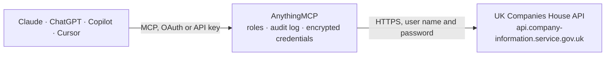

<!-- Generated by scripts/export-github-catalog.mjs in the anythingmcp-website repository. Do not edit by hand. -->

# UK Companies House MCP connector

Search and inspect the official UK companies register: company profiles, directors and secretaries, filing history. The AnythingMCP connector gives Claude, ChatGPT, Microsoft Copilot, Cursor and Gemini 4 MCP tools for UK Companies House, all read-only.

**Category:** [Government](../government.md) · **Tools:** 4 · **Setup guide:** [anythingmcp.com](https://anythingmcp.com/guides/companies-house-to-mcp) · [Deutsch](https://anythingmcp.com/de/guides/companies-house-to-mcp) · [Italiano](https://anythingmcp.com/it/guides/companies-house-to-mcp) · [Español](https://anythingmcp.com/es/guides/companies-house-to-mcp) · [日本語](https://anythingmcp.com/ja/guides/companies-house-to-mcp) · [Русский](https://anythingmcp.com/ru/guides/companies-house-to-mcp) · [中文](https://anythingmcp.com/zh/guides/companies-house-to-mcp)

## Start without code

No installation and no terminal: AnythingMCP Cloud runs the UK Companies House connector for you, operated by helpcode.ai in Frankfurt, Germany.

1. **Click the button above** and create an account or sign in. The UK Companies House connector opens, ready to install.
2. **Paste the API key or token from your UK Companies House account.** Every click is in the [step-by-step guide](https://anythingmcp.com/guides/companies-house-to-mcp).
3. **Click Install.** AnythingMCP shows the address of your MCP server.
4. **Add that address to your assistant:** [Claude](https://anythingmcp.com/guides/connect-companies-house-to-claude) · [ChatGPT](https://anythingmcp.com/guides/connect-companies-house-to-chatgpt) · [Microsoft Copilot](https://anythingmcp.com/guides/connect-companies-house-to-copilot) · [Cursor](https://anythingmcp.com/guides/connect-companies-house-to-cursor) · [Gemini CLI](https://anythingmcp.com/guides/connect-companies-house-to-gemini) · [Meta Muse](https://anythingmcp.com/guides/connect-companies-house-to-muse).
5. **Ask your first question**, for example: *Find the company number and current status for Brightfield Logistics Ltd*

Prefer help with the setup? [Talk to us](https://anythingmcp.com/contact).

## How it works

- **The AI client** speaks MCP (Streamable HTTP) to AnythingMCP and only sees tool names, descriptions and results. It never gets the UK Companies House credentials.
- **AnythingMCP** checks the client's role, builds the call from the tool definition, adds the credentials (user name and password), calls UK Companies House, logs the call and returns the result.
- **UK Companies House** sees an ordinary API client with the rights of the account the credentials belong to.

## Tools

| Tool | What it does | Access |
|---|---|---|
| [`companies_house_search_company`](#companies_house_search_company) | Search the UK companies register by company name or number. | read |
| [`companies_house_get_company_profile`](#companies_house_get_company_profile) | Fetch the full profile for a UK company by its 8-character zero-padded company number. | read |
| [`companies_house_list_officers`](#companies_house_list_officers) | List directors, secretaries and other officers (current and resigned) for a UK company. | read |
| [`companies_house_list_filings`](#companies_house_list_filings) | List the filing history (accounts, confirmation statements, officer appointments, share allotments, …) for a UK company. | read |

## Tool reference

Every parameter as the AI client sees it in `tools/list`. Source: [`packages/backend/src/adapters/gb/companies-house.json`](../../../packages/backend/src/adapters/gb/companies-house.json).

### `companies_house_search_company`

Search the UK companies register by company name or number. Returns up to `items_per_page` matches with company number, title, status (active/dissolved/liquidation), address snippet, and incorporation date.

**Access:** read · **Call:** `GET /search/companies`

| Parameter | Type | Required | Description |
|---|---|---|---|
| `q` | string | yes | Search query — company name, partial name, or company number. |
| `items_per_page` | number | no | Max results to return (default 20, max 100). |
| `start_index` | number | no | Offset for pagination (0-based). |

### `companies_house_get_company_profile`

Fetch the full profile for a UK company by its 8-character zero-padded company number. Returns registered office address, company status, type (ltd/plc/llp/…), incorporation date, SIC codes, accounts and confirmation-statement filing dates.

**Access:** read · **Call:** `GET /company/{company_number}`

| Parameter | Type | Required | Description |
|---|---|---|---|
| `company_number` | string | yes | 8-character zero-padded company number (e.g. '00006400'). Obtain from companies_house_search_company. |

### `companies_house_list_officers`

List directors, secretaries and other officers (current and resigned) for a UK company. Returns officer name, role, appointment date, resignation date if any, date of birth (month/year only), nationality, country of residence.

**Access:** read · **Call:** `GET /company/{company_number}/officers`

| Parameter | Type | Required | Description |
|---|---|---|---|
| `company_number` | string | yes | 8-character zero-padded company number. |
| `items_per_page` | number | no | Max results (default 35, max 100). |
| `register_view` | boolean | no | If true, show only the officers currently in the register view. |

### `companies_house_list_filings`

List the filing history (accounts, confirmation statements, officer appointments, share allotments, …) for a UK company. Returns filing type, description, date, and a link to the underlying document on the Companies House website.

**Access:** read · **Call:** `GET /company/{company_number}/filing-history`

| Parameter | Type | Required | Description |
|---|---|---|---|
| `company_number` | string | yes | 8-character zero-padded company number. |
| `category` | string | no | Filter by category: 'accounts', 'address', 'annual-return', 'capital', 'change-of-name', 'incorporation', 'officers', 'persons-with-significant-control', 'resolution'. |
| `items_per_page` | number | no | Max results (default 25, max 100). |

## Run it yourself

AnythingMCP is open source (AGPL-3.0). [Run it with Docker](../../../README.md#run-it-yourself), open **Connectors → Store**, pick **UK Companies House** and enter `COMPANIES_HOUSE_API_KEY`, then add your MCP server URL to the AI client.

[← Government connectors](../government.md) · [All categories](../README.md)
