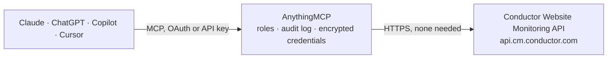

<!-- Generated by scripts/export-github-catalog.mjs in the anythingmcp-website repository. Do not edit by hand. -->

# Conductor Website Monitoring MCP connector

Real-time SEO auditing data from Conductor Website Monitoring (formerly ContentKing): monitored websites and segments, health scores and issue statistics, tracked pages with their SEO data, SEO … The AnythingMCP connector gives Claude, ChatGPT, Microsoft Copilot, Cursor and Gemini 17 MCP tools for Conductor Website Monitoring: 16 read and 1 can change data.

**Category:** [Analytics](../analytics.md) · **Tools:** 17 · **Setup guide:** [anythingmcp.com](https://anythingmcp.com/guides/conductor-monitoring-to-mcp) · [Deutsch](https://anythingmcp.com/de/guides/conductor-monitoring-to-mcp) · [Italiano](https://anythingmcp.com/it/guides/conductor-monitoring-to-mcp) · [Español](https://anythingmcp.com/es/guides/conductor-monitoring-to-mcp) · [日本語](https://anythingmcp.com/ja/guides/conductor-monitoring-to-mcp) · [Русский](https://anythingmcp.com/ru/guides/conductor-monitoring-to-mcp) · [中文](https://anythingmcp.com/zh/guides/conductor-monitoring-to-mcp)

## Start without code

No installation and no terminal: AnythingMCP Cloud runs the Conductor Website Monitoring connector for you, operated by helpcode.ai in Frankfurt, Germany.

1. **Click the button above** and create an account or sign in. The Conductor Website Monitoring connector opens, ready to install.
2. **Nothing to enter:** this connector needs no credentials. Every click is in the [step-by-step guide](https://anythingmcp.com/guides/conductor-monitoring-to-mcp).
3. **Click Install.** AnythingMCP shows the address of your MCP server.
4. **Add that address to your assistant:** [Claude](https://anythingmcp.com/guides/connect-conductor-monitoring-to-claude) · [ChatGPT](https://anythingmcp.com/guides/connect-conductor-monitoring-to-chatgpt) · [Microsoft Copilot](https://anythingmcp.com/guides/connect-conductor-monitoring-to-copilot) · [Cursor](https://anythingmcp.com/guides/connect-conductor-monitoring-to-cursor) · [Gemini CLI](https://anythingmcp.com/guides/connect-conductor-monitoring-to-gemini) · [Meta Muse](https://anythingmcp.com/guides/connect-conductor-monitoring-to-muse).
5. **Ask your first question**, for example: *Show open SEO issues for https://www.verdant-digital.de/case-study/windfarm-oberalz*

Prefer help with the setup? [Talk to us](https://anythingmcp.com/contact).

## How it works

- **The AI client** speaks MCP (Streamable HTTP) to AnythingMCP and only sees tool names, descriptions and results. It never gets the Conductor Website Monitoring credentials.
- **AnythingMCP** checks the client's role, builds the call from the tool definition, adds the credentials (none needed), calls Conductor Website Monitoring, logs the call and returns the result.
- **Conductor Website Monitoring** sees an ordinary API client with the rights of the account the credentials belong to.

## Tools

| Tool | What it does | Access |
|---|---|---|
| [`conductor_monitoring_list_websites`](#conductor_monitoring_list_websites) | All websites monitored in the account: id (the website_id the other tools need, except inspect_url and trigger_page_crawl), name, domain, page capacity and… | read |
| [`conductor_monitoring_list_segments`](#conductor_monitoring_list_segments) | Segments of a website (groups of pages such as blog or product pages): id, label, shortcode, color. | read |
| [`conductor_monitoring_get_statistics`](#conductor_monitoring_get_statistics) | Aggregate statistics of a website or segment: health score, number of issues, URL counts by type and status code, indexability, title, meta description and… | read |
| [`conductor_monitoring_list_pages`](#conductor_monitoring_list_pages) | Tracked URLs of a website with their SEO data (status code, type, indexability, title, meta description, H1, canonical, health, importance, Lighthouse, and… | read |
| [`conductor_monitoring_get_page`](#conductor_monitoring_get_page) | Everything known about one page: SEO fields, status, indexability, Lighthouse scores, open issues, Schema.org data, content, log file crawl frequency and… | read |
| [`conductor_monitoring_get_log_file_analysis`](#conductor_monitoring_get_log_file_analysis) | Daily visits of search engine and AI crawlers (Googlebot, Bingbot, OpenAI, Anthropic, Perplexity, Meta) to up to 50 URLs, from the server logs. | read |
| [`conductor_monitoring_list_issues`](#conductor_monitoring_list_issues) | All SEO issue types of a website or segment with how many pages are open, closed, ignored or not applicable, and percentages. | read |
| [`conductor_monitoring_list_affected_pages`](#conductor_monitoring_list_affected_pages) | Pages affected by one SEO issue, e.g. title/missing, meta_description/duplicate, h1/missing, canonical_link/points_to_unindexable, links/broken, lighthouse/lcp. | read |
| [`conductor_monitoring_get_page_issues`](#conductor_monitoring_get_page_issues) | Every open SEO issue of one page, with the issue name, its details and since when it is open. | read |
| [`conductor_monitoring_list_page_broken_links`](#conductor_monitoring_list_page_broken_links) | Broken links found on one page: target URL, anchor text, internal or external, status code. | read |
| [`conductor_monitoring_list_page_redirected_links`](#conductor_monitoring_list_page_redirected_links) | Redirected links found on one page: target URL, anchor text, internal or external, status code and redirect target. | read |
| [`conductor_monitoring_list_page_canonicalized_links`](#conductor_monitoring_list_page_canonicalized_links) | Links pointing to canonicalized URLs found on one page: target URL, anchor text, internal or external. | read |
| [`conductor_monitoring_list_alerts`](#conductor_monitoring_list_alerts) | Active alerts of a website (sudden changes such as pages becoming non-indexable, titles changing, robots.txt changes, 5xx errors): id, type, scope, opened… | read |
| [`conductor_monitoring_list_alert_pages`](#conductor_monitoring_list_alert_pages) | Pages of one alert, each with whether it entered or exited the alert, its relevance and segments. | read |
| [`conductor_monitoring_get_metrics`](#conductor_monitoring_get_metrics) | Daily time series of a website over a date range (health, issues, page counts and more). | read |
| [`conductor_monitoring_inspect_url`](#conductor_monitoring_inspect_url) | Look up a URL across all websites of the account and get its page data without knowing the website id. | read |
| [`conductor_monitoring_trigger_page_crawl`](#conductor_monitoring_trigger_page_crawl) | Queue one URL for immediate crawling (CMS API), so a change that was just published is audited right away instead of at the next scheduled visit. | write |

## Tool reference

Every parameter as the AI client sees it in `tools/list`. Source: [`packages/backend/src/adapters/intl/conductor-monitoring.json`](../../../packages/backend/src/adapters/intl/conductor-monitoring.json).

### `conductor_monitoring_list_websites`

All websites monitored in the account: id (the website_id the other tools need, except inspect_url and trigger_page_crawl), name, domain, page capacity and the link to the website in the app.

**Access:** read · **Call:** `GET /v2/entities/websites`

No parameters.

### `conductor_monitoring_list_segments`

Segments of a website (groups of pages such as blog or product pages): id, label, shortcode, color. Use segment:<id> or segment_label:<label> as scope in statistics and issues.

**Access:** read · **Call:** `GET /v2/entities/segments`

| Parameter | Type | Required | Description |
|---|---|---|---|
| `website_id` | string | yes | Website id, from conductor_monitoring_list_websites (e.g. 1-234). |

### `conductor_monitoring_get_statistics`

Aggregate statistics of a website or segment: health score, number of issues, URL counts by type and status code, indexability, title, meta description and H1 distributions, Lighthouse scores. Pass captured_at for a past date.

**Access:** read · **Call:** `GET /v2/data/statistics`

| Parameter | Type | Required | Description |
|---|---|---|---|
| `website_id` | string | yes | Website id, from conductor_monitoring_list_websites (e.g. 1-234). |
| `scope` | string | no | website for the whole site, segment:<id> or segment_label:<label> for a segment from conductor_monitoring_list_segments. |
| `captured_at` | string | no | Optional point in time for historical data, ISO 8601 (e.g. 2026-10-01T00:00:00Z). Default: now. |

### `conductor_monitoring_list_pages`

Tracked URLs of a website with their SEO data (status code, type, indexability, title, meta description, H1, canonical, health, importance, Lighthouse, and more). Page with page_cursor (next_page_cursor) on big sites, or page.

**Access:** read · **Call:** `GET /v2/data/pages`

| Parameter | Type | Required | Description |
|---|---|---|---|
| `website_id` | string | yes | Website id, from conductor_monitoring_list_websites (e.g. 1-234). |
| `per_page` | integer | no | Results per request, 1 to 1000. |
| `page` | integer | no | Result page, from 1 (ignored when page_cursor is sent). |
| `page_cursor` | string | no | next_page_cursor from the previous answer; faster than page on big sites. Do not send together with page. |
| `sort` | string | no | Field to sort by, e.g. url. |
| `direction` | `asc` \| `desc` | no | Sort direction. |

### `conductor_monitoring_get_page`

Everything known about one page: SEO fields, status, indexability, Lighthouse scores, open issues, Schema.org data, content, log file crawl frequency and Enrichment Fields. A redirect answers with its target, a missing page with what is known.

**Access:** read · **Call:** `GET /v2/data/page`

| Parameter | Type | Required | Description |
|---|---|---|---|
| `website_id` | string | yes | Website id, from conductor_monitoring_list_websites (e.g. 1-234). |
| `url` | string | yes | Full absolute URL of the page, with https://, exactly as Conductor Monitoring tracks it. |

### `conductor_monitoring_get_log_file_analysis`

Daily visits of search engine and AI crawlers (Googlebot, Bingbot, OpenAI, Anthropic, Perplexity, Meta) to up to 50 URLs, from the server logs. Needs the Log File Analysis feature. Default range: the last 30 days.

**Access:** read · **Call:** `GET /v2/data/page_lfa`

| Parameter | Type | Required | Description |
|---|---|---|---|
| `website_id` | string | yes | Website id, from conductor_monitoring_list_websites (e.g. 1-234). |
| `urls` | string[] | yes | Full URLs, at most 50. |
| `start_date` | string | no | First day, YYYY-MM-DD (send end_date too). |
| `end_date` | string | no | Last day, YYYY-MM-DD. |

### `conductor_monitoring_list_issues`

All SEO issue types of a website or segment with how many pages are open, closed, ignored or not applicable, and percentages. The name field (e.g. title/missing) is the issue for conductor_monitoring_list_affected_pages.

**Access:** read · **Call:** `GET /v2/data/issues`

| Parameter | Type | Required | Description |
|---|---|---|---|
| `website_id` | string | yes | Website id, from conductor_monitoring_list_websites (e.g. 1-234). |
| `scope` | string | no | website for the whole site, segment:<id> or segment_label:<label> for a segment from conductor_monitoring_list_segments. |
| `captured_at` | string | no | Optional point in time for historical data, ISO 8601 (e.g. 2026-10-01T00:00:00Z). Default: now. |

### `conductor_monitoring_list_affected_pages`

Pages affected by one SEO issue, e.g. title/missing, meta_description/duplicate, h1/missing, canonical_link/points_to_unindexable, links/broken, lighthouse/lcp.

**Access:** read · **Call:** `GET /v2/data/affected_pages`

| Parameter | Type | Required | Description |
|---|---|---|---|
| `website_id` | string | yes | Website id, from conductor_monitoring_list_websites (e.g. 1-234). |
| `issue` | string | yes | Issue name from conductor_monitoring_list_issues, e.g. title/missing. |
| `page` | integer | no | Result page, from 1. |
| `per_page` | integer | no | Results per request, 1 to 1000. |

### `conductor_monitoring_get_page_issues`

Every open SEO issue of one page, with the issue name, its details and since when it is open.

**Access:** read · **Call:** `GET /v2/data/page/issues`

| Parameter | Type | Required | Description |
|---|---|---|---|
| `website_id` | string | yes | Website id, from conductor_monitoring_list_websites (e.g. 1-234). |
| `url` | string | yes | Full absolute URL of the page, with https://, exactly as Conductor Monitoring tracks it. |

### `conductor_monitoring_list_page_broken_links`

Broken links found on one page: target URL, anchor text, internal or external, status code. Page with page_cursor (next_page_cursor); total is the count.

**Access:** read · **Call:** `GET /v2/data/page/issues/broken_links`

| Parameter | Type | Required | Description |
|---|---|---|---|
| `website_id` | string | yes | Website id, from conductor_monitoring_list_websites (e.g. 1-234). |
| `url` | string | yes | Full absolute URL of the page, with https://, exactly as Conductor Monitoring tracks it. |
| `per_page` | integer | no | Results per request, 1 to 1000. |
| `page_cursor` | string | no | next_page_cursor from the previous answer; faster than page on big sites. Do not send together with page. |

### `conductor_monitoring_list_page_redirected_links`

Redirected links found on one page: target URL, anchor text, internal or external, status code and redirect target. Page with page_cursor (next_page_cursor); total is the count.

**Access:** read · **Call:** `GET /v2/data/page/issues/redirected_links`

| Parameter | Type | Required | Description |
|---|---|---|---|
| `website_id` | string | yes | Website id, from conductor_monitoring_list_websites (e.g. 1-234). |
| `url` | string | yes | Full absolute URL of the page, with https://, exactly as Conductor Monitoring tracks it. |
| `per_page` | integer | no | Results per request, 1 to 1000. |
| `page_cursor` | string | no | next_page_cursor from the previous answer; faster than page on big sites. Do not send together with page. |

### `conductor_monitoring_list_page_canonicalized_links`

Links pointing to canonicalized URLs found on one page: target URL, anchor text, internal or external. Page with page_cursor (next_page_cursor); total is the count.

**Access:** read · **Call:** `GET /v2/data/page/issues/canonicalized_links`

| Parameter | Type | Required | Description |
|---|---|---|---|
| `website_id` | string | yes | Website id, from conductor_monitoring_list_websites (e.g. 1-234). |
| `url` | string | yes | Full absolute URL of the page, with https://, exactly as Conductor Monitoring tracks it. |
| `per_page` | integer | no | Results per request, 1 to 1000. |
| `page_cursor` | string | no | next_page_cursor from the previous answer; faster than page on big sites. Do not send together with page. |

### `conductor_monitoring_list_alerts`

Active alerts of a website (sudden changes such as pages becoming non-indexable, titles changing, robots.txt changes, 5xx errors): id, type, scope, opened and last updated dates, link in the app.

**Access:** read · **Call:** `GET /v2/alerts`

| Parameter | Type | Required | Description |
|---|---|---|---|
| `website_id` | string | yes | Website id, from conductor_monitoring_list_websites (e.g. 1-234). |

### `conductor_monitoring_list_alert_pages`

Pages of one alert, each with whether it entered or exited the alert, its relevance and segments.

**Access:** read · **Call:** `GET /v2/alerts/alert_pages`

| Parameter | Type | Required | Description |
|---|---|---|---|
| `website_id` | string | yes | Website id, from conductor_monitoring_list_websites (e.g. 1-234). |
| `alert_id` | string | yes | Alert id from conductor_monitoring_list_alerts. |
| `page` | integer | no | Result page, from 1. |
| `per_page` | integer | no | Results per request, 1 to 1000. |

### `conductor_monitoring_get_metrics`

Daily time series of a website over a date range (health, issues, page counts and more). Reporting API v1, which Conductor no longer develops: it has no v2 equivalent and may be switched off later.

**Access:** read · **Call:** `GET /v1/websites/{website_id}/metrics`

| Parameter | Type | Required | Description |
|---|---|---|---|
| `website_id` | string | yes | Website id, from conductor_monitoring_list_websites (e.g. 1-234). |
| `start_date` | string | yes | First day, YYYY-MM-DD. |
| `end_date` | string | yes | Last day, YYYY-MM-DD. |

### `conductor_monitoring_inspect_url`

Look up a URL across all websites of the account and get its page data without knowing the website id. Reporting API v1, which Conductor no longer develops: it has no v2 equivalent and may be switched off later.

**Access:** read · **Call:** `GET /v1/inspect_url`

| Parameter | Type | Required | Description |
|---|---|---|---|
| `url` | string | yes | Full absolute URL of the page, with https://, exactly as Conductor Monitoring tracks it. |

### `conductor_monitoring_trigger_page_crawl`

Queue one URL for immediate crawling (CMS API), so a change that was just published is audited right away instead of at the next scheduled visit. The URL must belong to a website in the account. Needs CONDUCTOR_CMS_API_TOKEN.

**Access:** write · **Call:** `POST /v1/check_url`

| Parameter | Type | Required | Description |
|---|---|---|---|
| `url` | string | yes | Full absolute URL of the page, with https://, exactly as Conductor Monitoring tracks it. |

## Run it yourself

AnythingMCP is open source (AGPL-3.0). [Run it with Docker](../../../README.md#run-it-yourself), open **Connectors → Store**, pick **Conductor Website Monitoring** and enter `CONDUCTOR_REPORTING_API_TOKEN`, then add your MCP server URL to the AI client.

[← Analytics connectors](../analytics.md) · [All categories](../README.md)
