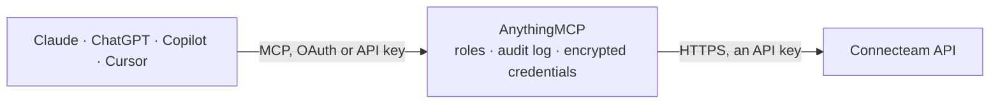

<!-- Generated by scripts/export-github-catalog.mjs in the anythingmcp-website repository. Do not edit by hand. -->

# Connecteam MCP connector

Connecteam workforce app for deskless teams: users and custom fields, time clock (time activities, clock in and out, timesheet totals), scheduler shifts, jobs, forms and submissions, quick tasks, … The AnythingMCP connector gives Claude, ChatGPT, Microsoft Copilot, Cursor and Gemini 49 MCP tools for Connecteam: 28 read and 21 can change data.

**Category:** [HR](../hr.md) · **Tools:** 49 · **Setup guide:** [anythingmcp.com](https://anythingmcp.com/guides/connecteam-to-mcp) · [Deutsch](https://anythingmcp.com/de/guides/connecteam-to-mcp) · [Italiano](https://anythingmcp.com/it/guides/connecteam-to-mcp) · [Español](https://anythingmcp.com/es/guides/connecteam-to-mcp) · [日本語](https://anythingmcp.com/ja/guides/connecteam-to-mcp) · [Русский](https://anythingmcp.com/ru/guides/connecteam-to-mcp) · [中文](https://anythingmcp.com/zh/guides/connecteam-to-mcp)

## Start without code

No installation and no terminal: AnythingMCP Cloud runs the Connecteam connector for you, operated by helpcode.ai in Frankfurt, Germany.

1. **Click the button above** and create an account or sign in. The Connecteam connector opens, ready to install.
2. **Paste the API key or token from your Connecteam account.** Every click is in the [step-by-step guide](https://anythingmcp.com/guides/connecteam-to-mcp).
3. **Click Install.** AnythingMCP shows the address of your MCP server.
4. **Add that address to your assistant:** [Claude](https://anythingmcp.com/guides/connect-connecteam-to-claude) · [ChatGPT](https://anythingmcp.com/guides/connect-connecteam-to-chatgpt) · [Microsoft Copilot](https://anythingmcp.com/guides/connect-connecteam-to-copilot) · [Cursor](https://anythingmcp.com/guides/connect-connecteam-to-cursor) · [Gemini CLI](https://anythingmcp.com/guides/connect-connecteam-to-gemini) · [Meta Muse](https://anythingmcp.com/guides/connect-connecteam-to-muse).
5. **Ask your first question**, for example: *Find the Connecteam user for Marco Bianchi with phone +39 345 6789012*

Prefer help with the setup? [Talk to us](https://anythingmcp.com/contact).

## How it works

- **The AI client** speaks MCP (Streamable HTTP) to AnythingMCP and only sees tool names, descriptions and results. It never gets the Connecteam credentials.
- **AnythingMCP** checks the client's role, builds the call from the tool definition, adds the credentials (an API key), calls Connecteam, logs the call and returns the result.
- **Connecteam** sees an ordinary API client with the rights of the account the credentials belong to.

## Tools

| Tool | What it does | Access |
|---|---|---|
| [`connecteam_get_account`](#connecteam_get_account) | Account of the API key: company id, name and time zone. | read |
| [`connecteam_list_users`](#connecteam_list_users) | List users (employees, managers, owners): id, name, phone, email, user type, archived flag, custom field values and smart groups. | read |
| [`connecteam_list_custom_fields`](#connecteam_list_custom_fields) | List the user custom fields (profile fields such as employee number, department, birthday) with id, name, type and dropdown options. | read |
| [`connecteam_list_custom_field_categories`](#connecteam_list_custom_field_categories) | List the categories that group user custom fields, with id and name. | read |
| [`connecteam_list_smart_groups`](#connecteam_list_smart_groups) | List smart groups (user groups built from rules, used to assign jobs, forms and chats) with id and name. | read |
| [`connecteam_list_time_clocks`](#connecteam_list_time_clocks) | List the time clocks of the account (one per time clock app or location) with id and name; the id is needed by every time activity tool. | read |
| [`connecteam_list_time_activities`](#connecteam_list_time_activities) | Clocked work per user in a date range: shifts with start and end (Unix seconds and time zone), job, notes and GPS, manual breaks and time off entries. | read |
| [`connecteam_get_timesheet_totals`](#connecteam_get_timesheet_totals) | Timesheet totals per user and day for a period: worked hours, breaks, overtime, pay, approval, submission and lock state. | read |
| [`connecteam_list_schedulers`](#connecteam_list_schedulers) | List the job schedulers (schedule apps) with id and name; the id is needed by every shift tool. | read |
| [`connecteam_list_shifts`](#connecteam_list_shifts) | Scheduled shifts in a time range: id, start and end (Unix seconds), title, job, assigned users, open spots, published flag, notes, tasks, breaks and status. | read |
| [`connecteam_get_shift`](#connecteam_get_shift) | One scheduled shift by id with assignments, job, notes, tasks, breaks and custom fields. | read |
| [`connecteam_list_shift_custom_fields`](#connecteam_list_shift_custom_fields) | Custom fields defined on the shifts of a scheduler, with id, name and type, for use in shift customFields. | read |
| [`connecteam_list_user_unavailabilities`](#connecteam_list_user_unavailabilities) | Times a user marked as unavailable (and available) for scheduling in a range. | read |
| [`connecteam_list_jobs`](#connecteam_list_jobs) | List jobs (clients, sites or projects that shifts and clocked time are tracked against): id, title, code, description, GPS address, assigned users or groups… | read |
| [`connecteam_get_job`](#connecteam_get_job) | One job by id with code, description, location, assignment, custom fields and sub-jobs. | read |
| [`connecteam_list_job_custom_fields`](#connecteam_list_job_custom_fields) | Custom fields defined on jobs, with id, name, type and options, for use in job customFields. | read |
| [`connecteam_list_forms`](#connecteam_list_forms) | List forms (checklists, reports, inspections) with id, name and creation date. | read |
| [`connecteam_get_form`](#connecteam_get_form) | One form by id with its questions (id, type, title and options). | read |
| [`connecteam_list_form_submissions`](#connecteam_list_form_submissions) | Submissions of a form: submitter, time, and the answer to each question (text, choices, images and file links). | read |
| [`connecteam_get_form_submission`](#connecteam_get_form_submission) | One form submission with the submitter, submission time and the answer to every question. | read |
| [`connecteam_list_task_boards`](#connecteam_list_task_boards) | List quick task boards with id and name; the id is needed by every task tool. | read |
| [`connecteam_list_tasks`](#connecteam_list_tasks) | Tasks of a board: title, description, assignees, status, start and due time (Unix seconds), labels and sub-tasks. | read |
| [`connecteam_list_task_labels`](#connecteam_list_task_labels) | Labels of a task board with id, title and colour, to filter or tag tasks by label. | read |
| [`connecteam_list_time_off_policy_types`](#connecteam_list_time_off_policy_types) | Time off policy types (vacation, sick and others) with id and name; needed for balances and requests. | read |
| [`connecteam_list_time_off_balances`](#connecteam_list_time_off_balances) | Time off balances of users for one policy type (days or hours left). | read |
| [`connecteam_list_time_off_requests`](#connecteam_list_time_off_requests) | Time off requests overlapping a date range: user, policy type, dates or times, all-day flag, status and notes. | read |
| [`connecteam_list_conversations`](#connecteam_list_conversations) | Chat conversations (channels and groups) the API can post to, with id, title and type. | read |
| [`connecteam_list_publishers`](#connecteam_list_publishers) | Custom publishers (named senders for API messages) with id and name; a publisher id is the senderId of the chat tools. | read |
| [`connecteam_create_users`](#connecteam_create_users) | Create one or more users. | write |
| [`connecteam_update_users`](#connecteam_update_users) | Update one or more users by userId (or by phone with editUsersByPhone): name, phone, email, user type, custom field values, archived flag. | write |
| [`connecteam_archive_users`](#connecteam_archive_users) | Archive users: they lose access but keep their history and can be restored (update with isArchived false). | write |
| [`connecteam_delete_user`](#connecteam_delete_user) | Permanently delete a user and their data. | write |
| [`connecteam_create_user_note`](#connecteam_create_user_note) | Add a note (title and text) to a user's profile in Connecteam, e.g. a manager remark. | write |
| [`connecteam_create_shifts`](#connecteam_create_shifts) | Create shifts in a scheduler. | write |
| [`connecteam_update_shifts`](#connecteam_update_shifts) | Update shifts by shiftId: times, title, job, assignees, publish state, notes, tasks or breaks. | write |
| [`connecteam_delete_shift`](#connecteam_delete_shift) | Delete a scheduled shift. | write |
| [`connecteam_clock_in`](#connecteam_clock_in) | Clock a user in on a time clock now (or at timestamp), optionally on a job or a scheduled shift. | write |
| [`connecteam_clock_out`](#connecteam_clock_out) | Clock a user out of the running shift on a time clock now (or at timestamp). | write |
| [`connecteam_create_time_activities`](#connecteam_create_time_activities) | Add past clocked shifts or manual breaks for users (e.g. a forgotten clock-in). | write |
| [`connecteam_update_time_activities`](#connecteam_update_time_activities) | Correct clocked shifts or manual breaks by their id (start, end, job, notes). | write |
| [`connecteam_create_jobs`](#connecteam_create_jobs) | Create jobs (or sub-jobs with parentId) and attach them to schedulers or time clocks. | write |
| [`connecteam_update_job`](#connecteam_update_job) | Update a job: title, code, description, location, assignment, custom fields or the schedulers and time clocks it belongs to. | write |
| [`connecteam_create_task`](#connecteam_create_task) | Create a task on a board and assign it to users; publish it to notify them. | write |
| [`connecteam_update_task`](#connecteam_update_task) | Update a task, e.g. mark it completed. | write |
| [`connecteam_delete_task`](#connecteam_delete_task) | Delete a task from a board. | write |
| [`connecteam_create_time_off_request`](#connecteam_create_time_off_request) | Create a time off request for a user, pending for approval or already approved. | write |
| [`connecteam_update_time_off_request`](#connecteam_update_time_off_request) | Approve or deny a time off request (status), or change its dates and notes. | write |
| [`connecteam_send_message`](#connecteam_send_message) | Post a message to a chat conversation (channel or group) as a custom publisher. | write |
| [`connecteam_send_private_message`](#connecteam_send_private_message) | Send a private chat message to one user as a custom publisher. | write |

## Tool reference

Every parameter as the AI client sees it in `tools/list`. Source: [`packages/backend/src/adapters/intl/connecteam.json`](../../../packages/backend/src/adapters/intl/connecteam.json).

### `connecteam_get_account`

Account of the API key: company id, name and time zone. The install check.

**Access:** read · **Call:** `GET /me`

No parameters.

### `connecteam_list_users`

List users (employees, managers, owners): id, name, phone, email, user type, archived flag, custom field values and smart groups. Contains personal data.

**Access:** read · **Call:** `GET /users/v1/users`

| Parameter | Type | Required | Description |
|---|---|---|---|
| `userIds` | integer[] | no | Only these user ids. |
| `userStatus` | `active` \| `archived` \| `all` | no | active (default), archived or all. |
| `fullNames` | string[] | no | Exact full names (first and last name with a space, any case). |
| `emailAddresses` | string[] | no | Email addresses. |
| `phoneNumbers` | string[] | no | Phone numbers in +<country code><number> format. |
| `createdAt` | integer | no | Only users created after this Unix time (seconds). |
| `modifiedAt` | integer | no | Only users changed after this Unix time (seconds). |
| `sort` | `created_at` | no | Sort key. |
| `order` | `asc` \| `desc` | no | asc or desc, with sort. |
| `limit` | integer | no | Results per page, up to 500 (default 10). |
| `offset` | integer | no | Results to skip: the previous offset plus limit (default 0). |

### `connecteam_list_custom_fields`

List the user custom fields (profile fields such as employee number, department, birthday) with id, name, type and dropdown options.

**Access:** read · **Call:** `GET /users/v1/custom-fields`

| Parameter | Type | Required | Description |
|---|---|---|---|
| `customFieldIds` | integer[] | no | Only these custom field ids. |
| `categoryIds` | integer[] | no | Only fields in these category ids. |
| `customFieldNames` | string[] | no | Field names. |
| `customFieldTypes` | string[] | no | Field types: email, date, phone, number, str, dropdown, file, directManager, birthday, link, location. |
| `sort` | `id` \| `name` \| `type` | no | Sort key. |
| `order` | `asc` \| `desc` | no | asc or desc, with sort. |
| `limit` | integer | no | Results per page, up to 500 (default 10). |
| `offset` | integer | no | Results to skip: the previous offset plus limit (default 0). |

### `connecteam_list_custom_field_categories`

List the categories that group user custom fields, with id and name.

**Access:** read · **Call:** `GET /users/v1/custom-field-categories`

| Parameter | Type | Required | Description |
|---|---|---|---|
| `categoryIds` | integer[] | no | Only these category ids. |
| `categoryNames` | string[] | no | Category names. |
| `sort` | `id` \| `name` | no | Sort key. |
| `order` | `asc` \| `desc` | no | asc or desc, with sort. |
| `limit` | integer | no | Results per page, up to 500 (default 10). |
| `offset` | integer | no | Results to skip: the previous offset plus limit (default 0). |

### `connecteam_list_smart_groups`

List smart groups (user groups built from rules, used to assign jobs, forms and chats) with id and name.

**Access:** read · **Call:** `GET /users/v1/smart-groups`

| Parameter | Type | Required | Description |
|---|---|---|---|
| `id` | integer | no | Only this smart group id. |
| `name` | string | no | Only smart groups with this name. |

### `connecteam_list_time_clocks`

List the time clocks of the account (one per time clock app or location) with id and name; the id is needed by every time activity tool.

**Access:** read · **Call:** `GET /time-clock/v1/time-clocks`

No parameters.

### `connecteam_list_time_activities`

Clocked work per user in a date range: shifts with start and end (Unix seconds and time zone), job, notes and GPS, manual breaks and time off entries.

**Access:** read · **Call:** `GET /time-clock/v1/time-clocks/{timeClockId}/time-activities`

| Parameter | Type | Required | Description |
|---|---|---|---|
| `timeClockId` | integer | yes | Time clock id from connecteam_list_time_clocks. |
| `startDate` | string | yes | First day, YYYY-MM-DD. |
| `endDate` | string | yes | Last day, YYYY-MM-DD (at most 92 days after startDate). |
| `userIds` | integer[] | no | Only these user ids. |
| `jobIds` | string[] | no | Only shifts on these job ids. |
| `activityTypes` | string[] | no | shift, manual_break or time_off. |
| `manualBreakIds` | string[] | no | Only these manual break type ids. |
| `policyTypeIds` | string[] | no | Only time off of these policy type ids. |

### `connecteam_get_timesheet_totals`

Timesheet totals per user and day for a period: worked hours, breaks, overtime, pay, approval, submission and lock state.

**Access:** read · **Call:** `GET /time-clock/v1/time-clocks/{timeClockId}/timesheet`

| Parameter | Type | Required | Description |
|---|---|---|---|
| `timeClockId` | integer | yes | Time clock id. |
| `startDate` | string | yes | First day, YYYY-MM-DD. |
| `endDate` | string | yes | Last day, YYYY-MM-DD. |
| `userIds` | integer[] | no | Only these user ids. |
| `groupIds` | string[] | no | Only users in these group ids. |
| `jobIds` | string[] | no | Only these job ids. |
| `isApproved` | boolean | no | true approved days only, false unapproved only. |
| `isSubmitted` | boolean | no | true submitted days only, false unsubmitted only. |
| `isLocked` | boolean | no | true locked days only, false unlocked only. |
| `includePlanVsActual` | boolean | no | true adds scheduled versus actual hours per day. |

### `connecteam_list_schedulers`

List the job schedulers (schedule apps) with id and name; the id is needed by every shift tool.

**Access:** read · **Call:** `GET /scheduler/v1/schedulers`

No parameters.

### `connecteam_list_shifts`

Scheduled shifts in a time range: id, start and end (Unix seconds), title, job, assigned users, open spots, published flag, notes, tasks, breaks and status.

**Access:** read · **Call:** `GET /scheduler/v1/schedulers/{schedulerId}/shifts`

| Parameter | Type | Required | Description |
|---|---|---|---|
| `schedulerId` | integer | yes | Scheduler id from connecteam_list_schedulers. |
| `startTime` | integer | yes | Range start, Unix time in seconds. |
| `endTime` | integer | yes | Range end, Unix time in seconds. |
| `assignedUserIds` | integer[] | no | Only shifts of these user ids. |
| `jobId` | string[] | no | Only shifts on these job ids. |
| `shiftId` | string[] | no | Only these shift ids. |
| `isOpenShift` | boolean | no | true open shifts only. |
| `isPublished` | boolean | no | true published only, false drafts only. |
| `isRequireAdminApproval` | boolean | no | true shifts needing admin approval only. |
| `title` | string | no | Only shifts with this title. |
| `sort` | `created_at` \| `updated_at` | no | Sort key. |
| `order` | `asc` \| `desc` | no | asc or desc, with sort. |
| `limit` | integer | no | Results per page, up to 500 (default 10). |
| `offset` | integer | no | Results to skip: the previous offset plus limit (default 0). |

### `connecteam_get_shift`

One scheduled shift by id with assignments, job, notes, tasks, breaks and custom fields.

**Access:** read · **Call:** `GET /scheduler/v1/schedulers/{schedulerId}/shifts/{shiftId}`

| Parameter | Type | Required | Description |
|---|---|---|---|
| `schedulerId` | integer | yes | Scheduler id. |
| `shiftId` | string | yes | Shift id. |

### `connecteam_list_shift_custom_fields`

Custom fields defined on the shifts of a scheduler, with id, name and type, for use in shift customFields.

**Access:** read · **Call:** `GET /scheduler/v1/schedulers/{schedulerId}/custom-fields`

| Parameter | Type | Required | Description |
|---|---|---|---|
| `schedulerId` | integer | yes | Scheduler id. |
| `limit` | integer | no | Results per page, up to 100 (default 10). |
| `offset` | integer | no | Results to skip: the previous offset plus limit (default 0). |

### `connecteam_list_user_unavailabilities`

Times a user marked as unavailable (and available) for scheduling in a range.

**Access:** read · **Call:** `GET /scheduler/v1/schedulers/user-unavailability`

| Parameter | Type | Required | Description |
|---|---|---|---|
| `userId` | integer | yes | User id. |
| `startTime` | integer | yes | Range start, Unix time in seconds. |
| `endTime` | integer | yes | Range end, Unix time in seconds. |

### `connecteam_list_jobs`

List jobs (clients, sites or projects that shifts and clocked time are tracked against): id, title, code, description, GPS address, assigned users or groups and sub-jobs.

**Access:** read · **Call:** `GET /jobs/v1/jobs`

| Parameter | Type | Required | Description |
|---|---|---|---|
| `instanceIds` | integer[] | no | Only jobs of these scheduler or time clock ids. |
| `jobIds` | string[] | no | Only these job ids (with their sub-jobs). |
| `jobNames` | string[] | no | Job names. |
| `jobCodes` | string[] | no | Job codes. |
| `includeDeleted` | boolean | no | Include deleted jobs (default true). |
| `sort` | `title` | no | Sort key. |
| `order` | `asc` \| `desc` | no | asc or desc, with sort. |
| `limit` | integer | no | Results per page, up to 500 (default 10). |
| `offset` | integer | no | Results to skip: the previous offset plus limit (default 0). |

### `connecteam_get_job`

One job by id with code, description, location, assignment, custom fields and sub-jobs.

**Access:** read · **Call:** `GET /jobs/v1/jobs/{jobId}`

| Parameter | Type | Required | Description |
|---|---|---|---|
| `jobId` | string | yes | Job id. |

### `connecteam_list_job_custom_fields`

Custom fields defined on jobs, with id, name, type and options, for use in job customFields.

**Access:** read · **Call:** `GET /jobs/v1/custom-fields`

| Parameter | Type | Required | Description |
|---|---|---|---|
| `customFieldIds` | integer[] | no | Only these custom field ids. |
| `categoryIds` | integer[] | no | Only these category ids. |
| `customFieldNames` | string[] | no | Field names. |
| `customFieldTypes` | string[] | no | str, phone or dropdown. |
| `sort` | `name` \| `type` | no | Sort key. |
| `order` | `asc` \| `desc` | no | asc or desc, with sort. |
| `limit` | integer | no | Results per page, up to 500 (default 10). |
| `offset` | integer | no | Results to skip: the previous offset plus limit (default 0). |

### `connecteam_list_forms`

List forms (checklists, reports, inspections) with id, name and creation date.

**Access:** read · **Call:** `GET /forms/v1/forms`

| Parameter | Type | Required | Description |
|---|---|---|---|
| `name` | string | no | Part of the form name (case-insensitive). |
| `startDate` | string | no | Forms created on or after, YYYY-MM-DD. |
| `endDate` | string | no | Forms created on or before, YYYY-MM-DD. |
| `limit` | integer | no | Results per page, up to 300 (default 10). |
| `offset` | integer | no | Results to skip: the previous offset plus limit (default 0). |

### `connecteam_get_form`

One form by id with its questions (id, type, title and options).

**Access:** read · **Call:** `GET /forms/v1/forms/{formId}`

| Parameter | Type | Required | Description |
|---|---|---|---|
| `formId` | integer | yes | Form id. |

### `connecteam_list_form_submissions`

Submissions of a form: submitter, time, and the answer to each question (text, choices, images and file links).

**Access:** read · **Call:** `GET /forms/v1/forms/{formId}/form-submissions`

| Parameter | Type | Required | Description |
|---|---|---|---|
| `formId` | integer | yes | Form id. |
| `userIds` | integer[] | no | Only submissions by these user ids. |
| `submittingStartTimestamp` | integer | no | Submitted from this Unix time (seconds). |
| `submittingEndTime` | integer | no | Submitted until this Unix time (seconds). |
| `limit` | integer | no | Results per page, up to 100 (default 10). |
| `offset` | integer | no | Results to skip: the previous offset plus limit (default 0). |

### `connecteam_get_form_submission`

One form submission with the submitter, submission time and the answer to every question.

**Access:** read · **Call:** `GET /forms/v1/forms/{formId}/form-submissions/{formSubmissionId}`

| Parameter | Type | Required | Description |
|---|---|---|---|
| `formId` | integer | yes | Form id. |
| `formSubmissionId` | string | yes | Submission id. |

### `connecteam_list_task_boards`

List quick task boards with id and name; the id is needed by every task tool.

**Access:** read · **Call:** `GET /tasks/v1/taskboards`

No parameters.

### `connecteam_list_tasks`

Tasks of a board: title, description, assignees, status, start and due time (Unix seconds), labels and sub-tasks.

**Access:** read · **Call:** `GET /tasks/v1/taskboards/{taskBoardId}/tasks`

| Parameter | Type | Required | Description |
|---|---|---|---|
| `taskBoardId` | string | yes | Task board id. |
| `status` | `draft` \| `published` \| `completed` \| `all` | no | draft, published, completed or all (default). |
| `userIds` | integer[] | no | Only tasks assigned to these user ids (group tasks included). |
| `labelIds` | string[] | no | Only tasks with these label ids. |
| `taskIds` | string[] | no | Only these task ids. |
| `limit` | integer | no | Results per page, up to 100 (default 10). |
| `offset` | integer | no | Results to skip: the previous offset plus limit (default 0). |

### `connecteam_list_task_labels`

Labels of a task board with id, title and colour, to filter or tag tasks by label.

**Access:** read · **Call:** `GET /tasks/v1/taskboards/{taskBoardId}/labels`

| Parameter | Type | Required | Description |
|---|---|---|---|
| `taskBoardId` | string | yes | Task board id. |
| `title` | string | no | Only the label with this title. |
| `limit` | integer | no | Results per page, up to 100 (default 10). |
| `offset` | integer | no | Results to skip: the previous offset plus limit (default 0). |

### `connecteam_list_time_off_policy_types`

Time off policy types (vacation, sick and others) with id and name; needed for balances and requests.

**Access:** read · **Call:** `GET /time-off/v1/policy-types`

No parameters.

### `connecteam_list_time_off_balances`

Time off balances of users for one policy type (days or hours left).

**Access:** read · **Call:** `GET /time-off/v1/policy-types/{policyTypeId}/balances`

| Parameter | Type | Required | Description |
|---|---|---|---|
| `policyTypeId` | string | yes | Policy type id. |
| `userIds` | integer[] | no | Only these user ids. |
| `limit` | integer | no | Results per page, up to 100 (default 10). |
| `offset` | integer | no | Results to skip: the previous offset plus limit (default 0). |

### `connecteam_list_time_off_requests`

Time off requests overlapping a date range: user, policy type, dates or times, all-day flag, status and notes. Default status filter is approved.

**Access:** read · **Call:** `GET /time-off/v1/requests`

| Parameter | Type | Required | Description |
|---|---|---|---|
| `startDate` | string | yes | Range start, YYYY-MM-DD; requests overlapping the range are returned. |
| `endDate` | string | yes | Range end, YYYY-MM-DD; at most 365 days after startDate. |
| `userIds` | integer[] | no | Only these user ids. |
| `statuses` | string[] | no | approved, pending, denied. Default approved only. |
| `limit` | integer | no | Results per page, up to 100 (default 10). |
| `offset` | integer | no | Results to skip: the previous offset plus limit (default 0). |

### `connecteam_list_conversations`

Chat conversations (channels and groups) the API can post to, with id, title and type.

**Access:** read · **Call:** `GET /chat/v1/conversations`

| Parameter | Type | Required | Description |
|---|---|---|---|
| `limit` | integer | no | Results per page, up to 100 (default 10). |
| `offset` | integer | no | Results to skip: the previous offset plus limit (default 0). |

### `connecteam_list_publishers`

Custom publishers (named senders for API messages) with id and name; a publisher id is the senderId of the chat tools.

**Access:** read · **Call:** `GET /publishers/v1/publishers`

| Parameter | Type | Required | Description |
|---|---|---|---|
| `limit` | integer | no | Results per page, up to 100 (default 10). |
| `offset` | integer | no | Results to skip: the previous offset plus limit (default 0). |

### `connecteam_create_users`

Create one or more users. Each needs firstName, lastName, phoneNumber and userType.

**Access:** write · **Call:** `POST /users/v1/users`

| Parameter | Type | Required | Description |
|---|---|---|---|
| `users` | object[] | yes | Users, e.g. [{"firstName":"Ana","lastName":"Diaz","phoneNumber":"+15555550123","userType":"user","email":"ana@example.com","customFields":[{"customFieldId":123,"value":"E-42"}]}]. userType is user, manager or owner. |
| `sendActivation` | boolean | no | true sends the activation SMS to the new users. |

### `connecteam_update_users`

Update one or more users by userId (or by phone with editUsersByPhone): name, phone, email, user type, custom field values, archived flag. Only the fields sent change.

**Access:** write · **Call:** `PUT /users/v1/users`

| Parameter | Type | Required | Description |
|---|---|---|---|
| `users` | object[] | yes | Changes, e.g. [{"userId":9170357,"email":"ana@example.com","customFields":[{"customFieldId":123,"value":"E-43"}]}]. |
| `editUsersByPhone` | boolean | no | true matches users by phoneNumber instead of userId. |

### `connecteam_archive_users`

Archive users: they lose access but keep their history and can be restored (update with isArchived false).

**Access:** write · **Call:** `DELETE /users/v1/users`

| Parameter | Type | Required | Description |
|---|---|---|---|
| `userIds` | integer[] | yes | User ids to archive. |

### `connecteam_delete_user`

Permanently delete a user and their data. Cannot be undone; switched off at install.

**Access:** write · **Call:** `DELETE /users/v1/users/{userId}`

| Parameter | Type | Required | Description |
|---|---|---|---|
| `userId` | integer | yes | User id. |

### `connecteam_create_user_note`

Add a note (title and text) to a user's profile in Connecteam, e.g. a manager remark.

**Access:** write · **Call:** `POST /users/v1/users/{userId}/notes`

| Parameter | Type | Required | Description |
|---|---|---|---|
| `userId` | integer | yes | User id. |
| `title` | string | no | Note title. |
| `text` | string | yes | Note text. |

### `connecteam_create_shifts`

Create shifts in a scheduler. Each needs startTime and endTime (Unix seconds); assign users or make it open, set title, job, notes, tasks and breaks; publish to show it.

**Access:** write · **Call:** `POST /scheduler/v1/schedulers/{schedulerId}/shifts`

| Parameter | Type | Required | Description |
|---|---|---|---|
| `schedulerId` | integer | yes | Scheduler id. |
| `shifts` | object[] | yes | Shifts, e.g. [{"startTime":1767258000,"endTime":1767286800,"timezone":"America/New_York","title":"Morning","jobId":"...","assignedUserIds":[9170357],"isPublished":true,"notes":[{"html":"Bring keys"}]}]. Open shift: isOpenShift true with openSpots. |
| `notifyUsers` | boolean | no | true notifies assigned users of published shifts. |

### `connecteam_update_shifts`

Update shifts by shiftId: times, title, job, assignees, publish state, notes, tasks or breaks. Only the fields sent change.

**Access:** write · **Call:** `PUT /scheduler/v1/schedulers/{schedulerId}/shifts`

| Parameter | Type | Required | Description |
|---|---|---|---|
| `schedulerId` | integer | yes | Scheduler id. |
| `shifts` | object[] | yes | Changes, e.g. [{"shiftId":"...","startTime":1767261600,"isPublished":true}]. |
| `notifyUsers` | boolean | no | true notifies assigned users of published shifts. |

### `connecteam_delete_shift`

Delete a scheduled shift. Cannot be undone; switched off at install.

**Access:** write · **Call:** `DELETE /scheduler/v1/schedulers/{schedulerId}/shifts/{shiftId}`

| Parameter | Type | Required | Description |
|---|---|---|---|
| `schedulerId` | integer | yes | Scheduler id. |
| `shiftId` | string | yes | Shift id. |
| `notifyUsers` | boolean | no | true notifies the assigned users. |

### `connecteam_clock_in`

Clock a user in on a time clock now (or at timestamp), optionally on a job or a scheduled shift.

**Access:** write · **Call:** `POST /time-clock/v1/time-clocks/{timeClockId}/clock-in`

| Parameter | Type | Required | Description |
|---|---|---|---|
| `timeClockId` | integer | yes | Time clock id. |
| `userId` | integer | yes | User id. |
| `jobId` | string | no | Job id, when the clock tracks jobs. |
| `schedulerShiftId` | string | no | Scheduled shift id to clock in to. |
| `timestamp` | integer | no | Clock-in time, Unix seconds; omit for now. |
| `timezone` | string | no | IANA time zone, e.g. Europe/Berlin. |
| `locationData` | object | no | Optional location: {"address":"...","latitude":40.7,"longitude":-74.0}. |

### `connecteam_clock_out`

Clock a user out of the running shift on a time clock now (or at timestamp).

**Access:** write · **Call:** `POST /time-clock/v1/time-clocks/{timeClockId}/clock-out`

| Parameter | Type | Required | Description |
|---|---|---|---|
| `timeClockId` | integer | yes | Time clock id. |
| `userId` | integer | yes | User id. |
| `timestamp` | integer | no | Clock-out time, Unix seconds; omit for now. |
| `timezone` | string | no | IANA time zone. |
| `locationData` | object | no | Optional location: {"address":"...","latitude":40.7,"longitude":-74.0}. |

### `connecteam_create_time_activities`

Add past clocked shifts or manual breaks for users (e.g. a forgotten clock-in). Locked or approved days are refused.

**Access:** write · **Call:** `POST /time-clock/v1/time-clocks/{timeClockId}/time-activities`

| Parameter | Type | Required | Description |
|---|---|---|---|
| `timeClockId` | integer | yes | Time clock id. |
| `timeActivities` | object[] | yes | Per user, e.g. [{"userId":9170357,"shifts":[{"start":{"timestamp":1704110400,"timezone":"America/New_York"},"end":{"timestamp":1704139200,"timezone":"America/New_York"},"jobId":"...","managerNote":"Imported"}],"manualbreaks":[]}]. |
| `isSplitShiftOnManualBreak` | boolean | no | true splits an existing completed shift around a new manual break. |

### `connecteam_update_time_activities`

Correct clocked shifts or manual breaks by their id (start, end, job, notes). Locked or approved days are refused.

**Access:** write · **Call:** `PUT /time-clock/v1/time-clocks/{timeClockId}/time-activities`

| Parameter | Type | Required | Description |
|---|---|---|---|
| `timeClockId` | integer | yes | Time clock id. |
| `timeActivities` | object[] | yes | Per user, with the ids of the shifts to change, e.g. [{"userId":9170357,"shifts":[{"id":"...","end":{"timestamp":1704139200,"timezone":"America/New_York"}}]}]. |

### `connecteam_create_jobs`

Create jobs (or sub-jobs with parentId) and attach them to schedulers or time clocks.

**Access:** write · **Call:** `POST /jobs/v1/jobs`

| Parameter | Type | Required | Description |
|---|---|---|---|
| `jobs` | object[] | yes | Jobs, e.g. [{"title":"Main St site","code":"MS-01","instanceIds":[12345],"gps":{"address":"1 Main St, Springfield"},"assign":{"type":"users","userIds":[9170357]}}]. Sub-job: {"title":"Floor 2","parentId":"..."}. |

### `connecteam_update_job`

Update a job: title, code, description, location, assignment, custom fields or the schedulers and time clocks it belongs to. title is required by the API.

**Access:** write · **Call:** `PUT /jobs/v1/jobs/{jobId}`

| Parameter | Type | Required | Description |
|---|---|---|---|
| `jobId` | string | yes | Job id. |
| `fields` | object | yes | Job fields, e.g. {"title":"Main St site","code":"MS-01","description":"Night access via gate B"}. For a sub-job include parentId and useParentData. |

### `connecteam_create_task`

Create a task on a board and assign it to users; publish it to notify them.

**Access:** write · **Call:** `POST /tasks/v1/taskboards/{taskBoardId}/tasks`

| Parameter | Type | Required | Description |
|---|---|---|---|
| `taskBoardId` | string | yes | Task board id. |
| `userIds` | integer[] | yes | Assignee user ids. |
| `status` | `draft` \| `published` \| `completed` | yes | draft, published or completed. |
| `title` | string | yes | Task title. |
| `startTime` | integer | no | Start, Unix seconds. |
| `dueDate` | integer | no | Due, Unix seconds. |
| `labelIds` | string[] | no | Label ids from connecteam_list_task_labels. |
| `type` | `oneTime` \| `recurring` | no | oneTime or recurring. |
| `isArchived` | boolean | no | true archives the task. |
| `subTasks` | object[] | no | Sub-tasks, e.g. [{"title":"Photo of the meter","isCompleted":false}]. |
| `description` | object | no | Description, e.g. {"content":"Check the fire exits"}. |

### `connecteam_update_task`

Update a task, e.g. mark it completed. The API replaces the task: send userIds, status and title every time.

**Access:** write · **Call:** `PUT /tasks/v1/taskboards/{taskBoardId}/tasks/{taskId}`

| Parameter | Type | Required | Description |
|---|---|---|---|
| `taskBoardId` | string | yes | Task board id. |
| `taskId` | string | yes | Task id. |
| `userIds` | integer[] | yes | Assignee user ids. |
| `status` | `draft` \| `published` \| `completed` | yes | draft, published or completed. |
| `title` | string | yes | Task title. |
| `startTime` | integer | no | Start, Unix seconds. |
| `dueDate` | integer | no | Due, Unix seconds. |
| `labelIds` | string[] | no | Label ids from connecteam_list_task_labels. |
| `type` | `oneTime` \| `recurring` | no | oneTime or recurring. |
| `isArchived` | boolean | no | true archives the task. |
| `subTasks` | object[] | no | Sub-tasks, e.g. [{"title":"Photo of the meter","isCompleted":false}]. |
| `description` | object | no | Description, e.g. {"content":"Check the fire exits"}. |

### `connecteam_delete_task`

Delete a task from a board. Cannot be undone; switched off at install.

**Access:** write · **Call:** `DELETE /tasks/v1/taskboards/{taskBoardId}/tasks/{taskId}`

| Parameter | Type | Required | Description |
|---|---|---|---|
| `taskBoardId` | string | yes | Task board id. |
| `taskId` | string | yes | Task id. |

### `connecteam_create_time_off_request`

Create a time off request for a user, pending for approval or already approved.

**Access:** write · **Call:** `POST /time-off/v1/requests`

| Parameter | Type | Required | Description |
|---|---|---|---|
| `userId` | integer | yes | User id. |
| `policyTypeId` | string | yes | Policy type id from connecteam_list_time_off_policy_types. |
| `employeeNote` | string | no | Employee note. |
| `isAllDay` | boolean | yes | true for whole days. |
| `startDate` | string | yes | First day, YYYY-MM-DD. |
| `endDate` | string | yes | Last day, YYYY-MM-DD. |
| `startTime` | string | no | Start time for a partial day, HH:MM. |
| `endTime` | string | no | End time for a partial day, HH:MM. |
| `timezone` | string | yes | IANA time zone, e.g. America/Chicago. |
| `status` | `approved` \| `pending` \| `denied` | yes | approved, pending or denied. |
| `managerNote` | string | no | Manager note. |
| `timeClockId` | integer | no | Time clock id the time off is recorded on. |
| `isAdjustForDayLightSaving` | boolean | no | true adjusts hours across a daylight saving change. |

### `connecteam_update_time_off_request`

Approve or deny a time off request (status), or change its dates and notes. Only the fields sent change.

**Access:** write · **Call:** `PUT /time-off/v1/requests/{requestId}`

| Parameter | Type | Required | Description |
|---|---|---|---|
| `requestId` | string | yes | Time off request id. |
| `isAllDay` | boolean | no | true for whole days. |
| `startDate` | string | no | First day, YYYY-MM-DD. |
| `endDate` | string | no | Last day, YYYY-MM-DD. |
| `startTime` | string | no | Start time for a partial day, HH:MM. |
| `endTime` | string | no | End time for a partial day, HH:MM. |
| `timezone` | string | no | IANA time zone, e.g. America/Chicago. |
| `status` | `approved` \| `pending` \| `denied` | no | approved, pending or denied. |
| `managerNote` | string | no | Manager note. |
| `timeClockId` | integer | no | Time clock id the time off is recorded on. |
| `isAdjustForDayLightSaving` | boolean | no | true adjusts hours across a daylight saving change. |

### `connecteam_send_message`

Post a message to a chat conversation (channel or group) as a custom publisher.

**Access:** write · **Call:** `POST /chat/v1/conversations/{conversationId}/message`

| Parameter | Type | Required | Description |
|---|---|---|---|
| `conversationId` | string | yes | Conversation id from connecteam_list_conversations. |
| `senderId` | integer | yes | Publisher id from connecteam_list_publishers. |
| `text` | string | yes | Message text. |

### `connecteam_send_private_message`

Send a private chat message to one user as a custom publisher.

**Access:** write · **Call:** `POST /chat/v1/conversations/privateMessage/{userId}`

| Parameter | Type | Required | Description |
|---|---|---|---|
| `userId` | integer | yes | Recipient user id. |
| `senderId` | integer | yes | Publisher id from connecteam_list_publishers. |
| `text` | string | yes | Message text. |

## Run it yourself

AnythingMCP is open source (AGPL-3.0). [Run it with Docker](../../../README.md#run-it-yourself), open **Connectors → Store**, pick **Connecteam** and enter `CONNECTEAM_API_HOST`, `CONNECTEAM_API_KEY`, then add your MCP server URL to the AI client.

[← HR connectors](../hr.md) · [All categories](../README.md)
