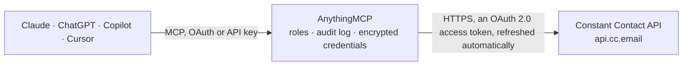

<!-- Generated by scripts/export-github-catalog.mjs in the anythingmcp-website repository. Do not edit by hand. -->

# Constant Contact MCP connector

Constant Contact email marketing: contacts with consent status, lists, tags, custom fields and segments, bulk list and tag changes, email campaigns built from HTML with preview, test and scheduled … The AnythingMCP connector gives Claude, ChatGPT, Microsoft Copilot, Cursor and Gemini 50 MCP tools for Constant Contact: 30 read and 20 can change data.

**Category:** [Email](../email.md) · **Tools:** 50 · **Setup guide:** [anythingmcp.com](https://anythingmcp.com/guides/constant-contact-to-mcp) · [Deutsch](https://anythingmcp.com/de/guides/constant-contact-to-mcp) · [Italiano](https://anythingmcp.com/it/guides/constant-contact-to-mcp) · [Español](https://anythingmcp.com/es/guides/constant-contact-to-mcp) · [日本語](https://anythingmcp.com/ja/guides/constant-contact-to-mcp) · [Русский](https://anythingmcp.com/ru/guides/constant-contact-to-mcp) · [中文](https://anythingmcp.com/zh/guides/constant-contact-to-mcp)

## Start without code

No installation and no terminal: AnythingMCP Cloud runs the Constant Contact connector for you, operated by helpcode.ai in Frankfurt, Germany.

1. **Click the button above** and create an account or sign in. The Constant Contact connector opens, ready to install.
2. **Sign in with your Constant Contact account** when AnythingMCP asks. The first time, an admin creates a small app in the Constant Contact developer console. Every click is in the [step-by-step guide](https://anythingmcp.com/guides/constant-contact-to-mcp).
3. **Click Install.** AnythingMCP shows the address of your MCP server.
4. **Add that address to your assistant:** [Claude](https://anythingmcp.com/guides/connect-constant-contact-to-claude) · [ChatGPT](https://anythingmcp.com/guides/connect-constant-contact-to-chatgpt) · [Microsoft Copilot](https://anythingmcp.com/guides/connect-constant-contact-to-copilot) · [Cursor](https://anythingmcp.com/guides/connect-constant-contact-to-cursor) · [Gemini CLI](https://anythingmcp.com/guides/connect-constant-contact-to-gemini) · [Meta Muse](https://anythingmcp.com/guides/connect-constant-contact-to-muse).
5. **Ask your first question**, for example: *Find contact record for maria.lopez@verdeconsulting.es and show which lists and tags she's on.*

Prefer help with the setup? [Talk to us](https://anythingmcp.com/contact).

## How it works

- **The AI client** speaks MCP (Streamable HTTP) to AnythingMCP and only sees tool names, descriptions and results. It never gets the Constant Contact credentials.
- **AnythingMCP** checks the client's role, builds the call from the tool definition, adds the credentials (an OAuth 2.0 access token, refreshed automatically), calls Constant Contact, logs the call and returns the result.
- **Constant Contact** sees an ordinary API client with the rights of the account the credentials belong to.

## Tools

| Tool | What it does | Access |
|---|---|---|
| [`constant_contact_get_account_summary`](#constant_contact_get_account_summary) | Account details of the connected Constant Contact account: organization name, contact email and phone, website, time zone, country, state and the encoded… | read |
| [`constant_contact_list_account_emails`](#constant_contact_list_account_emails) | Email addresses of the account with their confirm status (CONFIRMED or UNCONFIRMED) and roles. | read |
| [`constant_contact_get_user_privileges`](#constant_contact_get_user_privileges) | Privileges of the Constant Contact user who authorized the connector (for example contacts:write, campaign:send, ui:campaign:metrics). | read |
| [`constant_contact_list_contacts`](#constant_contact_list_contacts) | Search contacts, newest changes not guaranteed first. | read |
| [`constant_contact_get_contact`](#constant_contact_get_contact) | One contact by id with its email permission, opt-in and opt-out details and, with include, its lists, tags, custom fields, phone numbers, addresses and notes. | read |
| [`constant_contact_get_contact_counts`](#constant_contact_get_contact_counts) | Total number of contacts in the account and how many are in each email consent state (explicit, implicit, pending confirmation, unsubscribed). | read |
| [`constant_contact_create_contact`](#constant_contact_create_contact) | Create a new contact. | write |
| [`constant_contact_create_or_update_contact`](#constant_contact_create_or_update_contact) | Add a contact by email address or update the existing one, and add it to one or more lists. | write |
| [`constant_contact_update_contact`](#constant_contact_update_contact) | Replace a contact's data. | write |
| [`constant_contact_delete_contact`](#constant_contact_delete_contact) | Delete a contact. | write |
| [`constant_contact_list_contact_lists`](#constant_contact_list_contact_lists) | Contact lists of the account with list_id, name, description, favorite flag and, with include_membership_count, the number of members. | read |
| [`constant_contact_get_contact_list`](#constant_contact_get_contact_list) | One contact list by id, optionally with its number of members. | read |
| [`constant_contact_create_contact_list`](#constant_contact_create_contact_list) | Create a contact list. | write |
| [`constant_contact_update_contact_list`](#constant_contact_update_contact_list) | Rename a list or change its description or favorite flag. | write |
| [`constant_contact_delete_contact_list`](#constant_contact_delete_contact_list) | Delete a contact list and its memberships (the contacts stay in the account). | write |
| [`constant_contact_add_contacts_to_lists`](#constant_contact_add_contacts_to_lists) | Add contacts to one or more lists as a background activity. | write |
| [`constant_contact_remove_contacts_from_lists`](#constant_contact_remove_contacts_from_lists) | Remove contacts from one or more lists as a background activity (the contacts stay in the account). | write |
| [`constant_contact_list_tags`](#constant_contact_list_tags) | Tags of the account with tag_id, name, tag_source and, with include_count, the number of tagged contacts. | read |
| [`constant_contact_get_tag`](#constant_contact_get_tag) | One tag by id, optionally with the number of contacts that carry it. | read |
| [`constant_contact_create_tag`](#constant_contact_create_tag) | Create a tag. | write |
| [`constant_contact_update_tag`](#constant_contact_update_tag) | Rename a tag. | write |
| [`constant_contact_add_tags_to_contacts`](#constant_contact_add_tags_to_contacts) | Put one or more tags on contacts as a background activity. | write |
| [`constant_contact_remove_tags_from_contacts`](#constant_contact_remove_tags_from_contacts) | Take one or more tags off contacts as a background activity (the tags themselves stay). | write |
| [`constant_contact_list_custom_fields`](#constant_contact_list_custom_fields) | Custom contact fields of the account with custom_field_id, label, name, type and, for select fields, the choices. | read |
| [`constant_contact_get_custom_field`](#constant_contact_get_custom_field) | One custom field by id with its label, name, type, metadata and select choices. | read |
| [`constant_contact_create_custom_field`](#constant_contact_create_custom_field) | Create a custom contact field. | write |
| [`constant_contact_list_segments`](#constant_contact_list_segments) | Segments (saved contact filters) of the account with segment_id, name and dates. | read |
| [`constant_contact_get_segment`](#constant_contact_get_segment) | One segment with its criteria (segment_criteria as JSON text). | read |
| [`constant_contact_list_activities`](#constant_contact_list_activities) | Background activities (bulk list and tag changes, imports, exports, deletes) with their state and percent done, newest first. | read |
| [`constant_contact_get_activity`](#constant_contact_get_activity) | Status of one background activity: state (initialized, processing, completed, cancelled, failed, timed_out), percent_done, counts and any errors. | read |
| [`constant_contact_list_email_campaigns`](#constant_contact_list_email_campaigns) | Email campaigns of the account with campaign_id, name, current_status (Draft, Scheduled, Executing, Done, Error, Removed), type and created and updated times. | read |
| [`constant_contact_get_email_campaign`](#constant_contact_get_email_campaign) | One email campaign with its status and campaign_activities: each with campaign_activity_id and role (primary_email is the email itself, permalink, resend… | read |
| [`constant_contact_get_email_campaign_activity`](#constant_contact_get_email_campaign_activity) | One email campaign activity: subject, from and reply-to, preheader, format_type, current_status, the contact_list_ids or segment_ids it goes to and, with… | read |
| [`constant_contact_create_email_campaign`](#constant_contact_create_email_campaign) | Create a draft email campaign from your own HTML (custom code email, format_type 5). | write |
| [`constant_contact_update_email_campaign_activity`](#constant_contact_update_email_campaign_activity) | Change a draft (or sent, for some fields) primary_email activity: subject, sender, HTML, preheader, footer address and the audience (contact_list_ids or… | write |
| [`constant_contact_rename_email_campaign`](#constant_contact_rename_email_campaign) | Rename an email campaign (the internal name, not the subject). | write |
| [`constant_contact_get_email_preview`](#constant_contact_get_email_preview) | HTML preview of an email campaign activity, with contact and custom field variables filled from the account owner's data, plus the preview text. | read |
| [`constant_contact_send_test_email`](#constant_contact_send_test_email) | Send a test of an email campaign activity to up to 5 addresses (50 test recipients a day per account). | write |
| [`constant_contact_get_email_schedule`](#constant_contact_get_email_schedule) | Scheduled send time of an email campaign activity; an empty array when it is not scheduled. | read |
| [`constant_contact_schedule_email_campaign_activity`](#constant_contact_schedule_email_campaign_activity) | Send an email campaign activity to its lists or segment, now (scheduled_date "0") or at a time. | write |
| [`constant_contact_unschedule_email_campaign_activity`](#constant_contact_unschedule_email_campaign_activity) | Cancel the schedule of an email campaign activity in SCHEDULED status; it goes back to its previous status (usually DRAFT). | write |
| [`constant_contact_get_email_send_history`](#constant_contact_get_email_send_history) | Each time an email campaign activity was sent: date, number of contacts, the lists or segments used, and whether the send completed or failed with the reason. | read |
| [`constant_contact_list_email_campaign_summaries`](#constant_contact_list_email_campaign_summaries) | Results of sent email campaigns, last sent first: per campaign the unique sends, opens, clicks, forwards, unsubscribes (optouts), bounces and spam reports,… | read |
| [`constant_contact_get_email_campaign_stats`](#constant_contact_get_email_campaign_stats) | Stats for one or more email campaigns: counts (sends, opens, clicks, forwards, optouts, bounces, abuse, not opened) and percents (open, click, bounce rates)… | read |
| [`constant_contact_get_email_campaign_activity_stats`](#constant_contact_get_email_campaign_activity_stats) | Stats for up to 10 email campaign activities: counts per tracked action and the campaign each belongs to. | read |
| [`constant_contact_get_email_links_report`](#constant_contact_get_email_links_report) | Links in an email campaign activity with the number of unique contacts who clicked each and the link action. | read |
| [`constant_contact_get_email_tracking_report`](#constant_contact_get_email_tracking_report) | Contacts behind an email campaign activity's numbers, most recent first: who it was sent to, who opened (every open or unique opens), who did not open, who… | read |
| [`constant_contact_get_contact_activity_details`](#constant_contact_get_contact_activity_details) | What one contact did with your emails and landing pages, newest first: sends, opens, clicks, bounces, unsubscribes, forwards and landing page actions, with… | read |
| [`constant_contact_get_contact_activity_summary`](#constant_contact_get_contact_activity_summary) | The emails sent to one contact in a date range (up to the 200 most recent campaigns) with what the contact did with each: opens, clicks, forwards, bounces,… | read |
| [`constant_contact_get_contact_open_click_rates`](#constant_contact_get_contact_open_click_rates) | Average open and click rate of one contact over a date range of up to 5 years, with the number of emails counted. | read |

## Tool reference

Every parameter as the AI client sees it in `tools/list`. Source: [`packages/backend/src/adapters/intl/constant-contact.json`](../../../packages/backend/src/adapters/intl/constant-contact.json).

### `constant_contact_get_account_summary`

Account details of the connected Constant Contact account: organization name, contact email and phone, website, time zone, country, state and the encoded account id. Optionally the physical address and company logo. Needs no ids; use it to check the connection.

**Access:** read · **Call:** `GET /account/summary`

| Parameter | Type | Required | Description |
|---|---|---|---|
| `extra_fields` | string | no | Extra details, comma-separated: physical_address, company_logo. |

### `constant_contact_list_account_emails`

Email addresses of the account with their confirm status (CONFIRMED or UNCONFIRMED) and roles. A campaign's from_email and reply_to_email must be a CONFIRMED address from this list.

**Access:** read · **Call:** `GET /account/emails`

| Parameter | Type | Required | Description |
|---|---|---|---|
| `confirm_status` | `CONFIRMED` \| `UNCONFIRMED` | no | Only addresses with this status. |
| `role_code` | `CONTACT` \| `BILLING` \| `REPLY_TO` \| `JOURNALING` \| `OTHER` | no | Only addresses with this role. |
| `email_address` | string | no | Look up one address. |

### `constant_contact_get_user_privileges`

Privileges of the Constant Contact user who authorized the connector (for example contacts:write, campaign:send, ui:campaign:metrics). Use it when a call answers 403 to see which privilege is missing.

**Access:** read · **Call:** `GET /account/user/privileges`

No parameters.

### `constant_contact_list_contacts`

Search contacts, newest changes not guaranteed first. Filter by email, status, lists, tags, segment or created, updated and opt-out dates; add sub-resources with include. Returns contacts[] with contact_id, email_address (address, permission_to_send, opt-in and opt-out data), names and the included sub-resources, plus _links.next.href when more pages exist. Deleted contacts are left out unless status is all or deleted.

**Access:** read · **Call:** `GET /contacts`

| Parameter | Type | Required | Description |
|---|---|---|---|
| `email` | string | no | Find the contact with this exact email address. |
| `status` | string | no | Contact status, one or more comma-separated: all, active, deleted, not_set, pending_confirmation, temp_hold, unsubscribed. |
| `lists` | string | no | Only members of these lists: up to 25 list ids, comma-separated. |
| `tags` | string | no | Only contacts with these tags: up to 50 tag ids, comma-separated. |
| `segment_id` | string | no | Only contacts matching this segment (from constant_contact_list_segments). Can only be combined with limit; the API may answer 202 while it builds the result, then ask again. |
| `created_after` | string | no | Created after this time, ISO 8601 (2026-10-01T00:00:00Z). |
| `created_before` | string | no | Created before this time, ISO 8601. |
| `updated_after` | string | no | Updated after this time, ISO 8601. |
| `updated_before` | string | no | Updated before this time, ISO 8601. |
| `optout_after` | string | no | Unsubscribed after this time, ISO 8601. |
| `optout_before` | string | no | Unsubscribed before this time, ISO 8601. |
| `sms_status` | string | no | SMS status, comma-separated: all, explicit, unsubscribed, pending_confirmation, not_set. |
| `include` | string | no | Sub-resources to add, comma-separated: custom_fields, list_memberships, phone_numbers, street_addresses, taggings, notes. Without it only the basic fields come back. |
| `include_count` | boolean | no | true adds contacts_count, the number of contacts that match. |
| `limit` | integer | no | Contacts per page, 1-500 (default 50). |
| `cursor` | string | no | Next page: the value of the cursor query parameter in _links.next.href of the previous answer (the text after cursor=). Leave empty for the first page. |

### `constant_contact_get_contact`

One contact by id with its email permission, opt-in and opt-out details and, with include, its lists, tags, custom fields, phone numbers, addresses and notes.

**Access:** read · **Call:** `GET /contacts/{contact_id}`

| Parameter | Type | Required | Description |
|---|---|---|---|
| `contact_id` | string | yes | Contact id (UUID), from constant_contact_list_contacts. |
| `include` | string | no | Sub-resources to add, comma-separated: custom_fields, list_memberships, phone_numbers, street_addresses, taggings, notes. Without it only the basic fields come back. |

### `constant_contact_get_contact_counts`

Total number of contacts in the account and how many are in each email consent state (explicit, implicit, pending confirmation, unsubscribed). With include new_subscriber also the subscribers of the last 30 days.

**Access:** read · **Call:** `GET /contacts/counts`

| Parameter | Type | Required | Description |
|---|---|---|---|
| `include` | `new_subscriber` | no | new_subscriber adds the number of contacts that subscribed in the last 30 days. |

### `constant_contact_create_contact`

Create a new contact. Fails with 409 when the email address already exists: use constant_contact_create_or_update_contact to add or update by email. Only add people who agreed to receive email from the business.

**Access:** write · **Call:** `POST /contacts`

| Parameter | Type | Required | Description |
|---|---|---|---|
| `email` | string | yes | Email address of the contact (up to 80 characters). |
| `permission_to_send` | `explicit` \| `implicit` \| `not_set` \| `pending_confirmation` | no | Email permission: explicit (the person opted in), implicit (an existing business relationship), not_set, pending_confirmation. Set explicit or implicit only when the contact really gave that consent. |
| `first_name` | string | no | First name (up to 50 characters). |
| `last_name` | string | no | Last name (up to 50 characters). |
| `job_title` | string | no | Job title (up to 50 characters). |
| `company_name` | string | no | Company name (up to 50 characters). |
| `birthday_month` | integer | no | Birthday month, 1-12; send together with birthday_day. |
| `birthday_day` | integer | no | Birthday day, 1-31; send together with birthday_month. |
| `anniversary` | string | no | Anniversary date, e.g. 2026-04-30 or 04/30/2026. |
| `list_memberships` | string[] | no | List ids (UUIDs) the contact belongs to, up to 50, from constant_contact_list_contact_lists. |
| `taggings` | string[] | no | Tag ids (UUIDs) to put on the contact, from constant_contact_list_tags. |
| `custom_fields` | object[] | no | Custom field values: [{"custom_field_id": "<uuid from constant_contact_list_custom_fields>", "value": "Gold"}]. |
| `phone_numbers` | object[] | no | Phone numbers: [{"phone_number": "+1 555 0100", "kind": "work"}]; kind is home, work, mobile or other. At most 3. |
| `street_addresses` | object[] | no | Postal addresses: [{"kind": "work", "street": "...", "city": "...", "state": "...", "postal_code": "...", "country": "..."}]. At most 3. |
| `create_source` | `Account` \| `Contact` | yes | Who is adding the contact: Account (you, on behalf of the business) or Contact (the person signed up themselves). Default Account. |

### `constant_contact_create_or_update_contact`

Add a contact by email address or update the existing one, and add it to one or more lists. Updates are partial: only the fields you send change, and lists and custom fields are added to the existing ones. Returns the contact_id and action (created or updated). New contacts get permission explicit, or pending_confirmation when the account uses Confirmed Opt-in. Use it only for people who agreed to receive email.

**Access:** write · **Call:** `POST /contacts/sign_up_form`

| Parameter | Type | Required | Description |
|---|---|---|---|
| `email` | string | yes | Email address that identifies the contact (up to 50 characters here). |
| `list_memberships` | string[] | yes | List ids (UUIDs) to add the contact to, 1 to 50, from constant_contact_list_contact_lists. |
| `first_name` | string | no | First name. |
| `last_name` | string | no | Last name. |
| `job_title` | string | no | Job title. |
| `company_name` | string | no | Company name. |
| `phone_number` | string | no | Phone number (up to 25 characters). |
| `anniversary` | string | no | Anniversary date, e.g. 2026-04-30. |
| `birthday_month` | integer | no | Birthday month, 1-12; with birthday_day. |
| `birthday_day` | integer | no | Birthday day, 1-31; with birthday_month. |
| `custom_fields` | object[] | no | Custom field values: [{"custom_field_id": "<uuid>", "value": "..."}]. |
| `street_address` | object | no | One postal address: {"kind": "home", "street": "...", "city": "...", "state": "...", "postal_code": "...", "country": "..."}; kind (home, work, other) is required inside it. |

### `constant_contact_update_contact`

Replace a contact's data. This is a full update: name, job, company, birthday and anniversary fields you leave out are cleared. Read the contact first with constant_contact_get_contact and send every field again with your change. Sub-resources (lists, tags, custom fields, phones, addresses) you leave out stay as they are; ones you send replace the current values. Updating a deleted contact restores it.

**Access:** write · **Call:** `PUT /contacts/{contact_id}`

| Parameter | Type | Required | Description |
|---|---|---|---|
| `email` | string | yes | Email address of the contact (up to 80 characters). |
| `permission_to_send` | `explicit` \| `implicit` \| `not_set` \| `pending_confirmation` | no | Email permission: explicit (the person opted in), implicit (an existing business relationship), not_set, pending_confirmation. Set explicit or implicit only when the contact really gave that consent. |
| `first_name` | string | no | First name (up to 50 characters). |
| `last_name` | string | no | Last name (up to 50 characters). |
| `job_title` | string | no | Job title (up to 50 characters). |
| `company_name` | string | no | Company name (up to 50 characters). |
| `birthday_month` | integer | no | Birthday month, 1-12; send together with birthday_day. |
| `birthday_day` | integer | no | Birthday day, 1-31; send together with birthday_month. |
| `anniversary` | string | no | Anniversary date, e.g. 2026-04-30 or 04/30/2026. |
| `list_memberships` | string[] | no | List ids (UUIDs) the contact belongs to, up to 50, from constant_contact_list_contact_lists. |
| `taggings` | string[] | no | Tag ids (UUIDs) to put on the contact, from constant_contact_list_tags. |
| `custom_fields` | object[] | no | Custom field values: [{"custom_field_id": "<uuid from constant_contact_list_custom_fields>", "value": "Gold"}]. |
| `phone_numbers` | object[] | no | Phone numbers: [{"phone_number": "+1 555 0100", "kind": "work"}]; kind is home, work, mobile or other. At most 3. |
| `street_addresses` | object[] | no | Postal addresses: [{"kind": "work", "street": "...", "city": "...", "state": "...", "postal_code": "...", "country": "..."}]. At most 3. |
| `contact_id` | string | yes | Contact id (UUID), from constant_contact_list_contacts. |
| `update_source` | `Account` \| `Contact` | yes | Who makes the change: Account (default) or Contact. Account also restores a deleted contact. |

### `constant_contact_delete_contact`

Delete a contact. Deleted contacts get no email and do not count as active, but can be restored (constant_contact_update_contact or constant_contact_create_or_update_contact). To stop email to someone, unsubscribing in Constant Contact is usually the right step instead. Installed switched off.

**Access:** write · **Call:** `DELETE /contacts/{contact_id}`

| Parameter | Type | Required | Description |
|---|---|---|---|
| `contact_id` | string | yes | Contact id (UUID), from constant_contact_list_contacts. |

### `constant_contact_list_contact_lists`

Contact lists of the account with list_id, name, description, favorite flag and, with include_membership_count, the number of members.

**Access:** read · **Call:** `GET /contact_lists`

| Parameter | Type | Required | Description |
|---|---|---|---|
| `name` | string | no | Find one list by its full name. |
| `status` | string | no | List status, comma-separated: all, active, deleted. |
| `include_membership_count` | `active` \| `all` | no | Add membership_count: active counts only mailable contacts, all counts every member. |
| `include_count` | boolean | no | true adds lists_count, the number of lists that match. |
| `channel_type` | `email` \| `sms` | no | email (default) or sms lists. |
| `limit` | integer | no | Lists per page, 1-1000 (default 50). |
| `cursor` | string | no | Next page: the value of the cursor query parameter in _links.next.href of the previous answer (the text after cursor=). Leave empty for the first page. |

### `constant_contact_get_contact_list`

One contact list by id, optionally with its number of members.

**Access:** read · **Call:** `GET /contact_lists/{list_id}`

| Parameter | Type | Required | Description |
|---|---|---|---|
| `list_id` | string | yes | Contact list id (UUID), from constant_contact_list_contact_lists. |
| `include_membership_count` | `active` \| `all` | no | active or all, as in constant_contact_list_contact_lists. |

### `constant_contact_create_contact_list`

Create a contact list. The name must be unique in the account. Returns the new list_id.

**Access:** write · **Call:** `POST /contact_lists`

| Parameter | Type | Required | Description |
|---|---|---|---|
| `name` | string | yes | List name, unique, up to 255 characters. |
| `favorite` | boolean | yes | Mark the list as a favorite in the UI. |
| `description` | string | no | Description of the list. |

### `constant_contact_update_contact_list`

Rename a list or change its description or favorite flag. Send name and favorite every time; a description you leave out is cleared.

**Access:** write · **Call:** `PUT /contact_lists/{list_id}`

| Parameter | Type | Required | Description |
|---|---|---|---|
| `list_id` | string | yes | Contact list id (UUID), from constant_contact_list_contact_lists. |
| `name` | string | yes | List name, unique, up to 255 characters. |
| `favorite` | boolean | yes | Favorite flag. |
| `description` | string | no | Description of the list. |

### `constant_contact_delete_contact_list`

Delete a contact list and its memberships (the contacts stay in the account). Runs as a background activity: the answer holds an activity link to follow with constant_contact_get_activity. Installed switched off.

**Access:** write · **Call:** `DELETE /contact_lists/{list_id}`

| Parameter | Type | Required | Description |
|---|---|---|---|
| `list_id` | string | yes | Contact list id (UUID), from constant_contact_list_contact_lists. |

### `constant_contact_add_contacts_to_lists`

Add contacts to one or more lists as a background activity. Pick the contacts with source (contact ids, other lists, tags, all active contacts or a segment). Returns activity_id; check it with constant_contact_get_activity. A contact can be on at most 50 lists.

**Access:** write · **Call:** `POST /activities/add_list_memberships`

| Parameter | Type | Required | Description |
|---|---|---|---|
| `source` | object | yes | Which contacts: {"contact_ids": [...]} (up to 500), {"list_ids": [...]}, {"tag_ids": [...]}, {"all_active_contacts": true} or {"segment_id": 12}. Use exactly one of these keys. |
| `list_ids` | string[] | yes | Target list ids (UUIDs) to add the contacts to. |
| `exclude` | object | no | Contacts to leave out, only with list_ids or all_active_contacts as source: {"contact_ids": ["<uuid>"]}. |

### `constant_contact_remove_contacts_from_lists`

Remove contacts from one or more lists as a background activity (the contacts stay in the account). Pick the contacts with source (contact ids, lists, tags or all active contacts). Returns activity_id for constant_contact_get_activity.

**Access:** write · **Call:** `POST /activities/remove_list_memberships`

| Parameter | Type | Required | Description |
|---|---|---|---|
| `source` | object | yes | Which contacts: {"contact_ids": [...]} (up to 500), {"list_ids": [...]}, {"tag_ids": [...]} or {"all_active_contacts": true}. Use exactly one of these keys. |
| `list_ids` | string[] | yes | List ids (UUIDs) to remove the contacts from. |
| `exclude` | object | no | Contacts to leave out, only with list_ids or all_active_contacts as source: {"contact_ids": ["<uuid>"]}. |

### `constant_contact_list_tags`

Tags of the account with tag_id, name, tag_source and, with include_count, the number of tagged contacts.

**Access:** read · **Call:** `GET /contact_tags`

| Parameter | Type | Required | Description |
|---|---|---|---|
| `include_count` | boolean | no | true adds contacts_count per tag. |
| `limit` | integer | no | Tags per page, up to 500 (default 50). |
| `cursor` | string | no | Next page: the value of the cursor query parameter in _links.next.href of the previous answer (the text after cursor=). Leave empty for the first page. |

### `constant_contact_get_tag`

One tag by id, optionally with the number of contacts that carry it.

**Access:** read · **Call:** `GET /contact_tags/{tag_id}`

| Parameter | Type | Required | Description |
|---|---|---|---|
| `tag_id` | string | yes | Tag id (UUID), from constant_contact_list_tags. |
| `include_count` | boolean | no | true adds contacts_count. |

### `constant_contact_create_tag`

Create a tag. The name must be unique (up to 255 characters). Returns the new tag_id.

**Access:** write · **Call:** `POST /contact_tags`

| Parameter | Type | Required | Description |
|---|---|---|---|
| `name` | string | yes | Tag name, unique, up to 255 characters. |
| `tag_source` | string | no | Optional note on where the tagged contacts come from, e.g. a trade show name. |

### `constant_contact_update_tag`

Rename a tag. The new name must be unique in the account; the tag_source cannot be changed.

**Access:** write · **Call:** `PUT /contact_tags/{tag_id}`

| Parameter | Type | Required | Description |
|---|---|---|---|
| `tag_id` | string | yes | Tag id (UUID), from constant_contact_list_tags. |
| `name` | string | yes | New tag name. |

### `constant_contact_add_tags_to_contacts`

Put one or more tags on contacts as a background activity. Pick the contacts with source (contact ids, lists, tags, all active contacts or new subscribers). Returns activity_id for constant_contact_get_activity.

**Access:** write · **Call:** `POST /activities/contacts_taggings_add`

| Parameter | Type | Required | Description |
|---|---|---|---|
| `source` | object | yes | Which contacts: {"contact_ids": [...]} (up to 500), {"list_ids": [...]}, {"tag_ids": [...]}, {"all_active_contacts": true} or {"new_subscriber": true}. Use exactly one of these keys. |
| `tag_ids` | string[] | yes | Tag ids (UUIDs) to add. |
| `exclude` | object | no | Contacts to leave out, only with list_ids or all_active_contacts as source: {"contact_ids": ["<uuid>"]}. |

### `constant_contact_remove_tags_from_contacts`

Take one or more tags off contacts as a background activity (the tags themselves stay). Pick the contacts with source as in constant_contact_add_tags_to_contacts. Returns activity_id for constant_contact_get_activity.

**Access:** write · **Call:** `POST /activities/contacts_taggings_remove`

| Parameter | Type | Required | Description |
|---|---|---|---|
| `source` | object | yes | Which contacts: {"contact_ids": [...]}, {"list_ids": [...]}, {"tag_ids": [...]}, {"all_active_contacts": true} or {"new_subscriber": true}. Use exactly one of these keys. |
| `tag_ids` | string[] | yes | Tag ids (UUIDs) to remove. |
| `exclude` | object | no | Contacts to leave out, only with list_ids or all_active_contacts as source: {"contact_ids": ["<uuid>"]}. |

### `constant_contact_list_custom_fields`

Custom contact fields of the account with custom_field_id, label, name, type and, for select fields, the choices. Use the ids when setting custom_fields on a contact.

**Access:** read · **Call:** `GET /contact_custom_fields`

| Parameter | Type | Required | Description |
|---|---|---|---|
| `limit` | integer | no | Fields per page, 1-100 (default 50). |
| `cursor` | string | no | Next page: the value of the cursor query parameter in _links.next.href of the previous answer (the text after cursor=). Leave empty for the first page. |

### `constant_contact_get_custom_field`

One custom field by id with its label, name, type, metadata and select choices.

**Access:** read · **Call:** `GET /contact_custom_fields/{custom_field_id}`

| Parameter | Type | Required | Description |
|---|---|---|---|
| `custom_field_id` | string | yes | Custom field id (UUID), from constant_contact_list_custom_fields. |

### `constant_contact_create_custom_field`

Create a custom contact field. The label must be unique. Returns the new custom_field_id.

**Access:** write · **Call:** `POST /contact_custom_fields`

| Parameter | Type | Required | Description |
|---|---|---|---|
| `label` | string | yes | Field name shown in Constant Contact, up to 50 characters. |
| `type` | `string` \| `text_area` \| `number` \| `currency` \| `date` \| `datetime` \| `boolean` \| `single_select` \| `multi_select` | yes | Data type: string (short text), text_area, number, currency, date, datetime, boolean, single_select, multi_select. |
| `choices` | object[] | no | For single_select and multi_select: [{"choice_label": "Gold", "display_order": 1}, ...]; up to 20 choices for checkbox and radio, 100 for dropdown. |
| `metadata` | object | no | Optional details: display_type (checkbox, radio or dropdown for selects), decimal_places, currency_code, integer, allow_negative, display_format for dates. |

### `constant_contact_list_segments`

Segments (saved contact filters) of the account with segment_id, name and dates. Deleted segments are left out. Use a segment_id in constant_contact_list_contacts or as the audience of a campaign.

**Access:** read · **Call:** `GET /segments`

| Parameter | Type | Required | Description |
|---|---|---|---|
| `sort_by` | `name` \| `date` | no | name (A-Z) or date (most recently edited first, default). |
| `limit` | integer | no | Segments per page (default 1000). |
| `next` | string | no | Next page: the value of the next query parameter in _links.next.href of the previous answer (the text after next=). Leave empty for the first page. |

### `constant_contact_get_segment`

One segment with its criteria (segment_criteria as JSON text).

**Access:** read · **Call:** `GET /segments/{segment_id}`

| Parameter | Type | Required | Description |
|---|---|---|---|
| `segment_id` | integer | yes | Segment id (an integer), from constant_contact_list_segments. |

### `constant_contact_list_activities`

Background activities (bulk list and tag changes, imports, exports, deletes) with their state and percent done, newest first.

**Access:** read · **Call:** `GET /activities`

| Parameter | Type | Required | Description |
|---|---|---|---|
| `state` | `processing` \| `completed` \| `cancelled` \| `failed` \| `timed_out` | no | Only activities in this state. |
| `limit` | integer | no | Activities per page, 1-500 (default 50). |
| `cursor` | string | no | Next page: the value of the cursor query parameter in _links.next.href of the previous answer (the text after cursor=). Leave empty for the first page. |

### `constant_contact_get_activity`

Status of one background activity: state (initialized, processing, completed, cancelled, failed, timed_out), percent_done, counts and any errors.

**Access:** read · **Call:** `GET /activities/{activity_id}`

| Parameter | Type | Required | Description |
|---|---|---|---|
| `activity_id` | string | yes | Activity id returned by a bulk tool (add or remove list members or tags, delete a list), or from constant_contact_list_activities. |

### `constant_contact_list_email_campaigns`

Email campaigns of the account with campaign_id, name, current_status (Draft, Scheduled, Executing, Done, Error, Removed), type and created and updated times. Includes deleted (Removed) campaigns. Use constant_contact_get_email_campaign for the activity ids.

**Access:** read · **Call:** `GET /emails`

| Parameter | Type | Required | Description |
|---|---|---|---|
| `after_date` | string | no | Only campaigns updated after this time, ISO 8601. |
| `before_date` | string | no | Only campaigns updated before this time, ISO 8601. |
| `limit` | integer | no | Campaigns per page, 1-500 (default 50). |
| `cursor` | string | no | Next page: the value of the cursor query parameter in _links.next.href of the previous answer (the text after cursor=). Leave empty for the first page. |

### `constant_contact_get_email_campaign`

One email campaign with its status and campaign_activities: each with campaign_activity_id and role (primary_email is the email itself, permalink, resend for resends to non-openers). Most other campaign tools need the primary_email activity id.

**Access:** read · **Call:** `GET /emails/{campaign_id}`

| Parameter | Type | Required | Description |
|---|---|---|---|
| `campaign_id` | string | yes | Email campaign id (UUID), from constant_contact_list_email_campaigns. |

### `constant_contact_get_email_campaign_activity`

One email campaign activity: subject, from and reply-to, preheader, format_type, current_status, the contact_list_ids or segment_ids it goes to and, with include, the HTML, the footer address and the permalink.

**Access:** read · **Call:** `GET /emails/activities/{campaign_activity_id}`

| Parameter | Type | Required | Description |
|---|---|---|---|
| `campaign_activity_id` | string | yes | Email campaign activity id (UUID), from campaign_activities in constant_contact_get_email_campaign (role primary_email for the email itself). Not the campaign id. |
| `include` | string | no | Extra properties, comma-separated: html_content, physical_address_in_footer, permalink_url, document_properties. |

### `constant_contact_create_email_campaign`

Create a draft email campaign from your own HTML (custom code email, format_type 5). The HTML must contain [[trackingImage]] for opens to be tracked. from_email and reply_to_email must be CONFIRMED addresses from constant_contact_list_account_emails. Returns campaign_id and campaign_activities; then set the audience with constant_contact_update_email_campaign_activity. Nothing is sent.

**Access:** write · **Call:** `POST /emails`

| Parameter | Type | Required | Description |
|---|---|---|---|
| `name` | string | yes | Campaign name, unique in the account, up to 80 characters (not shown to recipients). |
| `subject` | string | yes | Subject line. |
| `from_name` | string | yes | Sender name, up to 100 characters. |
| `from_email` | string | yes | Sender address: a CONFIRMED account email address. |
| `reply_to_email` | string | yes | Reply-to address: a CONFIRMED account email address. |
| `html_content` | string | yes | Full HTML of the email, up to 150,000 characters, including [[trackingImage]] (for example right after <body>). |
| `preheader` | string | no | Preview text shown after the subject in most inboxes, up to 200 characters. |
| `physical_address_in_footer` | object | no | Sender address shown in the footer, required by anti-spam law: {"address_line1": "...", "city": "...", "postal_code": "...", "country_code": "US", "state_code": "MA", "organization_name": "..."}. address_line1, country_code and organization_name are required inside it. Leave out to use the account address. |

### `constant_contact_update_email_campaign_activity`

Change a draft (or sent, for some fields) primary_email activity: subject, sender, HTML, preheader, footer address and the audience (contact_list_ids or segment_ids). This replaces the activity: read it first with constant_contact_get_email_campaign_activity (include html_content,physical_address_in_footer) and send every field again with your change. Setting the lists here is the step before scheduling.

**Access:** write · **Call:** `PUT /emails/activities/{campaign_activity_id}`

| Parameter | Type | Required | Description |
|---|---|---|---|
| `campaign_activity_id` | string | yes | Email campaign activity id (UUID), from campaign_activities in constant_contact_get_email_campaign (role primary_email for the email itself). Not the campaign id. |
| `subject` | string | yes | Subject line. |
| `from_name` | string | yes | Sender name. |
| `from_email` | string | yes | Sender address: a CONFIRMED account email address. |
| `reply_to_email` | string | yes | Reply-to address: a CONFIRMED account email address. |
| `html_content` | string | no | Full HTML (custom code emails, format_type 5); include [[trackingImage]]. Leave out for emails built in the Constant Contact editor. |
| `preheader` | string | no | Preview text. |
| `contact_list_ids` | string[] | no | Lists (UUIDs) the email goes to. Use either lists or segment_ids. |
| `segment_ids` | integer[] | no | Segment (one id) the email goes to, instead of lists. |
| `physical_address_in_footer` | object | no | Sender address shown in the footer, required by anti-spam law: {"address_line1": "...", "city": "...", "postal_code": "...", "country_code": "US", "state_code": "MA", "organization_name": "..."}. address_line1, country_code and organization_name are required inside it. Leave out to use the account address. |

### `constant_contact_rename_email_campaign`

Rename an email campaign (the internal name, not the subject). The name must be unique, up to 80 characters; Removed campaigns cannot be renamed.

**Access:** write · **Call:** `PATCH /emails/{campaign_id}`

| Parameter | Type | Required | Description |
|---|---|---|---|
| `campaign_id` | string | yes | Email campaign id (UUID). |
| `name` | string | yes | New campaign name. |

### `constant_contact_get_email_preview`

HTML preview of an email campaign activity, with contact and custom field variables filled from the account owner's data, plus the preview text. Use it to show the user what will be sent.

**Access:** read · **Call:** `GET /emails/activities/{campaign_activity_id}/previews`

| Parameter | Type | Required | Description |
|---|---|---|---|
| `campaign_activity_id` | string | yes | Email campaign activity id (UUID), from campaign_activities in constant_contact_get_email_campaign (role primary_email for the email itself). Not the campaign id. |

### `constant_contact_send_test_email`

Send a test of an email campaign activity to up to 5 addresses (50 test recipients a day per account). Dynamic content is not personalized in tests. Does not reach the contact lists.

**Access:** write · **Call:** `POST /emails/activities/{campaign_activity_id}/tests`

| Parameter | Type | Required | Description |
|---|---|---|---|
| `campaign_activity_id` | string | yes | Email campaign activity id (UUID), from campaign_activities in constant_contact_get_email_campaign (role primary_email for the email itself). Not the campaign id. |
| `email_addresses` | string[] | yes | Recipients of the test, up to 5 addresses. |
| `personal_message` | string | no | Note shown above the email content in the test. |

### `constant_contact_get_email_schedule`

Scheduled send time of an email campaign activity; an empty array when it is not scheduled.

**Access:** read · **Call:** `GET /emails/activities/{campaign_activity_id}/schedules`

| Parameter | Type | Required | Description |
|---|---|---|---|
| `campaign_activity_id` | string | yes | Email campaign activity id (UUID), from campaign_activities in constant_contact_get_email_campaign (role primary_email for the email itself). Not the campaign id. |

### `constant_contact_schedule_email_campaign_activity`

Send an email campaign activity to its lists or segment, now (scheduled_date "0") or at a time. This emails real contacts and cannot be taken back once sending starts: show the user subject, sender, audience and time and send only after a clear yes. The activity needs contact_list_ids or segment_ids first (constant_contact_update_email_campaign_activity). Installed switched off.

**Access:** write · **Call:** `POST /emails/activities/{campaign_activity_id}/schedules`

| Parameter | Type | Required | Description |
|---|---|---|---|
| `campaign_activity_id` | string | yes | Email campaign activity id (UUID), from campaign_activities in constant_contact_get_email_campaign (role primary_email for the email itself). Not the campaign id. |
| `scheduled_date` | string | yes | When to send: ISO 8601 date or time (2026-11-05T15:00:00Z), or "0" to send immediately. |

### `constant_contact_unschedule_email_campaign_activity`

Cancel the schedule of an email campaign activity in SCHEDULED status; it goes back to its previous status (usually DRAFT).

**Access:** write · **Call:** `DELETE /emails/activities/{campaign_activity_id}/schedules`

| Parameter | Type | Required | Description |
|---|---|---|---|
| `campaign_activity_id` | string | yes | Email campaign activity id (UUID), from campaign_activities in constant_contact_get_email_campaign (role primary_email for the email itself). Not the campaign id. |

### `constant_contact_get_email_send_history`

Each time an email campaign activity was sent: date, number of contacts, the lists or segments used, and whether the send completed or failed with the reason.

**Access:** read · **Call:** `GET /emails/activities/{campaign_activity_id}/send_history`

| Parameter | Type | Required | Description |
|---|---|---|---|
| `campaign_activity_id` | string | yes | Email campaign activity id (UUID), from campaign_activities in constant_contact_get_email_campaign (role primary_email for the email itself). Not the campaign id. |

### `constant_contact_list_email_campaign_summaries`

Results of sent email campaigns, last sent first: per campaign the unique sends, opens, clicks, forwards, unsubscribes (optouts), bounces and spam reports, plus aggregate_percents over the page. The quick way to answer "how did my last campaigns do".

**Access:** read · **Call:** `GET /reports/summary_reports/email_campaign_summaries`

| Parameter | Type | Required | Description |
|---|---|---|---|
| `limit` | integer | no | Campaigns per page, up to 500 (default 50). |
| `next` | string | no | Next page: the value of the next query parameter in _links.next.href of the previous answer (the text after next=). Leave empty for the first page. |

### `constant_contact_get_email_campaign_stats`

Stats for one or more email campaigns: counts (sends, opens, clicks, forwards, optouts, bounces, abuse, not opened) and percents (open, click, bounce rates) with the time of the last refresh. One unknown id makes the whole call fail with 404.

**Access:** read · **Call:** `GET /reports/stats/email_campaigns/{campaign_ids}`

| Parameter | Type | Required | Description |
|---|---|---|---|
| `campaign_ids` | string | yes | One or more campaign ids (UUIDs), comma-separated. |

### `constant_contact_get_email_campaign_activity_stats`

Stats for up to 10 email campaign activities: counts per tracked action and the campaign each belongs to. Use it for resends and A/B parts, which have their own activity ids.

**Access:** read · **Call:** `GET /reports/stats/email_campaign_activities/{campaign_activity_ids}`

| Parameter | Type | Required | Description |
|---|---|---|---|
| `campaign_activity_ids` | string | yes | Up to 10 campaign activity ids (UUIDs), comma-separated. |

### `constant_contact_get_email_links_report`

Links in an email campaign activity with the number of unique contacts who clicked each and the link action. url_id from here filters the clicks report.

**Access:** read · **Call:** `GET /reports/email_reports/{campaign_activity_id}/links`

| Parameter | Type | Required | Description |
|---|---|---|---|
| `campaign_activity_id` | string | yes | Email campaign activity id (UUID), from campaign_activities in constant_contact_get_email_campaign (role primary_email for the email itself). Not the campaign id. |
| `no_clicks` | boolean | no | true also lists links nobody clicked. |

### `constant_contact_get_email_tracking_report`

Contacts behind an email campaign activity's numbers, most recent first: who it was sent to, who opened (every open or unique opens), who did not open, who clicked (optionally one link), forwarded, unsubscribed or bounced, with email address, contact_id, time and device or bounce code.

**Access:** read · **Call:** `GET /reports/email_reports/{campaign_activity_id}/tracking/{report_type}`

| Parameter | Type | Required | Description |
|---|---|---|---|
| `campaign_activity_id` | string | yes | Email campaign activity id (UUID), from campaign_activities in constant_contact_get_email_campaign (role primary_email for the email itself). Not the campaign id. |
| `report_type` | `sends` \| `opens` \| `unique_opens` \| `didnotopens` \| `clicks` \| `forwards` \| `optouts` \| `bounces` | yes | Which report: sends, opens, unique_opens, didnotopens, clicks, forwards, optouts (unsubscribes) or bounces. |
| `url_id` | integer | no | clicks only: one link, url_id from constant_contact_get_email_links_report. |
| `bounce_code` | string[] | no | bounces only: bounce codes to include, e.g. ["B", "D"]: B non-existent address, D undeliverable, F full mailbox, S suspended, V vacation or autoreply, X other, Z blocked. |
| `limit` | integer | no | Rows per page, up to 500 (default 500). |
| `next` | string | no | Next page: the value of the next query parameter in _links.next.href of the previous answer (the text after next=). Leave empty for the first page. |

### `constant_contact_get_contact_activity_details`

What one contact did with your emails and landing pages, newest first: sends, opens, clicks, bounces, unsubscribes, forwards and landing page actions, with campaign activity and time.

**Access:** read · **Call:** `GET /reports/contact_reports/{contact_id}/activity_details`

| Parameter | Type | Required | Description |
|---|---|---|---|
| `contact_id` | string | yes | Contact id (UUID), from constant_contact_list_contacts. |
| `tracking_activities_list` | string | yes | Activity types, comma-separated: em_sends, em_opens, em_clicks, em_bounces, em_optouts, em_forwards, p_contact_open, p_contact_click, p_contact_add, p_contact_update. Required in practice. |
| `include_campaign_activity_names` | boolean | no | false leaves out the campaign names (faster). Default true. |
| `limit` | integer | no | Rows per page, 1-100 (default 100). |
| `next` | string | no | Next page: the value of the next query parameter in _links.next.href of the previous answer (the text after next=). Leave empty for the first page. |

### `constant_contact_get_contact_activity_summary`

The emails sent to one contact in a date range (up to the 200 most recent campaigns) with what the contact did with each: opens, clicks, forwards, bounces, unsubscribes.

**Access:** read · **Call:** `GET /reports/contact_reports/{contact_id}/activity_summary`

| Parameter | Type | Required | Description |
|---|---|---|---|
| `contact_id` | string | yes | Contact id (UUID), from constant_contact_list_contacts. |
| `start` | string | yes | Range start, ISO 8601 with offset, e.g. 2026-01-01T00:00:00-0500. |
| `end` | string | yes | Range end, ISO 8601 with offset. |

### `constant_contact_get_contact_open_click_rates`

Average open and click rate of one contact over a date range of up to 5 years, with the number of emails counted. All 0 when nothing was sent in the range.

**Access:** read · **Call:** `GET /reports/contact_reports/{contact_id}/open_and_click_rates`

| Parameter | Type | Required | Description |
|---|---|---|---|
| `contact_id` | string | yes | Contact id (UUID), from constant_contact_list_contacts. |
| `start` | string | yes | Range start, ISO 8601 with offset, e.g. 2026-01-01T00:00:00-0500. |
| `end` | string | yes | Range end, ISO 8601 with offset. |

## Run it yourself

AnythingMCP is open source (AGPL-3.0). [Run it with Docker](../../../README.md#run-it-yourself), open **Connectors → Store**, pick **Constant Contact** and enter `CONSTANT_CONTACT_CLIENT_ID`, `CONSTANT_CONTACT_CLIENT_SECRET`, then add your MCP server URL to the AI client.

[← Email connectors](../email.md) · [All categories](../README.md)
