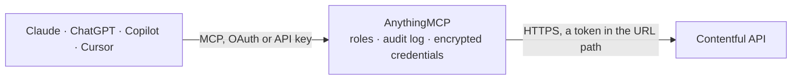

<!-- Generated by scripts/export-github-catalog.mjs in the anythingmcp-website repository. Do not edit by hand. -->

# Contentful MCP connector

Let your AI work with your Contentful content: search entries and assets, read content types, locales and tags, and create, change, publish or unpublish entries. The AnythingMCP connector gives Claude, ChatGPT, Microsoft Copilot, Cursor and Gemini 20 MCP tools for Contentful: 13 read and 7 can change data.

**Category:** [CMS](../cms.md) · **Tools:** 20 · **Setup guide:** [anythingmcp.com](https://anythingmcp.com/guides/contentful-to-mcp) · [Deutsch](https://anythingmcp.com/de/guides/contentful-to-mcp) · [Italiano](https://anythingmcp.com/it/guides/contentful-to-mcp) · [Español](https://anythingmcp.com/es/guides/contentful-to-mcp) · [日本語](https://anythingmcp.com/ja/guides/contentful-to-mcp) · [Русский](https://anythingmcp.com/ru/guides/contentful-to-mcp) · [中文](https://anythingmcp.com/zh/guides/contentful-to-mcp)

## Start without code

No installation and no terminal: AnythingMCP Cloud runs the Contentful connector for you, operated by helpcode.ai in Frankfurt, Germany.

1. **Click the button above** and create an account or sign in. The Contentful connector opens, ready to install.
2. **Paste the API key or token from your Contentful account.** Every click is in the [step-by-step guide](https://anythingmcp.com/guides/contentful-to-mcp).
3. **Click Install.** AnythingMCP shows the address of your MCP server.
4. **Add that address to your assistant:** [Claude](https://anythingmcp.com/guides/connect-contentful-to-claude) · [ChatGPT](https://anythingmcp.com/guides/connect-contentful-to-chatgpt) · [Microsoft Copilot](https://anythingmcp.com/guides/connect-contentful-to-copilot) · [Cursor](https://anythingmcp.com/guides/connect-contentful-to-cursor) · [Gemini CLI](https://anythingmcp.com/guides/connect-contentful-to-gemini) · [Meta Muse](https://anythingmcp.com/guides/connect-contentful-to-muse).
5. **Ask your first question**, for example: *Find the published invoice PDF for invoice INV-2026-03-001 in our Contentful assets*

Prefer help with the setup? [Talk to us](https://anythingmcp.com/contact).

## How it works

- **The AI client** speaks MCP (Streamable HTTP) to AnythingMCP and only sees tool names, descriptions and results. It never gets the Contentful credentials.
- **AnythingMCP** checks the client's role, builds the call from the tool definition, adds the credentials (a token in the URL path), calls Contentful, logs the call and returns the result.
- **Contentful** sees an ordinary API client with the rights of the account the credentials belong to.

## Tools

| Tool | What it does | Access |
|---|---|---|
| [`contentful_get_space`](#contentful_get_space) | Read the space the connector is set up for (Content Delivery API): its name and locales with the default locale. | read |
| [`contentful_list_content_types`](#contentful_list_content_types) | List the content types of the environment (Content Delivery API): for each its sys.id (the id entries are filtered by), name, displayField and fields with… | read |
| [`contentful_get_content_type`](#contentful_get_content_type) | Read one content type by id (Content Delivery API): its fields with id, name, type (Symbol, Text, RichText, Integer, Number, Date, Boolean, Location, Link,… | read |
| [`contentful_list_entries`](#contentful_list_entries) | Search published entries (Content Delivery API). | read |
| [`contentful_get_entry`](#contentful_get_entry) | Read one published entry by id (Content Delivery API): sys (id, contentType, createdAt, updatedAt, revision), metadata.tags and fields. | read |
| [`contentful_list_assets`](#contentful_list_assets) | Search published assets (images, documents, videos) via the Content Delivery API. | read |
| [`contentful_get_asset`](#contentful_get_asset) | Read one published asset by id (Content Delivery API): title, description and file with url (prefix https:), fileName, contentType, size and, for images,… | read |
| [`contentful_list_locales`](#contentful_list_locales) | List the locales of the environment (Content Delivery API): code (e.g. en-US, de-DE), name, default flag and fallbackCode. | read |
| [`contentful_list_tags`](#contentful_list_tags) | List the public content tags of the environment (Content Delivery API) with sys.id and name. | read |
| [`contentful_list_spaces`](#contentful_list_spaces) | List the spaces the management token can reach (Content Management API), with sys.id and name. | read |
| [`contentful_list_environments`](#contentful_list_environments) | List the environments of the space (Content Management API), e.g. master, staging, with sys.id, name, status and aliases. | read |
| [`contentful_list_all_entries`](#contentful_list_all_entries) | Search all entries including drafts and changed-but-unpublished versions (Content Management API). | read |
| [`contentful_get_entry_for_editing`](#contentful_get_entry_for_editing) | Read the latest version of an entry, draft changes included (Content Management API): fields with every locale, metadata.tags and sys.version. | read |
| [`contentful_create_entry`](#contentful_create_entry) | Create a draft entry of a content type (Content Management API). | write |
| [`contentful_update_entry`](#contentful_update_entry) | Replace the fields of an entry (Content Management API). | write |
| [`contentful_patch_entry`](#contentful_patch_entry) | Change single fields of an entry with JSON Patch operations (Content Management API), leaving the rest untouched. | write |
| [`contentful_publish_entry`](#contentful_publish_entry) | Publish an entry, making its current version visible on the website or app through the delivery API (Content Management API). | write |
| [`contentful_unpublish_entry`](#contentful_unpublish_entry) | Unpublish an entry: it disappears from the delivery API, so from the website or app, and stays as a draft (Content Management API). | write |
| [`contentful_delete_entry`](#contentful_delete_entry) | Delete an entry for good (Content Management API). | write |
| [`contentful_create_tag`](#contentful_create_tag) | Create a content tag in the environment (Content Management API). | write |

## Tool reference

Every parameter as the AI client sees it in `tools/list`. Source: [`packages/backend/src/adapters/intl/contentful.json`](../../../packages/backend/src/adapters/intl/contentful.json).

### `contentful_get_space`

Read the space the connector is set up for (Content Delivery API): its name and locales with the default locale. A quick check that the space id and delivery token work.

**Access:** read · **Call:** `GET /spaces/{{CONTENTFUL_SPACE_ID}}`

No parameters.

### `contentful_list_content_types`

List the content types of the environment (Content Delivery API): for each its sys.id (the id entries are filtered by), name, displayField and fields with id, type, localized and required. Read this before querying or writing entries to learn the field ids.

**Access:** read · **Call:** `GET /spaces/{{CONTENTFUL_SPACE_ID}}/environments/{{CONTENTFUL_ENVIRONMENT}}/content_types`

| Parameter | Type | Required | Description |
|---|---|---|---|
| `limit` | integer | no | Items per page, 1 to 1000 (default 100). |
| `skip` | integer | no | Items to skip, for the next page (skip = previous skip + limit). |

### `contentful_get_content_type`

Read one content type by id (Content Delivery API): its fields with id, name, type (Symbol, Text, RichText, Integer, Number, Date, Boolean, Location, Link, Array, Object), validations and which field is the title.

**Access:** read · **Call:** `GET /spaces/{{CONTENTFUL_SPACE_ID}}/environments/{{CONTENTFUL_ENVIRONMENT}}/content_types/{content_type_id}`

| Parameter | Type | Required | Description |
|---|---|---|---|
| `content_type_id` | string | yes | The content type id (sys.id), e.g. blogPost. |

### `contentful_list_entries`

Search published entries (Content Delivery API). Returns total, skip, limit, items[] (each with sys.id, sys.contentType and fields) and includes with the linked Entry and Asset objects. A field filter needs content_type. With the preview host and a preview token in CONTENTFUL_DELIVERY_URL and CONTENTFUL_DELIVERY_TOKEN, drafts are included too. items is empty when nothing matches.

**Access:** read · **Call:** `GET /spaces/{{CONTENTFUL_SPACE_ID}}/environments/{{CONTENTFUL_ENVIRONMENT}}/entries`

| Parameter | Type | Required | Description |
|---|---|---|---|
| `content_type` | string | no | Content type id. Required whenever filters, select or order use fields.*. |
| `query` | string | no | Full-text search over all text fields. |
| `filters` | string | no | More search parameters as a query string, e.g. fields.slug=hello-world or fields.publishDate[gte]=2026-01-01&fields.title[match]=launch or sys.id[in]=id1,id2. Operators: [ne], [in], [nin], [all], [exists], [lt], [lte], [gt], [gte], [match], [near], [within]. |
| `select` | string | no | Comma-separated properties to return, e.g. sys.id,fields.title,fields.slug (needs content_type when it names fields). |
| `order` | string | no | Sort order, e.g. -sys.createdAt or fields.title (needs content_type for fields). Default: -sys.updatedAt. |
| `include` | integer | no | Levels of linked entries and assets to resolve into includes, 0 to 10 (default 1). |
| `locale` | string | no | Locale code such as de-DE, or * for all locales (fields then hold one value per locale). Default: the space default locale. |
| `links_to_entry` | string | no | Only entries that link to this entry id. |
| `links_to_asset` | string | no | Only entries that link to this asset id. |
| `tags` | string | no | Only entries with any of these tag ids, comma-separated. |
| `limit` | integer | no | Items per page, 1 to 1000 (default 100). |
| `skip` | integer | no | Items to skip, for the next page (skip = previous skip + limit). |

### `contentful_get_entry`

Read one published entry by id (Content Delivery API): sys (id, contentType, createdAt, updatedAt, revision), metadata.tags and fields. Links to other entries and assets come back as link objects; to resolve them use contentful_list_entries with filters sys.id=<id> and include.

**Access:** read · **Call:** `GET /spaces/{{CONTENTFUL_SPACE_ID}}/environments/{{CONTENTFUL_ENVIRONMENT}}/entries/{entry_id}`

| Parameter | Type | Required | Description |
|---|---|---|---|
| `entry_id` | string | yes | The entry id (sys.id). |
| `locale` | string | no | Locale code, or * for all locales. |

### `contentful_list_assets`

Search published assets (images, documents, videos) via the Content Delivery API. Each item has sys.id and fields title, description and file (url, fileName, contentType, details with size and image dimensions). file.url starts with // : prefix it with https: to open it. items is empty when nothing matches.

**Access:** read · **Call:** `GET /spaces/{{CONTENTFUL_SPACE_ID}}/environments/{{CONTENTFUL_ENVIRONMENT}}/assets`

| Parameter | Type | Required | Description |
|---|---|---|---|
| `query` | string | no | Full-text search over title, description and file name. |
| `mimetype_group` | `attachment` \| `plaintext` \| `image` \| `audio` \| `video` \| `richtext` \| `presentation` \| `spreadsheet` \| `pdfdocument` \| `archive` \| `code` \| `markup` | no | Only assets of this kind. |
| `filters` | string | no | More search parameters as a query string, e.g. fields.file.contentType=image/png or sys.createdAt[gte]=2026-01-01. |
| `order` | string | no | Sort order, e.g. -sys.createdAt or fields.file.details.size. |
| `locale` | string | no | Locale code, or * for all locales. |
| `limit` | integer | no | Items per page, 1 to 1000 (default 100). |
| `skip` | integer | no | Items to skip, for the next page (skip = previous skip + limit). |

### `contentful_get_asset`

Read one published asset by id (Content Delivery API): title, description and file with url (prefix https:), fileName, contentType, size and, for images, width and height.

**Access:** read · **Call:** `GET /spaces/{{CONTENTFUL_SPACE_ID}}/environments/{{CONTENTFUL_ENVIRONMENT}}/assets/{asset_id}`

| Parameter | Type | Required | Description |
|---|---|---|---|
| `asset_id` | string | yes | The asset id (sys.id). |
| `locale` | string | no | Locale code, or * for all locales. |

### `contentful_list_locales`

List the locales of the environment (Content Delivery API): code (e.g. en-US, de-DE), name, default flag and fallbackCode. Field values of localized fields are keyed by these codes.

**Access:** read · **Call:** `GET /spaces/{{CONTENTFUL_SPACE_ID}}/environments/{{CONTENTFUL_ENVIRONMENT}}/locales`

| Parameter | Type | Required | Description |
|---|---|---|---|
| `limit` | integer | no | Items per page, 1 to 1000 (default 100). |
| `skip` | integer | no | Items to skip, for the next page (skip = previous skip + limit). |

### `contentful_list_tags`

List the public content tags of the environment (Content Delivery API) with sys.id and name. Private tags are not shown here; they are visible only to editors in the web app. Filter entries by tag with the tags argument of contentful_list_entries.

**Access:** read · **Call:** `GET /spaces/{{CONTENTFUL_SPACE_ID}}/environments/{{CONTENTFUL_ENVIRONMENT}}/tags`

| Parameter | Type | Required | Description |
|---|---|---|---|
| `limit` | integer | no | Items per page, 1 to 1000 (default 100). |
| `skip` | integer | no | Items to skip, for the next page (skip = previous skip + limit). |

### `contentful_list_spaces`

List the spaces the management token can reach (Content Management API), with sys.id and name. Use it to find CONTENTFUL_SPACE_ID. Needs CONTENTFUL_MANAGEMENT_URL and CONTENTFUL_MANAGEMENT_TOKEN.

**Access:** read · **Call:** `GET {{CONTENTFUL_MANAGEMENT_URL}}/spaces`

| Parameter | Type | Required | Description |
|---|---|---|---|
| `limit` | integer | no | Items per page, 1 to 1000 (default 100). |
| `skip` | integer | no | Items to skip, for the next page (skip = previous skip + limit). |

### `contentful_list_environments`

List the environments of the space (Content Management API), e.g. master, staging, with sys.id, name, status and aliases. Use it to pick CONTENTFUL_ENVIRONMENT. Needs CONTENTFUL_MANAGEMENT_URL and CONTENTFUL_MANAGEMENT_TOKEN.

**Access:** read · **Call:** `GET {{CONTENTFUL_MANAGEMENT_URL}}/spaces/{{CONTENTFUL_SPACE_ID}}/environments`

| Parameter | Type | Required | Description |
|---|---|---|---|
| `limit` | integer | no | Items per page, 1 to 1000 (default 100). |
| `skip` | integer | no | Items to skip, for the next page (skip = previous skip + limit). |

### `contentful_list_all_entries`

Search all entries including drafts and changed-but-unpublished versions (Content Management API). Each item carries sys.version (needed by the write tools), sys.publishedVersion and sys.archivedVersion, and fields with every locale. Use contentful_list_entries for published content. Needs CONTENTFUL_MANAGEMENT_URL and CONTENTFUL_MANAGEMENT_TOKEN.

**Access:** read · **Call:** `GET {{CONTENTFUL_MANAGEMENT_URL}}/spaces/{{CONTENTFUL_SPACE_ID}}/environments/{{CONTENTFUL_ENVIRONMENT}}/entries`

| Parameter | Type | Required | Description |
|---|---|---|---|
| `content_type` | string | no | Content type id. Required whenever filters, select or order use fields.*. |
| `query` | string | no | Full-text search over all text fields. |
| `filters` | string | no | More search parameters as a query string, e.g. fields.slug=hello-world or sys.publishedAt[exists]=false (only entries never published). |
| `select` | string | no | Comma-separated properties to return, e.g. sys,fields.title. |
| `order` | string | no | Sort order, e.g. -sys.updatedAt. |
| `limit` | integer | no | Items per page, 1 to 1000 (default 100). |
| `skip` | integer | no | Items to skip, for the next page (skip = previous skip + limit). |

### `contentful_get_entry_for_editing`

Read the latest version of an entry, draft changes included (Content Management API): fields with every locale, metadata.tags and sys.version. Always read it right before contentful_update_entry, contentful_patch_entry or contentful_publish_entry and pass sys.version as version. An entry is published and current when sys.publishedVersion + 1 equals sys.version. Needs CONTENTFUL_MANAGEMENT_URL and CONTENTFUL_MANAGEMENT_TOKEN.

**Access:** read · **Call:** `GET {{CONTENTFUL_MANAGEMENT_URL}}/spaces/{{CONTENTFUL_SPACE_ID}}/environments/{{CONTENTFUL_ENVIRONMENT}}/entries/{entry_id}`

| Parameter | Type | Required | Description |
|---|---|---|---|
| `entry_id` | string | yes | The entry id (sys.id). |

### `contentful_create_entry`

Create a draft entry of a content type (Content Management API). fields maps each field id to its values per locale, e.g. {"title": {"en-US": "Hello"}, "slug": {"en-US": "hello"}}; a link is {"sys": {"type": "Link", "linkType": "Entry", "id": "<id>"}}. Returns the entry with sys.id and sys.version 1. It stays unpublished until contentful_publish_entry. Needs CONTENTFUL_MANAGEMENT_URL and CONTENTFUL_MANAGEMENT_TOKEN.

**Access:** write · **Call:** `POST {{CONTENTFUL_MANAGEMENT_URL}}/spaces/{{CONTENTFUL_SPACE_ID}}/environments/{{CONTENTFUL_ENVIRONMENT}}/entries`

| Parameter | Type | Required | Description |
|---|---|---|---|
| `content_type` | string | yes | Content type id of the new entry, e.g. blogPost. |
| `fields` | object | yes | Field values keyed by field id, then by locale code. |
| `metadata` | object | no | Optional tags, e.g. {"tags": [{"sys": {"type": "Link", "linkType": "Tag", "id": "news"}}]}. |

### `contentful_update_entry`

Replace the fields of an entry (Content Management API). Contentful does not merge: every field and locale left out of fields is deleted, so start from contentful_get_entry_for_editing and change only what the user asked. version must be the current sys.version (409 VersionMismatch otherwise). Returns the entry with a new sys.version; publish it again with contentful_publish_entry to make the change live. Prefer contentful_patch_entry for small changes. Needs CONTENTFUL_MANAGEMENT_URL and CONTENTFUL_MANAGEMENT_TOKEN.

**Access:** write · **Call:** `PUT {{CONTENTFUL_MANAGEMENT_URL}}/spaces/{{CONTENTFUL_SPACE_ID}}/environments/{{CONTENTFUL_ENVIRONMENT}}/entries/{entry_id}`

| Parameter | Type | Required | Description |
|---|---|---|---|
| `entry_id` | string | yes | The entry id (sys.id). |
| `version` | integer | yes | The current sys.version of the entry. |
| `fields` | object | yes | The complete field values keyed by field id, then by locale code. |
| `metadata` | object | no | The complete metadata, e.g. {"tags": [...]}. Pass the entry's current metadata to keep its tags. |

### `contentful_patch_entry`

Change single fields of an entry with JSON Patch operations (Content Management API), leaving the rest untouched. Example: [{"op": "replace", "path": "/fields/title/en-US", "value": "New title"}]. A field that has no value yet must be added whole: {"op": "add", "path": "/fields/summary", "value": {"en-US": "..."}}. version must be the current sys.version. Needs CONTENTFUL_MANAGEMENT_URL and CONTENTFUL_MANAGEMENT_TOKEN.

**Access:** write · **Call:** `PATCH {{CONTENTFUL_MANAGEMENT_URL}}/spaces/{{CONTENTFUL_SPACE_ID}}/environments/{{CONTENTFUL_ENVIRONMENT}}/entries/{entry_id}`

| Parameter | Type | Required | Description |
|---|---|---|---|
| `entry_id` | string | yes | The entry id (sys.id). |
| `version` | integer | yes | The current sys.version of the entry. |
| `operations` | object[] | yes | JSON Patch operations, each with op (add, replace, remove), path and value. |

### `contentful_publish_entry`

Publish an entry, making its current version visible on the website or app through the delivery API (Content Management API). version must be the current sys.version. Fails with 422 when required fields are missing or validations fail; the answer names them. Confirm with the user before publishing. Needs CONTENTFUL_MANAGEMENT_URL and CONTENTFUL_MANAGEMENT_TOKEN.

**Access:** write · **Call:** `PUT {{CONTENTFUL_MANAGEMENT_URL}}/spaces/{{CONTENTFUL_SPACE_ID}}/environments/{{CONTENTFUL_ENVIRONMENT}}/entries/{entry_id}/published`

| Parameter | Type | Required | Description |
|---|---|---|---|
| `entry_id` | string | yes | The entry id (sys.id). |
| `version` | integer | yes | The current sys.version of the entry. |

### `contentful_unpublish_entry`

Unpublish an entry: it disappears from the delivery API, so from the website or app, and stays as a draft (Content Management API). Confirm with the user first. Needs CONTENTFUL_MANAGEMENT_URL and CONTENTFUL_MANAGEMENT_TOKEN.

**Access:** write · **Call:** `DELETE {{CONTENTFUL_MANAGEMENT_URL}}/spaces/{{CONTENTFUL_SPACE_ID}}/environments/{{CONTENTFUL_ENVIRONMENT}}/entries/{entry_id}/published`

| Parameter | Type | Required | Description |
|---|---|---|---|
| `entry_id` | string | yes | The entry id (sys.id). |

### `contentful_delete_entry`

Delete an entry for good (Content Management API). Unpublish it first. Cannot be undone. Installed switched off; confirm with the user first. Needs CONTENTFUL_MANAGEMENT_URL and CONTENTFUL_MANAGEMENT_TOKEN.

**Access:** write · **Call:** `DELETE {{CONTENTFUL_MANAGEMENT_URL}}/spaces/{{CONTENTFUL_SPACE_ID}}/environments/{{CONTENTFUL_ENVIRONMENT}}/entries/{entry_id}`

| Parameter | Type | Required | Description |
|---|---|---|---|
| `entry_id` | string | yes | The entry id (sys.id). |

### `contentful_create_tag`

Create a content tag in the environment (Content Management API). Public tags are visible through the delivery API, private ones only to editors; visibility cannot be changed later. Attach it to an entry through metadata.tags in contentful_update_entry or contentful_create_entry. Needs CONTENTFUL_MANAGEMENT_URL and CONTENTFUL_MANAGEMENT_TOKEN.

**Access:** write · **Call:** `PUT {{CONTENTFUL_MANAGEMENT_URL}}/spaces/{{CONTENTFUL_SPACE_ID}}/environments/{{CONTENTFUL_ENVIRONMENT}}/tags/{tag_id}`

| Parameter | Type | Required | Description |
|---|---|---|---|
| `tag_id` | string | yes | Id of the new tag: letters, digits, -, _ and . only, e.g. summerCampaign. |
| `name` | string | yes | Display name, e.g. Summer campaign. |
| `visibility` | `public` \| `private` | no | public or private (default private). |

## Run it yourself

AnythingMCP is open source (AGPL-3.0). [Run it with Docker](../../../README.md#run-it-yourself), open **Connectors → Store**, pick **Contentful** and enter `CONTENTFUL_SPACE_ID`, `CONTENTFUL_ENVIRONMENT`, `CONTENTFUL_DELIVERY_URL`, `CONTENTFUL_DELIVERY_TOKEN`, then add your MCP server URL to the AI client.

[← CMS connectors](../cms.md) · [All categories](../README.md)
