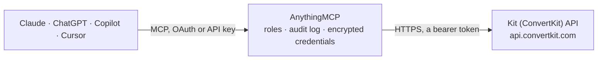

<!-- Generated by scripts/export-github-catalog.mjs in the anythingmcp-website repository. Do not edit by hand. -->

# Kit (ConvertKit) MCP connector

Drive Kit (formerly ConvertKit) — creator-focused email marketing — from any AI agent: subscribers, tags, forms, sequences, broadcasts, custom fields. 14 tools, v4 API with API-key Bearer auth. The AnythingMCP connector gives Claude, ChatGPT, Microsoft Copilot, Cursor and Gemini 14 MCP tools for Kit (ConvertKit): 7 read and 7 can change data.

**Category:** [Email](../email.md) · **Tools:** 14 · **Setup guide:** [anythingmcp.com](https://anythingmcp.com/guides/convertkit-to-mcp) · [Deutsch](https://anythingmcp.com/de/guides/convertkit-to-mcp) · [Italiano](https://anythingmcp.com/it/guides/convertkit-to-mcp) · [Español](https://anythingmcp.com/es/guides/convertkit-to-mcp) · [日本語](https://anythingmcp.com/ja/guides/convertkit-to-mcp) · [Русский](https://anythingmcp.com/ru/guides/convertkit-to-mcp) · [中文](https://anythingmcp.com/zh/guides/convertkit-to-mcp)

## Start without code

No installation and no terminal: AnythingMCP Cloud runs the Kit (ConvertKit) connector for you, operated by helpcode.ai in Frankfurt, Germany.

1. **Click the button above** and create an account or sign in. The Kit (ConvertKit) connector opens, ready to install.
2. **Paste the API key or token from your Kit (ConvertKit) account.** Every click is in the [step-by-step guide](https://anythingmcp.com/guides/convertkit-to-mcp).
3. **Click Install.** AnythingMCP shows the address of your MCP server.
4. **Add that address to your assistant:** [Claude](https://anythingmcp.com/guides/connect-convertkit-to-claude) · [ChatGPT](https://anythingmcp.com/guides/connect-convertkit-to-chatgpt) · [Microsoft Copilot](https://anythingmcp.com/guides/connect-convertkit-to-copilot) · [Cursor](https://anythingmcp.com/guides/connect-convertkit-to-cursor) · [Gemini CLI](https://anythingmcp.com/guides/connect-convertkit-to-gemini) · [Meta Muse](https://anythingmcp.com/guides/connect-convertkit-to-muse).
5. **Ask your first question**, for example: *What's the full subscriber record for emma@lumenmedia.studio?*

Prefer help with the setup? [Talk to us](https://anythingmcp.com/contact).

## How it works

- **The AI client** speaks MCP (Streamable HTTP) to AnythingMCP and only sees tool names, descriptions and results. It never gets the Kit (ConvertKit) credentials.
- **AnythingMCP** checks the client's role, builds the call from the tool definition, adds the credentials (a bearer token), calls Kit (ConvertKit), logs the call and returns the result.
- **Kit (ConvertKit)** sees an ordinary API client with the rights of the account the credentials belong to.

## Tools

| Tool | What it does | Access |
|---|---|---|
| [`convertkit_get_account`](#convertkit_get_account) | Return account info (name, plan, primary_email_address, created_at). | read |
| [`convertkit_list_subscribers`](#convertkit_list_subscribers) | List subscribers with filters. | read |
| [`convertkit_get_subscriber`](#convertkit_get_subscriber) | Fetch a subscriber by ID with full fields object and tags[]. | read |
| [`convertkit_create_subscriber`](#convertkit_create_subscriber) | Create a subscriber. | write |
| [`convertkit_update_subscriber`](#convertkit_update_subscriber) | Update a subscriber's email, first_name, or custom fields. | write |
| [`convertkit_unsubscribe`](#convertkit_unsubscribe) | Mark a subscriber as inactive (Kit's unsubscribe). | write |
| [`convertkit_list_tags`](#convertkit_list_tags) | List all tags. | read |
| [`convertkit_create_tag`](#convertkit_create_tag) | Create a tag. | write |
| [`convertkit_tag_subscriber`](#convertkit_tag_subscriber) | Apply a tag to a subscriber. | write |
| [`convertkit_remove_tag_from_subscriber`](#convertkit_remove_tag_from_subscriber) | Remove a tag from a subscriber. | write |
| [`convertkit_list_forms`](#convertkit_list_forms) | List signup forms / landing pages. | read |
| [`convertkit_list_sequences`](#convertkit_list_sequences) | List sequences (drip email courses). | read |
| [`convertkit_add_subscriber_to_sequence`](#convertkit_add_subscriber_to_sequence) | Enroll a subscriber in a sequence. | write |
| [`convertkit_list_broadcasts`](#convertkit_list_broadcasts) | List broadcasts (one-off email sends). | read |

## Tool reference

Every parameter as the AI client sees it in `tools/list`. Source: [`packages/backend/src/adapters/intl/convertkit.json`](../../../packages/backend/src/adapters/intl/convertkit.json).

### `convertkit_get_account`

Return account info (name, plan, primary_email_address, created_at). Health check + plan visibility.

**Access:** read · **Call:** `GET /account`

No parameters.

### `convertkit_list_subscribers`

List subscribers with filters. Each has id, first_name, email_address, state, created_at, fields, tags.

**Access:** read · **Call:** `GET /subscribers`

| Parameter | Type | Required | Description |
|---|---|---|---|
| `email_address` | string | no | Exact-match email filter. |
| `tagged_after` | string | no | ISO 8601 — subscribers tagged after this. |
| `tagged_before` | string | no | ISO 8601. |
| `created_after` | string | no | ISO 8601 created lower bound. |
| `created_before` | string | no | ISO 8601. |
| `updated_after` | string | no | ISO 8601 updated lower bound. |
| `updated_before` | string | no | ISO 8601. |
| `sort_field` | string | no | created_at, updated_at, cancelled_at. |
| `sort_order` | string | no | asc or desc. |
| `include_total_count` | boolean | no | If true, response includes total_count (expensive). |
| `per_page` | integer | no | Max per page (default 500, max 5000). |
| `after` | string | no | Cursor — return subscribers after this. |
| `before` | string | no | Cursor. |

### `convertkit_get_subscriber`

Fetch a subscriber by ID with full fields object and tags[].

**Access:** read · **Call:** `GET /subscribers/{subscriberId}`

| Parameter | Type | Required | Description |
|---|---|---|---|
| `subscriberId` | integer | yes | Subscriber numeric ID. |

### `convertkit_create_subscriber`

Create a subscriber. Required: email_address. The subscriber starts in `active` state by default. To onboard with consent for a specific form/sequence, use the form-specific subscribe endpoints (out of scope here) — this endpoint is for direct programmatic add.

**Access:** write · **Call:** `POST /subscribers`

| Parameter | Type | Required | Description |
|---|---|---|---|
| `email_address` | string | yes | Subscriber email (lowercase recommended). |
| `first_name` | string | no | First name (optional). |
| `state` | string | no | active or inactive. Default active. |
| `fields` | object | no | Custom fields object: {LAST_NAME:'Doe', COMPANY:'ACME'} — keys must match fields defined in the UI. |

### `convertkit_update_subscriber`

Update a subscriber's email, first_name, or custom fields. To change state (active/inactive), use convertkit_unsubscribe or the subscriber-specific state endpoints.

**Access:** write · **Call:** `PUT /subscribers/{subscriberId}`

| Parameter | Type | Required | Description |
|---|---|---|---|
| `subscriberId` | integer | yes | Subscriber ID. |
| `email_address` | string | no | New email. |
| `first_name` | string | no | New first name. |
| `fields` | object | no | Custom fields to update. |

### `convertkit_unsubscribe`

Mark a subscriber as inactive (Kit's unsubscribe). They stop receiving emails and count against your subscriber quota until manually deleted.

**Access:** write · **Call:** `POST /subscribers/{subscriberId}/unsubscribe`

| Parameter | Type | Required | Description |
|---|---|---|---|
| `subscriberId` | integer | yes | Subscriber ID. |

### `convertkit_list_tags`

List all tags. Each has id, name, created_at.

**Access:** read · **Call:** `GET /tags`

| Parameter | Type | Required | Description |
|---|---|---|---|
| `per_page` | integer | no | Per page. |
| `after` | string | no | Cursor. |
| `before` | string | no | Cursor. |

### `convertkit_create_tag`

Create a tag. Tag names are unique within the account.

**Access:** write · **Call:** `POST /tags`

| Parameter | Type | Required | Description |
|---|---|---|---|
| `name` | string | yes | Tag name. |

### `convertkit_tag_subscriber`

Apply a tag to a subscriber. The subscriber must be `active`.

**Access:** write · **Call:** `POST /tags/{tagId}/subscribers`

| Parameter | Type | Required | Description |
|---|---|---|---|
| `tagId` | integer | yes | Tag ID. |
| `subscriber_id` | integer | yes | Subscriber ID to tag. |

### `convertkit_remove_tag_from_subscriber`

Remove a tag from a subscriber.

**Access:** write · **Call:** `DELETE /tags/{tagId}/subscribers/{subscriberId}`

| Parameter | Type | Required | Description |
|---|---|---|---|
| `tagId` | integer | yes | Tag ID. |
| `subscriberId` | integer | yes | Subscriber ID. |

### `convertkit_list_forms`

List signup forms / landing pages. Each form has id, name, type (embed/hosted/modal), format, total_subscriptions.

**Access:** read · **Call:** `GET /forms`

| Parameter | Type | Required | Description |
|---|---|---|---|
| `type` | string | no | embed, hosted, modal. |
| `per_page` | integer | no | Per page. |
| `after` | string | no | Cursor. |

### `convertkit_list_sequences`

List sequences (drip email courses). Each has id, name, hold (paused?), repeat, created_at.

**Access:** read · **Call:** `GET /sequences`

| Parameter | Type | Required | Description |
|---|---|---|---|
| `per_page` | integer | no | Per page. |
| `after` | string | no | Cursor. |

### `convertkit_add_subscriber_to_sequence`

Enroll a subscriber in a sequence. They'll start receiving its emails on schedule. The subscriber must be `active`.

**Access:** write · **Call:** `POST /sequences/{sequenceId}/subscribers`

| Parameter | Type | Required | Description |
|---|---|---|---|
| `sequenceId` | integer | yes | Sequence ID. |
| `email_address` | string | yes | Subscriber email. |

### `convertkit_list_broadcasts`

List broadcasts (one-off email sends). Each has id, subject, description, content, public, published_at, send_at, thumbnail_url.

**Access:** read · **Call:** `GET /broadcasts`

| Parameter | Type | Required | Description |
|---|---|---|---|
| `per_page` | integer | no | Per page. |
| `after` | string | no | Cursor. |

## Run it yourself

AnythingMCP is open source (AGPL-3.0). [Run it with Docker](../../../README.md#run-it-yourself), open **Connectors → Store**, pick **Kit (ConvertKit)** and enter `CONVERTKIT_API_KEY`, then add your MCP server URL to the AI client.

[← Email connectors](../email.md) · [All categories](../README.md)
