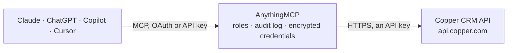

<!-- Generated by scripts/export-github-catalog.mjs in the anythingmcp-website repository. Do not edit by hand. -->

# Copper CRM MCP connector

Drive Copper (Google Workspace-native CRM) from any AI agent: people, companies, opportunities, leads, activities, tasks. 12 tools, API-token auth with email + token + appname headers. The AnythingMCP connector gives Claude, ChatGPT, Microsoft Copilot, Cursor and Gemini 12 MCP tools for Copper CRM: 6 read and 6 can change data.

**Category:** [CRM](../crm.md) · **Tools:** 12 · **Setup guide:** [anythingmcp.com](https://anythingmcp.com/guides/copper-to-mcp) · [Deutsch](https://anythingmcp.com/de/guides/copper-to-mcp) · [Italiano](https://anythingmcp.com/it/guides/copper-to-mcp) · [Español](https://anythingmcp.com/es/guides/copper-to-mcp) · [日本語](https://anythingmcp.com/ja/guides/copper-to-mcp) · [Русский](https://anythingmcp.com/ru/guides/copper-to-mcp) · [中文](https://anythingmcp.com/zh/guides/copper-to-mcp)

## Start without code

No installation and no terminal: AnythingMCP Cloud runs the Copper CRM connector for you, operated by helpcode.ai in Frankfurt, Germany.

1. **Click the button above** and create an account or sign in. The Copper CRM connector opens, ready to install.
2. **Paste the API key or token from your Copper CRM account.** Every click is in the [step-by-step guide](https://anythingmcp.com/guides/copper-to-mcp).
3. **Click Install.** AnythingMCP shows the address of your MCP server.
4. **Add that address to your assistant:** [Claude](https://anythingmcp.com/guides/connect-copper-to-claude) · [ChatGPT](https://anythingmcp.com/guides/connect-copper-to-chatgpt) · [Microsoft Copilot](https://anythingmcp.com/guides/connect-copper-to-copilot) · [Cursor](https://anythingmcp.com/guides/connect-copper-to-cursor) · [Gemini CLI](https://anythingmcp.com/guides/connect-copper-to-gemini) · [Meta Muse](https://anythingmcp.com/guides/connect-copper-to-muse).
5. **Ask your first question**, for example: *Find contact for invoice question: person with email sarah.klein@novumsolar.de*

Prefer help with the setup? [Talk to us](https://anythingmcp.com/contact).

## How it works

- **The AI client** speaks MCP (Streamable HTTP) to AnythingMCP and only sees tool names, descriptions and results. It never gets the Copper CRM credentials.
- **AnythingMCP** checks the client's role, builds the call from the tool definition, adds the credentials (an API key), calls Copper CRM, logs the call and returns the result.
- **Copper CRM** sees an ordinary API client with the rights of the account the credentials belong to.

## Tools

| Tool | What it does | Access |
|---|---|---|
| [`copper_search_people`](#copper_search_people) | Search people (contacts). | read |
| [`copper_get_person`](#copper_get_person) | Fetch a person by ID with full fields including emails, phone_numbers, address, custom_fields, websites, socials, company info, assignee. | read |
| [`copper_create_person`](#copper_create_person) | Create a new person. | write |
| [`copper_update_person`](#copper_update_person) | Update a person. | write |
| [`copper_search_companies`](#copper_search_companies) | Search companies (organizations). | read |
| [`copper_create_company`](#copper_create_company) | Create a company. | write |
| [`copper_search_opportunities`](#copper_search_opportunities) | Search opportunities (deals). | read |
| [`copper_create_opportunity`](#copper_create_opportunity) | Create an opportunity (deal). | write |
| [`copper_update_opportunity`](#copper_update_opportunity) | Update a deal — common: pipeline_stage_id (move stage), status (close as Won/Lost). | write |
| [`copper_list_pipelines`](#copper_list_pipelines) | List pipelines with their stages. | read |
| [`copper_list_custom_field_definitions`](#copper_list_custom_field_definitions) | List custom-field definitions for all object types. | read |
| [`copper_create_activity`](#copper_create_activity) | Log an activity (note/call/meeting) on a record. | write |

## Tool reference

Every parameter as the AI client sees it in `tools/list`. Source: [`packages/backend/src/adapters/intl/copper.json`](../../../packages/backend/src/adapters/intl/copper.json).

### `copper_search_people`

Search people (contacts). POST a filter body — accepts page_number/page_size/name/email_domains/contact_type_ids/tags/assignee_ids/age, etc. Returns list of person records.

**Access:** read · **Call:** `POST /people/search`

| Parameter | Type | Required | Description |
|---|---|---|---|
| `page_number` | integer | no | 1-based page. |
| `page_size` | integer | no | Per page (max 200). |
| `sort_by` | string | no | name, date_modified, date_created. |
| `sort_direction` | string | no | asc or desc. |
| `name` | string | no | Filter by name substring. |
| `emails` | any[] | no | Array of email substrings to match. |
| `assignee_ids` | any[] | no | Filter by assignee user IDs. |
| `tags` | any[] | no | Filter by tag names. |

### `copper_get_person`

Fetch a person by ID with full fields including emails, phone_numbers, address, custom_fields, websites, socials, company info, assignee.

**Access:** read · **Call:** `GET /people/{personId}`

| Parameter | Type | Required | Description |
|---|---|---|---|
| `personId` | integer | yes | Person numeric ID. |

### `copper_create_person`

Create a new person. Required: name. emails/phone_numbers are arrays of {email, category} / {number, category}.

**Access:** write · **Call:** `POST /people`

| Parameter | Type | Required | Description |
|---|---|---|---|
| `name` | string | yes | Full name. |
| `emails` | any[] | no | [{email, category:'work'\|'personal'\|'other'}]. |
| `phone_numbers` | any[] | no | [{number, category:'work'\|'mobile'\|'home'\|'other'}]. |
| `title` | string | no | Job title. |
| `company_id` | integer | no | Linked company ID. |
| `assignee_id` | integer | no | User ID of assignee. |
| `tags` | any[] | no | Array of tag name strings. |
| `custom_fields` | any[] | no | [{custom_field_definition_id, value}]. |
| `address` | object | no | {street, city, state, postal_code, country}. |

### `copper_update_person`

Update a person. Partial — only pass fields to change.

**Access:** write · **Call:** `PUT /people/{personId}`

| Parameter | Type | Required | Description |
|---|---|---|---|
| `personId` | integer | yes | Person ID. |
| `name` | string | no | New name. |
| `emails` | any[] | no | Replace emails array. |
| `phone_numbers` | any[] | no | Replace phones. |
| `title` | string | no | New title. |
| `company_id` | integer | no | Reassign company. |
| `assignee_id` | integer | no | Reassign owner. |
| `tags` | any[] | no | Replace tags. |
| `custom_fields` | any[] | no | Custom fields. |

### `copper_search_companies`

Search companies (organizations). POST filter body — name, contact_type_ids, tags, assignee_ids, etc.

**Access:** read · **Call:** `POST /companies/search`

| Parameter | Type | Required | Description |
|---|---|---|---|
| `page_number` | integer | no | 1-based page. |
| `page_size` | integer | no | Per page. |
| `name` | string | no | Name substring. |
| `tags` | any[] | no | Tag filter. |
| `assignee_ids` | any[] | no | Owner filter. |

### `copper_create_company`

Create a company. Required: name.

**Access:** write · **Call:** `POST /companies`

| Parameter | Type | Required | Description |
|---|---|---|---|
| `name` | string | yes | Company name. |
| `assignee_id` | integer | no | Owner user ID. |
| `tags` | any[] | no | Tag names. |
| `address` | object | no | {street, city, state, postal_code, country}. |
| `email_domain` | string | no | Primary domain (auto-link people by email). |
| `websites` | any[] | no | [{url, category:'work'\|'personal'\|'other'}]. |
| `phone_numbers` | any[] | no | [{number, category}]. |
| `custom_fields` | any[] | no | [{custom_field_definition_id, value}]. |
| `details` | string | no | Free-text description. |

### `copper_search_opportunities`

Search opportunities (deals). Filter by name, status (open/won/lost/abandoned), pipeline_stage_ids, assignee.

**Access:** read · **Call:** `POST /opportunities/search`

| Parameter | Type | Required | Description |
|---|---|---|---|
| `page_number` | integer | no | 1-based page. |
| `page_size` | integer | no | Per page. |
| `name` | string | no | Name substring. |
| `status_ids` | any[] | no | Status IDs: 0=open, 1=won, 2=lost, 3=abandoned. |
| `pipeline_stage_ids` | any[] | no | Stage ID filter. |
| `assignee_ids` | any[] | no | Owner filter. |

### `copper_create_opportunity`

Create an opportunity (deal). Required: name + primary_contact_id + pipeline_id + pipeline_stage_id. Monetary value in `monetary_value` (cents).

**Access:** write · **Call:** `POST /opportunities`

| Parameter | Type | Required | Description |
|---|---|---|---|
| `name` | string | yes | Deal name. |
| `primary_contact_id` | integer | yes | Person ID of the main contact. |
| `company_id` | integer | no | Linked company ID. |
| `pipeline_id` | integer | no | Pipeline ID (use copper_list_pipelines). |
| `pipeline_stage_id` | integer | no | Stage ID within the pipeline. |
| `assignee_id` | integer | no | Owner user ID. |
| `monetary_value` | number | no | Deal value (uses account's currency). |
| `status` | string | no | Open, Won, Lost, Abandoned. |
| `tags` | any[] | no | Tag names. |
| `custom_fields` | any[] | no | [{custom_field_definition_id, value}]. |
| `close_date` | string | no | Expected close date MM/DD/YYYY. |

### `copper_update_opportunity`

Update a deal — common: pipeline_stage_id (move stage), status (close as Won/Lost).

**Access:** write · **Call:** `PUT /opportunities/{opportunityId}`

| Parameter | Type | Required | Description |
|---|---|---|---|
| `opportunityId` | integer | yes | Opportunity ID. |
| `name` | string | no | New name. |
| `pipeline_stage_id` | integer | no | New stage. |
| `status` | string | no | Open / Won / Lost / Abandoned. |
| `monetary_value` | number | no | New value. |
| `assignee_id` | integer | no | Reassign owner. |

### `copper_list_pipelines`

List pipelines with their stages. Returns id, name, stages[{id, name, win_probability}]. Required to compose create-opportunity calls.

**Access:** read · **Call:** `GET /pipelines`

No parameters.

### `copper_list_custom_field_definitions`

List custom-field definitions for all object types. Returns id, name, data_type, available_on (people/companies/opportunities/leads). Required for composing custom_fields arrays.

**Access:** read · **Call:** `GET /custom_field_definitions`

No parameters.

### `copper_create_activity`

Log an activity (note/call/meeting) on a record. Activity type IDs come from /activity_types. Most common: type=0 (user) for notes.

**Access:** write · **Call:** `POST /activities`

| Parameter | Type | Required | Description |
|---|---|---|---|
| `parent` | object | yes | {type:'person'\|'company'\|'opportunity'\|'lead', id: ID}. |
| `type` | object | yes | {category:'user'\|'system', id: ACTIVITY_TYPE_ID}. Discover via /activity_types. |
| `details` | string | yes | Activity body / note. |
| `activity_date` | integer | no | Unix timestamp. |

## Run it yourself

AnythingMCP is open source (AGPL-3.0). [Run it with Docker](../../../README.md#run-it-yourself), open **Connectors → Store**, pick **Copper CRM** and enter `COPPER_API_KEY`, `COPPER_USER_EMAIL`, `COPPER_APP_NAME`, then add your MCP server URL to the AI client.

[← CRM connectors](../crm.md) · [All categories](../README.md)
