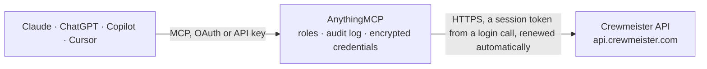

<!-- Generated by scripts/export-github-catalog.mjs in the anythingmcp-website repository. Do not edit by hand. -->

# Crewmeister MCP connector

Crewmeister, German time tracking, absence planning and shift planning for small businesses: members, teams and roles, absences and leave balances, clock stamps, durations, overtime balances, working … The AnythingMCP connector gives Claude, ChatGPT, Microsoft Copilot, Cursor and Gemini 27 MCP tools for Crewmeister: 25 read and 2 can change data.

**Category:** [Time Tracking](../time-tracking.md) · **Tools:** 27 · **Setup guide:** [anythingmcp.com](https://anythingmcp.com/guides/crewmeister-to-mcp) · [Deutsch](https://anythingmcp.com/de/guides/crewmeister-to-mcp) · [Italiano](https://anythingmcp.com/it/guides/crewmeister-to-mcp) · [Español](https://anythingmcp.com/es/guides/crewmeister-to-mcp) · [日本語](https://anythingmcp.com/ja/guides/crewmeister-to-mcp) · [Русский](https://anythingmcp.com/ru/guides/crewmeister-to-mcp) · [中文](https://anythingmcp.com/zh/guides/crewmeister-to-mcp)

## Start without code

No installation and no terminal: AnythingMCP Cloud runs the Crewmeister connector for you, operated by helpcode.ai in Frankfurt, Germany.

1. **Click the button above** and create an account or sign in. The Crewmeister connector opens, ready to install.
2. **Paste the API key or token from your Crewmeister account.** Every click is in the [step-by-step guide](https://anythingmcp.com/guides/crewmeister-to-mcp).
3. **Click Install.** AnythingMCP shows the address of your MCP server.
4. **Add that address to your assistant:** [Claude](https://anythingmcp.com/guides/connect-crewmeister-to-claude) · [ChatGPT](https://anythingmcp.com/guides/connect-crewmeister-to-chatgpt) · [Microsoft Copilot](https://anythingmcp.com/guides/connect-crewmeister-to-copilot) · [Cursor](https://anythingmcp.com/guides/connect-crewmeister-to-cursor) · [Gemini CLI](https://anythingmcp.com/guides/connect-crewmeister-to-gemini) · [Meta Muse](https://anythingmcp.com/guides/connect-crewmeister-to-muse).
5. **Ask your first question**, for example: *Remaining vacation days for Lena Braun as of 2026-11-01 (Lena Braun works front of house)?*

Prefer help with the setup? [Talk to us](https://anythingmcp.com/contact).

## How it works

- **The AI client** speaks MCP (Streamable HTTP) to AnythingMCP and only sees tool names, descriptions and results. It never gets the Crewmeister credentials.
- **AnythingMCP** checks the client's role, builds the call from the tool definition, adds the credentials (a session token from a login call, renewed automatically), calls Crewmeister, logs the call and returns the result.
- **Crewmeister** sees an ordinary API client with the rights of the account the credentials belong to.

## Tools

| Tool | What it does | Access |
|---|---|---|
| [`crewmeister_list_members`](#crewmeister_list_members) | List the members (employees) of the crew with id, userId, name, e-mail, employee id, first and last working day and disabled flag. | read |
| [`crewmeister_get_member`](#crewmeister_get_member) | Return one member by its member id with name, e-mail, userId, employee id, language, working-day range and disabled flag. | read |
| [`crewmeister_list_teams`](#crewmeister_list_teams) | List the teams of the crew with their name and the userIds that belong to each team. | read |
| [`crewmeister_list_member_roles`](#crewmeister_list_member_roles) | List role assignments: which user is MANAGER, SETTING_MANAGER or MANAGER_READ_ONLY, for which product and team. | read |
| [`crewmeister_list_crews`](#crewmeister_list_crews) | List the crews (companies) the logged-in user can access, with id, name, creation date and owner. | read |
| [`crewmeister_list_absences`](#crewmeister_list_absences) | List absences (vacation, sickness and other leave) with user, absence type id, from and to dates, day parts and state (DRAFT, REQUESTED, PRE_APPROVED,… | read |
| [`crewmeister_get_absence`](#crewmeister_get_absence) | Return one absence by id with its dates, day parts, state, state changes and the working days it covers. | read |
| [`crewmeister_list_absence_types`](#crewmeister_list_absence_types) | List the absence type settings: name, absenceTypeId, linked entitlement, whether members can request or create it, validity period and working-time… | read |
| [`crewmeister_list_absence_entitlements`](#crewmeister_list_absence_entitlements) | List the entitlement categories (leave allowances such as annual leave) of a crew with id and name. | read |
| [`crewmeister_list_entitlement_balances`](#crewmeister_list_entitlement_balances) | Return remaining leave per user and entitlement as of one date (balance in days). | read |
| [`crewmeister_list_entitlement_adjustments`](#crewmeister_list_entitlement_adjustments) | List manual adjustments to leave entitlements (carry-over, extra days, corrections) per user, entitlement and date, with the adjustment value. | read |
| [`crewmeister_list_absence_working_days`](#crewmeister_list_absence_working_days) | List the working days an absence covers, with the date and the length counted (1 for a full day, 0.5 for half a day). | read |
| [`crewmeister_list_stamps`](#crewmeister_list_stamps) | List raw clock events (START_WORK, START_BREAK, CLOCK_OUT) with timestamp, user, location, note, status and time categories. | read |
| [`crewmeister_list_durations`](#crewmeister_list_durations) | List aggregated durations per user, date and type (e.g. WORK, BREAK, OVERTIME), optionally by time category. | read |
| [`crewmeister_list_duration_balances`](#crewmeister_list_duration_balances) | Return running time account balances (e.g. overtime, can be negative) per user as of one date. | read |
| [`crewmeister_list_bookings`](#crewmeister_list_bookings) | List processed time bookings per user and date with duration, time account type, origin (STAMPS, ABSENCES, SHIFTS, CORRECTIONS, PAYOUTS ...) and time… | read |
| [`crewmeister_list_time_accounts`](#crewmeister_list_time_accounts) | List the time account types of the crew (e.g. regular working time, overtime) with their type key and description. | read |
| [`crewmeister_list_time_categories`](#crewmeister_list_time_categories) | List time categories (projects, cost centres or tasks on levels 1 to 5) that stamps and bookings are tagged with, with id, level and name. | read |
| [`crewmeister_list_working_time_models`](#crewmeister_list_working_time_models) | List the working time models: target hours per weekday and automatic break rules that apply to users or teams. | read |
| [`crewmeister_list_calendar_days`](#crewmeister_list_calendar_days) | List calendar day kinds (working day, weekend, public holiday, possibly split into morning and afternoon) for dates, as used in time and absence calculations. | read |
| [`crewmeister_list_shifts`](#crewmeister_list_shifts) | List planned shifts with user, start and end, break, workplace, notes, publication type and shift-offer details. | read |
| [`crewmeister_get_shift`](#crewmeister_get_shift) | Return one shift by id with user, times, break, workplace, notes and shift-offer settings. | read |
| [`crewmeister_list_shift_templates`](#crewmeister_list_shift_templates) | List the reusable week templates of the shift planner with id and name. | read |
| [`crewmeister_list_template_shifts`](#crewmeister_list_template_shifts) | List the shifts inside shift templates with times, offsets, break, workplace and assigned user. | read |
| [`crewmeister_list_workplaces`](#crewmeister_list_workplaces) | List the workplaces (locations or work areas) shifts are assigned to, with name, linked time category and disabled date. | read |
| [`crewmeister_create_stamp`](#crewmeister_create_stamp) | Record a clock event for a user: START_WORK to clock in, START_BREAK to start a break, CLOCK_OUT to clock out. | write |
| [`crewmeister_create_absence`](#crewmeister_create_absence) | Create an absence for a user: a request (state REQUESTED) that a manager approves, or, for managers, an approved entry. | write |

## Tool reference

Every parameter as the AI client sees it in `tools/list`. Source: [`packages/backend/src/adapters/de/crewmeister.json`](../../../packages/backend/src/adapters/de/crewmeister.json).

### `crewmeister_list_members`

List the members (employees) of the crew with id, userId, name, e-mail, employee id, first and last working day and disabled flag. The userId here is the id every other tool filters on.

**Access:** read · **Call:** `GET /platform-app/members`

| Parameter | Type | Required | Description |
|---|---|---|---|
| `filter` | string | no | RSQL filter. Operators: == != =lt= =le= =gt= =ge= =in=(a,b) =out=(a,b); join with ; for AND and , for OR. Dates are yyyy-MM-dd, timestamps ISO 8601 with offset. Fields: id, crewId, userId, name, email, username, employeeId, employeeType, disabled, firstWorkingDay, lastWorkingDay. Example: disabled==false;name==*Müller* |
| `sort` | string[] | no | Sort keys, each a field name with + (ascending) or - (descending) in front, e.g. ["+name"]. |
| `page` | integer | no | Page number, starting at 0. Default 0. |
| `page_size` | integer | no | Items per page. Default 20; ask for up to 100 at a time. |

### `crewmeister_get_member`

Return one member by its member id with name, e-mail, userId, employee id, language, working-day range and disabled flag.

**Access:** read · **Call:** `GET /platform-app/members/{id}`

| Parameter | Type | Required | Description |
|---|---|---|---|
| `id` | integer | yes | Member id (the id field from crewmeister_list_members, not the userId). |

### `crewmeister_list_teams`

List the teams of the crew with their name and the userIds that belong to each team. Use it to resolve a team name to its members.

**Access:** read · **Call:** `GET /platform-app/teams`

| Parameter | Type | Required | Description |
|---|---|---|---|
| `filter` | string | no | RSQL filter. Operators: == != =lt= =le= =gt= =ge= =in=(a,b) =out=(a,b); join with ; for AND and , for OR. Dates are yyyy-MM-dd, timestamps ISO 8601 with offset. Fields: id, name, crewId, userIds, legacyId. Example: name==Kitchen |
| `sort` | string[] | no | Sort keys, each a field name with + (ascending) or - (descending) in front, e.g. ["-id"]. |
| `page` | integer | no | Page number, starting at 0. Default 0. |
| `page_size` | integer | no | Items per page. Default 20; ask for up to 100 at a time. |

### `crewmeister_list_member_roles`

List role assignments: which user is MANAGER, SETTING_MANAGER or MANAGER_READ_ONLY, for which product and team. Use it to find who approves absences for a team.

**Access:** read · **Call:** `GET /platform-app/member-roles`

| Parameter | Type | Required | Description |
|---|---|---|---|
| `filter` | string | no | RSQL filter. Operators: == != =lt= =le= =gt= =ge= =in=(a,b) =out=(a,b); join with ; for AND and , for OR. Dates are yyyy-MM-dd, timestamps ISO 8601 with offset. Fields: id, crewId, userId, teamId, productId, roleType (MANAGER, SETTING_MANAGER, MANAGER_READ_ONLY). Example: roleType==MANAGER |
| `sort` | string[] | no | Sort keys, each a field name with + (ascending) or - (descending) in front, e.g. ["-id"]. |
| `page` | integer | no | Page number, starting at 0. Default 0. |
| `page_size` | integer | no | Items per page. Default 20; ask for up to 100 at a time. |

### `crewmeister_list_crews`

List the crews (companies) the logged-in user can access, with id, name, creation date and owner. The crew id is the crewId used in filters and when creating records.

**Access:** read · **Call:** `GET /platform-app/crews`

| Parameter | Type | Required | Description |
|---|---|---|---|
| `filter` | string | no | RSQL filter. Operators: == != =lt= =le= =gt= =ge= =in=(a,b) =out=(a,b); join with ; for AND and , for OR. Dates are yyyy-MM-dd, timestamps ISO 8601 with offset. Fields: id, name, createdAt, ownerUserId. Example: name==*GmbH* |
| `sort` | string[] | no | Sort keys, each a field name with + (ascending) or - (descending) in front, e.g. ["-id"]. |
| `page` | integer | no | Page number, starting at 0. Default 0. |
| `page_size` | integer | no | Items per page. Default 20; ask for up to 100 at a time. |

### `crewmeister_list_absences`

List absences (vacation, sickness and other leave) with user, absence type id, from and to dates, day parts and state (DRAFT, REQUESTED, PRE_APPROVED, APPROVED, REJECTED, REVOKED).

**Access:** read · **Call:** `GET /absencemanager/absences`

| Parameter | Type | Required | Description |
|---|---|---|---|
| `filter` | string | no | RSQL filter. Operators: == != =lt= =le= =gt= =ge= =in=(a,b) =out=(a,b); join with ; for AND and , for OR. Dates are yyyy-MM-dd, timestamps ISO 8601 with offset. Fields: id, crewId, userId, absenceType, from, to, fromDayPart, toDayPart, state, stateChangeUserId, stateChangeDatetime, entered, zoneId. Example: userId==123;from=le=2026-10-31;to=ge=2026-10-01;state==APPROVED |
| `sort` | string[] | no | Sort keys, each a field name with + (ascending) or - (descending) in front, e.g. ["+from"]. |
| `page` | integer | no | Page number, starting at 0. Default 0. |
| `page_size` | integer | no | Items per page. Default 20; ask for up to 100 at a time. |

### `crewmeister_get_absence`

Return one absence by id with its dates, day parts, state, state changes and the working days it covers.

**Access:** read · **Call:** `GET /absencemanager/absences/{id}`

| Parameter | Type | Required | Description |
|---|---|---|---|
| `id` | integer | yes | Absence id from crewmeister_list_absences. |

### `crewmeister_list_absence_types`

List the absence type settings: name, absenceTypeId, linked entitlement, whether members can request or create it, validity period and working-time compensation. Maps an absenceType id to a name.

**Access:** read · **Call:** `GET /absencemanager/absence-type-settings`

| Parameter | Type | Required | Description |
|---|---|---|---|
| `filter` | string | no | RSQL filter. Operators: == != =lt= =le= =gt= =ge= =in=(a,b) =out=(a,b); join with ; for AND and , for OR. Dates are yyyy-MM-dd, timestamps ISO 8601 with offset. Fields: id, crewId, userId, teamId, validFrom, validTo, name, absenceTypeId, enabled, entitlementId, memberCanRequest, memberCanCreate. Example: enabled==true |
| `sort` | string[] | no | Sort keys, each a field name with + (ascending) or - (descending) in front, e.g. ["-id"]. |
| `page` | integer | no | Page number, starting at 0. Default 0. |
| `page_size` | integer | no | Items per page. Default 20; ask for up to 100 at a time. |

### `crewmeister_list_absence_entitlements`

List the entitlement categories (leave allowances such as annual leave) of a crew with id and name. The entitlementId links absence types and balances to them.

**Access:** read · **Call:** `GET /absencemanager/absence-entitlements`

| Parameter | Type | Required | Description |
|---|---|---|---|
| `filter` | string | yes | Required: crewId==<crew id>. Crewmeister answers 400 without it. RSQL filter. Operators: == != =lt= =le= =gt= =ge= =in=(a,b) =out=(a,b); join with ; for AND and , for OR. Dates are yyyy-MM-dd, timestamps ISO 8601 with offset. Fields: id, crewId, name. Example: crewId==42 |
| `sort` | string[] | no | Sort keys, each a field name with + (ascending) or - (descending) in front, e.g. ["-id"]. |
| `page` | integer | no | Page number, starting at 0. Default 0. |
| `page_size` | integer | no | Items per page. Default 20; ask for up to 100 at a time. |

### `crewmeister_list_entitlement_balances`

Return remaining leave per user and entitlement as of one date (balance in days). The filter must name the crew and the date; add userId for one person.

**Access:** read · **Call:** `GET /absencemanager/entitlement-balances`

| Parameter | Type | Required | Description |
|---|---|---|---|
| `filter` | string | yes | Required: crewId==<crew id> and date==<yyyy-MM-dd>. Crewmeister answers 400 without it. RSQL filter. Operators: == != =lt= =le= =gt= =ge= =in=(a,b) =out=(a,b); join with ; for AND and , for OR. Dates are yyyy-MM-dd, timestamps ISO 8601 with offset. Fields: crewId, userId, entitlementId, date, balance. Example: crewId==42;userId==123;date==2026-12-31 |
| `sort` | string[] | no | Sort keys, each a field name with + (ascending) or - (descending) in front, e.g. ["-id"]. |
| `page` | integer | no | Page number, starting at 0. Default 0. |
| `page_size` | integer | no | Items per page. Default 20; ask for up to 100 at a time. |

### `crewmeister_list_entitlement_adjustments`

List manual adjustments to leave entitlements (carry-over, extra days, corrections) per user, entitlement and date, with the adjustment value.

**Access:** read · **Call:** `GET /absencemanager/entitlement-adjustments`

| Parameter | Type | Required | Description |
|---|---|---|---|
| `filter` | string | no | RSQL filter. Operators: == != =lt= =le= =gt= =ge= =in=(a,b) =out=(a,b); join with ; for AND and , for OR. Dates are yyyy-MM-dd, timestamps ISO 8601 with offset. Fields: id, crewId, userId, entitlementId, date, adjustment. Example: userId==123 |
| `sort` | string[] | no | Sort keys, each a field name with + (ascending) or - (descending) in front, e.g. ["-id"]. |
| `page` | integer | no | Page number, starting at 0. Default 0. |
| `page_size` | integer | no | Items per page. Default 20; ask for up to 100 at a time. |

### `crewmeister_list_absence_working_days`

List the working days an absence covers, with the date and the length counted (1 for a full day, 0.5 for half a day). Filter on absenceId.

**Access:** read · **Call:** `GET /absencemanager/working-days`

| Parameter | Type | Required | Description |
|---|---|---|---|
| `filter` | string | no | RSQL filter. Operators: == != =lt= =le= =gt= =ge= =in=(a,b) =out=(a,b); join with ; for AND and , for OR. Dates are yyyy-MM-dd, timestamps ISO 8601 with offset. Fields: id, absenceId, date, length. Example: absenceId==456 |
| `sort` | string[] | no | Sort keys, each a field name with + (ascending) or - (descending) in front, e.g. ["-id"]. |
| `page` | integer | no | Page number, starting at 0. Default 0. |
| `page_size` | integer | no | Items per page. Default 20; ask for up to 100 at a time. |

### `crewmeister_list_stamps`

List raw clock events (START_WORK, START_BREAK, CLOCK_OUT) with timestamp, user, location, note, status and time categories. Use it to see when someone clocked in and out.

**Access:** read · **Call:** `GET /timetracking/stamps`

| Parameter | Type | Required | Description |
|---|---|---|---|
| `filter` | string | no | RSQL filter. Operators: == != =lt= =le= =gt= =ge= =in=(a,b) =out=(a,b); join with ; for AND and , for OR. Dates are yyyy-MM-dd, timestamps ISO 8601 with offset. Fields: id, crewId, userId, timestamp, creationTimestamp, stampType, location, note, chainStartStampId, stampStatus, allocationDate, timeCategoryOneId to timeCategoryFiveId. Example: userId==123;allocationDate=ge=2026-09-01;allocationDate=le=2026-09-30 |
| `sort` | string[] | no | Sort keys, each a field name with + (ascending) or - (descending) in front, e.g. ["+timestamp"]. |
| `page` | integer | no | Page number, starting at 0. Default 0. |
| `page_size` | integer | no | Items per page. Default 20; ask for up to 100 at a time. |

### `crewmeister_list_durations`

List aggregated durations per user, date and type (e.g. WORK, BREAK, OVERTIME), optionally by time category. Use it for hours worked per day or month.

**Access:** read · **Call:** `GET /timetracking/durations`

| Parameter | Type | Required | Description |
|---|---|---|---|
| `filter` | string | yes | Required: crewId==<crew id> and a date condition (date==, or date=ge= with date=le=). Crewmeister answers 400 without it. RSQL filter. Operators: == != =lt= =le= =gt= =ge= =in=(a,b) =out=(a,b); join with ; for AND and , for OR. Dates are yyyy-MM-dd, timestamps ISO 8601 with offset. Fields: crewId, userId, date, type, timeCategoryOneId, timeCategoryTwoId. Example: crewId==42;userId==123;date=ge=2026-09-01;date=le=2026-09-30 |
| `sort` | string[] | no | Sort keys, each a field name with + (ascending) or - (descending) in front, e.g. ["+date"]. |
| `page` | integer | no | Page number, starting at 0. Default 0. |
| `page_size` | integer | no | Items per page. Default 20; ask for up to 100 at a time. |

### `crewmeister_list_duration_balances`

Return running time account balances (e.g. overtime, can be negative) per user as of one date. The filter must name the crew and the date; add userId for one person.

**Access:** read · **Call:** `GET /timetracking/duration-balances`

| Parameter | Type | Required | Description |
|---|---|---|---|
| `filter` | string | yes | Required: crewId==<crew id> and date==<yyyy-MM-dd>. Crewmeister answers 400 without it. RSQL filter. Operators: == != =lt= =le= =gt= =ge= =in=(a,b) =out=(a,b); join with ; for AND and , for OR. Dates are yyyy-MM-dd, timestamps ISO 8601 with offset. Fields: crewId, userId, date. Example: crewId==42;userId==123;date==2026-09-30 |
| `sort` | string[] | no | Sort keys, each a field name with + (ascending) or - (descending) in front, e.g. ["-id"]. |
| `page` | integer | no | Page number, starting at 0. Default 0. |
| `page_size` | integer | no | Items per page. Default 20; ask for up to 100 at a time. |

### `crewmeister_list_bookings`

List processed time bookings per user and date with duration, time account type, origin (STAMPS, ABSENCES, SHIFTS, CORRECTIONS, PAYOUTS ...) and time categories.

**Access:** read · **Call:** `GET /timetracking/bookings`

| Parameter | Type | Required | Description |
|---|---|---|---|
| `filter` | string | no | RSQL filter. Operators: == != =lt= =le= =gt= =ge= =in=(a,b) =out=(a,b); join with ; for AND and , for OR. Dates are yyyy-MM-dd, timestamps ISO 8601 with offset. Fields: id, crewId, userId, timeAccountType, allocationDate, from, type, origin, timeCategoryOneId, timeCategoryTwoId. Example: userId==123;allocationDate=ge=2026-09-01 |
| `sort` | string[] | no | Sort keys, each a field name with + (ascending) or - (descending) in front, e.g. ["+allocationDate"]. |
| `page` | integer | no | Page number, starting at 0. Default 0. |
| `page_size` | integer | no | Items per page. Default 20; ask for up to 100 at a time. |

### `crewmeister_list_time_accounts`

List the time account types of the crew (e.g. regular working time, overtime) with their type key and description. Explains the types used in bookings and balances.

**Access:** read · **Call:** `GET /timetracking/time-accounts`

| Parameter | Type | Required | Description |
|---|---|---|---|
| `filter` | string | no | RSQL filter. Operators: == != =lt= =le= =gt= =ge= =in=(a,b) =out=(a,b); join with ; for AND and , for OR. Dates are yyyy-MM-dd, timestamps ISO 8601 with offset. Fields: crewId, type, description. Example: type==OVERTIME |
| `sort` | string[] | no | Sort keys, each a field name with + (ascending) or - (descending) in front, e.g. ["-id"]. |
| `page` | integer | no | Page number, starting at 0. Default 0. |
| `page_size` | integer | no | Items per page. Default 20; ask for up to 100 at a time. |

### `crewmeister_list_time_categories`

List time categories (projects, cost centres or tasks on levels 1 to 5) that stamps and bookings are tagged with, with id, level and name.

**Access:** read · **Call:** `GET /timetracking/time-categories`

| Parameter | Type | Required | Description |
|---|---|---|---|
| `filter` | string | no | RSQL filter. Operators: == != =lt= =le= =gt= =ge= =in=(a,b) =out=(a,b); join with ; for AND and , for OR. Dates are yyyy-MM-dd, timestamps ISO 8601 with offset. Fields: id, crewId, level, name, legacyId. Example: level==1 |
| `sort` | string[] | no | Sort keys, each a field name with + (ascending) or - (descending) in front, e.g. ["-id"]. |
| `page` | integer | no | Page number, starting at 0. Default 0. |
| `page_size` | integer | no | Items per page. Default 20; ask for up to 100 at a time. |

### `crewmeister_list_working_time_models`

List the working time models: target hours per weekday and automatic break rules that apply to users or teams. Use it to explain target hours and overtime.

**Access:** read · **Call:** `GET /timetracking/working-time-models`

| Parameter | Type | Required | Description |
|---|---|---|---|
| `filter` | string | no | RSQL filter. Operators: == != =lt= =le= =gt= =ge= =in=(a,b) =out=(a,b); join with ; for AND and , for OR. Dates are yyyy-MM-dd, timestamps ISO 8601 with offset. Fields: see the API reference. Example: userId==123 |
| `sort` | string[] | no | Sort keys, each a field name with + (ascending) or - (descending) in front, e.g. ["-id"]. |
| `page` | integer | no | Page number, starting at 0. Default 0. |
| `page_size` | integer | no | Items per page. Default 20; ask for up to 100 at a time. |

### `crewmeister_list_calendar_days`

List calendar day kinds (working day, weekend, public holiday, possibly split into morning and afternoon) for dates, as used in time and absence calculations.

**Access:** read · **Call:** `GET /timetracking/day-kind-calendar-days`

| Parameter | Type | Required | Description |
|---|---|---|---|
| `filter` | string | yes | Required: crewId==<crew id> and a date range (date=ge= with date=le=). Crewmeister answers 400 without it. RSQL filter. Operators: == != =lt= =le= =gt= =ge= =in=(a,b) =out=(a,b); join with ; for AND and , for OR. Dates are yyyy-MM-dd, timestamps ISO 8601 with offset. Fields: crewId, userId, date. Example: crewId==42;date=ge=2026-12-20;date=le=2026-12-31 |
| `sort` | string[] | no | Sort keys, each a field name with + (ascending) or - (descending) in front, e.g. ["-id"]. |
| `page` | integer | no | Page number, starting at 0. Default 0. |
| `page_size` | integer | no | Items per page. Default 20; ask for up to 100 at a time. |

### `crewmeister_list_shifts`

List planned shifts with user, start and end, break, workplace, notes, publication type and shift-offer details. Filter on from/to for a week's roster.

**Access:** read · **Call:** `GET /shiftplanner/shifts`

| Parameter | Type | Required | Description |
|---|---|---|---|
| `filter` | string | no | RSQL filter. Operators: == != =lt= =le= =gt= =ge= =in=(a,b) =out=(a,b); join with ; for AND and , for OR. Dates are yyyy-MM-dd, timestamps ISO 8601 with offset. Fields: id, crewId, userId, from, to, type, publishedShiftId, workplaceId, shiftOffer. Example: from=ge=2026-10-05T00:00:00+02:00;to=le=2026-10-12T00:00:00+02:00 |
| `sort` | string[] | no | Sort keys, each a field name with + (ascending) or - (descending) in front, e.g. ["+from"]. |
| `page` | integer | no | Page number, starting at 0. Default 0. |
| `page_size` | integer | no | Items per page. Default 20; ask for up to 100 at a time. |

### `crewmeister_get_shift`

Return one shift by id with user, times, break, workplace, notes and shift-offer settings.

**Access:** read · **Call:** `GET /shiftplanner/shifts/{id}`

| Parameter | Type | Required | Description |
|---|---|---|---|
| `id` | integer | yes | Shift id from crewmeister_list_shifts. |

### `crewmeister_list_shift_templates`

List the reusable week templates of the shift planner with id and name. Use the id to read their shifts with crewmeister_list_template_shifts.

**Access:** read · **Call:** `GET /shiftplanner/templates`

| Parameter | Type | Required | Description |
|---|---|---|---|
| `filter` | string | no | RSQL filter. Operators: == != =lt= =le= =gt= =ge= =in=(a,b) =out=(a,b); join with ; for AND and , for OR. Dates are yyyy-MM-dd, timestamps ISO 8601 with offset. Fields: id, crewId, name, legacyId. Example: name==*Sommer* |
| `sort` | string[] | no | Sort keys, each a field name with + (ascending) or - (descending) in front, e.g. ["-id"]. |
| `page` | integer | no | Page number, starting at 0. Default 0. |
| `page_size` | integer | no | Items per page. Default 20; ask for up to 100 at a time. |

### `crewmeister_list_template_shifts`

List the shifts inside shift templates with times, offsets, break, workplace and assigned user. Filter on templateId.

**Access:** read · **Call:** `GET /shiftplanner/template-shifts`

| Parameter | Type | Required | Description |
|---|---|---|---|
| `filter` | string | no | RSQL filter. Operators: == != =lt= =le= =gt= =ge= =in=(a,b) =out=(a,b); join with ; for AND and , for OR. Dates are yyyy-MM-dd, timestamps ISO 8601 with offset. Fields: id, crewId, templateId, userId. Example: templateId==789 |
| `sort` | string[] | no | Sort keys, each a field name with + (ascending) or - (descending) in front, e.g. ["-id"]. |
| `page` | integer | no | Page number, starting at 0. Default 0. |
| `page_size` | integer | no | Items per page. Default 20; ask for up to 100 at a time. |

### `crewmeister_list_workplaces`

List the workplaces (locations or work areas) shifts are assigned to, with name, linked time category and disabled date.

**Access:** read · **Call:** `GET /shiftplanner/workplaces`

| Parameter | Type | Required | Description |
|---|---|---|---|
| `filter` | string | no | RSQL filter. Operators: == != =lt= =le= =gt= =ge= =in=(a,b) =out=(a,b); join with ; for AND and , for OR. Dates are yyyy-MM-dd, timestamps ISO 8601 with offset. Fields: id, crewId, name, disabledAt, timeCategoryId, legacyId. Example: disabledAt=isnull=true |
| `sort` | string[] | no | Sort keys, each a field name with + (ascending) or - (descending) in front, e.g. ["-id"]. |
| `page` | integer | no | Page number, starting at 0. Default 0. |
| `page_size` | integer | no | Items per page. Default 20; ask for up to 100 at a time. |

### `crewmeister_create_stamp`

Record a clock event for a user: START_WORK to clock in, START_BREAK to start a break, CLOCK_OUT to clock out. Returns the write response with the created stamp.

**Access:** write · **Call:** `POST /timetracking/stamps`

| Parameter | Type | Required | Description |
|---|---|---|---|
| `crew_id` | integer | yes | Crew id from crewmeister_list_crews. |
| `user_id` | integer | yes | userId of the member from crewmeister_list_members. |
| `stamp_type` | `START_WORK` \| `START_BREAK` \| `CLOCK_OUT` | yes | START_WORK, START_BREAK or CLOCK_OUT. |
| `timestamp` | string | yes | When the event happened, ISO 8601 with offset, e.g. 2026-10-06T08:00:00+02:00. |
| `location` | string | no | Optional location text. |
| `note` | string | no | Optional note. |
| `time_category_one_id` | integer | no | Optional level-1 time category id from crewmeister_list_time_categories. |

### `crewmeister_create_absence`

Create an absence for a user: a request (state REQUESTED) that a manager approves, or, for managers, an approved entry. Dates and type cannot be changed afterwards.

**Access:** write · **Call:** `POST /absencemanager/absences`

| Parameter | Type | Required | Description |
|---|---|---|---|
| `crew_id` | integer | yes | Crew id from crewmeister_list_crews. |
| `user_id` | integer | yes | userId of the member. |
| `absence_type` | integer | yes | absenceTypeId from crewmeister_list_absence_types. |
| `from` | string | yes | First day, yyyy-MM-dd. |
| `to` | string | yes | Last day, yyyy-MM-dd. |
| `from_day_part` | `MORNING` \| `AFTERNOON` | yes | MORNING for a full first day, AFTERNOON to start at midday. |
| `to_day_part` | `MORNING` \| `AFTERNOON` | yes | AFTERNOON for a full last day, MORNING to end at midday. |
| `state` | `REQUESTED` \| `APPROVED` | no | REQUESTED (default) or APPROVED (managers only). |
| `zone_id` | string | no | Time zone, e.g. Europe/Berlin. |

## Run it yourself

AnythingMCP is open source (AGPL-3.0). [Run it with Docker](../../../README.md#run-it-yourself), open **Connectors → Store**, pick **Crewmeister** and enter `CREWMEISTER_EMAIL`, `CREWMEISTER_PASSWORD`, then add your MCP server URL to the AI client.

[← Time Tracking connectors](../time-tracking.md) · [All categories](../README.md)
