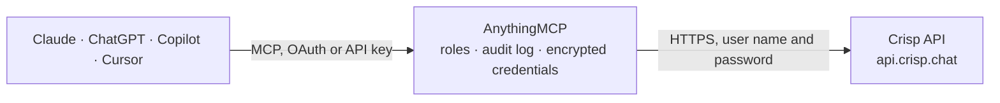

<!-- Generated by scripts/export-github-catalog.mjs in the anythingmcp-website repository. Do not edit by hand. -->

# Crisp MCP connector

Drive Crisp (live chat + helpdesk) from any AI agent: conversations, messages, people, tickets. 11 tools, plugin-token Basic auth + tier header. The AnythingMCP connector gives Claude, ChatGPT, Microsoft Copilot, Cursor and Gemini 11 MCP tools for Crisp: 7 read and 4 can change data.

**Category:** [Customer Support](../support.md) · **Tools:** 11 · **Setup guide:** [anythingmcp.com](https://anythingmcp.com/guides/crisp-to-mcp) · [Deutsch](https://anythingmcp.com/de/guides/crisp-to-mcp) · [Italiano](https://anythingmcp.com/it/guides/crisp-to-mcp) · [Español](https://anythingmcp.com/es/guides/crisp-to-mcp) · [日本語](https://anythingmcp.com/ja/guides/crisp-to-mcp) · [Русский](https://anythingmcp.com/ru/guides/crisp-to-mcp) · [中文](https://anythingmcp.com/zh/guides/crisp-to-mcp)

## Start without code

No installation and no terminal: AnythingMCP Cloud runs the Crisp connector for you, operated by helpcode.ai in Frankfurt, Germany.

1. **Click the button above** and create an account or sign in. The Crisp connector opens, ready to install.
2. **Paste the API key or token from your Crisp account.** Every click is in the [step-by-step guide](https://anythingmcp.com/guides/crisp-to-mcp).
3. **Click Install.** AnythingMCP shows the address of your MCP server.
4. **Add that address to your assistant:** [Claude](https://anythingmcp.com/guides/connect-crisp-to-claude) · [ChatGPT](https://anythingmcp.com/guides/connect-crisp-to-chatgpt) · [Microsoft Copilot](https://anythingmcp.com/guides/connect-crisp-to-copilot) · [Cursor](https://anythingmcp.com/guides/connect-crisp-to-cursor) · [Gemini CLI](https://anythingmcp.com/guides/connect-crisp-to-gemini) · [Meta Muse](https://anythingmcp.com/guides/connect-crisp-to-muse).
5. **Ask your first question**, for example: *Show latest conversation session for alice@brightline.de, unresolved ones first*

Prefer help with the setup? [Talk to us](https://anythingmcp.com/contact).

## How it works

- **The AI client** speaks MCP (Streamable HTTP) to AnythingMCP and only sees tool names, descriptions and results. It never gets the Crisp credentials.
- **AnythingMCP** checks the client's role, builds the call from the tool definition, adds the credentials (user name and password), calls Crisp, logs the call and returns the result.
- **Crisp** sees an ordinary API client with the rights of the account the credentials belong to.

## Tools

| Tool | What it does | Access |
|---|---|---|
| [`crisp_get_website`](#crisp_get_website) | Get website info (name, domain, logo). | read |
| [`crisp_list_conversations`](#crisp_list_conversations) | List conversations with filters. | read |
| [`crisp_get_conversation`](#crisp_get_conversation) | Fetch a conversation by session_id with metadata + state. | read |
| [`crisp_list_messages`](#crisp_list_messages) | List messages in a conversation. | read |
| [`crisp_send_message`](#crisp_send_message) | Send a message in a conversation as the operator. | write |
| [`crisp_update_conversation_state`](#crisp_update_conversation_state) | Change conversation state: pending, unresolved, resolved. | write |
| [`crisp_assign_conversation_routing`](#crisp_assign_conversation_routing) | Assign a conversation to an operator. | write |
| [`crisp_list_people_profiles`](#crisp_list_people_profiles) | List people (contact profiles) across the website. | read |
| [`crisp_get_people_profile`](#crisp_get_people_profile) | Fetch a people profile by people_id (UUID) or email/phone (URL-encoded). | read |
| [`crisp_update_people_profile`](#crisp_update_people_profile) | Update a people profile (segments, attributes, notes). | write |
| [`crisp_list_operators`](#crisp_list_operators) | List operators (agents) on the website. | read |

## Tool reference

Every parameter as the AI client sees it in `tools/list`. Source: [`packages/backend/src/adapters/intl/crisp.json`](../../../packages/backend/src/adapters/intl/crisp.json).

### `crisp_get_website`

Get website info (name, domain, logo).

**Access:** read · **Call:** `GET /`

No parameters.

### `crisp_list_conversations`

List conversations with filters. Cursor-paginated (page).

**Access:** read · **Call:** `GET /conversations/{page}`

| Parameter | Type | Required | Description |
|---|---|---|---|
| `page` | integer | no | Page (1-based). |
| `search_query` | string | no | Free-text search. |
| `search_type` | string | no | Match type: 'text' (default), 'segment', 'meta-id'. |
| `search_operator` | string | no | and or or. |
| `filter_unread` | integer | no | 1 = only unread. |
| `filter_resolved` | integer | no | 1 = only resolved. |
| `filter_not_resolved` | integer | no | 1 = only not resolved. |
| `filter_mentions` | integer | no | 1 = only with mentions. |
| `filter_assigned` | integer | no | 1 = only assigned. |
| `filter_unassigned` | integer | no | 1 = only unassigned. |
| `filter_date_start` | string | no | ISO 8601 — filter by created_at >=. |
| `filter_date_end` | string | no | ISO 8601. |

### `crisp_get_conversation`

Fetch a conversation by session_id with metadata + state.

**Access:** read · **Call:** `GET /conversation/{session_id}`

| Parameter | Type | Required | Description |
|---|---|---|---|
| `session_id` | string | yes | Conversation session ID. |

### `crisp_list_messages`

List messages in a conversation.

**Access:** read · **Call:** `GET /conversation/{session_id}/messages`

| Parameter | Type | Required | Description |
|---|---|---|---|
| `session_id` | string | yes | Session ID. |
| `timestamp_before` | integer | no | Unix ms — messages before this. |

### `crisp_send_message`

Send a message in a conversation as the operator. type='text' for plain text; 'note' for internal-only notes.

**Access:** write · **Call:** `POST /conversation/{session_id}/message`

| Parameter | Type | Required | Description |
|---|---|---|---|
| `session_id` | string | yes | Session ID. |
| `type` | string | yes | text, file, animation, audio, picker, field, carousel, note, event. |
| `from` | string | yes | user or operator. operator = the agent. |
| `origin` | string | yes | chat (default), email, etc. |
| `content` | any | yes | For type=text: the string body. For other types: typed content object. |
| `user` | object | no | {nickname?, avatar?, type?:'website'} — display info. |
| `mentions` | any[] | no | Operator user_ids to mention. |
| `stealth` | boolean | no | If true, hidden from the user (internal only). |

### `crisp_update_conversation_state`

Change conversation state: pending, unresolved, resolved.

**Access:** write · **Call:** `PATCH /conversation/{session_id}/state`

| Parameter | Type | Required | Description |
|---|---|---|---|
| `session_id` | string | yes | Session ID. |
| `state` | string | yes | pending, unresolved, resolved. |

### `crisp_assign_conversation_routing`

Assign a conversation to an operator. operator_id is the user_id of the agent (use crisp_list_operators to discover).

**Access:** write · **Call:** `PATCH /conversation/{session_id}/routing`

| Parameter | Type | Required | Description |
|---|---|---|---|
| `session_id` | string | yes | Session ID. |
| `assigned` | object | yes | {user_id: 'operator-uuid'} or {team_id: 'team-uuid'}. |

### `crisp_list_people_profiles`

List people (contact profiles) across the website.

**Access:** read · **Call:** `GET /people/profiles/{page}`

| Parameter | Type | Required | Description |
|---|---|---|---|
| `page` | integer | no | Page. |
| `search_text` | string | no | Free-text search. |
| `filter_segments` | string | no | Comma-separated segments. |
| `sort_field` | string | no | created_at, updated_at, last_active. |
| `sort_order` | integer | no | 1 (asc) or -1 (desc). |

### `crisp_get_people_profile`

Fetch a people profile by people_id (UUID) or email/phone (URL-encoded).

**Access:** read · **Call:** `GET /people/profile/{people_id}`

| Parameter | Type | Required | Description |
|---|---|---|---|
| `people_id` | string | yes | People ID (UUID) or URL-encoded email/phone. |

### `crisp_update_people_profile`

Update a people profile (segments, attributes, notes).

**Access:** write · **Call:** `PATCH /people/profile/{people_id}`

| Parameter | Type | Required | Description |
|---|---|---|---|
| `people_id` | string | yes | People ID. |
| `email` | string | no | Email. |
| `person` | object | no | {nickname?, avatar?, gender?, locales?:[], phone?, address?, description?, employment?:{name,title,role?}}. |
| `segments` | any[] | no | Replace segments. |
| `notepad` | string | no | Internal notes. |

### `crisp_list_operators`

List operators (agents) on the website. Returns user_id (use as operator_id), email, full_name, avatar, role.

**Access:** read · **Call:** `GET /operators/list`

No parameters.

## Run it yourself

AnythingMCP is open source (AGPL-3.0). [Run it with Docker](../../../README.md#run-it-yourself), open **Connectors → Store**, pick **Crisp** and enter `CRISP_PLUGIN_IDENTIFIER`, `CRISP_PLUGIN_KEY`, `CRISP_WEBSITE_ID`, then add your MCP server URL to the AI client.

[← Customer Support connectors](../support.md) · [All categories](../README.md)
