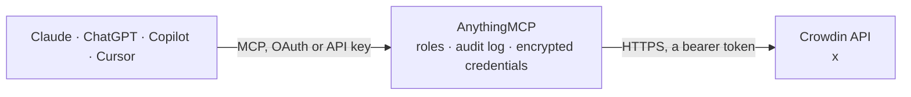

<!-- Generated by scripts/export-github-catalog.mjs in the anythingmcp-website repository. Do not edit by hand. -->

# Crowdin MCP connector

Crowdin localization on crowdin.com and Crowdin Enterprise: projects and progress, files, source strings, translations and approvals, comments, tasks, reports, translation builds and exports, … The AnythingMCP connector gives Claude, ChatGPT, Microsoft Copilot, Cursor and Gemini 44 MCP tools for Crowdin: 35 read and 9 can change data.

**Category:** [Productivity](../productivity.md) · **Tools:** 44 · **Setup guide:** [anythingmcp.com](https://anythingmcp.com/guides/crowdin-to-mcp) · [Deutsch](https://anythingmcp.com/de/guides/crowdin-to-mcp) · [Italiano](https://anythingmcp.com/it/guides/crowdin-to-mcp) · [Español](https://anythingmcp.com/es/guides/crowdin-to-mcp) · [日本語](https://anythingmcp.com/ja/guides/crowdin-to-mcp) · [Русский](https://anythingmcp.com/ru/guides/crowdin-to-mcp) · [中文](https://anythingmcp.com/zh/guides/crowdin-to-mcp)

## Start without code

No installation and no terminal: AnythingMCP Cloud runs the Crowdin connector for you, operated by helpcode.ai in Frankfurt, Germany.

1. **Click the button above** and create an account or sign in. The Crowdin connector opens, ready to install.
2. **Paste the API key or token from your Crowdin account.** Every click is in the [step-by-step guide](https://anythingmcp.com/guides/crowdin-to-mcp).
3. **Click Install.** AnythingMCP shows the address of your MCP server.
4. **Add that address to your assistant:** [Claude](https://anythingmcp.com/guides/connect-crowdin-to-claude) · [ChatGPT](https://anythingmcp.com/guides/connect-crowdin-to-chatgpt) · [Microsoft Copilot](https://anythingmcp.com/guides/connect-crowdin-to-copilot) · [Cursor](https://anythingmcp.com/guides/connect-crowdin-to-cursor) · [Gemini CLI](https://anythingmcp.com/guides/connect-crowdin-to-gemini) · [Meta Muse](https://anythingmcp.com/guides/connect-crowdin-to-muse).
5. **Ask your first question**, for example: *Show translation and approval progress for project Aurora Mobile App (project 101) in fr and de for this month.*

Prefer help with the setup? [Talk to us](https://anythingmcp.com/contact).

## How it works

- **The AI client** speaks MCP (Streamable HTTP) to AnythingMCP and only sees tool names, descriptions and results. It never gets the Crowdin credentials.
- **AnythingMCP** checks the client's role, builds the call from the tool definition, adds the credentials (a bearer token), calls Crowdin, logs the call and returns the result.
- **Crowdin** sees an ordinary API client with the rights of the account the credentials belong to.

## Tools

| Tool | What it does | Access |
|---|---|---|
| [`crowdin_get_authenticated_user`](#crowdin_get_authenticated_user) | The user the token belongs to: id, username, email, name and time zone. | read |
| [`crowdin_list_projects`](#crowdin_list_projects) | Projects the token can reach, with id, name, identifier, source language, target language ids, type (file-based or string-based) and last activity. | read |
| [`crowdin_get_project`](#crowdin_get_project) | One project with its settings: source language, target languages, workflow, QA checks, machine translation and translation memory settings. | read |
| [`crowdin_get_project_progress`](#crowdin_get_project_progress) | Translation and approval progress per target language: words and phrases total, translated, approved, and the percentages. | read |
| [`crowdin_get_file_progress`](#crowdin_get_file_progress) | Translation and approval progress of one file per target language. | read |
| [`crowdin_list_supported_languages`](#crowdin_list_supported_languages) | Every language Crowdin supports with its id (used everywhere else), name, locale, ISO codes and plural categories. | read |
| [`crowdin_list_branches`](#crowdin_list_branches) | Branches of a project (file-based projects) with id, name, title and export pattern. | read |
| [`crowdin_list_directories`](#crowdin_list_directories) | Directories of a project with id, name, path, branch and parent directory. | read |
| [`crowdin_list_files`](#crowdin_list_files) | Source files of a project with id, name, path, type, status, branch, directory and revision. | read |
| [`crowdin_get_file`](#crowdin_get_file) | One source file with its path, type, parser settings, export options, revision and timestamps. | read |
| [`crowdin_download_file`](#crowdin_download_file) | A short-lived download link (data.url, data.expireIn) for the source version of a file. | read |
| [`crowdin_list_strings`](#crowdin_list_strings) | Source strings of a project with id, identifier (key), text, context, file, max length, labels, plural forms and hidden flag. | read |
| [`crowdin_get_string`](#crowdin_get_string) | One source string with identifier, text, context, plural forms, labels, max length and file. | read |
| [`crowdin_add_string`](#crowdin_add_string) | Add a source string to a file (file-based projects) with its text, key and context for translators. | write |
| [`crowdin_edit_string`](#crowdin_edit_string) | Change a source string with JSON Patch operations on /text, /identifier, /context, /isHidden, /maxLength or /labelIds. | write |
| [`crowdin_list_translations`](#crowdin_list_translations) | All translations (suggestions) of strings into one language, with text, author, rating, plural category and time. | read |
| [`crowdin_get_translation`](#crowdin_get_translation) | One translation with its text, string, language, author, rating and provider. | read |
| [`crowdin_add_translation`](#crowdin_add_translation) | Add a translation (suggestion) for a string in one language. | write |
| [`crowdin_list_approvals`](#crowdin_list_approvals) | Approvals of translations, filtered by string, file, language, label or translation, with the approver and time. | read |
| [`crowdin_approve_translation`](#crowdin_approve_translation) | Approve a translation, making it the one that goes into the exported files. | write |
| [`crowdin_list_comments`](#crowdin_list_comments) | Comments and issues on strings: text, type (comment or issue), issue type and status, language, author and time. | read |
| [`crowdin_add_comment`](#crowdin_add_comment) | Comment on a string, or report an issue (a question, a translation or source mistake, a request for context). | write |
| [`crowdin_list_tasks`](#crowdin_list_tasks) | Tasks of a project with title, type (translate or proofread), status, language, assignees, progress, deadline and words count. | read |
| [`crowdin_get_task`](#crowdin_get_task) | One task with its files or strings, language, assignees, progress, deadline, cost estimate and status. | read |
| [`crowdin_create_task`](#crowdin_create_task) | Create a translate or proofread task for files (or, in string-based projects, strings) in one language, assigned to people, with a deadline. | write |
| [`crowdin_edit_task`](#crowdin_edit_task) | Change a task with JSON Patch operations, e.g. its status (todo, in_progress, done, closed), title, description, deadline or assignees. | write |
| [`crowdin_generate_report`](#crowdin_generate_report) | Start a project report: costs estimate, translation costs, top members, contribution raw data, translator accuracy, QA issues, translation activity and more. | read |
| [`crowdin_get_report_status`](#crowdin_get_report_status) | Progress of a report being generated: status (created, inProgress, finished, failed) and progress percent. | read |
| [`crowdin_download_report`](#crowdin_download_report) | A short-lived download link (data.url) for a finished report. | read |
| [`crowdin_build_project_translations`](#crowdin_build_project_translations) | Start a build of the translated files of a project (all or some languages, optionally a branch) as a zip. | read |
| [`crowdin_get_build_status`](#crowdin_get_build_status) | Status and progress of a translations build (created, inProgress, finished, failed, canceled). | read |
| [`crowdin_download_build`](#crowdin_download_build) | A short-lived download link (data.url) for the zip of a finished build. | read |
| [`crowdin_export_project_translation`](#crowdin_export_project_translation) | Export the translations of one language right away, as one file in a chosen format (e.g. xliff, json, android, macosx), for all or some files. | read |
| [`crowdin_list_tms`](#crowdin_list_tms) | Translation memories with id, name, languages, segments count and the projects using them. | read |
| [`crowdin_get_tm`](#crowdin_get_tm) | One translation memory with its languages, segments count and default project. | read |
| [`crowdin_list_tm_segments`](#crowdin_list_tm_segments) | Segments of a translation memory, each with its records (language id and text). | read |
| [`crowdin_search_tm`](#crowdin_search_tm) | Concordance search: find how phrases were translated before in the translation memories of a project. | read |
| [`crowdin_add_tm_segment`](#crowdin_add_tm_segment) | Add a segment to a translation memory: the same sentence in several languages. | write |
| [`crowdin_list_glossaries`](#crowdin_list_glossaries) | Glossaries with id, name, languages, terms count and the projects using them. | read |
| [`crowdin_get_glossary`](#crowdin_get_glossary) | One glossary with its languages, terms count and default project. | read |
| [`crowdin_list_glossary_terms`](#crowdin_list_glossary_terms) | Terms of a glossary with text, language, description, part of speech, status, type, note and concept id (terms of one concept are translations of each other). | read |
| [`crowdin_add_glossary_term`](#crowdin_add_glossary_term) | Add a term to a glossary, optionally as the translation of an existing term (translation_of_term_id) or into a concept. | write |
| [`crowdin_list_members`](#crowdin_list_members) | Members of a project with id, username, full name, role (manager, proofreader, translator, ...) and their languages. | read |
| [`crowdin_get_member`](#crowdin_get_member) | One project member with role, permissions per language and join date. | read |

## Tool reference

Every parameter as the AI client sees it in `tools/list`. Source: [`packages/backend/src/adapters/intl/crowdin.json`](../../../packages/backend/src/adapters/intl/crowdin.json).

### `crowdin_get_authenticated_user`

The user the token belongs to: id, username, email, name and time zone. Use it to check the token.

**Access:** read · **Call:** `GET /user`

No parameters.

### `crowdin_list_projects`

Projects the token can reach, with id, name, identifier, source language, target language ids, type (file-based or string-based) and last activity.

**Access:** read · **Call:** `GET /projects`

| Parameter | Type | Required | Description |
|---|---|---|---|
| `filter` | string | no | Text to match in the project name or identifier. |
| `has_manager_access` | `0` \| `1` | no | 1 for projects you manage only. |
| `type` | `0` \| `1` | no | 0 file-based, 1 string-based (crowdin.com). |
| `order_by` | string | no | Sort, e.g. name asc or lastActivity desc. |
| `limit` | integer | no | Items per page (default 25, max 500). |
| `offset` | integer | no | Items to skip (default 0). |

### `crowdin_get_project`

One project with its settings: source language, target languages, workflow, QA checks, machine translation and translation memory settings.

**Access:** read · **Call:** `GET /projects/{project_id}`

| Parameter | Type | Required | Description |
|---|---|---|---|
| `project_id` | integer | yes | Numeric project id from crowdin_list_projects. |

### `crowdin_get_project_progress`

Translation and approval progress per target language: words and phrases total, translated, approved, and the percentages.

**Access:** read · **Call:** `GET /projects/{project_id}/languages/progress`

| Parameter | Type | Required | Description |
|---|---|---|---|
| `project_id` | integer | yes | Numeric project id from crowdin_list_projects. |
| `language_ids` | string | no | Comma-separated language ids to limit the answer. |
| `limit` | integer | no | Items per page (default 25, max 500). |
| `offset` | integer | no | Items to skip (default 0). |

### `crowdin_get_file_progress`

Translation and approval progress of one file per target language.

**Access:** read · **Call:** `GET /projects/{project_id}/files/{file_id}/languages/progress`

| Parameter | Type | Required | Description |
|---|---|---|---|
| `project_id` | integer | yes | Numeric project id from crowdin_list_projects. |
| `file_id` | integer | yes | Numeric file id. |
| `limit` | integer | no | Items per page (default 25, max 500). |
| `offset` | integer | no | Items to skip (default 0). |

### `crowdin_list_supported_languages`

Every language Crowdin supports with its id (used everywhere else), name, locale, ISO codes and plural categories.

**Access:** read · **Call:** `GET /languages`

| Parameter | Type | Required | Description |
|---|---|---|---|
| `limit` | integer | no | Items per page (default 25, max 500). |
| `offset` | integer | no | Items to skip (default 0). |

### `crowdin_list_branches`

Branches of a project (file-based projects) with id, name, title and export pattern.

**Access:** read · **Call:** `GET /projects/{project_id}/branches`

| Parameter | Type | Required | Description |
|---|---|---|---|
| `project_id` | integer | yes | Numeric project id from crowdin_list_projects. |
| `name` | string | no | Only the branch with this name. |
| `limit` | integer | no | Items per page (default 25, max 500). |
| `offset` | integer | no | Items to skip (default 0). |

### `crowdin_list_directories`

Directories of a project with id, name, path, branch and parent directory.

**Access:** read · **Call:** `GET /projects/{project_id}/directories`

| Parameter | Type | Required | Description |
|---|---|---|---|
| `project_id` | integer | yes | Numeric project id from crowdin_list_projects. |
| `branch_id` | integer | no | Only in this branch. |
| `directory_id` | integer | no | Only inside this directory. |
| `filter` | string | no | Text to match in names. |
| `recursion` | `0` \| `1` | no | 1 to include nested directories. |
| `limit` | integer | no | Items per page (default 25, max 500). |
| `offset` | integer | no | Items to skip (default 0). |

### `crowdin_list_files`

Source files of a project with id, name, path, type, status, branch, directory and revision.

**Access:** read · **Call:** `GET /projects/{project_id}/files`

| Parameter | Type | Required | Description |
|---|---|---|---|
| `project_id` | integer | yes | Numeric project id from crowdin_list_projects. |
| `branch_id` | integer | no | Only in this branch. |
| `directory_id` | integer | no | Only in this directory. |
| `filter` | string | no | Text to match in file names. |
| `recursion` | `0` \| `1` | no | 1 to include files in nested directories. |
| `limit` | integer | no | Items per page (default 25, max 500). |
| `offset` | integer | no | Items to skip (default 0). |

### `crowdin_get_file`

One source file with its path, type, parser settings, export options, revision and timestamps.

**Access:** read · **Call:** `GET /projects/{project_id}/files/{file_id}`

| Parameter | Type | Required | Description |
|---|---|---|---|
| `project_id` | integer | yes | Numeric project id from crowdin_list_projects. |
| `file_id` | integer | yes | Numeric file id. |

### `crowdin_download_file`

A short-lived download link (data.url, data.expireIn) for the source version of a file.

**Access:** read · **Call:** `GET /projects/{project_id}/files/{file_id}/download`

| Parameter | Type | Required | Description |
|---|---|---|---|
| `project_id` | integer | yes | Numeric project id from crowdin_list_projects. |
| `file_id` | integer | yes | Numeric file id. |

### `crowdin_list_strings`

Source strings of a project with id, identifier (key), text, context, file, max length, labels, plural forms and hidden flag. Filter by file, branch, directory, label, task, a text match or a CroQL expression.

**Access:** read · **Call:** `GET /projects/{project_id}/strings`

| Parameter | Type | Required | Description |
|---|---|---|---|
| `project_id` | integer | yes | Numeric project id from crowdin_list_projects. |
| `file_id` | integer | no | Only strings of this file. |
| `branch_id` | integer | no | Only strings of this branch. |
| `directory_id` | integer | no | Only strings of this directory. |
| `label_ids` | string | no | Comma-separated label ids. |
| `task_id` | integer | no | Only strings of this task. |
| `filter` | string | no | Text to match in identifier, text or context. |
| `scope` | string | no | Where filter looks, comma-separated: identifier, text, context. |
| `croql` | string | no | CroQL filter, e.g. count of translations where (language = @language:"de") = 0. Combines only with order_by, offset and limit. |
| `denormalize_placeholders` | `0` \| `1` | no | 1 to show placeholders in their original format. |
| `order_by` | string | no | Sort, e.g. createdAt desc or identifier asc. |
| `limit` | integer | no | Items per page (default 25, max 500). |
| `offset` | integer | no | Items to skip (default 0). |

### `crowdin_get_string`

One source string with identifier, text, context, plural forms, labels, max length and file.

**Access:** read · **Call:** `GET /projects/{project_id}/strings/{string_id}`

| Parameter | Type | Required | Description |
|---|---|---|---|
| `project_id` | integer | yes | Numeric project id from crowdin_list_projects. |
| `string_id` | integer | yes | Numeric string id. |

### `crowdin_add_string`

Add a source string to a file (file-based projects) with its text, key and context for translators.

**Access:** write · **Call:** `POST /projects/{project_id}/strings`

| Parameter | Type | Required | Description |
|---|---|---|---|
| `project_id` | integer | yes | Numeric project id from crowdin_list_projects. |
| `file_id` | integer | yes | File id to add the string to. |
| `text` | string | yes | Source text. |
| `identifier` | string | no | String key, e.g. checkout.title. |
| `context` | string | no | Context for translators. |
| `max_length` | integer | no | Maximum length of translations. |
| `is_hidden` | boolean | no | Hide the string from translators. |
| `label_ids` | integer[] | no | Label ids. |

### `crowdin_edit_string`

Change a source string with JSON Patch operations on /text, /identifier, /context, /isHidden, /maxLength or /labelIds. update_option says what happens to existing translations when the text changes.

**Access:** write · **Call:** `PATCH /projects/{project_id}/strings/{string_id}`

| Parameter | Type | Required | Description |
|---|---|---|---|
| `project_id` | integer | yes | Numeric project id from crowdin_list_projects. |
| `string_id` | integer | yes | Numeric string id. |
| `operations` | object[] | yes | JSON Patch operations, e.g. [{"op": "replace", "path": "/context", "value": "Button on the cart page"}]. |
| `update_option` | `keep_translations_and_approvals` \| `keep_translations` \| `clear_translations_and_approvals` | no | For a text change: keep translations and approvals, keep translations only, or clear both. |

### `crowdin_list_translations`

All translations (suggestions) of strings into one language, with text, author, rating, plural category and time. Filter by string or file.

**Access:** read · **Call:** `GET /projects/{project_id}/translations`

| Parameter | Type | Required | Description |
|---|---|---|---|
| `project_id` | integer | yes | Numeric project id from crowdin_list_projects. |
| `language_id` | string | yes | Crowdin language id, e.g. de, fr, es-ES, pt-BR (from crowdin_list_supported_languages or the project's targetLanguageIds). |
| `string_id` | integer | no | Only translations of this string. |
| `file_id` | integer | no | Only translations of strings in this file. |
| `denormalize_placeholders` | `0` \| `1` | no | 1 to show placeholders in their original format. |
| `order_by` | string | no | Sort, e.g. rating desc or createdAt desc. |
| `limit` | integer | no | Items per page (default 25, max 500). |
| `offset` | integer | no | Items to skip (default 0). |

### `crowdin_get_translation`

One translation with its text, string, language, author, rating and provider.

**Access:** read · **Call:** `GET /projects/{project_id}/translations/{translation_id}`

| Parameter | Type | Required | Description |
|---|---|---|---|
| `project_id` | integer | yes | Numeric project id from crowdin_list_projects. |
| `translation_id` | integer | yes | Numeric translation id. |

### `crowdin_add_translation`

Add a translation (suggestion) for a string in one language. A proofreader or crowdin_approve_translation then approves it.

**Access:** write · **Call:** `POST /projects/{project_id}/translations`

| Parameter | Type | Required | Description |
|---|---|---|---|
| `project_id` | integer | yes | Numeric project id from crowdin_list_projects. |
| `string_id` | integer | yes | Numeric string id. |
| `language_id` | string | yes | Crowdin language id, e.g. de, fr, es-ES, pt-BR (from crowdin_list_supported_languages or the project's targetLanguageIds). |
| `text` | string | yes | Translated text. |
| `plural_category_name` | string | no | For plural strings: zero, one, two, few, many or other. |
| `add_to_tm` | boolean | no | Also save it to the translation memory (default true). |

### `crowdin_list_approvals`

Approvals of translations, filtered by string, file, language, label or translation, with the approver and time.

**Access:** read · **Call:** `GET /projects/{project_id}/approvals`

| Parameter | Type | Required | Description |
|---|---|---|---|
| `project_id` | integer | yes | Numeric project id from crowdin_list_projects. |
| `string_id` | integer | no | Only approvals of this string. |
| `file_id` | integer | no | Only approvals in this file. |
| `language_id` | string | no | Crowdin language id, e.g. de, fr, es-ES, pt-BR (from crowdin_list_supported_languages or the project's targetLanguageIds). |
| `translation_id` | integer | no | Only approvals of this translation. |
| `label_ids` | string | no | Comma-separated label ids. |
| `limit` | integer | no | Items per page (default 25, max 500). |
| `offset` | integer | no | Items to skip (default 0). |

### `crowdin_approve_translation`

Approve a translation, making it the one that goes into the exported files. Needs proofreader rights for its language.

**Access:** write · **Call:** `POST /projects/{project_id}/approvals`

| Parameter | Type | Required | Description |
|---|---|---|---|
| `project_id` | integer | yes | Numeric project id from crowdin_list_projects. |
| `translation_id` | integer | yes | Numeric translation id. |

### `crowdin_list_comments`

Comments and issues on strings: text, type (comment or issue), issue type and status, language, author and time.

**Access:** read · **Call:** `GET /projects/{project_id}/comments`

| Parameter | Type | Required | Description |
|---|---|---|---|
| `project_id` | integer | yes | Numeric project id from crowdin_list_projects. |
| `string_id` | integer | no | Only comments on this string. |
| `type` | `comment` \| `issue` | no | comment or issue. |
| `issue_type` | `general_question` \| `translation_mistake` \| `context_request` \| `source_mistake` | no | Kind of issue. |
| `issue_status` | `resolved` \| `unresolved` | no | resolved or unresolved. |
| `order_by` | string | no | Sort, e.g. createdAt desc. |
| `limit` | integer | no | Items per page (default 25, max 500). |
| `offset` | integer | no | Items to skip (default 0). |

### `crowdin_add_comment`

Comment on a string, or report an issue (a question, a translation or source mistake, a request for context).

**Access:** write · **Call:** `POST /projects/{project_id}/comments`

| Parameter | Type | Required | Description |
|---|---|---|---|
| `project_id` | integer | yes | Numeric project id from crowdin_list_projects. |
| `string_id` | integer | yes | Numeric string id. |
| `text` | string | yes | Comment text. |
| `type` | `comment` \| `issue` | yes | comment or issue. |
| `target_language_id` | string | no | Language id the comment is about, e.g. de. |
| `issue_type` | `general_question` \| `translation_mistake` \| `context_request` \| `source_mistake` | no | For an issue: its kind. |

### `crowdin_list_tasks`

Tasks of a project with title, type (translate or proofread), status, language, assignees, progress, deadline and words count.

**Access:** read · **Call:** `GET /projects/{project_id}/tasks`

| Parameter | Type | Required | Description |
|---|---|---|---|
| `project_id` | integer | yes | Numeric project id from crowdin_list_projects. |
| `status` | string | no | Comma-separated statuses: todo, in_progress, done, closed (Enterprise also review). |
| `assignee_id` | integer | no | Only tasks assigned to this user id (crowdin.com). |
| `order_by` | string | no | Sort, e.g. deadline asc. |
| `limit` | integer | no | Items per page (default 25, max 500). |
| `offset` | integer | no | Items to skip (default 0). |

### `crowdin_get_task`

One task with its files or strings, language, assignees, progress, deadline, cost estimate and status.

**Access:** read · **Call:** `GET /projects/{project_id}/tasks/{task_id}`

| Parameter | Type | Required | Description |
|---|---|---|---|
| `project_id` | integer | yes | Numeric project id from crowdin_list_projects. |
| `task_id` | integer | yes | Numeric task id. |

### `crowdin_create_task`

Create a translate or proofread task for files (or, in string-based projects, strings) in one language, assigned to people, with a deadline. In Crowdin Enterprise pass workflow_step_id instead of type.

**Access:** write · **Call:** `POST /projects/{project_id}/tasks`

| Parameter | Type | Required | Description |
|---|---|---|---|
| `project_id` | integer | yes | Numeric project id from crowdin_list_projects. |
| `title` | string | yes | Task title. |
| `language_id` | string | yes | Crowdin language id, e.g. de, fr, es-ES, pt-BR (from crowdin_list_supported_languages or the project's targetLanguageIds). |
| `type` | `0` \| `1` | no | 0 translate, 1 proofread (crowdin.com). |
| `workflow_step_id` | integer | no | Crowdin Enterprise: the workflow step id. |
| `file_ids` | integer[] | no | File ids to include (file-based projects). |
| `string_ids` | integer[] | no | String ids to include (string-based projects). |
| `assignees` | object[] | no | Assignees, e.g. [{"id": 12345}] or with wordsCount to split the work. |
| `description` | string | no | Instructions for the assignees. |
| `deadline` | string | no | Deadline in ISO 8601, e.g. 2026-12-01T18:00:00+00:00. |
| `status` | `todo` \| `in_progress` | no | Initial status. |
| `skip_assigned_strings` | boolean | no | Leave out strings already in other tasks. |
| `label_ids` | integer[] | no | Only strings with these labels. |

### `crowdin_edit_task`

Change a task with JSON Patch operations, e.g. its status (todo, in_progress, done, closed), title, description, deadline or assignees.

**Access:** write · **Call:** `PATCH /projects/{project_id}/tasks/{task_id}`

| Parameter | Type | Required | Description |
|---|---|---|---|
| `project_id` | integer | yes | Numeric project id from crowdin_list_projects. |
| `task_id` | integer | yes | Numeric task id. |
| `operations` | object[] | yes | JSON Patch operations, e.g. [{"op": "replace", "path": "/status", "value": "done"}, {"op": "replace", "path": "/deadline", "value": "2026-12-15T18:00:00+00:00"}]. |

### `crowdin_generate_report`

Start a project report: costs estimate, translation costs, top members, contribution raw data, translator accuracy, QA issues, translation activity and more. Returns an identifier: check crowdin_get_report_status until finished, then crowdin_download_report. Read-only for the project, although it is a POST.

**Access:** read · **Call:** `POST /projects/{project_id}/reports`

| Parameter | Type | Required | Description |
|---|---|---|---|
| `project_id` | integer | yes | Numeric project id from crowdin_list_projects. |
| `name` | `pre-translate-efficiency` \| `pre-translate-accuracy` \| `translator-accuracy` \| `costs-estimation-pe` \| `translation-costs-pe` \| `top-members` \| `contribution-raw-data` \| `source-content-updates` \| `project-members` \| `editor-issues` \| `qa-check-issues` \| `saving-activity` \| `translation-activity` \| `time-spent` | yes | Report type. |
| `schema` | object | yes | Report settings, e.g. {"unit": "words", "format": "xlsx", "dateFrom": "2026-10-01T00:00:00+00:00", "dateTo": "2026-10-31T23:59:59+00:00", "languageId": "de"}. Formats: xlsx, csv, json. Cost reports also take currency and baseRates. |

### `crowdin_get_report_status`

Progress of a report being generated: status (created, inProgress, finished, failed) and progress percent.

**Access:** read · **Call:** `GET /projects/{project_id}/reports/{report_id}`

| Parameter | Type | Required | Description |
|---|---|---|---|
| `project_id` | integer | yes | Numeric project id from crowdin_list_projects. |
| `report_id` | string | yes | Report identifier from crowdin_generate_report. |

### `crowdin_download_report`

A short-lived download link (data.url) for a finished report.

**Access:** read · **Call:** `GET /projects/{project_id}/reports/{report_id}/download`

| Parameter | Type | Required | Description |
|---|---|---|---|
| `project_id` | integer | yes | Numeric project id from crowdin_list_projects. |
| `report_id` | string | yes | Report identifier from crowdin_generate_report. |

### `crowdin_build_project_translations`

Start a build of the translated files of a project (all or some languages, optionally a branch) as a zip. Returns a build id: poll crowdin_get_build_status, then crowdin_download_build. Read-only for the content, although it is a POST.

**Access:** read · **Call:** `POST /projects/{project_id}/translations/builds`

| Parameter | Type | Required | Description |
|---|---|---|---|
| `project_id` | integer | yes | Numeric project id from crowdin_list_projects. |
| `target_language_ids` | string[] | no | Only these language ids; empty for all. |
| `branch_id` | integer | no | Build only this branch. |
| `skip_untranslated_strings` | boolean | no | Leave untranslated strings out. |
| `skip_untranslated_files` | boolean | no | Leave files that are not fully translated out. |
| `export_approved_only` | boolean | no | Only approved translations (crowdin.com; Enterprise exports by workflow). |

### `crowdin_get_build_status`

Status and progress of a translations build (created, inProgress, finished, failed, canceled).

**Access:** read · **Call:** `GET /projects/{project_id}/translations/builds/{build_id}`

| Parameter | Type | Required | Description |
|---|---|---|---|
| `project_id` | integer | yes | Numeric project id from crowdin_list_projects. |
| `build_id` | integer | yes | Numeric build id. |

### `crowdin_download_build`

A short-lived download link (data.url) for the zip of a finished build.

**Access:** read · **Call:** `GET /projects/{project_id}/translations/builds/{build_id}/download`

| Parameter | Type | Required | Description |
|---|---|---|---|
| `project_id` | integer | yes | Numeric project id from crowdin_list_projects. |
| `build_id` | integer | yes | Numeric build id. |

### `crowdin_export_project_translation`

Export the translations of one language right away, as one file in a chosen format (e.g. xliff, json, android, macosx), for all or some files. Returns a short-lived download link. Read-only although it is a POST.

**Access:** read · **Call:** `POST /projects/{project_id}/translations/exports`

| Parameter | Type | Required | Description |
|---|---|---|---|
| `project_id` | integer | yes | Numeric project id from crowdin_list_projects. |
| `target_language_id` | string | yes | Crowdin language id, e.g. de, fr, es-ES, pt-BR (from crowdin_list_supported_languages or the project's targetLanguageIds). |
| `format` | string | no | Export format, e.g. xliff, crowdin-json, android, macosx, gettext, yaml. |
| `file_ids` | integer[] | no | Only these files. |
| `branch_ids` | integer[] | no | Only these branches. |
| `label_ids` | integer[] | no | Only strings with these labels. |
| `skip_untranslated_strings` | boolean | no | Leave untranslated strings out. |
| `export_approved_only` | boolean | no | Only approved translations (crowdin.com; Enterprise exports by workflow). |

### `crowdin_list_tms`

Translation memories with id, name, languages, segments count and the projects using them.

**Access:** read · **Call:** `GET /tms`

| Parameter | Type | Required | Description |
|---|---|---|---|
| `filter` | string | no | Text to match in the name. |
| `limit` | integer | no | Items per page (default 25, max 500). |
| `offset` | integer | no | Items to skip (default 0). |

### `crowdin_get_tm`

One translation memory with its languages, segments count and default project.

**Access:** read · **Call:** `GET /tms/{tm_id}`

| Parameter | Type | Required | Description |
|---|---|---|---|
| `tm_id` | integer | yes | Numeric TM id. |

### `crowdin_list_tm_segments`

Segments of a translation memory, each with its records (language id and text). Filter with CroQL.

**Access:** read · **Call:** `GET /tms/{tm_id}/segments`

| Parameter | Type | Required | Description |
|---|---|---|---|
| `tm_id` | integer | yes | Numeric TM id. |
| `croql` | string | no | CroQL filter on the segments. |
| `limit` | integer | no | Items per page (default 25, max 500). |
| `offset` | integer | no | Items to skip (default 0). |

### `crowdin_search_tm`

Concordance search: find how phrases were translated before in the translation memories of a project. Read-only although it is a POST.

**Access:** read · **Call:** `POST /projects/{project_id}/tms/concordance`

| Parameter | Type | Required | Description |
|---|---|---|---|
| `project_id` | integer | yes | Numeric project id from crowdin_list_projects. |
| `source_language_id` | string | yes | Source language id, e.g. en. |
| `target_language_id` | string | yes | Crowdin language id, e.g. de, fr, es-ES, pt-BR (from crowdin_list_supported_languages or the project's targetLanguageIds). |
| `expressions` | string[] | yes | Phrases to look up. |
| `min_relevant` | integer | yes | Minimum match percentage, e.g. 60. |
| `auto_substitution` | boolean | yes | Substitute tags and numbers automatically. |

### `crowdin_add_tm_segment`

Add a segment to a translation memory: the same sentence in several languages.

**Access:** write · **Call:** `POST /tms/{tm_id}/segments`

| Parameter | Type | Required | Description |
|---|---|---|---|
| `tm_id` | integer | yes | Numeric TM id. |
| `records` | object[] | yes | Records, e.g. [{"languageId": "en", "text": "Add to cart"}, {"languageId": "de", "text": "In den Warenkorb"}]. |

### `crowdin_list_glossaries`

Glossaries with id, name, languages, terms count and the projects using them.

**Access:** read · **Call:** `GET /glossaries`

| Parameter | Type | Required | Description |
|---|---|---|---|
| `filter` | string | no | Text to match in the name. |
| `limit` | integer | no | Items per page (default 25, max 500). |
| `offset` | integer | no | Items to skip (default 0). |

### `crowdin_get_glossary`

One glossary with its languages, terms count and default project.

**Access:** read · **Call:** `GET /glossaries/{glossary_id}`

| Parameter | Type | Required | Description |
|---|---|---|---|
| `glossary_id` | integer | yes | Numeric glossary id. |

### `crowdin_list_glossary_terms`

Terms of a glossary with text, language, description, part of speech, status, type, note and concept id (terms of one concept are translations of each other).

**Access:** read · **Call:** `GET /glossaries/{glossary_id}/terms`

| Parameter | Type | Required | Description |
|---|---|---|---|
| `glossary_id` | integer | yes | Numeric glossary id. |
| `language_id` | string | no | Only terms in this language. |
| `concept_id` | integer | no | Only terms of this concept. |
| `croql` | string | no | CroQL filter on the terms. |
| `limit` | integer | no | Items per page (default 25, max 500). |
| `offset` | integer | no | Items to skip (default 0). |

### `crowdin_add_glossary_term`

Add a term to a glossary, optionally as the translation of an existing term (translation_of_term_id) or into a concept.

**Access:** write · **Call:** `POST /glossaries/{glossary_id}/terms`

| Parameter | Type | Required | Description |
|---|---|---|---|
| `glossary_id` | integer | yes | Numeric glossary id. |
| `language_id` | string | yes | Language id of the term. |
| `text` | string | yes | The term. |
| `description` | string | no | Definition or usage note. |
| `part_of_speech` | string | no | Part of speech, e.g. noun, verb, adjective, proper noun. |
| `status` | `preferred` \| `admitted` \| `not recommended` \| `obsolete` \| `draft` | no | Term status. |
| `type` | `full form` \| `acronym` \| `abbreviation` \| `short form` \| `phrase` \| `variant` | no | Term type. |
| `note` | string | no | Extra note. |
| `translation_of_term_id` | integer | no | Id of the term this one translates. |
| `concept_id` | integer | no | Concept to add the term to. |

### `crowdin_list_members`

Members of a project with id, username, full name, role (manager, proofreader, translator, ...) and their languages.

**Access:** read · **Call:** `GET /projects/{project_id}/members`

| Parameter | Type | Required | Description |
|---|---|---|---|
| `project_id` | integer | yes | Numeric project id from crowdin_list_projects. |
| `search` | string | no | Text to match in username or name. |
| `role` | `all` \| `manager` \| `developer` \| `language_coordinator` \| `proofreader` \| `translator` \| `blocked` \| `pending` | no | Only this role (crowdin.com). |
| `language_id` | string | no | Only members working on this language. |
| `limit` | integer | no | Items per page (default 25, max 500). |
| `offset` | integer | no | Items to skip (default 0). |

### `crowdin_get_member`

One project member with role, permissions per language and join date.

**Access:** read · **Call:** `GET /projects/{project_id}/members/{member_id}`

| Parameter | Type | Required | Description |
|---|---|---|---|
| `project_id` | integer | yes | Numeric project id from crowdin_list_projects. |
| `member_id` | integer | yes | Numeric member (user) id. |

## Run it yourself

AnythingMCP is open source (AGPL-3.0). [Run it with Docker](../../../README.md#run-it-yourself), open **Connectors → Store**, pick **Crowdin** and enter `CROWDIN_PERSONAL_ACCESS_TOKEN`, `CROWDIN_API_HOST`, then add your MCP server URL to the AI client.

[← Productivity connectors](../productivity.md) · [All categories](../README.md)
