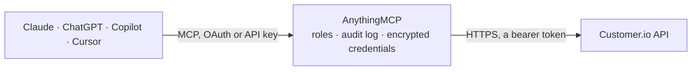

<!-- Generated by scripts/export-github-catalog.mjs in the anythingmcp-website repository. Do not edit by hand. -->

# Customer.io MCP connector

Let your AI work with Customer.io: look up people, their attributes, segments, activity and messages, review automations, broadcasts and one-time sends with their metrics, and send transactional … The AnythingMCP connector gives Claude, ChatGPT, Microsoft Copilot, Cursor and Gemini 26 MCP tools for Customer.io: 24 read and 2 can change data.

**Category:** [Marketing Automation](../marketing-automation.md) · **Tools:** 26 · **Setup guide:** [anythingmcp.com](https://anythingmcp.com/guides/customer-io-to-mcp) · [Deutsch](https://anythingmcp.com/de/guides/customer-io-to-mcp) · [Italiano](https://anythingmcp.com/it/guides/customer-io-to-mcp) · [Español](https://anythingmcp.com/es/guides/customer-io-to-mcp) · [日本語](https://anythingmcp.com/ja/guides/customer-io-to-mcp) · [Русский](https://anythingmcp.com/ru/guides/customer-io-to-mcp) · [中文](https://anythingmcp.com/zh/guides/customer-io-to-mcp)

## Start without code

No installation and no terminal: AnythingMCP Cloud runs the Customer.io connector for you, operated by helpcode.ai in Frankfurt, Germany.

1. **Click the button above** and create an account or sign in. The Customer.io connector opens, ready to install.
2. **Paste the API key or token from your Customer.io account.** Every click is in the [step-by-step guide](https://anythingmcp.com/guides/customer-io-to-mcp).
3. **Click Install.** AnythingMCP shows the address of your MCP server.
4. **Add that address to your assistant:** [Claude](https://anythingmcp.com/guides/connect-customer-io-to-claude) · [ChatGPT](https://anythingmcp.com/guides/connect-customer-io-to-chatgpt) · [Microsoft Copilot](https://anythingmcp.com/guides/connect-customer-io-to-copilot) · [Cursor](https://anythingmcp.com/guides/connect-customer-io-to-cursor) · [Gemini CLI](https://anythingmcp.com/guides/connect-customer-io-to-gemini) · [Meta Muse](https://anythingmcp.com/guides/connect-customer-io-to-muse).
5. **Ask your first question**, for example: *Show me the Customer.io profile for invoice@ludex-retail.de and whether they have the subscription attribute 'paid' set.*

Prefer help with the setup? [Talk to us](https://anythingmcp.com/contact).

## How it works

- **The AI client** speaks MCP (Streamable HTTP) to AnythingMCP and only sees tool names, descriptions and results. It never gets the Customer.io credentials.
- **AnythingMCP** checks the client's role, builds the call from the tool definition, adds the credentials (a bearer token), calls Customer.io, logs the call and returns the result.
- **Customer.io** sees an ordinary API client with the rights of the account the credentials belong to.

## Tools

| Tool | What it does | Access |
|---|---|---|
| [`customer_io_list_workspaces`](#customer_io_list_workspaces) | List the workspaces of the Customer.io account with their id, name and counts of people, objects and messages sent in the billing period (cached up to two… | read |
| [`customer_io_find_customers_by_email`](#customer_io_find_customers_by_email) | Find the people in the workspace with an email address: returns their id, email and cio_id. | read |
| [`customer_io_search_customers`](#customer_io_search_customers) | Search people in the workspace with a filter on segment membership and attribute values, up to 1000 per page; returns their identifiers (id, email, cio_id). | read |
| [`customer_io_get_customer_attributes`](#customer_io_get_customer_attributes) | Get a person's profile: all attributes (stored as strings), identifiers, subscription preferences, timestamps and devices. | read |
| [`customer_io_get_customer_segments`](#customer_io_get_customer_segments) | List the segments a person currently belongs to (id, name, description). | read |
| [`customer_io_list_customer_activities`](#customer_io_list_customer_activities) | List what happened to a person in the last 30 days or more: events, attribute changes, messages attempted, sent, opened, clicked, bounced and more, newest… | read |
| [`customer_io_list_customer_messages`](#customer_io_list_customer_messages) | List the deliveries sent to a person (newest six months unless start_ts and end_ts are given): message id, automation, broadcast or one-time send, template,… | read |
| [`customer_io_list_campaigns`](#customer_io_list_campaigns) | List the automations (campaigns) of the workspace: id, name, type of trigger, state, active flag, created and updated times, trigger and filter segments,… | read |
| [`customer_io_get_campaign`](#customer_io_get_campaign) | Get one automation (campaign) with its trigger, segments, state, tags and actions (messages, delays, branches). | read |
| [`customer_io_get_campaign_metrics`](#customer_io_get_campaign_metrics) | Get an automation's message metrics over a window: series of attempted, sent, delivered, opened, clicked, converted, bounced, spammed, unsubscribed, failed… | read |
| [`customer_io_list_broadcasts`](#customer_io_list_broadcasts) | List the API-triggered broadcasts of the workspace: id, name, active flag, created and updated times, tags and actions. | read |
| [`customer_io_get_broadcast`](#customer_io_get_broadcast) | Get one API-triggered broadcast: name, state, active flag, created, updated and first started times, tags and actions. | read |
| [`customer_io_get_broadcast_metrics`](#customer_io_get_broadcast_metrics) | Get a broadcast's message metrics per period: series of attempted, sent, delivered, opened, clicked, converted, bounced, unsubscribed, failed and more. | read |
| [`customer_io_get_broadcast_trigger`](#customer_io_get_broadcast_trigger) | Get the status of one broadcast trigger (as returned by customer_io_trigger_broadcast): created, processed and cancelled times, schedule and send window. | read |
| [`customer_io_list_newsletters`](#customer_io_list_newsletters) | List the one-time sends (newsletters) of the workspace: id, name, type, sent and created times, recipient segments, tags and variant (content) ids. | read |
| [`customer_io_get_newsletter_metrics`](#customer_io_get_newsletter_metrics) | Get a one-time send's message metrics per period: series of attempted, sent, delivered, opened, clicked, converted, bounced, unsubscribed, failed and more. | read |
| [`customer_io_list_segments`](#customer_io_list_segments) | List the segments of the workspace (not archived ones): id, name, description, type (data-driven or manual), state, progress and tags. | read |
| [`customer_io_get_segment`](#customer_io_get_segment) | Get one segment with its conditions (for data-driven segments), type, state and tags. | read |
| [`customer_io_get_segment_customer_count`](#customer_io_get_segment_customer_count) | Count the people currently in a segment, for example to size a broadcast audience before sending. | read |
| [`customer_io_list_segment_members`](#customer_io_list_segment_members) | List the people in a segment, page by page: their identifiers (id, email, cio_id). | read |
| [`customer_io_list_messages`](#customer_io_list_messages) | List deliveries across the workspace, newest first, filtered by message type, metric (sent, delivered, opened, clicked, bounced, failed...), automation,… | read |
| [`customer_io_get_message`](#customer_io_get_message) | Get one delivery by id: recipient, parent automation, broadcast, one-time send or transactional message, subject, template, created, sent and delivered… | read |
| [`customer_io_list_activities`](#customer_io_list_activities) | List activities across the workspace, newest first: events, attribute changes and message activity, optionally for one person, one type or one event name. | read |
| [`customer_io_list_transactional_messages`](#customer_io_list_transactional_messages) | List the transactional message templates of the workspace (id, name, description, link tracking, body retention). | read |
| [`customer_io_send_transactional_email`](#customer_io_send_transactional_email) | Send one transactional email (receipts, password resets, notifications) to up to 15 addresses in to, cc and bcc, from a transactional template… | write |
| [`customer_io_trigger_broadcast`](#customer_io_trigger_broadcast) | Trigger an API-triggered broadcast: send it to its default audience set in Customer.io, or to listed emails or ids, per-person data, or recipients matching… | write |

## Tool reference

Every parameter as the AI client sees it in `tools/list`. Source: [`packages/backend/src/adapters/intl/customer-io.json`](../../../packages/backend/src/adapters/intl/customer-io.json).

### `customer_io_list_workspaces`

List the workspaces of the Customer.io account with their id, name and counts of people, objects and messages sent in the billing period (cached up to two hours). Also a quick check that the App API key works. Read-only.

**Access:** read · **Call:** `GET /v1/workspaces`

No parameters.

### `customer_io_find_customers_by_email`

Find the people in the workspace with an email address: returns their id, email and cio_id. Use the id (or cio_id with id_type cio_id) with the other customer tools. Read-only.

**Access:** read · **Call:** `GET /v1/customers`

| Parameter | Type | Required | Description |
|---|---|---|---|
| `email` | string | yes | Email address to look up, exactly as stored. |

### `customer_io_search_customers`

Search people in the workspace with a filter on segment membership and attribute values, up to 1000 per page; returns their identifiers (id, email, cio_id). Filter examples: {"segment": {"id": 4}}, {"attribute": {"field": "plan", "operator": "eq", "value": "pro"}}, {"and": [{...}, {...}]}, {"or": [...]}, {"not": {...}}. Sent as a POST but only reads. Read-only.

**Access:** read · **Call:** `POST /v1/customers`

| Parameter | Type | Required | Description |
|---|---|---|---|
| `filter` | object | yes | The audience filter: one of and, or, not, segment (by id) or attribute (field, operator eq or exists, value). |
| `limit` | integer | no | People per page, up to 1000. Default 50. |
| `start` | string | no | The next value from the previous page, to get the following page. Leave out for the first page. |

### `customer_io_get_customer_attributes`

Get a person's profile: all attributes (stored as strings), identifiers, subscription preferences, timestamps and devices. Read-only.

**Access:** read · **Call:** `GET /v1/customers/{customer_id}/attributes`

| Parameter | Type | Required | Description |
|---|---|---|---|
| `customer_id` | string | yes | The person's identifier. By default their id; set id_type to use their email, phone or cio_id instead. |
| `id_type` | `id` \| `email` \| `phone` \| `cio_id` | no | What customer_id is: id (default), email, phone or cio_id. email and phone work only when they are identifiers in the workspace. |

### `customer_io_get_customer_segments`

List the segments a person currently belongs to (id, name, description). Read-only.

**Access:** read · **Call:** `GET /v1/customers/{customer_id}/segments`

| Parameter | Type | Required | Description |
|---|---|---|---|
| `customer_id` | string | yes | The person's identifier. By default their id; set id_type to use their email, phone or cio_id instead. |
| `id_type` | `id` \| `email` \| `phone` \| `cio_id` | no | What customer_id is: id (default), email, phone or cio_id. email and phone work only when they are identifiers in the workspace. |

### `customer_io_list_customer_activities`

List what happened to a person in the last 30 days or more: events, attribute changes, messages attempted, sent, opened, clicked, bounced and more, newest first. Filter by type and by event or attribute name. Read-only.

**Access:** read · **Call:** `GET /v1/customers/{customer_id}/activities`

| Parameter | Type | Required | Description |
|---|---|---|---|
| `customer_id` | string | yes | The person's identifier. By default their id; set id_type to use their email, phone or cio_id instead. |
| `id_type` | `id` \| `email` \| `phone` \| `cio_id` | no | What customer_id is: id (default), email, phone or cio_id. email and phone work only when they are identifiers in the workspace. |
| `type` | string | no | Only this activity type, e.g. event, attribute_change, sent_email, opened_email, clicked_email, bounced_email, failed_email, unsubscribed. |
| `name` | string | no | For event and attribute_change, the event or attribute name; for consent, opted_in or opted_out. |
| `limit` | integer | no | Activities per page, up to 100. Default 10. |
| `start` | string | no | The next value from the previous page, to get the following page. Leave out for the first page. |

### `customer_io_list_customer_messages`

List the deliveries sent to a person (newest six months unless start_ts and end_ts are given): message id, automation, broadcast or one-time send, template, subject, recipient, sent and delivered times, metrics and failure reason. Read-only.

**Access:** read · **Call:** `GET /v1/customers/{customer_id}/messages`

| Parameter | Type | Required | Description |
|---|---|---|---|
| `customer_id` | string | yes | The person's identifier. By default their id; set id_type to use their email, phone or cio_id instead. |
| `id_type` | `id` \| `email` \| `phone` \| `cio_id` | no | What customer_id is: id (default), email, phone or cio_id. email and phone work only when they are identifiers in the workspace. |
| `start_ts` | integer | no | Only deliveries created at or after this Unix timestamp (seconds). |
| `end_ts` | integer | no | Only deliveries created before this Unix timestamp (seconds). |
| `limit` | integer | no | Deliveries per page, up to 1000. Default 50. |
| `start` | string | no | The next value from the previous page, to get the following page. Leave out for the first page. |

### `customer_io_list_campaigns`

List the automations (campaigns) of the workspace: id, name, type of trigger, state, active flag, created and updated times, trigger and filter segments, tags and actions. Read-only.

**Access:** read · **Call:** `GET /v1/campaigns`

No parameters.

### `customer_io_get_campaign`

Get one automation (campaign) with its trigger, segments, state, tags and actions (messages, delays, branches). Read-only.

**Access:** read · **Call:** `GET /v1/campaigns/{campaign_id}`

| Parameter | Type | Required | Description |
|---|---|---|---|
| `campaign_id` | integer | yes | Automation id from customer_io_list_campaigns. |

### `customer_io_get_campaign_metrics`

Get an automation's message metrics over a window: series of attempted, sent, delivered, opened, clicked, converted, bounced, spammed, unsubscribed, failed and more, per hour, day, week or month. Uses Customer.io's metrics version 2: give start and end as Unix timestamps. Read-only.

**Access:** read · **Call:** `GET /v1/campaigns/{campaign_id}/metrics`

| Parameter | Type | Required | Description |
|---|---|---|---|
| `campaign_id` | integer | yes | Automation id from customer_io_list_campaigns. |
| `start` | integer | yes | Start of the window, Unix timestamp in seconds. |
| `end` | integer | yes | End of the window, Unix timestamp in seconds. |
| `res` | `hourly` \| `daily` \| `weekly` \| `monthly` | no | Size of each point: hourly, daily (default), weekly or monthly. |
| `tz` | string | no | Time zone of the window in region format, e.g. Europe/Berlin. Default UTC. |
| `type` | `email` \| `webhook` \| `twilio` \| `whatsapp` \| `slack` \| `push` \| `in_app` \| `live_notification` | no | Only this message type. Leave out for all types. |

### `customer_io_list_broadcasts`

List the API-triggered broadcasts of the workspace: id, name, active flag, created and updated times, tags and actions. Use the id with customer_io_trigger_broadcast or customer_io_get_broadcast_metrics. Read-only.

**Access:** read · **Call:** `GET /v1/broadcasts`

No parameters.

### `customer_io_get_broadcast`

Get one API-triggered broadcast: name, state, active flag, created, updated and first started times, tags and actions. Read-only.

**Access:** read · **Call:** `GET /v1/broadcasts/{broadcast_id}`

| Parameter | Type | Required | Description |
|---|---|---|---|
| `broadcast_id` | integer | yes | Broadcast id from customer_io_list_broadcasts. |

### `customer_io_get_broadcast_metrics`

Get a broadcast's message metrics per period: series of attempted, sent, delivered, opened, clicked, converted, bounced, unsubscribed, failed and more. Read-only.

**Access:** read · **Call:** `GET /v1/broadcasts/{broadcast_id}/metrics`

| Parameter | Type | Required | Description |
|---|---|---|---|
| `broadcast_id` | integer | yes | Broadcast id from customer_io_list_broadcasts. |
| `period` | `hours` \| `days` \| `weeks` \| `months` | no | Unit of each step: hours, days (default), weeks or months. |
| `steps` | integer | no | How many periods to return, counting back from now (max 24 hours, 45 days, 12 weeks or 121 months). |
| `type` | `email` \| `webhook` \| `twilio` \| `whatsapp` \| `slack` \| `push` \| `in_app` \| `live_notification` | no | Only this message type. Leave out for all types. |

### `customer_io_get_broadcast_trigger`

Get the status of one broadcast trigger (as returned by customer_io_trigger_broadcast): created, processed and cancelled times, schedule and send window. Read-only.

**Access:** read · **Call:** `GET /v1/campaigns/{broadcast_id}/triggers/{trigger_id}`

| Parameter | Type | Required | Description |
|---|---|---|---|
| `broadcast_id` | integer | yes | Broadcast id. |
| `trigger_id` | integer | yes | Trigger id returned when the broadcast was triggered. |

### `customer_io_list_newsletters`

List the one-time sends (newsletters) of the workspace: id, name, type, sent and created times, recipient segments, tags and variant (content) ids. Read-only.

**Access:** read · **Call:** `GET /v1/newsletters`

| Parameter | Type | Required | Description |
|---|---|---|---|
| `limit` | integer | no | One-time sends per page. |
| `sort` | `asc` \| `desc` | no | asc for oldest first, desc for newest first. |
| `start` | string | no | The next value from the previous page, to get the following page. Leave out for the first page. |

### `customer_io_get_newsletter_metrics`

Get a one-time send's message metrics per period: series of attempted, sent, delivered, opened, clicked, converted, bounced, unsubscribed, failed and more. Read-only.

**Access:** read · **Call:** `GET /v1/newsletters/{newsletter_id}/metrics`

| Parameter | Type | Required | Description |
|---|---|---|---|
| `newsletter_id` | integer | yes | One-time send id from customer_io_list_newsletters. |
| `period` | `hours` \| `days` \| `weeks` \| `months` | no | Unit of each step: hours, days (default), weeks or months. |
| `steps` | integer | no | How many periods to return, counting back from now (max 24 hours, 45 days, 12 weeks or 121 months). |
| `type` | `email` \| `webhook` \| `twilio` \| `push` \| `in_app` \| `inbox` | no | Only this message type. Leave out for all types. |

### `customer_io_list_segments`

List the segments of the workspace (not archived ones): id, name, description, type (data-driven or manual), state, progress and tags. Read-only.

**Access:** read · **Call:** `GET /v1/segments`

No parameters.

### `customer_io_get_segment`

Get one segment with its conditions (for data-driven segments), type, state and tags. Read-only.

**Access:** read · **Call:** `GET /v1/segments/{segment_id}`

| Parameter | Type | Required | Description |
|---|---|---|---|
| `segment_id` | integer | yes | Segment id from customer_io_list_segments. |

### `customer_io_get_segment_customer_count`

Count the people currently in a segment, for example to size a broadcast audience before sending. Read-only.

**Access:** read · **Call:** `GET /v1/segments/{segment_id}/customer_count`

| Parameter | Type | Required | Description |
|---|---|---|---|
| `segment_id` | integer | yes | Segment id from customer_io_list_segments. |

### `customer_io_list_segment_members`

List the people in a segment, page by page: their identifiers (id, email, cio_id). Default 100 per page here; call again with start = next while next is present. Read-only.

**Access:** read · **Call:** `GET /v1/segments/{segment_id}/membership`

| Parameter | Type | Required | Description |
|---|---|---|---|
| `segment_id` | integer | yes | Segment id from customer_io_list_segments. |
| `limit` | integer | no | People per page, up to 30000. Default 100. |
| `start` | string | no | The next value from the previous page, to get the following page. Leave out for the first page. |

### `customer_io_list_messages`

List deliveries across the workspace, newest first, filtered by message type, metric (sent, delivered, opened, clicked, bounced, failed...), automation, one-time send, action or time range. Read-only.

**Access:** read · **Call:** `GET /v1/messages`

| Parameter | Type | Required | Description |
|---|---|---|---|
| `type` | `email` \| `webhook` \| `twilio` \| `whatsapp` \| `slack` \| `push` \| `in_app` \| `live_notification` | no | Only this message type. Leave out for all types. |
| `metric` | `attempted` \| `sent` \| `delivered` \| `opened` \| `clicked` \| `converted` \| `bounced` \| `spammed` \| `unsubscribed` \| `dropped` \| `failed` \| `undeliverable` | no | Only deliveries that reached this metric. |
| `campaign_id` | integer | no | Only deliveries of this automation. |
| `newsletter_id` | integer | no | Only deliveries of this one-time send. |
| `action_id` | integer | no | Only deliveries of this action. |
| `start_ts` | integer | no | Only deliveries created at or after this Unix timestamp (seconds). |
| `end_ts` | integer | no | Only deliveries created before this Unix timestamp (seconds). |
| `drafts` | boolean | no | true lists drafts instead of sent messages. |
| `limit` | integer | no | Deliveries per page, up to 1000. Default 50. |
| `start` | string | no | The next value from the previous page, to get the following page. Leave out for the first page. |

### `customer_io_get_message`

Get one delivery by id: recipient, parent automation, broadcast, one-time send or transactional message, subject, template, created, sent and delivered times, metrics and failure reason. Read-only.

**Access:** read · **Call:** `GET /v1/messages/{message_id}`

| Parameter | Type | Required | Description |
|---|---|---|---|
| `message_id` | string | yes | Delivery id, e.g. from customer_io_list_messages or customer_io_list_customer_messages. |

### `customer_io_list_activities`

List activities across the workspace, newest first: events, attribute changes and message activity, optionally for one person, one type or one event name. Read-only.

**Access:** read · **Call:** `GET /v1/activities`

| Parameter | Type | Required | Description |
|---|---|---|---|
| `type` | string | no | Only this activity type, e.g. event, attribute_change, sent_email, opened_email, clicked_email, bounced_email. |
| `name` | string | no | For event and attribute_change, the event or attribute name; for consent, opted_in or opted_out. |
| `customer_id` | string | no | Only this person. By default their id; set id_type for email, phone or cio_id (prefix a cio_id with cio_). |
| `id_type` | `id` \| `email` \| `phone` \| `cio_id` | no | What customer_id is: id (default), email, phone or cio_id. email and phone work only when they are identifiers in the workspace. |
| `deleted` | boolean | no | true returns activities of deleted people. |
| `limit` | integer | no | Activities per page, up to 100. Default 10. |
| `start` | string | no | The next value from the previous page, to get the following page. Leave out for the first page. |

### `customer_io_list_transactional_messages`

List the transactional message templates of the workspace (id, name, description, link tracking, body retention). Their id is the transactional_message_id that customer_io_send_transactional_email uses. Read-only.

**Access:** read · **Call:** `GET /v1/transactional`

No parameters.

### `customer_io_send_transactional_email`

Send one transactional email (receipts, password resets, notifications) to up to 15 addresses in to, cc and bcc, from a transactional template (transactional_message_id) with message_data, or with your own subject, body and from. This sends a real email. Show the user the recipient, subject and content first and call only after the user confirms. Returns delivery_id and queued_at.

**Access:** write · **Call:** `POST /v1/send/email`

| Parameter | Type | Required | Description |
|---|---|---|---|
| `transactional_message_id` | integer,string | no | The transactional message from customer_io_list_transactional_messages: its numeric id as a number (e.g. 44), or its trigger name as text (e.g. pwdreset). |
| `to` | string | yes | Recipient address(es), comma-separated; up to 15 across to, cc and bcc. |
| `identifiers` | object | no | The person the message belongs to, exactly one of {"id": "..."}, {"email": "..."} or {"cio_id": "..."}. Required when the template has no fixed recipient. |
| `message_data` | object | no | Values for the template's liquid placeholders, used as {{trigger.key}}. |
| `subject` | string | no | Subject; overrides the template's. |
| `body` | string | no | HTML body; overrides the template's. |
| `body_plain` | string | no | Plain-text body; overrides the template's. |
| `from` | string | no | Sender, a verified address, e.g. "Support" <support@example.com>; overrides the template's. |
| `reply_to` | string | no | Reply-to address. |
| `cc` | string | no | Visible copies, comma-separated. |
| `bcc` | string | no | Blind copies, comma-separated. |
| `send_at` | integer | no | Unix timestamp (seconds) to schedule the email for later, up to 90 days ahead. |
| `send_to_unsubscribed` | boolean | no | Send even if the person unsubscribed. Default true for transactional messages; set false for marketing-like content. |
| `language` | string | no | Language of a translated template variant to use. |

### `customer_io_trigger_broadcast`

Trigger an API-triggered broadcast: send it to its default audience set in Customer.io, or to listed emails or ids, per-person data, or recipients matching a filter, with data for its placeholders. This sends real messages to many people at once. Before calling, show the user the broadcast, who will receive it (customer_io_get_segment_customer_count helps size the audience) and the data, and call only after the user answers with an explicit "yes, send". Returns the trigger id; check progress with customer_io_get_broadcast_trigger.

**Access:** write · **Call:** `POST /v1/campaigns/{broadcast_id}/triggers`

| Parameter | Type | Required | Description |
|---|---|---|---|
| `broadcast_id` | integer | yes | Broadcast id from customer_io_list_broadcasts. |
| `data` | object | no | Values for the broadcast's liquid placeholders, used as {{trigger.key}}. |
| `recipients` | object | no | Audience filter instead of the default audience: and, or, not, segment {"id": 4} or attribute conditions, as in customer_io_search_customers. |
| `emails` | string[] | no | Send only to these existing people by email. |
| `ids` | string[] | no | Send only to these existing people by id. |
| `per_user_data` | object[] | no | Per-person data: [{"id": "u1", "data": {...}}] or with "email". |
| `email_ignore_missing` | boolean | no | Skip listed emails that match nobody instead of failing. Default false. |
| `id_ignore_missing` | boolean | no | Skip listed ids that match nobody instead of failing. Default false. |
| `scheduled_at` | integer | no | Unix timestamp (seconds) to send later; leave out to send right away. |

## Run it yourself

AnythingMCP is open source (AGPL-3.0). [Run it with Docker](../../../README.md#run-it-yourself), open **Connectors → Store**, pick **Customer.io** and enter `CUSTOMERIO_API_URL`, `CUSTOMERIO_APP_API_KEY`, then add your MCP server URL to the AI client.

[← Marketing Automation connectors](../marketing-automation.md) · [All categories](../README.md)
