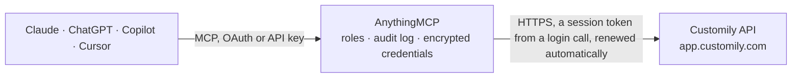

<!-- Generated by scripts/export-github-catalog.mjs in the anythingmcp-website repository. Do not edit by hand. -->

# Customily MCP connector

Customily product personalization for Shopify, Etsy, WooCommerce and standalone stores: list and read Design Studio product templates, and fetch what a shopper personalized (options, preview image, … The AnythingMCP connector gives Claude, ChatGPT, Microsoft Copilot, Cursor and Gemini 7 MCP tools for Customily: 5 read and 2 can change data.

**Category:** [E-commerce](../e-commerce.md) · **Tools:** 7 · **Setup guide:** [anythingmcp.com](https://anythingmcp.com/guides/customily-to-mcp) · [Deutsch](https://anythingmcp.com/de/guides/customily-to-mcp) · [Italiano](https://anythingmcp.com/it/guides/customily-to-mcp) · [Español](https://anythingmcp.com/es/guides/customily-to-mcp) · [日本語](https://anythingmcp.com/ja/guides/customily-to-mcp) · [Русский](https://anythingmcp.com/ru/guides/customily-to-mcp) · [中文](https://anythingmcp.com/zh/guides/customily-to-mcp)

## Start without code

No installation and no terminal: AnythingMCP Cloud runs the Customily connector for you, operated by helpcode.ai in Frankfurt, Germany.

1. **Click the button above** and create an account or sign in. The Customily connector opens, ready to install.
2. **Paste the API key or token from your Customily account.** Every click is in the [step-by-step guide](https://anythingmcp.com/guides/customily-to-mcp).
3. **Click Install.** AnythingMCP shows the address of your MCP server.
4. **Add that address to your assistant:** [Claude](https://anythingmcp.com/guides/connect-customily-to-claude) · [ChatGPT](https://anythingmcp.com/guides/connect-customily-to-chatgpt) · [Microsoft Copilot](https://anythingmcp.com/guides/connect-customily-to-copilot) · [Cursor](https://anythingmcp.com/guides/connect-customily-to-cursor) · [Gemini CLI](https://anythingmcp.com/guides/connect-customily-to-gemini) · [Meta Muse](https://anythingmcp.com/guides/connect-customily-to-muse).
5. **Ask your first question**, for example: *Get all personalizations for order ORD-2026-0452 so I can check preview images and production files*

Prefer help with the setup? [Talk to us](https://anythingmcp.com/contact).

## How it works

- **The AI client** speaks MCP (Streamable HTTP) to AnythingMCP and only sees tool names, descriptions and results. It never gets the Customily credentials.
- **AnythingMCP** checks the client's role, builds the call from the tool definition, adds the credentials (a session token from a login call, renewed automatically), calls Customily, logs the call and returns the result.
- **Customily** sees an ordinary API client with the rights of the account the credentials belong to.

## Tools

| Tool | What it does | Access |
|---|---|---|
| [`customily_count_products`](#customily_count_products) | Count the product templates in the Customily Design Studio, optionally only those matching a search, linked to a store product, deleted or carrying given tags. | read |
| [`customily_list_products`](#customily_list_products) | List product templates from the Customily Design Studio, one page at a time, with id, name, thumbnail, tags and dates. | read |
| [`customily_get_product`](#customily_get_product) | Get one product template in full: sides, layers, text and image elements, option sets and settings. | read |
| [`customily_get_personalization`](#customily_get_personalization) | Get what a shopper personalized for one cart item: chosen options (optionsJson), template id, quantity, preview image URL, production file URLs and whether… | read |
| [`customily_list_order_personalizations`](#customily_list_order_personalizations) | List every personalized item of one store order, each with options, preview image and production file URLs. | read |
| [`customily_generate_production_file`](#customily_generate_production_file) | Generate the print-ready production file behind an exportedFiles URL after the order is paid. | write |
| [`customily_rename_product`](#customily_rename_product) | Rename a product template in the Customily Design Studio. | write |

## Tool reference

Every parameter as the AI client sees it in `tools/list`. Source: [`packages/backend/src/adapters/intl/customily.json`](../../../packages/backend/src/adapters/intl/customily.json).

### `customily_count_products`

Count the product templates in the Customily Design Studio, optionally only those matching a search, linked to a store product, deleted or carrying given tags. Use it to check the login and to plan paging.

**Access:** read · **Call:** `GET /Product/GetProductsCount`

| Parameter | Type | Required | Description |
|---|---|---|---|
| `search` | string | no | Count only templates whose name matches this text. |
| `linked` | boolean | no | true for templates linked to a store product, false for unlinked ones. |
| `deleted` | boolean | no | true to count deleted templates instead of active ones. |
| `full_access_only` | boolean | no | true to count only templates this login has full access to. |
| `tag_ids` | string[] | no | Only templates carrying these tag ids. |

### `customily_list_products`

List product templates from the Customily Design Studio, one page at a time, with id, name, thumbnail, tags and dates. Use the id with customily_get_product. Page with from (offset) and page_size.

**Access:** read · **Call:** `GET /Product/GetProducts`

| Parameter | Type | Required | Description |
|---|---|---|---|
| `search` | string | no | Only templates whose name matches this text. The API requires a value; the default single space matches every template. |
| `from` | integer | no | Offset of the first template, 0 for the first page. |
| `page_size` | integer | no | Templates per page, e.g. 20. |
| `sort_by` | string | no | Field to sort by, e.g. name or date as offered in the Design Studio list. |
| `sort_mode` | string | no | Sort direction, asc or desc. |
| `linked` | boolean | no | true for templates linked to a store product, false for unlinked ones. |
| `deleted` | boolean | no | true to list deleted templates. |
| `full_access_only` | boolean | no | true to list only templates this login has full access to. |
| `tag_ids` | string[] | no | Only templates carrying these tag ids. |

### `customily_get_product`

Get one product template in full: sides, layers, text and image elements, option sets and settings. The answer can be large; use it to see which options a template offers or how it is built.

**Access:** read · **Call:** `GET /Product`

| Parameter | Type | Required | Description |
|---|---|---|---|
| `product_id` | string | yes | Template id (GUID) from customily_list_products or the productId of a personalization. |

### `customily_get_personalization`

Get what a shopper personalized for one cart item: chosen options (optionsJson), template id, quantity, preview image URL, production file URLs and whether the file was generated. Use it when fulfilling an order.

**Access:** read · **Call:** `GET https://sh.customily.com/api/standalone/item/{personalization_id}`

| Parameter | Type | Required | Description |
|---|---|---|---|
| `personalization_id` | string | yes | The personalizationGUID stored with the order line. |

### `customily_list_order_personalizations`

List every personalized item of one store order, each with options, preview image and production file URLs. Works when the store passed its order id when the Customily cart record was created.

**Access:** read · **Call:** `GET https://sh.customily.com/api/standalone/item`

| Parameter | Type | Required | Description |
|---|---|---|---|
| `order_id` | string | yes | The store's own order id, as sent to Customily with the cart record. |

### `customily_generate_production_file`

Generate the print-ready production file behind an exportedFiles URL after the order is paid. Customily charges per generated file. Returns a confirmation; the file is then available at the same URL.

**Access:** write · **Call:** `POST https://sh.customily.com/api/standalone/item/generate`

| Parameter | Type | Required | Description |
|---|---|---|---|
| `url` | string | yes | Production file URL from exportedFiles[].url, on a customily.com domain. |
| `shop` | string | yes | Your store identifier as configured in Customily, e.g. yourstore.com. |
| `order` | string | no | Optional order reference from your store. |

### `customily_rename_product`

Rename a product template in the Customily Design Studio. Only the name changes; links to store products stay. Returns Customily's confirmation.

**Access:** write · **Call:** `POST /Product/Rename`

| Parameter | Type | Required | Description |
|---|---|---|---|
| `product_id` | string | yes | Template id (GUID). |
| `name` | string | yes | New template name. |

## Run it yourself

AnythingMCP is open source (AGPL-3.0). [Run it with Docker](../../../README.md#run-it-yourself), open **Connectors → Store**, pick **Customily** and enter `CUSTOMILY_USERNAME`, `CUSTOMILY_PASSWORD`, then add your MCP server URL to the AI client.

[← E-commerce connectors](../e-commerce.md) · [All categories](../README.md)
