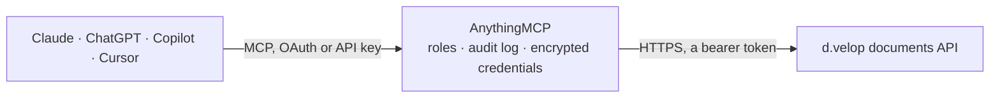

<!-- Generated by scripts/export-github-catalog.mjs in the anythingmcp-website repository. Do not edit by hand. -->

# d.velop documents MCP connector

d.velop documents (d.3one) DMS: search the repository, read document metadata and source properties, list repositories and categories. The AnythingMCP connector gives Claude, ChatGPT, Microsoft Copilot, Cursor and Gemini 6 MCP tools for d.velop documents, all read-only.

**Category:** [Document Management](../dms.md) · **Tools:** 6 · **Setup guide:** [anythingmcp.com](https://anythingmcp.com/guides/d-velop-to-mcp) · [Deutsch](https://anythingmcp.com/de/guides/d-velop-to-mcp) · [Italiano](https://anythingmcp.com/it/guides/d-velop-to-mcp) · [Español](https://anythingmcp.com/es/guides/d-velop-to-mcp) · [日本語](https://anythingmcp.com/ja/guides/d-velop-to-mcp) · [Русский](https://anythingmcp.com/ru/guides/d-velop-to-mcp) · [中文](https://anythingmcp.com/zh/guides/d-velop-to-mcp)

## Start without code

No installation and no terminal: AnythingMCP Cloud runs the d.velop documents connector for you, operated by helpcode.ai in Frankfurt, Germany.

1. **Click the button above** and create an account or sign in. The d.velop documents connector opens, ready to install.
2. **Paste the API key or token from your d.velop documents account.** Every click is in the [step-by-step guide](https://anythingmcp.com/guides/d-velop-to-mcp).
3. **Click Install.** AnythingMCP shows the address of your MCP server.
4. **Add that address to your assistant:** [Claude](https://anythingmcp.com/guides/connect-d-velop-to-claude) · [ChatGPT](https://anythingmcp.com/guides/connect-d-velop-to-chatgpt) · [Microsoft Copilot](https://anythingmcp.com/guides/connect-d-velop-to-copilot) · [Cursor](https://anythingmcp.com/guides/connect-d-velop-to-cursor) · [Gemini CLI](https://anythingmcp.com/guides/connect-d-velop-to-gemini) · [Meta Muse](https://anythingmcp.com/guides/connect-d-velop-to-muse).
5. **Ask your first question**, for example: *Find invoice INV-2026-045 for Kunde Müller Haustechnik GmbH in our Rechnungen repository*

Prefer help with the setup? [Talk to us](https://anythingmcp.com/contact).

## How it works

- **The AI client** speaks MCP (Streamable HTTP) to AnythingMCP and only sees tool names, descriptions and results. It never gets the d.velop documents credentials.
- **AnythingMCP** checks the client's role, builds the call from the tool definition, adds the credentials (a bearer token), calls d.velop documents, logs the call and returns the result.
- **d.velop documents** sees an ordinary API client with the rights of the account the credentials belong to.

## Tools

| Tool | What it does | Access |
|---|---|---|
| [`d_velop_list_repositories`](#d_velop_list_repositories) | List the repositories in this d.velop tenant with their id, name and supported features. | read |
| [`d_velop_get_repository`](#d_velop_get_repository) | Read one repository's definition: its name, the sources (index definitions) it exposes and the operations it supports. | read |
| [`d_velop_search_documents`](#d_velop_search_documents) | Search a repository by full text and/or property and category filters, through a source's mapping. | read |
| [`d_velop_get_document`](#d_velop_get_document) | Read one document's details through a source's mapping: its category, property values and link relations. | read |
| [`d_velop_get_document_versions`](#d_velop_get_document_versions) | Read the version history of one document — who changed it, when, and with what comment. | read |
| [`d_velop_list_categories`](#d_velop_list_categories) | Read the repository's default source: its id (the sourceid every search and document read needs), its categories (Dokumentarten) and its properties, each… | read |

## Tool reference

Every parameter as the AI client sees it in `tools/list`. Source: [`packages/backend/src/adapters/de/d-velop.json`](../../../packages/backend/src/adapters/de/d-velop.json).

### `d_velop_list_repositories`

List the repositories in this d.velop tenant with their id, name and supported features. Start here — every other tool needs a repository id.

**Access:** read · **Call:** `GET /dms/r`

No parameters.

### `d_velop_get_repository`

Read one repository's definition: its name, the sources (index definitions) it exposes and the operations it supports.

**Access:** read · **Call:** `GET /dms/r/{repositoryId}`

| Parameter | Type | Required | Description |
|---|---|---|---|
| `repositoryId` | string | yes | Repository id from d_velop_list_repositories. |

### `d_velop_search_documents`

Search a repository by full text and/or property and category filters, through a source's mapping. Returns items with their source property values; follow _links.next.href or raise page for more.

**Access:** read · **Call:** `GET /dms/r/{repositoryId}/srm`

| Parameter | Type | Required | Description |
|---|---|---|---|
| `repositoryId` | string | yes | Repository id to search. |
| `sourceid` | string | yes | Source id: the `id` returned by d_velop_list_categories, normally /dms/r/<repositoryId>/source. Required: without it d.velop returns only ids and links. |
| `fulltext` | string | no | Full-text query over document content. |
| `sourcecategories` | string | no | JSON array of category keys from d_velop_list_categories, e.g. ["d42018fc-..."]. |
| `sourceproperties` | string | no | JSON object mapping property keys from d_velop_list_categories to arrays of values, e.g. {"<propertyKey>":["12345"]}. |
| `sourcepropertysort` | string | no | Property key to sort by (default: last modified). |
| `ascending` | boolean | no | Sort ascending (true) or descending (false). |
| `page` | number | no | Page number, starting at 1. |
| `pageSize` | number | no | Results per page (default 25). |

### `d_velop_get_document`

Read one document's details through a source's mapping: its category, property values and link relations.

**Access:** read · **Call:** `GET /dms/r/{repositoryId}/o2m/{documentId}`

| Parameter | Type | Required | Description |
|---|---|---|---|
| `repositoryId` | string | yes | Repository id. |
| `documentId` | string | yes | Document id as returned by a search. |
| `sourceid` | string | yes | Source id: the `id` returned by d_velop_list_categories, normally /dms/r/<repositoryId>/source. Required: without it d.velop returns only ids and links. |

### `d_velop_get_document_versions`

Read the version history of one document — who changed it, when, and with what comment. The audit answer for 'which version did the auditor see'.

**Access:** read · **Call:** `GET /dms/r/{repositoryId}/o2m/{documentId}/v`

| Parameter | Type | Required | Description |
|---|---|---|---|
| `repositoryId` | string | yes | Repository id. |
| `documentId` | string | yes | Document id. |

### `d_velop_list_categories`

Read the repository's default source: its id (the sourceid every search and document read needs), its categories (Dokumentarten) and its properties, each with the key to use in a search filter and a display name.

**Access:** read · **Call:** `GET /dms/r/{repositoryId}/source`

| Parameter | Type | Required | Description |
|---|---|---|---|
| `repositoryId` | string | yes | Repository id. |

## Run it yourself

AnythingMCP is open source (AGPL-3.0). [Run it with Docker](../../../README.md#run-it-yourself), open **Connectors → Store**, pick **d.velop documents** and enter `DVELOP_URL`, `DVELOP_API_KEY`, then add your MCP server URL to the AI client.

[← Document Management connectors](../dms.md) · [All categories](../README.md)
