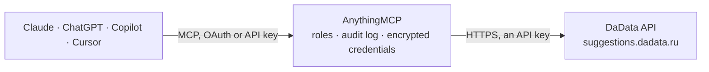

<!-- Generated by scripts/export-github-catalog.mjs in the anythingmcp-website repository. Do not edit by hand. -->

# DaData MCP connector

Suggest and look up Russian addresses, companies and sole proprietors by INN or OGRN (ЕГРЮЛ/ЕГРИП), banks by BIC, full names and emails, reverse geocode coordinates, find the city of an IP and search … The AnythingMCP connector gives Claude, ChatGPT, Microsoft Copilot, Cursor and Gemini 15 MCP tools for DaData: 13 read and 2 can change data.

**Category:** [Public Data](../data.md) · **Tools:** 15 · **Setup guide:** [anythingmcp.com](https://anythingmcp.com/guides/dadata-to-mcp) · [Deutsch](https://anythingmcp.com/de/guides/dadata-to-mcp) · [Italiano](https://anythingmcp.com/it/guides/dadata-to-mcp) · [Español](https://anythingmcp.com/es/guides/dadata-to-mcp) · [日本語](https://anythingmcp.com/ja/guides/dadata-to-mcp) · [Русский](https://anythingmcp.com/ru/guides/dadata-to-mcp) · [中文](https://anythingmcp.com/zh/guides/dadata-to-mcp)

## Start without code

No installation and no terminal: AnythingMCP Cloud runs the DaData connector for you, operated by helpcode.ai in Frankfurt, Germany.

1. **Click the button above** and create an account or sign in. The DaData connector opens, ready to install.
2. **Paste the API key or token from your DaData account.** Every click is in the [step-by-step guide](https://anythingmcp.com/guides/dadata-to-mcp).
3. **Click Install.** AnythingMCP shows the address of your MCP server.
4. **Add that address to your assistant:** [Claude](https://anythingmcp.com/guides/connect-dadata-to-claude) · [ChatGPT](https://anythingmcp.com/guides/connect-dadata-to-chatgpt) · [Microsoft Copilot](https://anythingmcp.com/guides/connect-dadata-to-copilot) · [Cursor](https://anythingmcp.com/guides/connect-dadata-to-cursor) · [Gemini CLI](https://anythingmcp.com/guides/connect-dadata-to-gemini) · [Meta Muse](https://anythingmcp.com/guides/connect-dadata-to-muse).
5. **Ask your first question**, for example: *Need full company record for INN 7705123456: registration date, OGRN and legal address.*

Prefer help with the setup? [Talk to us](https://anythingmcp.com/contact).

## How it works

- **The AI client** speaks MCP (Streamable HTTP) to AnythingMCP and only sees tool names, descriptions and results. It never gets the DaData credentials.
- **AnythingMCP** checks the client's role, builds the call from the tool definition, adds the credentials (an API key), calls DaData, logs the call and returns the result.
- **DaData** sees an ordinary API client with the rights of the account the credentials belong to.

## Tools

| Tool | What it does | Access |
|---|---|---|
| [`dadata_suggest_address`](#dadata_suggest_address) | Suggest Russian (and CIS) addresses from free text as the user types: up to 20 normalised variants with postal code, region, city, street, house, FIAS/GAR… | read |
| [`dadata_find_address`](#dadata_find_address) | Look up one address by its FIAS/GAR id, KLADR code or cadastral number and return the full normalised record (postal code, ids, OKATO/OKTMO, coordinates,… | read |
| [`dadata_geolocate_address`](#dadata_geolocate_address) | Reverse geocoding: the addresses nearest to a latitude and longitude in Russia, closest first, within radius_meters. | write |
| [`dadata_iplocate`](#dadata_iplocate) | The city of an IPv4 or IPv6 address (Russian addresses only), as a full address record with KLADR and FIAS ids. | read |
| [`dadata_suggest_party`](#dadata_suggest_party) | Suggest Russian companies and sole proprietors (ЕГРЮЛ/ЕГРИП) by name, INN, OGRN, address or director: name, INN, KPP, OGRN, legal address, director, OKVED,… | read |
| [`dadata_find_party`](#dadata_find_party) | Company or sole proprietor by INN or OGRN: the full ЕГРЮЛ/ЕГРИП record (names, KPP, OGRN, OKPO, OKVED, address, director, capital, status, branches, tax… | read |
| [`dadata_find_affiliated`](#dadata_find_affiliated) | Companies affiliated with a person or company by its INN: where it is a founder or a manager. | read |
| [`dadata_suggest_bank`](#dadata_suggest_bank) | Suggest Russian banks by name, BIC, SWIFT, INN or address: BIC, SWIFT, correspondent account, INN, KPP, registration number, address and status. | read |
| [`dadata_find_bank`](#dadata_find_bank) | One bank by BIC, SWIFT, INN (with KPP for a branch) or registration number: names, correspondent account, address, payment city, status. | read |
| [`dadata_suggest_fio`](#dadata_suggest_fio) | Suggest and split Russian full names (ФИО) as typed: surname, name and patronymic with the detected gender. | read |
| [`dadata_suggest_email`](#dadata_suggest_email) | Complete an email address as typed with common domains (mail.ru, yandex.ru, gmail.com and others). | read |
| [`dadata_suggest_reference`](#dadata_suggest_reference) | Suggest entries of DaData's Russian reference lists: fms_unit (who issued a passport, by code), postal_unit (post offices by postal code or address),… | read |
| [`dadata_get_balance`](#dadata_get_balance) | The DaData account balance in roubles, which paid calls such as dadata_clean spend. | read |
| [`dadata_get_daily_stats`](#dadata_get_daily_stats) | How many suggestions, cleansing (clean) and merging calls the account made on a day, to see how much of the daily limit is used. | read |
| [`dadata_clean`](#dadata_clean) | Standardise and check raw values (Стандартизация): addresses with postal code, FIAS ids, coordinates and quality codes; phones with operator, region and… | write |

## Tool reference

Every parameter as the AI client sees it in `tools/list`. Source: [`packages/backend/src/adapters/intl/dadata.json`](../../../packages/backend/src/adapters/intl/dadata.json).

### `dadata_suggest_address`

Suggest Russian (and CIS) addresses from free text as the user types: up to 20 normalised variants with postal code, region, city, street, house, FIAS/GAR and KLADR ids, OKATO/OKTMO, tax office, coordinates and timezone in data. Restrict by region or city with locations and choose the granularity with from_bound/to_bound. Free within the daily limit.

**Access:** read · **Call:** `POST /suggest/address`

| Parameter | Type | Required | Description |
|---|---|---|---|
| `query` | string | yes | Address text as typed, up to 300 characters, e.g. мск сухонская 11. |
| `count` | integer | no | Number of suggestions, 1 to 20. |
| `language` | `ru` \| `en` | no | Language of the answer: ru (default) or en (transliterated). |
| `locations` | object[] | no | Only addresses in these places, e.g. [{"region": "Москва"}] or [{"kladr_id": "7700000000000"}] or [{"country_iso_code": "KZ"}]. Use [{"country_iso_code": "*"}] for all countries. |
| `locations_boost` | object[] | no | Rank these places first without excluding others, e.g. [{"kladr_id": "7800000000000"}]. |
| `from_bound` | object | no | Smallest part to suggest, e.g. {"value": "city"}. Values: country, region, area, city, settlement, street, house, flat. |
| `to_bound` | object | no | Largest part to suggest, e.g. {"value": "settlement"} for cities and towns only. |
| `division` | `administrative` \| `municipal` | no | Address division: administrative (default) or municipal. |

### `dadata_find_address`

Look up one address by its FIAS/GAR id, KLADR code or cadastral number and return the full normalised record (postal code, ids, OKATO/OKTMO, coordinates, tax office). Free within the daily limit.

**Access:** read · **Call:** `POST /findById/address`

| Parameter | Type | Required | Description |
|---|---|---|---|
| `query` | string | yes | FIAS/GAR id (GUID), KLADR code or cadastral number, e.g. 9120b43f-2fae-4838-a144-85e43c2bfb29. |
| `count` | integer | no | Number of suggestions, 1 to 20. |
| `language` | `ru` \| `en` | no | Language of the answer: ru (default) or en (transliterated). |

### `dadata_geolocate_address`

Reverse geocoding: the addresses nearest to a latitude and longitude in Russia, closest first, within radius_meters. Free within the daily limit.

**Access:** write · **Call:** `POST /geolocate/address`

| Parameter | Type | Required | Description |
|---|---|---|---|
| `lat` | number | yes | Latitude, e.g. 55.878. |
| `lon` | number | yes | Longitude, e.g. 37.653. |
| `radius_meters` | integer | no | Search radius in metres, up to 1000 (default 100). |
| `count` | integer | no | Number of suggestions, 1 to 20. |
| `language` | `ru` \| `en` | no | Language of the answer: ru (default) or en (transliterated). |

### `dadata_iplocate`

The city of an IPv4 or IPv6 address (Russian addresses only), as a full address record with KLADR and FIAS ids. Returns location null when the IP is not in Russia or unknown. Free within the daily limit.

**Access:** read · **Call:** `GET /iplocate/address`

| Parameter | Type | Required | Description |
|---|---|---|---|
| `ip` | string | yes | IPv4 or IPv6 address, e.g. 46.226.227.20. |
| `language` | `ru` \| `en` | no | Language of the answer: ru (default) or en (transliterated). |

### `dadata_suggest_party`

Suggest Russian companies and sole proprietors (ЕГРЮЛ/ЕГРИП) by name, INN, OGRN, address or director: name, INN, KPP, OGRN, legal address, director, OKVED, status (active or liquidated), registration and liquidation dates. Free within the daily limit.

**Access:** read · **Call:** `POST /suggest/party`

| Parameter | Type | Required | Description |
|---|---|---|---|
| `query` | string | yes | Name, INN, OGRN, address or director, e.g. сбербанк or 7707083893. |
| `count` | integer | no | Number of suggestions, 1 to 20. |
| `status` | `ACTIVE` \| `LIQUIDATING` \| `LIQUIDATED` \| `BANKRUPT` \| `REORGANIZING`[] | no | Only companies in these states: ACTIVE, LIQUIDATING, LIQUIDATED, BANKRUPT, REORGANIZING. |
| `type` | `LEGAL` \| `INDIVIDUAL` | no | LEGAL for companies, INDIVIDUAL for sole proprietors. |
| `locations` | object[] | no | Only companies registered in these places, e.g. [{"kladr_id": "77"}]. |
| `okved` | string[] | no | Only companies with these OKVED codes, e.g. ["62.01"]. |

### `dadata_find_party`

Company or sole proprietor by INN or OGRN: the full ЕГРЮЛ/ЕГРИП record (names, KPP, OGRN, OKPO, OKVED, address, director, capital, status, branches, tax regime and finances on paid plans). Pass kpp or branch_type MAIN to get only the head office. Free within the daily limit.

**Access:** read · **Call:** `POST /findById/party`

| Parameter | Type | Required | Description |
|---|---|---|---|
| `query` | string | yes | INN (10 or 12 digits) or OGRN (13 or 15 digits). |
| `count` | integer | no | Number of suggestions, 1 to 20. |
| `kpp` | string | no | KPP of the branch you want, 9 digits. |
| `branch_type` | `MAIN` \| `BRANCH` | no | MAIN for the head office only, BRANCH for branches only. |
| `type` | `LEGAL` \| `INDIVIDUAL` | no | LEGAL or INDIVIDUAL. |
| `status` | `ACTIVE` \| `LIQUIDATING` \| `LIQUIDATED` \| `BANKRUPT` \| `REORGANIZING`[] | no | Only companies in these states: ACTIVE, LIQUIDATING, LIQUIDATED, BANKRUPT, REORGANIZING. |

### `dadata_find_affiliated`

Companies affiliated with a person or company by its INN: where it is a founder or a manager. Only on DaData's Maximum plan; other plans answer 403.

**Access:** read · **Call:** `POST /findAffiliated/party`

| Parameter | Type | Required | Description |
|---|---|---|---|
| `query` | string | yes | INN of the person (12 digits) or company (10 digits). |
| `count` | integer | no | Number of suggestions, 1 to 20. |
| `scope` | `FOUNDERS` \| `MANAGERS`[] | no | Which links: FOUNDERS, MANAGERS (default both). |

### `dadata_suggest_bank`

Suggest Russian banks by name, BIC, SWIFT, INN or address: BIC, SWIFT, correspondent account, INN, KPP, registration number, address and status. Free within the daily limit.

**Access:** read · **Call:** `POST /suggest/bank`

| Parameter | Type | Required | Description |
|---|---|---|---|
| `query` | string | yes | Bank name, BIC, SWIFT, INN or address, e.g. сбербанк or 044525225. |
| `count` | integer | no | Number of suggestions, 1 to 20. |
| `status` | `ACTIVE` \| `LIQUIDATING` \| `LIQUIDATED`[] | no | Only banks in these states: ACTIVE, LIQUIDATING, LIQUIDATED. |
| `type` | `BANK` \| `BANK_BRANCH` \| `NKO` \| `NKO_BRANCH` \| `RKC` \| `CBR` \| `TREASURY` \| `OTHER`[] | no | Kinds: BANK, BANK_BRANCH, NKO, NKO_BRANCH, RKC, CBR, TREASURY, OTHER. |

### `dadata_find_bank`

One bank by BIC, SWIFT, INN (with KPP for a branch) or registration number: names, correspondent account, address, payment city, status. Free within the daily limit.

**Access:** read · **Call:** `POST /findById/bank`

| Parameter | Type | Required | Description |
|---|---|---|---|
| `query` | string | yes | BIC (9 digits), SWIFT, INN or registration number. |
| `kpp` | string | no | KPP, to pick a branch when the query is an INN. |

### `dadata_suggest_fio`

Suggest and split Russian full names (ФИО) as typed: surname, name and patronymic with the detected gender. Restrict to one part with parts. Free within the daily limit.

**Access:** read · **Call:** `POST /suggest/fio`

| Parameter | Type | Required | Description |
|---|---|---|---|
| `query` | string | yes | Name text as typed, e.g. Викт. |
| `count` | integer | no | Number of suggestions, 1 to 20. |
| `parts` | `SURNAME` \| `NAME` \| `PATRONYMIC`[] | no | Only these parts: SURNAME, NAME, PATRONYMIC. |
| `gender` | `MALE` \| `FEMALE` \| `UNKNOWN` | no | MALE, FEMALE or UNKNOWN. |

### `dadata_suggest_email`

Complete an email address as typed with common domains (mail.ru, yandex.ru, gmail.com and others). It does not check that the mailbox exists. Free within the daily limit.

**Access:** read · **Call:** `POST /suggest/email`

| Parameter | Type | Required | Description |
|---|---|---|---|
| `query` | string | yes | The start of the email, e.g. anton@m. |
| `count` | integer | no | Number of suggestions, 1 to 20. |

### `dadata_suggest_reference`

Suggest entries of DaData's Russian reference lists: fms_unit (who issued a passport, by code), postal_unit (post offices by postal code or address), fns_unit (tax offices), fts_unit (customs offices), region_court (courts), metro (stations), car_brand, country, currency, okved2, okpd2, oktmo and mktu (trademark classes). Free within the daily limit.

**Access:** read · **Call:** `POST /suggest/{directory}`

| Parameter | Type | Required | Description |
|---|---|---|---|
| `directory` | `fms_unit` \| `postal_unit` \| `fns_unit` \| `fts_unit` \| `region_court` \| `metro` \| `car_brand` \| `country` \| `currency` \| `okved2` \| `okpd2` \| `oktmo` \| `mktu` | yes | Which list to search. |
| `query` | string | yes | Text, code or number to look for, e.g. 772-053 for fms_unit or 127642 for postal_unit. |
| `count` | integer | no | Number of suggestions, 1 to 20. |
| `filters` | object[] | no | Optional filters of the list, e.g. [{"city": "Москва"}] for metro or [{"region_code": "77"}] for fms_unit. |

### `dadata_get_balance`

The DaData account balance in roubles, which paid calls such as dadata_clean spend. Needs DADATA_SECRET_KEY. Free.

**Access:** read · **Call:** `GET https://dadata.ru/api/v2/profile/balance`

No parameters.

### `dadata_get_daily_stats`

How many suggestions, cleansing (clean) and merging calls the account made on a day, to see how much of the daily limit is used. Needs DADATA_SECRET_KEY. Free.

**Access:** read · **Call:** `GET https://dadata.ru/api/v2/stat/daily`

| Parameter | Type | Required | Description |
|---|---|---|---|
| `date` | string | no | Day as YYYY-MM-DD; omit for today. |

### `dadata_clean`

Standardise and check raw values (Стандартизация): addresses with postal code, FIAS ids, coordinates and quality codes; phones with operator, region and type; full names split with gender; emails, passports, birthdates and vehicles. COSTS MONEY: DaData charges about 20 kopecks per value from the account balance (any plan), so first say how many values will be cleaned and what it costs, and wait for a yes; never run it in a loop. Needs DADATA_SECRET_KEY. Installed switched off.

**Access:** write · **Call:** `POST https://cleaner.dadata.ru/api/v1/clean/{type}`

| Parameter | Type | Required | Description |
|---|---|---|---|
| `type` | `address` \| `phone` \| `name` \| `email` \| `passport` \| `birthdate` \| `vehicle` | yes | What the values are. |
| `values` | string[] | yes | The raw values to clean, one per item, e.g. ["мск сухонская 11/-89"]. Each value is billed. |

## Run it yourself

AnythingMCP is open source (AGPL-3.0). [Run it with Docker](../../../README.md#run-it-yourself), open **Connectors → Store**, pick **DaData** and enter `DADATA_API_KEY`, then add your MCP server URL to the AI client.

[← Public Data connectors](../data.md) · [All categories](../README.md)
