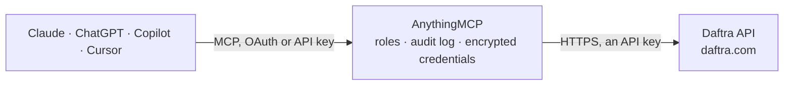

<!-- Generated by scripts/export-github-catalog.mjs in the anythingmcp-website repository. Do not edit by hand. -->

# Daftra MCP connector

Work with Daftra, the cloud accounting and ERP of the Middle East, from your AI: look up invoices, estimates, clients, products, stock and the ledger, and create invoices, estimates, payments, … The AnythingMCP connector gives Claude, ChatGPT, Microsoft Copilot, Cursor and Gemini 48 MCP tools for Daftra: 24 read and 24 can change data.

**Category:** [Accounting](../accounting.md) · **Tools:** 48 · **Setup guide:** [anythingmcp.com](https://anythingmcp.com/guides/daftra-to-mcp) · [Deutsch](https://anythingmcp.com/de/guides/daftra-to-mcp) · [Italiano](https://anythingmcp.com/it/guides/daftra-to-mcp) · [Español](https://anythingmcp.com/es/guides/daftra-to-mcp) · [日本語](https://anythingmcp.com/ja/guides/daftra-to-mcp) · [Русский](https://anythingmcp.com/ru/guides/daftra-to-mcp) · [中文](https://anythingmcp.com/zh/guides/daftra-to-mcp)

## Start without code

No installation and no terminal: AnythingMCP Cloud runs the Daftra connector for you, operated by helpcode.ai in Frankfurt, Germany.

1. **Click the button above** and create an account or sign in. The Daftra connector opens, ready to install.
2. **Paste the API key or token from your Daftra account.** Every click is in the [step-by-step guide](https://anythingmcp.com/guides/daftra-to-mcp).
3. **Click Install.** AnythingMCP shows the address of your MCP server.
4. **Add that address to your assistant:** [Claude](https://anythingmcp.com/guides/connect-daftra-to-claude) · [ChatGPT](https://anythingmcp.com/guides/connect-daftra-to-chatgpt) · [Microsoft Copilot](https://anythingmcp.com/guides/connect-daftra-to-copilot) · [Cursor](https://anythingmcp.com/guides/connect-daftra-to-cursor) · [Gemini CLI](https://anythingmcp.com/guides/connect-daftra-to-gemini) · [Meta Muse](https://anythingmcp.com/guides/connect-daftra-to-muse).
5. **Ask your first question**, for example: *Find sales invoice INV-2026-045 issued to Al Noor Trading LLC and show its status, date and outstanding amount*

Prefer help with the setup? [Talk to us](https://anythingmcp.com/contact).

## How it works

- **The AI client** speaks MCP (Streamable HTTP) to AnythingMCP and only sees tool names, descriptions and results. It never gets the Daftra credentials.
- **AnythingMCP** checks the client's role, builds the call from the tool definition, adds the credentials (an API key), calls Daftra, logs the call and returns the result.
- **Daftra** sees an ordinary API client with the rights of the account the credentials belong to.

## Tools

| Tool | What it does | Access |
|---|---|---|
| [`daftra_list_invoices`](#daftra_list_invoices) | List sales invoices, newest first, each with its client, totals and payment status. | read |
| [`daftra_get_invoice`](#daftra_get_invoice) | Get one sales invoice by its internal id with client, line items (InvoiceItem), taxes, payments and totals. | read |
| [`daftra_list_estimates`](#daftra_list_estimates) | List estimates (quotations, عروض الأسعار), newest first, each with its client and totals. | read |
| [`daftra_get_estimate`](#daftra_get_estimate) | Get one estimate (quotation) by its internal id with client, line items, taxes, documents and totals. | read |
| [`daftra_list_credit_notes`](#daftra_list_credit_notes) | List credit notes issued to clients, newest first, with client and totals. | read |
| [`daftra_list_refund_receipts`](#daftra_list_refund_receipts) | List sales refund receipts (returned goods against an invoice), newest first, with client and totals. | read |
| [`daftra_list_invoice_payments`](#daftra_list_invoice_payments) | List payments recorded against sales invoices, newest first: invoice id, amount, method, date, treasury and status. | read |
| [`daftra_list_clients`](#daftra_list_clients) | List clients (customers) with their id, business or personal name, contact details and balance. | read |
| [`daftra_get_client`](#daftra_get_client) | Get one client by its internal id with contact details, addresses and account settings. | read |
| [`daftra_list_suppliers`](#daftra_list_suppliers) | List suppliers (vendors) with their id, name and contact details. | read |
| [`daftra_get_supplier`](#daftra_get_supplier) | Get one supplier by its internal id with contact details and account settings. | read |
| [`daftra_list_products`](#daftra_list_products) | List products and services with id, name, code, selling and buying prices and stock settings. | read |
| [`daftra_get_product`](#daftra_get_product) | Get one product by its internal id: prices, taxes, type, stock per warehouse and, for a bundle, its components (ProductBundle). | read |
| [`daftra_list_product_categories`](#daftra_list_product_categories) | List the product categories with their ids and names. | read |
| [`daftra_list_stores`](#daftra_list_stores) | List warehouses (stores in Daftra) with their ids and names. | read |
| [`daftra_list_stock_transactions`](#daftra_list_stock_transactions) | List stock movements (goods in and out per product and warehouse) with quantity, price, date and source. | read |
| [`daftra_list_purchase_invoices`](#daftra_list_purchase_invoices) | List purchase invoices from suppliers, newest first, with supplier, totals and payment status. | read |
| [`daftra_get_purchase_invoice`](#daftra_get_purchase_invoice) | Get one purchase invoice by its internal id with supplier, every line (PurchaseOrderItem) with units and prices, taxes and totals. | read |
| [`daftra_list_expenses`](#daftra_list_expenses) | List expenses with amount, date, category, vendor, treasury and accounts. | read |
| [`daftra_list_treasuries`](#daftra_list_treasuries) | List treasuries: cash boxes, bank accounts and wallets, with id, name, type and currency. | read |
| [`daftra_list_journals`](#daftra_list_journals) | List journal entries of the general ledger, newest first, with date, description, totals and source document. | read |
| [`daftra_get_journal`](#daftra_get_journal) | Get one journal entry by its internal id with all its debit and credit lines (JournalTransaction) and their accounts. | read |
| [`daftra_list_journal_accounts`](#daftra_list_journal_accounts) | List the posting accounts of the chart of accounts with id, code, name, parent category (journal_cat_id) and type. | read |
| [`daftra_list_journal_categories`](#daftra_list_journal_categories) | List the parent (summary) accounts of the chart of accounts with id, code, name and their own parent (journal_cat_id, -1 at the top level). | read |
| [`daftra_create_invoice`](#daftra_create_invoice) | Create a sales invoice for a client. | write |
| [`daftra_create_estimate`](#daftra_create_estimate) | Create an estimate (quotation, عرض سعر) for a client: the same header and lines as an invoice, in Invoice.client_id and InvoiceItem. | write |
| [`daftra_create_invoice_payment`](#daftra_create_invoice_payment) | Record a payment received against a sales invoice: amount, date, method and the treasury it went into. | write |
| [`daftra_set_invoice_draft_status`](#daftra_set_invoice_draft_status) | Issue a draft sales invoice (draft_status 0: it gets its official sequential number and posts its payment journals; with e-invoicing it is reported and can… | write |
| [`daftra_create_client`](#daftra_create_client) | Create a client (customer) with name and contact details. | write |
| [`daftra_update_client`](#daftra_update_client) | Change fields of an existing client; only the fields you pass are changed. | write |
| [`daftra_create_supplier`](#daftra_create_supplier) | Create a supplier (vendor) with name and contact details. | write |
| [`daftra_create_product`](#daftra_create_product) | Create a product, service or bundle. | write |
| [`daftra_update_product`](#daftra_update_product) | Change fields of an existing product; only the fields in Product are changed (for example name, product_code, prices, status). | write |
| [`daftra_create_purchase_invoice`](#daftra_create_purchase_invoice) | Create a purchase invoice from a supplier: header in PurchaseOrder (supplier_id required) and the lines in PurchaseOrderItem. | write |
| [`daftra_update_purchase_invoice`](#daftra_update_purchase_invoice) | Update a purchase invoice. | write |
| [`daftra_create_expense`](#daftra_create_expense) | Record an expense: amount, date, vendor, category and the treasury it was paid from. | write |
| [`daftra_update_expense`](#daftra_update_expense) | Change fields of an existing expense, for example the treasury it was paid from, the amount or the note; only the fields you pass are changed. | write |
| [`daftra_create_journal`](#daftra_create_journal) | Post a manual journal entry: a header in Journal and two or more lines in JournalTransaction. | write |
| [`daftra_update_journal`](#daftra_update_journal) | Edit a manual journal entry: header in Journal and the COMPLETE set of lines in JournalTransaction (a line with id is updated, a line without id is added,… | write |
| [`daftra_create_journal_account`](#daftra_create_journal_account) | Add a posting account to the chart of accounts under an existing parent category. | write |
| [`daftra_create_journal_category`](#daftra_create_journal_category) | Add a category (a folder of the chart of accounts that groups sub-categories and posting accounts). | write |
| [`daftra_create_treasury`](#daftra_create_treasury) | Add a treasury (cash box) or bank account that payments and expenses can be paid from or into. | write |
| [`daftra_create_stock_transaction`](#daftra_create_stock_transaction) | Record a manual stock movement (goods in or out) for one product in one warehouse, for example to correct a balance. | write |
| [`daftra_create_refund_receipt`](#daftra_create_refund_receipt) | Create a sales refund receipt (a return) against an existing invoice: header in RefundReceipt with the original invoice id in subscription_id, returned… | write |
| [`daftra_delete_invoice`](#daftra_delete_invoice) | Delete a sales invoice by its internal id, with its effect on stock and the ledger. | write |
| [`daftra_delete_invoice_payment`](#daftra_delete_invoice_payment) | Delete a payment recorded against an invoice, by the payment id (not the invoice id). | write |
| [`daftra_delete_expense`](#daftra_delete_expense) | Delete an expense by its internal id, with its ledger entry. | write |
| [`daftra_delete_journal`](#daftra_delete_journal) | Delete a manual journal entry by its internal id. | write |

## Tool reference

Every parameter as the AI client sees it in `tools/list`. Source: [`packages/backend/src/adapters/intl/daftra.json`](../../../packages/backend/src/adapters/intl/daftra.json).

### `daftra_list_invoices`

List sales invoices, newest first, each with its client, totals and payment status. Filter by client, invoice date range, payment status or warehouse; page with page and limit. Use daftra_get_invoice for the lines, taxes and payments of one invoice. Read-only.

**Access:** read · **Call:** `GET /invoices.json`

| Parameter | Type | Required | Description |
|---|---|---|---|
| `page` | integer | no | Page number, starting at 1. |
| `limit` | integer | no | Records per page, 1 to 1000 (default 20). Keep it small unless the user needs a full export. |
| `client_id` | integer | no | Only invoices of this client id (see daftra_list_clients). |
| `date_from` | string | no | Only invoices dated on or after this day, YYYY-MM-DD. |
| `date_to` | string | no | Only invoices dated on or before this day, YYYY-MM-DD. |
| `payment_status` | `-1` \| `0` \| `1` \| `2` \| `3` \| `4` | no | Payment status: 0 unpaid, 1 partially paid, 2 paid, 3 refunded, 4 overpaid, -1 draft. |
| `store_id` | integer | no | Only invoices of this warehouse id (see daftra_list_stores). |
| `recursive` | `0` \| `1` | no | 1 also returns the line items, taxes and payments of every invoice in the page. Makes the answer much longer; prefer daftra_get_invoice for one invoice. |

### `daftra_get_invoice`

Get one sales invoice by its internal id with client, line items (InvoiceItem), taxes, payments and totals. Read-only.

**Access:** read · **Call:** `GET /invoices/{id}.json`

| Parameter | Type | Required | Description |
|---|---|---|---|
| `id` | integer | yes | Internal Daftra id of the invoice (the id field, not the printed document number). |

### `daftra_list_estimates`

List estimates (quotations, عروض الأسعار), newest first, each with its client and totals. Filter by client, estimate date range, status or a keyword; page with page and limit. Use daftra_get_estimate for the lines of one estimate. Read-only.

**Access:** read · **Call:** `GET /estimates.json`

| Parameter | Type | Required | Description |
|---|---|---|---|
| `page` | integer | no | Page number, starting at 1. |
| `limit` | integer | no | Records per page, 1 to 1000 (default 20). |
| `client_id` | integer | no | Only estimates of this client id (see daftra_list_clients). |
| `date_from` | string | no | Only estimates dated on or after this day, YYYY-MM-DD. |
| `date_to` | string | no | Only estimates dated on or before this day, YYYY-MM-DD. |
| `payment_status` | integer | no | Estimate status: -1 only drafts; any other status id only issued estimates with that status. |
| `name` | string | no | Keyword matched against the client name, client number, client e-mail and the estimate number. |

### `daftra_get_estimate`

Get one estimate (quotation) by its internal id with client, line items, taxes, documents and totals. Ids of other document types answer 404. Read-only.

**Access:** read · **Call:** `GET /estimates/{id}.json`

| Parameter | Type | Required | Description |
|---|---|---|---|
| `id` | integer | yes | Internal Daftra id of the estimate (the id field, not the printed number), from daftra_list_estimates. |

### `daftra_list_credit_notes`

List credit notes issued to clients, newest first, with client and totals. Page with page and limit. Read-only.

**Access:** read · **Call:** `GET /credit_notes.json`

| Parameter | Type | Required | Description |
|---|---|---|---|
| `page` | integer | no | Page number, starting at 1. |
| `limit` | integer | no | Records per page, 1 to 1000 (default 20). Keep it small unless the user needs a full export. |

### `daftra_list_refund_receipts`

List sales refund receipts (returned goods against an invoice), newest first, with client and totals. Page with page and limit. Read-only.

**Access:** read · **Call:** `GET /refund_receipts.json`

| Parameter | Type | Required | Description |
|---|---|---|---|
| `page` | integer | no | Page number, starting at 1. |
| `limit` | integer | no | Records per page, 1 to 1000 (default 20). Keep it small unless the user needs a full export. |

### `daftra_list_invoice_payments`

List payments recorded against sales invoices, newest first: invoice id, amount, method, date, treasury and status. Page with page and limit. Read-only.

**Access:** read · **Call:** `GET /invoice_payments.json`

| Parameter | Type | Required | Description |
|---|---|---|---|
| `page` | integer | no | Page number, starting at 1. |
| `limit` | integer | no | Records per page, 1 to 1000 (default 20). Keep it small unless the user needs a full export. |

### `daftra_list_clients`

List clients (customers) with their id, business or personal name, contact details and balance. Page with page and limit; the client id is what invoices and payments need. Read-only.

**Access:** read · **Call:** `GET /clients.json`

| Parameter | Type | Required | Description |
|---|---|---|---|
| `page` | integer | no | Page number, starting at 1. |
| `limit` | integer | no | Records per page, 1 to 1000 (default 20). Keep it small unless the user needs a full export. |

### `daftra_get_client`

Get one client by its internal id with contact details, addresses and account settings. Read-only.

**Access:** read · **Call:** `GET /clients/{id}.json`

| Parameter | Type | Required | Description |
|---|---|---|---|
| `id` | integer | yes | Internal Daftra id of the client (the id field, not the printed document number). |

### `daftra_list_suppliers`

List suppliers (vendors) with their id, name and contact details. Page with page and limit; the supplier id is what purchase invoices need. Read-only.

**Access:** read · **Call:** `GET /suppliers.json`

| Parameter | Type | Required | Description |
|---|---|---|---|
| `page` | integer | no | Page number, starting at 1. |
| `limit` | integer | no | Records per page, 1 to 1000 (default 20). Keep it small unless the user needs a full export. |

### `daftra_get_supplier`

Get one supplier by its internal id with contact details and account settings. Read-only.

**Access:** read · **Call:** `GET /suppliers/{id}.json`

| Parameter | Type | Required | Description |
|---|---|---|---|
| `id` | integer | yes | Internal Daftra id of the supplier (the id field, not the printed document number). |

### `daftra_list_products`

List products and services with id, name, code, selling and buying prices and stock settings. Page with page and limit. Read-only.

**Access:** read · **Call:** `GET /products.json`

| Parameter | Type | Required | Description |
|---|---|---|---|
| `page` | integer | no | Page number, starting at 1. |
| `limit` | integer | no | Records per page, 1 to 1000 (default 20). Keep it small unless the user needs a full export. |

### `daftra_get_product`

Get one product by its internal id: prices, taxes, type, stock per warehouse and, for a bundle, its components (ProductBundle). Read-only.

**Access:** read · **Call:** `GET /products/{id}.json`

| Parameter | Type | Required | Description |
|---|---|---|---|
| `id` | integer | yes | Internal Daftra id of the product (the id field, not the printed document number). |

### `daftra_list_product_categories`

List the product categories with their ids and names. Page with page and limit. Read-only.

**Access:** read · **Call:** `GET /product_categories.json`

| Parameter | Type | Required | Description |
|---|---|---|---|
| `page` | integer | no | Page number, starting at 1. |
| `limit` | integer | no | Records per page, 1 to 1000 (default 20). Keep it small unless the user needs a full export. |

### `daftra_list_stores`

List warehouses (stores in Daftra) with their ids and names. Invoices, refunds and stock movements refer to a store_id from here. Read-only.

**Access:** read · **Call:** `GET /stores.json`

| Parameter | Type | Required | Description |
|---|---|---|---|
| `page` | integer | no | Page number, starting at 1. |
| `limit` | integer | no | Records per page, 1 to 1000 (default 20). Keep it small unless the user needs a full export. |

### `daftra_list_stock_transactions`

List stock movements (goods in and out per product and warehouse) with quantity, price, date and source. Page with page and limit. Read-only.

**Access:** read · **Call:** `GET /stock_transactions.json`

| Parameter | Type | Required | Description |
|---|---|---|---|
| `page` | integer | no | Page number, starting at 1. |
| `limit` | integer | no | Records per page, 1 to 1000 (default 20). Keep it small unless the user needs a full export. |

### `daftra_list_purchase_invoices`

List purchase invoices from suppliers, newest first, with supplier, totals and payment status. Page with page and limit. Read-only.

**Access:** read · **Call:** `GET /purchase_invoices.json`

| Parameter | Type | Required | Description |
|---|---|---|---|
| `page` | integer | no | Page number, starting at 1. |
| `limit` | integer | no | Records per page, 1 to 1000 (default 20). Keep it small unless the user needs a full export. |

### `daftra_get_purchase_invoice`

Get one purchase invoice by its internal id with supplier, every line (PurchaseOrderItem) with units and prices, taxes and totals. Read-only.

**Access:** read · **Call:** `GET /purchase_invoices/{id}.json`

| Parameter | Type | Required | Description |
|---|---|---|---|
| `id` | integer | yes | Internal Daftra id of the purchase invoice (the id field, not the printed document number). |

### `daftra_list_expenses`

List expenses with amount, date, category, vendor, treasury and accounts. Page with page and limit. Read-only.

**Access:** read · **Call:** `GET /expenses.json`

| Parameter | Type | Required | Description |
|---|---|---|---|
| `page` | integer | no | Page number, starting at 1. |
| `limit` | integer | no | Records per page, 1 to 1000 (default 20). Keep it small unless the user needs a full export. |

### `daftra_list_treasuries`

List treasuries: cash boxes, bank accounts and wallets, with id, name, type and currency. Payments and expenses refer to a treasury_id from here. Read-only.

**Access:** read · **Call:** `GET /treasuries.json`

| Parameter | Type | Required | Description |
|---|---|---|---|
| `page` | integer | no | Page number, starting at 1. |
| `limit` | integer | no | Records per page, 1 to 1000 (default 20). Keep it small unless the user needs a full export. |

### `daftra_list_journals`

List journal entries of the general ledger, newest first, with date, description, totals and source document. Page with page and limit. Read-only.

**Access:** read · **Call:** `GET /journals.json`

| Parameter | Type | Required | Description |
|---|---|---|---|
| `page` | integer | no | Page number, starting at 1. |
| `limit` | integer | no | Records per page, 1 to 1000 (default 20). Keep it small unless the user needs a full export. |

### `daftra_get_journal`

Get one journal entry by its internal id with all its debit and credit lines (JournalTransaction) and their accounts. Read-only.

**Access:** read · **Call:** `GET /journals/{id}.json`

| Parameter | Type | Required | Description |
|---|---|---|---|
| `id` | integer | yes | Internal Daftra id of the journal entry (the id field, not the printed document number). |

### `daftra_list_journal_accounts`

List the posting accounts of the chart of accounts with id, code, name, parent category (journal_cat_id) and type. Journal lines need a journal_account_id from here. Read-only.

**Access:** read · **Call:** `GET /journal_accounts.json`

| Parameter | Type | Required | Description |
|---|---|---|---|
| `page` | integer | no | Page number, starting at 1. |
| `limit` | integer | no | Records per page, 1 to 1000 (default 20). Keep it small unless the user needs a full export. |

### `daftra_list_journal_categories`

List the parent (summary) accounts of the chart of accounts with id, code, name and their own parent (journal_cat_id, -1 at the top level). Read-only.

**Access:** read · **Call:** `GET /journal_cats.json`

| Parameter | Type | Required | Description |
|---|---|---|---|
| `page` | integer | no | Page number, starting at 1. |
| `limit` | integer | no | Records per page, 1 to 1000 (default 20). Keep it small unless the user needs a full export. |

### `daftra_create_invoice`

Create a sales invoice for a client. Needs the client in Invoice.client_id and at least one line in InvoiceItem. Returns the new invoice id. Set Invoice.draft to 1 to keep it as a draft. Changes live accounting data in Daftra: show the user what will be written and get their confirmation before calling.

**Access:** write · **Call:** `POST /invoices.json`

| Parameter | Type | Required | Description |
|---|---|---|---|
| `Invoice` | object | yes | Invoice header. Required: client_id. Common: store_id (warehouse), date (YYYY-MM-DD, default today), currency_code (3 letters, default the account currency), draft (0 or 1), discount (percent), discount_amount, notes, po_number. |
| `InvoiceItem` | object[] | yes | Invoice lines, sent next to Invoice. Each: product_id or item (free text name), quantity, unit_price (before tax); optional description, discount, discount_type (1 percent, 2 amount), tax1 and tax2 (tax ids as set up in Daftra; read them from the lines of an existing invoice with daftra_get_invoice). |

### `daftra_create_estimate`

Create an estimate (quotation, عرض سعر) for a client: the same header and lines as an invoice, in Invoice.client_id and InvoiceItem. Returns the new estimate id. An estimate posts nothing to the ledger or stock; set Invoice.draft to 1 to keep it as a draft. Show the user the client, lines and totals and get their confirmation before calling.

**Access:** write · **Call:** `POST /estimates.json`

| Parameter | Type | Required | Description |
|---|---|---|---|
| `Invoice` | object | yes | Estimate header (Daftra uses the Invoice envelope and sets the document type to estimate). Required: client_id. Common: date (YYYY-MM-DD), currency_code, store_id, draft (0 or 1), notes, discount, discount_amount. Deposit, due-after and terms do not apply to estimates. |
| `InvoiceItem` | object[] | yes | Estimate lines, same shape as invoice lines. Each: product_id or item (free text name), quantity, unit_price (before tax); optional description, discount, discount_type (1 percent, 2 amount), tax1 and tax2 (tax ids as on existing invoice lines). |

### `daftra_create_invoice_payment`

Record a payment received against a sales invoice: amount, date, method and the treasury it went into. This only records money already received; it does not charge anyone. Changes live accounting data in Daftra: show the user what will be written and get their confirmation before calling.

**Access:** write · **Call:** `POST /invoice_payments.json`

| Parameter | Type | Required | Description |
|---|---|---|---|
| `invoice_id` | integer | yes | Internal id of the sales invoice being paid. |
| `amount` | number | yes | Amount received, in the invoice currency. |
| `payment_method` | string | no | Payment method code as set up in Daftra, for example cash or bank. |
| `date` | string | no | Payment date, YYYY-MM-DD (a time may follow: YYYY-MM-DD HH:MM:SS). |
| `treasury_id` | integer | no | Treasury (cash box or bank account) id from daftra_list_treasuries. |
| `transaction_id` | string | no | Bank or gateway reference of the payment. |
| `notes` | string | no | Internal notes. |
| `currency_code` | string | no | Currency code; leave out to use the invoice currency. |

### `daftra_set_invoice_draft_status`

Issue a draft sales invoice (draft_status 0: it gets its official sequential number and posts its payment journals; with e-invoicing it is reported and can no longer be deleted) or move an issued invoice back to draft (1, refused once it has completed payments or refunds). Daftra exposes this as a GET, but it changes the invoice. Installed switched off. Changes live accounting data in Daftra: show the user what will be written and get their confirmation before calling.

**Access:** write · **Call:** `GET /invoices/update_draft/{id}/{draft_status}.json`

| Parameter | Type | Required | Description |
|---|---|---|---|
| `id` | integer | yes | Internal id of the sales invoice, from daftra_list_invoices. |
| `draft_status` | `0` \| `1` | yes | 0 issue the invoice, 1 set it back to draft. |

### `daftra_create_client`

Create a client (customer) with name and contact details. Returns the new client id for invoices. Check with daftra_list_clients first that the client does not exist yet. Changes live accounting data in Daftra: show the user what will be written and get their confirmation before calling.

**Access:** write · **Call:** `POST /clients.json`

| Parameter | Type | Required | Description |
|---|---|---|---|
| `business_name` | string | yes | Company or display name of the client. |
| `first_name` | string | no | First name of the contact person. |
| `last_name` | string | no | Last name of the contact person. |
| `email` | string | no | E-mail address. |
| `phone1` | string | no | Phone number. |
| `address1` | string | no | Street address. |
| `city` | string | no | City. |
| `state` | string | no | State or region. |
| `postal_code` | string | no | Postal code. |
| `country_code` | string | no | Two-letter country code, for example SA, EG or AE. |
| `default_currency_code` | string | no | Currency used for this client, for example SAR. |
| `type` | integer | no | Client type as Daftra numbers it; the documented example of a company uses 2. Leave out for the account default. |
| `notes` | string | no | Internal notes. |

### `daftra_update_client`

Change fields of an existing client; only the fields you pass are changed. Changes live accounting data in Daftra: show the user what will be written and get their confirmation before calling.

**Access:** write · **Call:** `PUT /clients/{id}.json`

| Parameter | Type | Required | Description |
|---|---|---|---|
| `id` | integer | yes | Internal id of the client. |
| `business_name` | string | no | New company or display name. |
| `first_name` | string | no | First name of the contact person. |
| `last_name` | string | no | Last name of the contact person. |
| `email` | string | no | E-mail address. |
| `phone1` | string | no | Phone number. |
| `address1` | string | no | Street address. |
| `city` | string | no | City. |
| `state` | string | no | State or region. |
| `postal_code` | string | no | Postal code. |
| `country_code` | string | no | Two-letter country code. |
| `notes` | string | no | Internal notes. |

### `daftra_create_supplier`

Create a supplier (vendor) with name and contact details. Returns the new supplier id for purchase invoices. Check with daftra_list_suppliers first that it does not exist yet. Changes live accounting data in Daftra: show the user what will be written and get their confirmation before calling.

**Access:** write · **Call:** `POST /suppliers.json`

| Parameter | Type | Required | Description |
|---|---|---|---|
| `business_name` | string | yes | Company name of the supplier. |
| `supplier_number` | string | no | Your own supplier number; leave out to let Daftra number it. |
| `first_name` | string | no | First name of the contact person. |
| `last_name` | string | no | Last name of the contact person. |
| `email` | string | no | E-mail address. |
| `phone1` | string | no | Phone number. |
| `address1` | string | no | Street address. |
| `city` | string | no | City. |
| `state` | string | no | State or region. |
| `postal_code` | string | no | Postal code. |
| `country_code` | string | no | Two-letter country code. |
| `default_currency_code` | string | no | Currency used with this supplier, for example SAR. |

### `daftra_create_product`

Create a product, service or bundle. Pass the fields in Product; for a bundle also pass its components in ProductBundle. Returns the new product id. Changes live accounting data in Daftra: show the user what will be written and get their confirmation before calling.

**Access:** write · **Call:** `POST /products.json`

| Parameter | Type | Required | Description |
|---|---|---|---|
| `Product` | object | yes | Product fields. Common: name (required), product_code, barcode, description, unit_price (selling price), buy_price, tax1 and tax2 (tax ids), supplier_id, brand, category, track_stock (0 or 1), low_stock_thershold (spelled this way by Daftra), type (1 for a stocked product, 3 for a bundle). |
| `ProductBundle` | object[] | no | Only for a bundle: its components as [{"product_id": 12, "quantity": 2}], quantity per one bundle unit in the component's base unit. |

### `daftra_update_product`

Change fields of an existing product; only the fields in Product are changed (for example name, product_code, prices, status). Passing ProductBundle replaces all components of a bundle. Changes live accounting data in Daftra: show the user what will be written and get their confirmation before calling.

**Access:** write · **Call:** `PUT /products/{id}.json`

| Parameter | Type | Required | Description |
|---|---|---|---|
| `id` | integer | yes | Internal id of the product. |
| `Product` | object | yes | Fields to change, for example {"unit_price": 49.5} or {"name": "New name"}. |
| `ProductBundle` | object[] | no | Only for a bundle: the complete new list of components [{"product_id": 12, "quantity": 2}]; it replaces the current one. |

### `daftra_create_purchase_invoice`

Create a purchase invoice from a supplier: header in PurchaseOrder (supplier_id required) and the lines in PurchaseOrderItem. Returns the new id. Posting it can update stock and the ledger. Changes live accounting data in Daftra: show the user what will be written and get their confirmation before calling.

**Access:** write · **Call:** `POST /purchase_invoices.json`

| Parameter | Type | Required | Description |
|---|---|---|---|
| `PurchaseOrder` | object | yes | Header. Required: supplier_id. Common: date (YYYY-MM-DD), currency_code, store_id (receiving warehouse), draft (0 or 1), notes, is_received (1 when the goods arrived). |
| `PurchaseOrderItem` | object[] | yes | Lines, sent next to PurchaseOrder. Each: product_id or item (name), quantity, unit_price; optional description, discount, discount_type, tax1, tax2. |

### `daftra_update_purchase_invoice`

Update a purchase invoice. Read it first with daftra_get_purchase_invoice: when you change lines, send the header and ALL lines, because lines left out may be removed. Changes live accounting data in Daftra: show the user what will be written and get their confirmation before calling.

**Access:** write · **Call:** `PUT /purchase_invoices/{id}.json`

| Parameter | Type | Required | Description |
|---|---|---|---|
| `id` | integer | yes | Internal id of the purchase invoice. |
| `PurchaseOrder` | object | yes | Header fields to change, for example {"date": "2026-10-01", "is_received": 1}. |
| `PurchaseOrderItem` | object[] | no | The complete list of lines, only when lines change. |

### `daftra_create_expense`

Record an expense: amount, date, vendor, category and the treasury it was paid from. Daftra posts it to the ledger. Changes live accounting data in Daftra: show the user what will be written and get their confirmation before calling.

**Access:** write · **Call:** `POST /expenses.json`

| Parameter | Type | Required | Description |
|---|---|---|---|
| `amount` | number | yes | Amount paid. |
| `date` | string | no | Expense date, YYYY-MM-DD. |
| `currency_code` | string | no | Currency code; leave out for the account currency. |
| `vendor` | string | no | Who was paid. |
| `category` | string | no | Expense category name as used in Daftra. |
| `treasury_id` | integer | no | Treasury paid from, id from daftra_list_treasuries. |
| `note` | string | no | Description of the expense. |
| `tax1_id` | integer | no | Tax id from daftra_list_taxes, when the expense carries a tax. |
| `tax1_included` | `0` \| `1` | no | 1 when amount already includes that tax. |

### `daftra_update_expense`

Change fields of an existing expense, for example the treasury it was paid from, the amount or the note; only the fields you pass are changed. Changes live accounting data in Daftra: show the user what will be written and get their confirmation before calling.

**Access:** write · **Call:** `PUT /expenses/{id}.json`

| Parameter | Type | Required | Description |
|---|---|---|---|
| `id` | integer | yes | Internal id of the expense. |
| `amount` | number | no | New amount. |
| `date` | string | no | New date, YYYY-MM-DD. |
| `vendor` | string | no | Who was paid. |
| `category` | string | no | Expense category name. |
| `treasury_id` | integer | no | Treasury paid from. |
| `note` | string | no | Description. |

### `daftra_create_journal`

Post a manual journal entry: a header in Journal and two or more lines in JournalTransaction. Total debit must equal total credit. Check the account ids with daftra_list_journal_accounts first. Changes live accounting data in Daftra: show the user what will be written and get their confirmation before calling.

**Access:** write · **Call:** `POST /journals.json`

| Parameter | Type | Required | Description |
|---|---|---|---|
| `Journal` | object | yes | Header: date (YYYY-MM-DD), description, currency_code, draft (0 posts it, 1 keeps a draft). |
| `JournalTransaction` | object[] | yes | Lines, sent next to Journal. Each: journal_account_id, currency_debit or currency_credit (the other 0), description. Example: [{"journal_account_id": 51, "currency_debit": 100, "currency_credit": 0, "description": "Rent"}, {"journal_account_id": 12, "currency_debit": 0, "currency_credit": 100, "description": "Bank"}]. |

### `daftra_update_journal`

Edit a manual journal entry: header in Journal and the COMPLETE set of lines in JournalTransaction (a line with id is updated, a line without id is added, any existing line left out is deleted). Total debit must equal total credit. Read the entry with daftra_get_journal first. Installed switched off. Changes live accounting data in Daftra: show the user what will be written and get their confirmation before calling.

**Access:** write · **Call:** `PUT /journals/{id}.json`

| Parameter | Type | Required | Description |
|---|---|---|---|
| `id` | integer | yes | Internal id of the journal entry, from daftra_list_journals. |
| `Journal` | object | yes | Header: date (YYYY-MM-DD, in an open financial period), currency_code (always send it, it is copied to every line), description, draft (0 posted, 1 draft). Send attachment with the current file ids to keep them; leaving it out detaches them. |
| `JournalTransaction` | object[] | yes | All lines that should remain. Each: id (to keep an existing line), journal_account_id, currency_debit or currency_credit (the other 0), description. Lines carrying only debit/credit are discarded. |

### `daftra_create_journal_account`

Add a posting account to the chart of accounts under an existing parent category. The code must be unique. Changes live accounting data in Daftra: show the user what will be written and get their confirmation before calling.

**Access:** write · **Call:** `POST /journal_accounts.json`

| Parameter | Type | Required | Description |
|---|---|---|---|
| `name` | string | yes | Account name. |
| `code` | string | yes | Account code, digits, unique in the chart of accounts. |
| `journal_cat_id` | integer | yes | Parent category id from daftra_list_journal_categories. |
| `type` | `0` \| `1` | no | Nature of the account: 0 credit, 1 debit. |

### `daftra_create_journal_category`

Add a category (a folder of the chart of accounts that groups sub-categories and posting accounts). The numeric code must not be used by any category or account: a used code answers with a redirect instead of an error, so check daftra_list_journal_categories and daftra_list_journal_accounts first. Changes live accounting data in Daftra: show the user what will be written and get their confirmation before calling.

**Access:** write · **Call:** `POST /journal_cats.json`

| Parameter | Type | Required | Description |
|---|---|---|---|
| `name` | string | yes | Category name as shown in the chart of accounts. |
| `code` | string | yes | Numeric code, unique across categories and accounts; by convention it extends the parent's code (51 under 5). |
| `journal_cat_id` | integer | no | Parent category id from daftra_list_journal_categories; -1 or left out for a top-level category. |
| `type` | `0` \| `1` | no | Normal balance side: 1 debit (assets, expenses), 0 credit (liabilities, income, equity). Defaults to 0. |

### `daftra_create_treasury`

Add a treasury (cash box) or bank account that payments and expenses can be paid from or into. Created inactive unless active is 1; is_primary 1 makes it the default treasury for everyone. Changes live accounting data in Daftra: show the user what will be written and get their confirmation before calling.

**Access:** write · **Call:** `POST /treasuries.json`

| Parameter | Type | Required | Description |
|---|---|---|---|
| `name` | string | yes | Name of the treasury or bank account. |
| `type` | `1` \| `3` | no | 1 bank account, 3 treasury (cash). Defaults to 3. |
| `active` | `0` \| `1` | no | 1 active, 0 inactive (the default when left out). |
| `is_primary` | `0` \| `1` | no | 1 makes it the default treasury and clears the flag on all others. Defaults to 0. |
| `type_name` | string | no | Bank name, for bank accounts. |
| `type_account_number` | string | no | Bank account number, for bank accounts. |
| `currency_code` | string | no | ISO currency code, for bank accounts (cash treasuries use the account currency). |
| `description` | string | no | Free-text description. |

### `daftra_create_stock_transaction`

Record a manual stock movement (goods in or out) for one product in one warehouse, for example to correct a balance. Changes stock levels and their valuation. Changes live accounting data in Daftra: show the user what will be written and get their confirmation before calling.

**Access:** write · **Call:** `POST /stock_transactions.json`

| Parameter | Type | Required | Description |
|---|---|---|---|
| `StockTransaction` | object | yes | Fields: product_id, store_id, transaction_type, quantity, price (unit cost), date, notes. transaction_type is Daftra's code for the direction of the movement; look at an existing movement of the same kind with daftra_list_stock_transactions to use the right code. |

### `daftra_create_refund_receipt`

Create a sales refund receipt (a return) against an existing invoice: header in RefundReceipt with the original invoice id in subscription_id, returned lines in InvoiceItem. Changes stock and the ledger. Changes live accounting data in Daftra: show the user what will be written and get their confirmation before calling.

**Access:** write · **Call:** `POST /refund_receipts.json`

| Parameter | Type | Required | Description |
|---|---|---|---|
| `RefundReceipt` | object | yes | Header: subscription_id (id of the original invoice), client_id, store_id, date (YYYY-MM-DD), currency_code, notes. |
| `InvoiceItem` | object[] | yes | Returned lines, sent next to RefundReceipt. Each: product_id, item (name), quantity, unit_price (before tax), tax1. |

### `daftra_delete_invoice`

Delete a sales invoice by its internal id, with its effect on stock and the ledger. Cannot be undone; issuing a credit note is usually the correct way to cancel an invoice. Installed switched off. Confirm the invoice number and client with the user before calling.

**Access:** write · **Call:** `DELETE /invoices/{id}.json`

| Parameter | Type | Required | Description |
|---|---|---|---|
| `id` | integer | yes | Internal Daftra id of the invoice (the id field, not the printed document number). |

### `daftra_delete_invoice_payment`

Delete a payment recorded against an invoice, by the payment id (not the invoice id). The invoice becomes unpaid or partially paid again. Installed switched off. Confirm the payment with the user before calling.

**Access:** write · **Call:** `DELETE /invoice_payments/{id}.json`

| Parameter | Type | Required | Description |
|---|---|---|---|
| `id` | integer | yes | Internal Daftra id of the payment (the id field, not the printed document number). |

### `daftra_delete_expense`

Delete an expense by its internal id, with its ledger entry. Cannot be undone. Installed switched off. Confirm the expense (amount, date, vendor) with the user before calling.

**Access:** write · **Call:** `DELETE /expenses/{id}.json`

| Parameter | Type | Required | Description |
|---|---|---|---|
| `id` | integer | yes | Internal Daftra id of the expense (the id field, not the printed document number). |

### `daftra_delete_journal`

Delete a manual journal entry by its internal id. Journals generated from an invoice, payment or other record, and entries dated in a closed financial period, cannot be deleted. Cannot be undone. Installed switched off. Confirm the entry (date, description, amounts) with the user before calling.

**Access:** write · **Call:** `DELETE /journals/{id}.json`

| Parameter | Type | Required | Description |
|---|---|---|---|
| `id` | integer | yes | Internal id of the journal entry, from daftra_list_journals. |

## Run it yourself

AnythingMCP is open source (AGPL-3.0). [Run it with Docker](../../../README.md#run-it-yourself), open **Connectors → Store**, pick **Daftra** and enter `DAFTRA_SUBDOMAIN`, `DAFTRA_API_KEY`, then add your MCP server URL to the AI client.

[← Accounting connectors](../accounting.md) · [All categories](../README.md)
