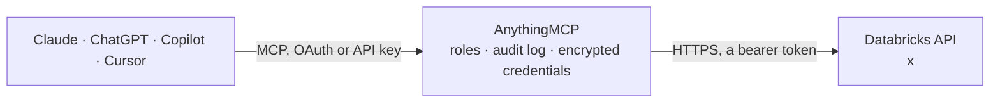

<!-- Generated by scripts/export-github-catalog.mjs in the anythingmcp-website repository. Do not edit by hand. -->

# Databricks MCP connector

Let your AI work with your Databricks workspace: run SQL on a warehouse, explore Unity Catalog catalogs, schemas and tables, check clusters, warehouses, jobs and runs, read notebooks, and start or … The AnythingMCP connector gives Claude, ChatGPT, Microsoft Copilot, Cursor and Gemini 28 MCP tools for Databricks: 20 read and 8 can change data.

**Category:** [Databases](../database.md) · **Tools:** 28 · **Setup guide:** [anythingmcp.com](https://anythingmcp.com/guides/databricks-to-mcp) · [Deutsch](https://anythingmcp.com/de/guides/databricks-to-mcp) · [Italiano](https://anythingmcp.com/it/guides/databricks-to-mcp) · [Español](https://anythingmcp.com/es/guides/databricks-to-mcp) · [日本語](https://anythingmcp.com/ja/guides/databricks-to-mcp) · [Русский](https://anythingmcp.com/ru/guides/databricks-to-mcp) · [中文](https://anythingmcp.com/zh/guides/databricks-to-mcp)

## Start without code

No installation and no terminal: AnythingMCP Cloud runs the Databricks connector for you, operated by helpcode.ai in Frankfurt, Germany.

1. **Click the button above** and create an account or sign in. The Databricks connector opens, ready to install.
2. **Paste the API key or token from your Databricks account.** Every click is in the [step-by-step guide](https://anythingmcp.com/guides/databricks-to-mcp).
3. **Click Install.** AnythingMCP shows the address of your MCP server.
4. **Add that address to your assistant:** [Claude](https://anythingmcp.com/guides/connect-databricks-to-claude) · [ChatGPT](https://anythingmcp.com/guides/connect-databricks-to-chatgpt) · [Microsoft Copilot](https://anythingmcp.com/guides/connect-databricks-to-copilot) · [Cursor](https://anythingmcp.com/guides/connect-databricks-to-cursor) · [Gemini CLI](https://anythingmcp.com/guides/connect-databricks-to-gemini) · [Meta Muse](https://anythingmcp.com/guides/connect-databricks-to-muse).
5. **Ask your first question**, for example: *Show the latest invoice row for customer 'Nordic Forge GmbH' from catalog sales_uc.schema_invoices.orders table*

Prefer help with the setup? [Talk to us](https://anythingmcp.com/contact).

## How it works

- **The AI client** speaks MCP (Streamable HTTP) to AnythingMCP and only sees tool names, descriptions and results. It never gets the Databricks credentials.
- **AnythingMCP** checks the client's role, builds the call from the tool definition, adds the credentials (a bearer token), calls Databricks, logs the call and returns the result.
- **Databricks** sees an ordinary API client with the rights of the account the credentials belong to.

## Tools

| Tool | What it does | Access |
|---|---|---|
| [`databricks_get_current_user`](#databricks_get_current_user) | Get the Databricks user or service principal behind the token: user name, display name, id, active flag, groups and entitlements. | read |
| [`databricks_list_clusters`](#databricks_list_clusters) | List the workspace's clusters (all-purpose and job clusters) with id, name, state, Spark version, node types, size or autoscale range, auto-termination and… | read |
| [`databricks_get_cluster`](#databricks_get_cluster) | Get one cluster's state and configuration: Spark version, node types, workers or autoscale range, auto-termination, access mode, memory and cores, start and… | read |
| [`databricks_start_cluster`](#databricks_start_cluster) | Start a terminated cluster. | write |
| [`databricks_terminate_cluster`](#databricks_terminate_cluster) | Terminate (stop) a running cluster. | write |
| [`databricks_list_warehouses`](#databricks_list_warehouses) | List the SQL warehouses with id, name, state (RUNNING, STOPPED, STARTING), size, type, serverless flag, cluster counts, active sessions and auto-stop minutes. | read |
| [`databricks_get_warehouse`](#databricks_get_warehouse) | Get one SQL warehouse: state, size, type, serverless flag, scaling range, active sessions, auto-stop minutes, health and its JDBC/ODBC connection details… | read |
| [`databricks_start_warehouse`](#databricks_start_warehouse) | Start a stopped SQL warehouse. | write |
| [`databricks_stop_warehouse`](#databricks_stop_warehouse) | Stop a running SQL warehouse. | write |
| [`databricks_execute_sql`](#databricks_execute_sql) | Run one SQL statement on a SQL warehouse and return columns and up to row_limit rows (default 200). | write |
| [`databricks_get_statement`](#databricks_get_statement) | Get the state and result of a SQL statement started with databricks_execute_sql: status (PENDING, RUNNING, SUCCEEDED, FAILED, CANCELED), error, columns and… | read |
| [`databricks_get_statement_chunk`](#databricks_get_statement_chunk) | Get a further chunk of rows of a finished SQL statement, by chunk index (next_chunk_index of the previous answer). | read |
| [`databricks_cancel_statement`](#databricks_cancel_statement) | Cancel a running SQL statement. | write |
| [`databricks_list_jobs`](#databricks_list_jobs) | List the workspace's jobs with id, name, creator, schedule and creation time. | read |
| [`databricks_get_job`](#databricks_get_job) | Get one job: name, description, run-as user, schedule or trigger, job parameters, concurrency, timeout and its tasks (key, dependencies, notebook, SQL,… | read |
| [`databricks_run_job`](#databricks_run_job) | Trigger a run of an existing job now. | write |
| [`databricks_list_job_runs`](#databricks_list_job_runs) | List job runs, newest first, with run id, job id, state, start and end time, duration and a link to the run page. | read |
| [`databricks_get_job_run`](#databricks_get_job_run) | Get one job run: state and result, times, trigger, parameters and each task's run_id, state and run page link. | read |
| [`databricks_get_run_output`](#databricks_get_run_output) | Get the output of one task run: notebook exit value, SQL output, error message and trace, and logs. | read |
| [`databricks_cancel_job_run`](#databricks_cancel_job_run) | Cancel a job run (asynchronously). | write |
| [`databricks_list_catalogs`](#databricks_list_catalogs) | List the Unity Catalog catalogs the user can see, with name, type, owner and comment. | read |
| [`databricks_list_schemas`](#databricks_list_schemas) | List the schemas of a Unity Catalog catalog with full name, owner and comment. | read |
| [`databricks_list_tables`](#databricks_list_tables) | List the tables and views of a Unity Catalog schema with full name, type (MANAGED, EXTERNAL, VIEW, MATERIALIZED_VIEW), format, owner and comment. | read |
| [`databricks_get_table`](#databricks_get_table) | Get a Unity Catalog table or view by full name: columns with types, nullability, comments and partitioning, table type, format, owner, comment, storage… | read |
| [`databricks_list_workspace`](#databricks_list_workspace) | List the contents of a workspace folder: notebooks (with language), files, folders, repos and libraries, with path, object id and modification time. | read |
| [`databricks_export_notebook`](#databricks_export_notebook) | Get the source code of one notebook or workspace file as text (Python, SQL, Scala or R source). | read |
| [`databricks_list_volume_files`](#databricks_list_volume_files) | List the files and folders in a Unity Catalog volume directory, with name, size and modification time. | read |
| [`databricks_list_dbfs`](#databricks_list_dbfs) | List a legacy DBFS directory (path, size, folder flag, modification time). | read |

## Tool reference

Every parameter as the AI client sees it in `tools/list`. Source: [`packages/backend/src/adapters/intl/databricks.json`](../../../packages/backend/src/adapters/intl/databricks.json).

### `databricks_get_current_user`

Get the Databricks user or service principal behind the token: user name, display name, id, active flag, groups and entitlements. Use it to check the connection and who the AI acts as.

**Access:** read · **Call:** `GET /api/2.0/preview/scim/v2/Me`

No parameters.

### `databricks_list_clusters`

List the workspace's clusters (all-purpose and job clusters) with id, name, state, Spark version, node types, size or autoscale range, auto-termination and creator.

**Access:** read · **Call:** `GET /api/2.1/clusters/list`

| Parameter | Type | Required | Description |
|---|---|---|---|
| `page_size` | integer | no | Clusters per page, default 50. |
| `page_token` | string | no | next_page_token from the previous page. |

### `databricks_get_cluster`

Get one cluster's state and configuration: Spark version, node types, workers or autoscale range, auto-termination, access mode, memory and cores, start and termination times and the termination reason.

**Access:** read · **Call:** `GET /api/2.1/clusters/get`

| Parameter | Type | Required | Description |
|---|---|---|---|
| `cluster_id` | string | yes | Cluster id, e.g. '0923-164208-meows279' (from databricks_list_clusters). |

### `databricks_start_cluster`

Start a terminated cluster. Confirm with the user first: a running cluster bills DBUs and cloud VMs until it terminates (see autotermination_minutes). It takes a few minutes; check with databricks_get_cluster.

**Access:** write · **Call:** `POST /api/2.1/clusters/start`

| Parameter | Type | Required | Description |
|---|---|---|---|
| `cluster_id` | string | yes | Cluster id, e.g. '0923-164208-meows279' (from databricks_list_clusters). |

### `databricks_terminate_cluster`

Terminate (stop) a running cluster. It keeps its configuration and can be started again. Confirm with the user first: notebooks and jobs running on it are interrupted.

**Access:** write · **Call:** `POST /api/2.1/clusters/delete`

| Parameter | Type | Required | Description |
|---|---|---|---|
| `cluster_id` | string | yes | Cluster id, e.g. '0923-164208-meows279' (from databricks_list_clusters). |

### `databricks_list_warehouses`

List the SQL warehouses with id, name, state (RUNNING, STOPPED, STARTING), size, type, serverless flag, cluster counts, active sessions and auto-stop minutes. Check this before running SQL: a stopped warehouse starts when queried.

**Access:** read · **Call:** `GET /api/2.0/sql/warehouses`

| Parameter | Type | Required | Description |
|---|---|---|---|
| `page_size` | integer | no | Warehouses per page, default 50. |
| `page_token` | string | no | next_page_token from the previous page. |

### `databricks_get_warehouse`

Get one SQL warehouse: state, size, type, serverless flag, scaling range, active sessions, auto-stop minutes, health and its JDBC/ODBC connection details (host and HTTP path).

**Access:** read · **Call:** `GET /api/2.0/sql/warehouses/{warehouse_id}`

| Parameter | Type | Required | Description |
|---|---|---|---|
| `warehouse_id` | string | yes | SQL warehouse id, e.g. '1234567890abcdef' (from databricks_list_warehouses). |

### `databricks_start_warehouse`

Start a stopped SQL warehouse. Confirm with the user first: it bills DBUs until it auto-stops. Check progress with databricks_get_warehouse.

**Access:** write · **Call:** `POST /api/2.0/sql/warehouses/{warehouse_id}/start`

| Parameter | Type | Required | Description |
|---|---|---|---|
| `warehouse_id` | string | yes | SQL warehouse id, e.g. '1234567890abcdef' (from databricks_list_warehouses). |

### `databricks_stop_warehouse`

Stop a running SQL warehouse. Confirm with the user first: running queries and dashboards using it fail.

**Access:** write · **Call:** `POST /api/2.0/sql/warehouses/{warehouse_id}/stop`

| Parameter | Type | Required | Description |
|---|---|---|---|
| `warehouse_id` | string | yes | SQL warehouse id, e.g. '1234567890abcdef' (from databricks_list_warehouses). |

### `databricks_execute_sql`

Run one SQL statement on a SQL warehouse and return columns and up to row_limit rows (default 200). A stopped warehouse is STARTED automatically and bills DBUs: check databricks_list_warehouses and ask the user first if it is not running. Statements that change data, tables or grants need the user's explicit confirmation first.

**Access:** write · **Call:** `POST /api/2.0/sql/statements`

| Parameter | Type | Required | Description |
|---|---|---|---|
| `warehouse_id` | string | yes | SQL warehouse id, e.g. '1234567890abcdef' (from databricks_list_warehouses). |
| `statement` | string | yes | One SQL statement, e.g. 'SELECT country, count(*) FROM main.sales.orders GROUP BY country'. Use :name placeholders for values. |
| `catalog` | string | no | Default catalog for unqualified names. |
| `schema` | string | no | Default schema for unqualified names. |
| `parameters` | object[] | no | Named parameters, e.g. [{"name": "country", "value": "DE", "type": "STRING"}]. |
| `row_limit` | integer | no | Maximum rows to return, default 200, at most 10000. |
| `wait_timeout` | string | no | How long to wait for the result: '0s' (return at once) or '5s' to '25s'. Default '20s'. A longer query keeps running; poll databricks_get_statement. |
| `byte_limit` | integer | no | Maximum result size in bytes. Default 1000000 (1 MB). |

### `databricks_get_statement`

Get the state and result of a SQL statement started with databricks_execute_sql: status (PENDING, RUNNING, SUCCEEDED, FAILED, CANCELED), error, columns and the first chunk of rows. Poll it every few seconds while the statement runs.

**Access:** read · **Call:** `GET /api/2.0/sql/statements/{statement_id}`

| Parameter | Type | Required | Description |
|---|---|---|---|
| `statement_id` | string | yes | statement_id returned by databricks_execute_sql. |

### `databricks_get_statement_chunk`

Get a further chunk of rows of a finished SQL statement, by chunk index (next_chunk_index of the previous answer). Rows are arrays in the order of the statement's columns.

**Access:** read · **Call:** `GET /api/2.0/sql/statements/{statement_id}/result/chunks/{chunk_index}`

| Parameter | Type | Required | Description |
|---|---|---|---|
| `statement_id` | string | yes | statement_id returned by databricks_execute_sql. |
| `chunk_index` | integer | yes | Chunk to read, from next_chunk_index. |

### `databricks_cancel_statement`

Cancel a running SQL statement. Confirm with the user first. Check the outcome with databricks_get_statement (state CANCELED).

**Access:** write · **Call:** `POST /api/2.0/sql/statements/{statement_id}/cancel`

| Parameter | Type | Required | Description |
|---|---|---|---|
| `statement_id` | string | yes | statement_id returned by databricks_execute_sql. |

### `databricks_list_jobs`

List the workspace's jobs with id, name, creator, schedule and creation time. Filter by exact name; page with page_token.

**Access:** read · **Call:** `GET /api/2.2/jobs/list`

| Parameter | Type | Required | Description |
|---|---|---|---|
| `name` | string | no | Only the job with exactly this name (case-insensitive). |
| `limit` | integer | no | Jobs per page, 1 to 100. Default 25. |
| `page_token` | string | no | next_page_token from the previous page. |

### `databricks_get_job`

Get one job: name, description, run-as user, schedule or trigger, job parameters, concurrency, timeout and its tasks (key, dependencies, notebook, SQL, Python or pipeline task, cluster).

**Access:** read · **Call:** `GET /api/2.2/jobs/get`

| Parameter | Type | Required | Description |
|---|---|---|---|
| `job_id` | integer | yes | Job id (from databricks_list_jobs). |

### `databricks_run_job`

Trigger a run of an existing job now. Confirm with the user first: it uses compute and may change data. Returns the run_id; follow it with databricks_get_job_run.

**Access:** write · **Call:** `POST /api/2.2/jobs/run-now`

| Parameter | Type | Required | Description |
|---|---|---|---|
| `job_id` | integer | yes | Job id (from databricks_list_jobs). |
| `job_parameters` | object | no | Job-level parameter values, e.g. {"date": "2026-10-15"}. Only for jobs that define parameters. |
| `idempotency_token` | string | no | Optional unique token (up to 64 characters) so a retried call does not start a second run. |

### `databricks_list_job_runs`

List job runs, newest first, with run id, job id, state, start and end time, duration and a link to the run page. Filter by job, active or completed runs and start time.

**Access:** read · **Call:** `GET /api/2.2/jobs/runs/list`

| Parameter | Type | Required | Description |
|---|---|---|---|
| `job_id` | integer | no | Job id (from databricks_list_jobs). |
| `active_only` | boolean | no | Only runs that are queued, pending or running. |
| `completed_only` | boolean | no | Only finished runs. |
| `start_time_from` | integer | no | Only runs started at or after this time, milliseconds since 1970. |
| `start_time_to` | integer | no | Only runs started before this time, milliseconds since 1970. |
| `limit` | integer | no | Runs per page, 1 to 25. Default 25. |
| `page_token` | string | no | next_page_token from the previous page. |

### `databricks_get_job_run`

Get one job run: state and result, times, trigger, parameters and each task's run_id, state and run page link. Use the task run_id with databricks_get_run_output.

**Access:** read · **Call:** `GET /api/2.2/jobs/runs/get`

| Parameter | Type | Required | Description |
|---|---|---|---|
| `run_id` | integer | yes | Run id (from databricks_run_job or databricks_list_job_runs). |

### `databricks_get_run_output`

Get the output of one task run: notebook exit value, SQL output, error message and trace, and logs. For a multi-task job pass the task's run_id from databricks_get_job_run. Outputs are kept for 60 days.

**Access:** read · **Call:** `GET /api/2.2/jobs/runs/get-output`

| Parameter | Type | Required | Description |
|---|---|---|---|
| `run_id` | string | yes | Run id of a single task run. |

### `databricks_cancel_job_run`

Cancel a job run (asynchronously). Confirm with the user first: unfinished tasks stop. Check the outcome with databricks_get_job_run.

**Access:** write · **Call:** `POST /api/2.2/jobs/runs/cancel`

| Parameter | Type | Required | Description |
|---|---|---|---|
| `run_id` | integer | yes | Run id (from databricks_run_job or databricks_list_job_runs). |

### `databricks_list_catalogs`

List the Unity Catalog catalogs the user can see, with name, type, owner and comment. Start here to explore data.

**Access:** read · **Call:** `GET /api/2.1/unity-catalog/catalogs`

| Parameter | Type | Required | Description |
|---|---|---|---|
| `max_results` | integer | no | Catalogs per page, default 100. |
| `page_token` | string | no | next_page_token from the previous page. |

### `databricks_list_schemas`

List the schemas of a Unity Catalog catalog with full name, owner and comment.

**Access:** read · **Call:** `GET /api/2.1/unity-catalog/schemas`

| Parameter | Type | Required | Description |
|---|---|---|---|
| `catalog_name` | string | yes | Catalog name, e.g. 'main'. |
| `max_results` | integer | no | Schemas per page, default 100. |
| `page_token` | string | no | next_page_token from the previous page. |

### `databricks_list_tables`

List the tables and views of a Unity Catalog schema with full name, type (MANAGED, EXTERNAL, VIEW, MATERIALIZED_VIEW), format, owner and comment. Columns are left out: use databricks_get_table.

**Access:** read · **Call:** `GET /api/2.1/unity-catalog/tables`

| Parameter | Type | Required | Description |
|---|---|---|---|
| `catalog_name` | string | yes | Catalog name, e.g. 'main'. |
| `schema_name` | string | yes | Schema name, e.g. 'sales'. |
| `max_results` | integer | no | Tables per page, default 100. |
| `page_token` | string | no | next_page_token from the previous page. |

### `databricks_get_table`

Get a Unity Catalog table or view by full name: columns with types, nullability, comments and partitioning, table type, format, owner, comment, storage location and a view's SQL.

**Access:** read · **Call:** `GET /api/2.1/unity-catalog/tables/{full_name}`

| Parameter | Type | Required | Description |
|---|---|---|---|
| `full_name` | string | yes | Three-part name catalog.schema.table, e.g. 'main.sales.orders'. |

### `databricks_list_workspace`

List the contents of a workspace folder: notebooks (with language), files, folders, repos and libraries, with path, object id and modification time.

**Access:** read · **Call:** `GET /api/2.0/workspace/list`

| Parameter | Type | Required | Description |
|---|---|---|---|
| `path` | string | yes | Absolute folder path, e.g. '/Users/anna@example.com' or '/Workspace/Shared'. '/' for the root. |

### `databricks_export_notebook`

Get the source code of one notebook or workspace file as text (Python, SQL, Scala or R source). Keep to small notebooks: the answer is capped at about 100 KB. Read-only.

**Access:** read · **Call:** `GET /api/2.0/workspace/export`

| Parameter | Type | Required | Description |
|---|---|---|---|
| `path` | string | yes | Absolute path of the notebook or file, e.g. '/Users/anna@example.com/etl/daily_load'. |

### `databricks_list_volume_files`

List the files and folders in a Unity Catalog volume directory, with name, size and modification time.

**Access:** read · **Call:** `GET /api/2.0/fs/directories{directory_path}`

| Parameter | Type | Required | Description |
|---|---|---|---|
| `directory_path` | string | yes | Absolute volume path starting with /Volumes, e.g. '/Volumes/main/raw/landing/2026'. |
| `page_size` | integer | no | Entries per page, default 200. |
| `page_token` | string | no | next_page_token from the previous page. |

### `databricks_list_dbfs`

List a legacy DBFS directory (path, size, folder flag, modification time). DBFS root and mounts are deprecated and disabled on many newer workspaces; prefer databricks_list_volume_files.

**Access:** read · **Call:** `GET /api/2.0/dbfs/list`

| Parameter | Type | Required | Description |
|---|---|---|---|
| `path` | string | yes | Absolute DBFS path, e.g. '/FileStore' or 'dbfs:/databricks-datasets'. |

## Run it yourself

AnythingMCP is open source (AGPL-3.0). [Run it with Docker](../../../README.md#run-it-yourself), open **Connectors → Store**, pick **Databricks** and enter `DATABRICKS_HOST`, `DATABRICKS_TOKEN`, then add your MCP server URL to the AI client.

[← Databases connectors](../database.md) · [All categories](../README.md)
