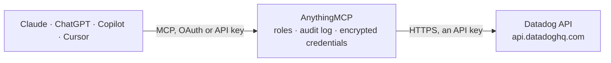

<!-- Generated by scripts/export-github-catalog.mjs in the anythingmcp-website repository. Do not edit by hand. -->

# Datadog MCP connector

Query Datadog (metrics, logs, monitors, events, incidents, dashboards) from any AI agent. 8 tools, dual-key auth. The AnythingMCP connector gives Claude, ChatGPT, Microsoft Copilot, Cursor and Gemini 8 MCP tools for Datadog: 7 read and 1 can change data.

**Category:** [Monitoring](../monitoring.md) · **Tools:** 8 · **Setup guide:** [anythingmcp.com](https://anythingmcp.com/guides/datadog-to-mcp) · [Deutsch](https://anythingmcp.com/de/guides/datadog-to-mcp) · [Italiano](https://anythingmcp.com/it/guides/datadog-to-mcp) · [Español](https://anythingmcp.com/es/guides/datadog-to-mcp) · [日本語](https://anythingmcp.com/ja/guides/datadog-to-mcp) · [Русский](https://anythingmcp.com/ru/guides/datadog-to-mcp) · [中文](https://anythingmcp.com/zh/guides/datadog-to-mcp)

## Start without code

No installation and no terminal: AnythingMCP Cloud runs the Datadog connector for you, operated by helpcode.ai in Frankfurt, Germany.

1. **Click the button above** and create an account or sign in. The Datadog connector opens, ready to install.
2. **Paste the API key or token from your Datadog account.** Every click is in the [step-by-step guide](https://anythingmcp.com/guides/datadog-to-mcp).
3. **Click Install.** AnythingMCP shows the address of your MCP server.
4. **Add that address to your assistant:** [Claude](https://anythingmcp.com/guides/connect-datadog-to-claude) · [ChatGPT](https://anythingmcp.com/guides/connect-datadog-to-chatgpt) · [Microsoft Copilot](https://anythingmcp.com/guides/connect-datadog-to-copilot) · [Cursor](https://anythingmcp.com/guides/connect-datadog-to-cursor) · [Gemini CLI](https://anythingmcp.com/guides/connect-datadog-to-gemini) · [Meta Muse](https://anythingmcp.com/guides/connect-datadog-to-muse).
5. **Ask your first question**, for example: *Show error logs for service:paygate status:error in the last 30 minutes*

Prefer help with the setup? [Talk to us](https://anythingmcp.com/contact).

## How it works

- **The AI client** speaks MCP (Streamable HTTP) to AnythingMCP and only sees tool names, descriptions and results. It never gets the Datadog credentials.
- **AnythingMCP** checks the client's role, builds the call from the tool definition, adds the credentials (an API key), calls Datadog, logs the call and returns the result.
- **Datadog** sees an ordinary API client with the rights of the account the credentials belong to.

## Tools

| Tool | What it does | Access |
|---|---|---|
| [`datadog_query_metrics`](#datadog_query_metrics) | Run a metrics query over a time window. | read |
| [`datadog_search_logs`](#datadog_search_logs) | Search logs using the Logs Search syntax. | read |
| [`datadog_list_monitors`](#datadog_list_monitors) | List monitors. | read |
| [`datadog_get_monitor`](#datadog_get_monitor) | Get a single monitor by ID with full definition (query, thresholds, notifications, state). | read |
| [`datadog_list_dashboards`](#datadog_list_dashboards) | List all dashboards in the org. | read |
| [`datadog_get_dashboard`](#datadog_get_dashboard) | Fetch a dashboard's full layout: widgets, queries, template variables. | read |
| [`datadog_list_events`](#datadog_list_events) | List events in a time range. | read |
| [`datadog_post_event`](#datadog_post_event) | Post an event to the Datadog event stream (useful for marking deploys, releases, manual incidents). | write |

## Tool reference

Every parameter as the AI client sees it in `tools/list`. Source: [`packages/backend/src/adapters/intl/datadog.json`](../../../packages/backend/src/adapters/intl/datadog.json).

### `datadog_query_metrics`

Run a metrics query over a time window. `q` uses the Datadog metric query language: e.g. `avg:system.cpu.user{*}` or `sum:requests{service:api,env:prod} by {host}`. Returns a series array with per-point [timestamp, value] pairs.

**Access:** read · **Call:** `GET /api/v1/query`

| Parameter | Type | Required | Description |
|---|---|---|---|
| `from` | integer | yes | Start UNIX epoch seconds. |
| `to` | integer | yes | End UNIX epoch seconds. |
| `query` | string | yes | Datadog metric query expression. |

### `datadog_search_logs`

Search logs using the Logs Search syntax. Use this for 'show me errors in the last hour' or 'find logs containing X in service Y'.

**Access:** read · **Call:** `POST /api/v2/logs/events/search`

| Parameter | Type | Required | Description |
|---|---|---|---|
| `query` | string | yes | Logs query string, e.g. 'service:api status:error'. |
| `from` | string | no | Start time: ISO 8601 OR relative like 'now-15m'. |
| `to` | string | no | End time: ISO 8601 OR 'now'. |
| `limit` | integer | no | Max events (1-1000). Default 10. |
| `sort` | string | no | 'timestamp' (asc) or '-timestamp' (desc). |

### `datadog_list_monitors`

List monitors. Filter by tags, name match, or monitor type. Returns each monitor's id, name, query, type, message, state.

**Access:** read · **Call:** `GET /api/v1/monitor`

| Parameter | Type | Required | Description |
|---|---|---|---|
| `name` | string | no | Filter by name substring. |
| `tags` | string | no | Comma-separated tag list (AND). |
| `monitor_tags` | string | no | Filter by monitor-level tags. |
| `page` | integer | no | 0-based page index. |
| `page_size` | integer | no | Per page (max 100). |

### `datadog_get_monitor`

Get a single monitor by ID with full definition (query, thresholds, notifications, state).

**Access:** read · **Call:** `GET /api/v1/monitor/{monitor_id}`

| Parameter | Type | Required | Description |
|---|---|---|---|
| `monitor_id` | integer | yes | Monitor numeric ID. |

### `datadog_list_dashboards`

List all dashboards in the org. Returns each dashboard's id, title, url, author, modified_at. Use this to find a dashboard ID before fetching its full layout.

**Access:** read · **Call:** `GET /api/v1/dashboard`

| Parameter | Type | Required | Description |
|---|---|---|---|
| `filter_shared` | boolean | no | If true, only shared dashboards. |

### `datadog_get_dashboard`

Fetch a dashboard's full layout: widgets, queries, template variables.

**Access:** read · **Call:** `GET /api/v1/dashboard/{dashboard_id}`

| Parameter | Type | Required | Description |
|---|---|---|---|
| `dashboard_id` | string | yes | Dashboard ID. |

### `datadog_list_events`

List events in a time range. Use for 'what deploys/alerts/changes happened today'. Filter by tags, priority, sources, or text query.

**Access:** read · **Call:** `GET /api/v1/events`

| Parameter | Type | Required | Description |
|---|---|---|---|
| `start` | integer | yes | Start UNIX epoch seconds. |
| `end` | integer | yes | End UNIX epoch seconds. |
| `priority` | string | no | 'normal' or 'low'. |
| `sources` | string | no | Comma-separated sources, e.g. 'github,jira'. |
| `tags` | string | no | Comma-separated tags. |
| `unaggregated` | boolean | no | If true, return all events (not deduped/aggregated). |

### `datadog_post_event`

Post an event to the Datadog event stream (useful for marking deploys, releases, manual incidents). Returns the created event's id + url.

**Access:** write · **Call:** `POST /api/v1/events`

| Parameter | Type | Required | Description |
|---|---|---|---|
| `title` | string | yes | Event title. |
| `text` | string | yes | Event body (supports @-mentions and Markdown). |
| `tags` | any[] | no | Tag strings like 'env:prod' or 'service:api'. |
| `alert_type` | string | no | 'info', 'warning', 'error', 'success', 'user_update', 'recommendation', 'snapshot'. |
| `priority` | string | no | 'normal' or 'low'. |

## Run it yourself

AnythingMCP is open source (AGPL-3.0). [Run it with Docker](../../../README.md#run-it-yourself), open **Connectors → Store**, pick **Datadog** and enter `DATADOG_API_KEY`, `DATADOG_APP_KEY`, then add your MCP server URL to the AI client.

[← Monitoring connectors](../monitoring.md) · [All categories](../README.md)
