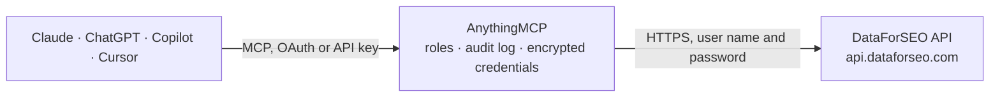

<!-- Generated by scripts/export-github-catalog.mjs in the anythingmcp-website repository. Do not edit by hand. -->

# DataForSEO MCP connector

Give your AI SEO data from DataForSEO: live Google results, keyword search volume and ideas, keyword difficulty, ranked keywords and competitors of any domain, backlinks, instant on-page checks and … The AnythingMCP connector gives Claude, ChatGPT, Microsoft Copilot, Cursor and Gemini 18 MCP tools for DataForSEO, all read-only.

**Category:** [Analytics](../analytics.md) · **Tools:** 18 · **Setup guide:** [anythingmcp.com](https://anythingmcp.com/guides/dataforseo-to-mcp) · [Deutsch](https://anythingmcp.com/de/guides/dataforseo-to-mcp) · [Italiano](https://anythingmcp.com/it/guides/dataforseo-to-mcp) · [Español](https://anythingmcp.com/es/guides/dataforseo-to-mcp) · [日本語](https://anythingmcp.com/ja/guides/dataforseo-to-mcp) · [Русский](https://anythingmcp.com/ru/guides/dataforseo-to-mcp) · [中文](https://anythingmcp.com/zh/guides/dataforseo-to-mcp)

## Start without code

No installation and no terminal: AnythingMCP Cloud runs the DataForSEO connector for you, operated by helpcode.ai in Frankfurt, Germany.

1. **Click the button above** and create an account or sign in. The DataForSEO connector opens, ready to install.
2. **Paste the API key or token from your DataForSEO account.** Every click is in the [step-by-step guide](https://anythingmcp.com/guides/dataforseo-to-mcp).
3. **Click Install.** AnythingMCP shows the address of your MCP server.
4. **Add that address to your assistant:** [Claude](https://anythingmcp.com/guides/connect-dataforseo-to-claude) · [ChatGPT](https://anythingmcp.com/guides/connect-dataforseo-to-chatgpt) · [Microsoft Copilot](https://anythingmcp.com/guides/connect-dataforseo-to-copilot) · [Cursor](https://anythingmcp.com/guides/connect-dataforseo-to-cursor) · [Gemini CLI](https://anythingmcp.com/guides/connect-dataforseo-to-gemini) · [Meta Muse](https://anythingmcp.com/guides/connect-dataforseo-to-muse).
5. **Ask your first question**, for example: *What's our DataForSEO API login and current USD balance right now?*

Prefer help with the setup? [Talk to us](https://anythingmcp.com/contact).

## How it works

- **The AI client** speaks MCP (Streamable HTTP) to AnythingMCP and only sees tool names, descriptions and results. It never gets the DataForSEO credentials.
- **AnythingMCP** checks the client's role, builds the call from the tool definition, adds the credentials (user name and password), calls DataForSEO, logs the call and returns the result.
- **DataForSEO** sees an ordinary API client with the rights of the account the credentials belong to.

## Tools

| Tool | What it does | Access |
|---|---|---|
| [`dataforseo_get_account`](#dataforseo_get_account) | Read the DataForSEO account: login, time zone and the money balance left (USD). | read |
| [`dataforseo_list_locations`](#dataforseo_list_locations) | List the location codes of one country for SERP and Google Ads requests: the country, its regions, cities, municipalities, counties and districts (postal… | read |
| [`dataforseo_list_languages`](#dataforseo_list_languages) | List the language codes and names Google SERP requests accept (en English, de German, ...). | read |
| [`dataforseo_list_labs_locations`](#dataforseo_list_labs_locations) | List the countries DataForSEO Labs has data for, with their location codes and the languages available in each (with the number of keywords per language). | read |
| [`dataforseo_serp_google_organic`](#dataforseo_serp_google_organic) | Get the live Google results page for a keyword in a location and language: organic results with position, title, URL and snippet, plus featured snippets,… | read |
| [`dataforseo_keywords_search_volume`](#dataforseo_keywords_search_volume) | Get Google Ads search volume, monthly searches, competition and cost per click for up to 1,000 keywords in one call. | read |
| [`dataforseo_keywords_for_keywords`](#dataforseo_keywords_for_keywords) | Get keyword ideas from Google Ads Keyword Planner for up to 20 seed keywords, with search volume, competition and cost per click. | read |
| [`dataforseo_labs_ranked_keywords`](#dataforseo_labs_ranked_keywords) | List the Google keywords a domain, subdomain or page ranks for, with position, ranking URL, search volume, cost per click, keyword difficulty and search… | read |
| [`dataforseo_labs_keyword_ideas`](#dataforseo_labs_keyword_ideas) | Find keyword ideas in the same topic category as up to 200 seed keywords, with search volume, cost per click, competition, keyword difficulty and search… | read |
| [`dataforseo_labs_related_keywords`](#dataforseo_labs_related_keywords) | Get the keywords Google shows under "searches related to" for a seed keyword, up to four levels deep, with search volume, cost per click, competition,… | read |
| [`dataforseo_labs_competitors_domain`](#dataforseo_labs_competitors_domain) | Find the domains that compete with a domain in Google: shared keywords, average position and their organic and paid traffic estimates. | read |
| [`dataforseo_labs_domain_rank_overview`](#dataforseo_labs_domain_rank_overview) | Get the Google ranking overview of a domain: how many keywords it ranks for in positions 1, 2-3, 4-10 and beyond, estimated organic and paid traffic and… | read |
| [`dataforseo_labs_bulk_keyword_difficulty`](#dataforseo_labs_bulk_keyword_difficulty) | Get the keyword difficulty (0 to 100, how hard it is to reach the Google top 10) of up to 1,000 keywords. | read |
| [`dataforseo_backlinks_summary`](#dataforseo_backlinks_summary) | Get the backlink profile summary of a domain, subdomain or page: rank, backlinks, referring domains, IPs and subnets, nofollow counts, broken links, spam… | read |
| [`dataforseo_backlinks_list`](#dataforseo_backlinks_list) | List the backlinks of a domain, subdomain or page: linking URL and domain, target URL, anchor text, dofollow, ranks of the linking page and domain, first… | read |
| [`dataforseo_backlinks_referring_domains`](#dataforseo_backlinks_referring_domains) | List the domains that link to a domain, subdomain or page, with their rank, number of backlinks, referring pages, first seen and lost dates and spam score. | read |
| [`dataforseo_onpage_instant_page`](#dataforseo_onpage_instant_page) | Crawl one page now and get its on-page SEO data: status code, title, meta description, canonical, headings, word count and readability, link and image… | read |
| [`dataforseo_domain_technologies`](#dataforseo_domain_technologies) | Detect the technologies a website uses (CMS, analytics, advertising, frameworks, hosting, payment, marketing tools ...) with its title, description,… | read |

## Tool reference

Every parameter as the AI client sees it in `tools/list`. Source: [`packages/backend/src/adapters/intl/dataforseo.json`](../../../packages/backend/src/adapters/intl/dataforseo.json).

### `dataforseo_get_account`

Read the DataForSEO account: login, time zone and the money balance left (USD). Free: DataForSEO does not charge for this call. Use it to check the balance before an expensive batch.

**Access:** read · **Call:** `GET /appendix/user_data`

No parameters.

### `dataforseo_list_locations`

List the location codes of one country for SERP and Google Ads requests: the country, its regions, cities, municipalities, counties and districts (postal codes, neighbourhoods, airports and universities are left out). Free. Large countries have thousands of cities, so the list is cut after about 1,000 rows; for a city it is usually easier to pass location_name as city,region,country directly.

**Access:** read · **Call:** `GET /serp/google/locations/{country}`

| Parameter | Type | Required | Description |
|---|---|---|---|
| `country` | string | yes | Two-letter ISO country code, lower case, e.g. de, us, it, gb. |

### `dataforseo_list_languages`

List the language codes and names Google SERP requests accept (en English, de German, ...). Free.

**Access:** read · **Call:** `GET /serp/google/languages`

No parameters.

### `dataforseo_list_labs_locations`

List the countries DataForSEO Labs has data for, with their location codes and the languages available in each (with the number of keywords per language). Free. The country codes also work for SERP and Google Ads requests.

**Access:** read · **Call:** `GET /dataforseo_labs/locations_and_languages`

No parameters.

### `dataforseo_serp_google_organic`

Get the live Google results page for a keyword in a location and language: organic results with position, title, URL and snippet, plus featured snippets, People also ask, AI overview, local pack, top stories and related searches when Google shows them. Costs $0.002 per call (one page of 10 results); each further 10 results of depth cost another $0.002, a keyword with a search operator (site:, intitle:, inurl:, filetype: ...) costs 5 times as much, load_async_ai_overview adds $0.002 and each People also ask click $0.00015. Read-only.

**Access:** read · **Call:** `POST /serp/google/organic/live/advanced`

| Parameter | Type | Required | Description |
|---|---|---|---|
| `keyword` | string | yes | The search query, up to 700 characters. Search operators such as site: multiply the price by 5. |
| `location_code` | integer | no | Location code, e.g. 2840 United States, 2276 Germany, 2826 United Kingdom, 2380 Italy, 2250 France, 2724 Spain, 2040 Austria, 2756 Switzerland. Give location_code or location_name. dataforseo_list_locations lists regions and cities of a country. |
| `location_name` | string | no | Location by its full DataForSEO name instead of a code: a country (Germany) or a city as city,region,country (Munich,Bavaria,Germany; London,England,United Kingdom). |
| `language_code` | string | no | Language code of the search, e.g. en, de, it, fr, es. dataforseo_list_languages lists them. |
| `depth` | integer | no | Number of results to fetch. Default 10 (one page, $0.002); billed per started block of 10. |
| `device` | `desktop` \| `mobile` | no | Device to search from. Default desktop. |
| `load_async_ai_overview` | boolean | no | Also load an AI overview that Google renders after the page ($0.002 extra, refunded when there is none). |
| `people_also_ask_click_depth` | integer | no | Expand People also ask questions by this many clicks to get more questions ($0.00015 per click). |

### `dataforseo_keywords_search_volume`

Get Google Ads search volume, monthly searches, competition and cost per click for up to 1,000 keywords in one call. Costs $0.09 per call, whatever the number of keywords. Google Ads live calls are limited to 12 a minute per account. Read-only.

**Access:** read · **Call:** `POST /keywords_data/google_ads/search_volume/live`

| Parameter | Type | Required | Description |
|---|---|---|---|
| `keywords` | string[] | yes | Up to 1,000 keywords of at most 80 characters and 10 words each; no emojis. |
| `location_code` | integer | no | Location code, e.g. 2840 United States, 2276 Germany, 2826 United Kingdom, 2380 Italy. Leave out location_code and location_name for worldwide data. |
| `location_name` | string | no | Location by its full DataForSEO name instead of a code, e.g. Germany or Munich,Bavaria,Germany. |
| `language_code` | string | no | Language code, e.g. en, de, it. Leave out for all languages. |
| `search_partners` | boolean | no | Include Google search partner sites. Default false. |
| `date_from` | string | no | First month of the range as YYYY-MM-DD, at most 4 years back. Default: the last 12 months. |
| `date_to` | string | no | Last month of the range as YYYY-MM-DD. Default: the most recent month with data. |
| `include_adult_keywords` | boolean | no | Include adult keywords. Default false. |
| `sort_by` | `relevance` \| `search_volume` \| `competition_index` \| `low_top_of_page_bid` \| `high_top_of_page_bid` | no | Sort order of the results, descending. Default relevance. |

### `dataforseo_keywords_for_keywords`

Get keyword ideas from Google Ads Keyword Planner for up to 20 seed keywords, with search volume, competition and cost per click. Costs $0.09 per call. Google returns up to 20,000 ideas; this tool keeps the first 100 in the chosen sort order (sort_by search_volume for the biggest). Limited to 12 calls a minute per account. Read-only.

**Access:** read · **Call:** `POST /keywords_data/google_ads/keywords_for_keywords/live`

| Parameter | Type | Required | Description |
|---|---|---|---|
| `keywords` | string[] | yes | Up to 20 seed keywords of at most 80 characters each. |
| `location_code` | integer | no | Location code, e.g. 2840 United States, 2276 Germany, 2826 United Kingdom, 2380 Italy. Leave out location_code and location_name for worldwide data. |
| `location_name` | string | no | Location by its full DataForSEO name instead of a code, e.g. Germany or Munich,Bavaria,Germany. |
| `language_code` | string | no | Language code, e.g. en, de, it. Leave out for all languages. |
| `search_partners` | boolean | no | Include Google search partner sites. Default false. |
| `date_from` | string | no | First month of the range as YYYY-MM-DD. Default: the last 12 months. |
| `date_to` | string | no | Last month of the range as YYYY-MM-DD. |
| `include_adult_keywords` | boolean | no | Include adult keywords. Default false. |
| `sort_by` | `relevance` \| `search_volume` \| `competition_index` \| `low_top_of_page_bid` \| `high_top_of_page_bid` | no | Sort order of the results, descending. Default relevance. |

### `dataforseo_labs_ranked_keywords`

List the Google keywords a domain, subdomain or page ranks for, with position, ranking URL, search volume, cost per click, keyword difficulty and search intent, plus the ranking distribution and estimated traffic of the target. Costs $0.012 per call plus $0.00012 per returned keyword (20 keywords: $0.0144). Read-only.

**Access:** read · **Call:** `POST /dataforseo_labs/google/ranked_keywords/live`

| Parameter | Type | Required | Description |
|---|---|---|---|
| `target` | string | yes | Domain without https:// or www. (example.com), or a full page URL with https:// for a single page. |
| `location_code` | integer | no | Country code, e.g. 2840 United States, 2276 Germany, 2826 United Kingdom, 2380 Italy, 2250 France, 2724 Spain. Leave out for all countries. DataForSEO Labs only knows countries; dataforseo_list_labs_locations lists them with their languages. |
| `location_name` | string | no | Country by its English name instead of a code, e.g. Germany or United Kingdom. |
| `language_code` | string | no | Language code, e.g. en, de, it. Leave out for all languages. |
| `limit` | integer | no | How many keywords to return, 1 to 1000. Default 20; every returned row is billed, so keep it small and page with offset. |
| `offset` | integer | no | Rows to skip, for paging. |
| `item_types` | `organic` \| `paid` \| `featured_snippet` \| `local_pack` \| `ai_overview_reference`[] | no | Result types to include. Default organic and paid. |
| `historical_serp_mode` | `live` \| `lost` \| `all` | no | live: keywords the target ranks for now (default); lost: keywords it lost; all: both. |
| `ignore_synonyms` | boolean | no | Leave out near-duplicate keywords. Default false. |
| `filters` | any[] | no | DataForSEO filter expression, up to 8 conditions joined with "and"/"or", e.g. ["keyword_data.keyword_info.search_volume", ">", 100] or [["ranked_serp_element.serp_item.rank_group", "<=", 10], "and", ["keyword_data.keyword_info.search_volume", ">", 0]]. Operators: =, <>, <, <=, >, >=, in, not_in, like, not_like, ilike, not_ilike, regex, not_regex, match, not_match. |
| `order_by` | string[] | no | Sort rules as "field,asc" or "field,desc", at most three, e.g. ["keyword_data.keyword_info.search_volume,desc"] (default rank_group,asc). |

### `dataforseo_labs_keyword_ideas`

Find keyword ideas in the same topic category as up to 200 seed keywords, with search volume, cost per click, competition, keyword difficulty and search intent, from the DataForSEO Labs database. Costs $0.012 per call plus $0.00012 per returned keyword. Read-only.

**Access:** read · **Call:** `POST /dataforseo_labs/google/keyword_ideas/live`

| Parameter | Type | Required | Description |
|---|---|---|---|
| `keywords` | string[] | yes | Up to 200 seed keywords. |
| `location_code` | integer | no | Country code, e.g. 2840 United States, 2276 Germany, 2826 United Kingdom, 2380 Italy, 2250 France, 2724 Spain. Give location_code or location_name. DataForSEO Labs only knows countries; dataforseo_list_labs_locations lists them with their languages. |
| `location_name` | string | no | Country by its English name instead of a code, e.g. Germany or United Kingdom. |
| `language_code` | string | no | Language code, e.g. en, de, it. Required with some locations; when left out DataForSEO picks the language with the most data in that country. |
| `limit` | integer | no | How many keyword ideas to return, 1 to 1000. Default 20; every returned row is billed, so keep it small and page with offset. |
| `offset` | integer | no | Rows to skip, for paging. |
| `closely_variants` | boolean | no | true for phrase match, false (default) for broad match. |
| `ignore_synonyms` | boolean | no | Leave out near-duplicate keywords. Default false. |
| `filters` | any[] | no | DataForSEO filter expression, up to 8 conditions joined with "and"/"or", e.g. ["keyword_info.search_volume", ">", 100]. Operators: =, <>, <, <=, >, >=, in, not_in, like, not_like, ilike, not_ilike, regex, not_regex, match, not_match. |
| `order_by` | string[] | no | Sort rules as "field,asc" or "field,desc", at most three, e.g. ["keyword_info.search_volume,desc"] (default relevance,desc). |

### `dataforseo_labs_related_keywords`

Get the keywords Google shows under "searches related to" for a seed keyword, up to four levels deep, with search volume, cost per click, competition, keyword difficulty and search intent. Costs $0.012 per call plus $0.00012 per returned keyword. Read-only.

**Access:** read · **Call:** `POST /dataforseo_labs/google/related_keywords/live`

| Parameter | Type | Required | Description |
|---|---|---|---|
| `keyword` | string | yes | The seed keyword. |
| `location_code` | integer | no | Country code, e.g. 2840 United States, 2276 Germany, 2826 United Kingdom, 2380 Italy, 2250 France, 2724 Spain. Give location_code or location_name. DataForSEO Labs only knows countries; dataforseo_list_labs_locations lists them with their languages. |
| `location_name` | string | no | Country by its English name instead of a code, e.g. Germany or United Kingdom. |
| `language_code` | string | no | Language code, e.g. en, de, it. Required with some locations; when left out DataForSEO picks the language with the most data in that country. |
| `depth` | integer | no | How far to follow related searches: 0 the seed only, 1 about 8 keywords (default), 2 about 72, 3 about 584, 4 about 4,680 (limit still caps the rows). |
| `limit` | integer | no | How many keywords to return, 1 to 1000. Default 20; every returned row is billed, so keep it small and page with offset. |
| `offset` | integer | no | Rows to skip, for paging. |
| `include_seed_keyword` | boolean | no | Also return the metrics of the seed keyword. |
| `ignore_synonyms` | boolean | no | Leave out near-duplicate keywords. Default false. |
| `filters` | any[] | no | DataForSEO filter expression, up to 8 conditions joined with "and"/"or", e.g. ["keyword_data.keyword_info.search_volume", ">", 100]. Operators: =, <>, <, <=, >, >=, in, not_in, like, not_like, ilike, not_ilike, regex, not_regex, match, not_match. |
| `order_by` | string[] | no | Sort rules as "field,asc" or "field,desc", at most three, e.g. ["keyword_data.keyword_info.search_volume,desc"]. |

### `dataforseo_labs_competitors_domain`

Find the domains that compete with a domain in Google: shared keywords, average position and their organic and paid traffic estimates. Costs $0.012 per call plus $0.00012 per returned domain. Read-only.

**Access:** read · **Call:** `POST /dataforseo_labs/google/competitors_domain/live`

| Parameter | Type | Required | Description |
|---|---|---|---|
| `target` | string | yes | Domain without https:// or www., e.g. example.com. |
| `location_code` | integer | no | Country code, e.g. 2840 United States, 2276 Germany, 2826 United Kingdom, 2380 Italy, 2250 France, 2724 Spain. Give location_code or location_name. DataForSEO Labs only knows countries; dataforseo_list_labs_locations lists them with their languages. |
| `location_name` | string | no | Country by its English name instead of a code, e.g. Germany or United Kingdom. |
| `language_code` | string | no | Language code, e.g. en, de, it. Required with some locations; when left out DataForSEO picks the language with the most data in that country. |
| `limit` | integer | no | How many competitor domains to return, 1 to 1000. Default 10; every returned row is billed, so keep it small and page with offset. |
| `offset` | integer | no | Rows to skip, for paging. |
| `item_types` | `organic` \| `paid` \| `featured_snippet` \| `local_pack`[] | no | Result types to compare. Default organic and paid. |
| `exclude_top_domains` | boolean | no | Leave out the largest sites (wikipedia.org, amazon.com, youtube.com, reddit.com and similar). Default false. |
| `exclude_domains` | string[] | no | Domains to leave out of the results. |
| `intersecting_domains` | string[] | no | Further domains whose shared keywords sharpen the result. |
| `filters` | any[] | no | DataForSEO filter expression, up to 8 conditions joined with "and"/"or", e.g. ["metrics.organic.count", ">", 50]. Operators: =, <>, <, <=, >, >=, in, not_in, like, not_like, ilike, not_ilike, regex, not_regex, match, not_match. |
| `order_by` | string[] | no | Sort rules as "field,asc" or "field,desc", at most three, e.g. ["intersections,desc"]. |

### `dataforseo_labs_domain_rank_overview`

Get the Google ranking overview of a domain: how many keywords it ranks for in positions 1, 2-3, 4-10 and beyond, estimated organic and paid traffic and their value, and new, improved, declined and lost rankings. Costs $0.012 per call plus $0.00012 per returned row (one row per country and language). Read-only.

**Access:** read · **Call:** `POST /dataforseo_labs/google/domain_rank_overview/live`

| Parameter | Type | Required | Description |
|---|---|---|---|
| `target` | string | yes | Domain without https:// or www., e.g. example.com. |
| `location_code` | integer | no | Country code, e.g. 2840 United States, 2276 Germany, 2826 United Kingdom, 2380 Italy, 2250 France, 2724 Spain. Leave out for all countries. DataForSEO Labs only knows countries; dataforseo_list_labs_locations lists them with their languages. |
| `location_name` | string | no | Country by its English name instead of a code, e.g. Germany or United Kingdom. |
| `language_code` | string | no | Language code, e.g. en, de, it. Leave out for all languages. |
| `limit` | integer | no | How many country and language rows to return, 1 to 1000. Default 10; every returned row is billed, so keep it small and page with offset. |
| `offset` | integer | no | Rows to skip, for paging. |
| `ignore_synonyms` | boolean | no | Leave out near-duplicate keywords. Default false. |

### `dataforseo_labs_bulk_keyword_difficulty`

Get the keyword difficulty (0 to 100, how hard it is to reach the Google top 10) of up to 1,000 keywords. Costs $0.012 per call plus $0.00012 per keyword. Read-only.

**Access:** read · **Call:** `POST /dataforseo_labs/google/bulk_keyword_difficulty/live`

| Parameter | Type | Required | Description |
|---|---|---|---|
| `keywords` | string[] | yes | Up to 1,000 keywords. |
| `location_code` | integer | no | Country code, e.g. 2840 United States, 2276 Germany, 2826 United Kingdom, 2380 Italy, 2250 France, 2724 Spain. Give location_code or location_name. DataForSEO Labs only knows countries; dataforseo_list_labs_locations lists them with their languages. |
| `location_name` | string | no | Country by its English name instead of a code, e.g. Germany or United Kingdom. |
| `language_code` | string | no | Language code, e.g. en, de, it. Required with some locations; when left out DataForSEO picks the language with the most data in that country. |

### `dataforseo_backlinks_summary`

Get the backlink profile summary of a domain, subdomain or page: rank, backlinks, referring domains, IPs and subnets, nofollow counts, broken links, spam score and the split by link type, attribute, platform and country. Costs $0.024 per call (+$0.000036 per row). The Backlinks API may need activating in the DataForSEO account first. Read-only.

**Access:** read · **Call:** `POST /backlinks/summary/live`

| Parameter | Type | Required | Description |
|---|---|---|---|
| `target` | string | yes | Domain or subdomain without https:// or www. (example.com), or a full page URL with https://. |
| `include_subdomains` | boolean | no | Count links to subdomains too. Default true. |
| `include_indirect_links` | boolean | no | Count links that reach the target through a redirect or canonical. Default true. |
| `exclude_internal_backlinks` | boolean | no | Leave out links from the target's own subdomains. Default true. |
| `backlinks_status_type` | `live` \| `lost` \| `all` | no | live: links found at the last check (default); lost: links that disappeared; all: both. |
| `internal_list_limit` | integer | no | Entries in each breakdown (TLDs, link types, countries ...). Default 10. |
| `rank_scale` | `one_hundred` \| `one_thousand` | no | Scale of the rank values, 0-100 or 0-1000 (default). |

### `dataforseo_backlinks_list`

List the backlinks of a domain, subdomain or page: linking URL and domain, target URL, anchor text, dofollow, ranks of the linking page and domain, first and last seen, new, lost or broken, and spam score. Costs $0.024 per call plus $0.000036 per returned backlink. The Backlinks API may need activating in the DataForSEO account first. Read-only.

**Access:** read · **Call:** `POST /backlinks/backlinks/live`

| Parameter | Type | Required | Description |
|---|---|---|---|
| `target` | string | yes | Domain or subdomain without https:// or www. (example.com), or a full page URL with https://. |
| `mode` | `as_is` \| `one_per_domain` \| `one_per_anchor` | no | as_is: every backlink (default); one_per_domain: the best one per linking domain; one_per_anchor: one per anchor text. |
| `limit` | integer | no | How many backlinks to return, 1 to 1000. Default 20; every returned row is billed, so keep it small and page with offset. |
| `offset` | integer | no | Rows to skip, for paging up to 20,000; beyond that use search_after_token. |
| `search_after_token` | string | no | search_after_token from the previous answer, to continue past 20,000 rows. |
| `backlinks_status_type` | `live` \| `lost` \| `all` | no | live: links found at the last check (default); lost: links that disappeared; all: both. |
| `include_subdomains` | boolean | no | Include links to subdomains. Default true. |
| `exclude_internal_backlinks` | boolean | no | Leave out links from the target's own subdomains. Default true. |
| `filters` | any[] | no | DataForSEO filter expression, up to 8 conditions joined with "and"/"or", e.g. ["dofollow", "=", true] or [["domain_from_rank", ">", 100], "and", ["anchor", "like", "%seo%"]]. Operators: =, <>, <, <=, >, >=, in, not_in, like, not_like, ilike, not_ilike, regex, not_regex, match, not_match. |
| `order_by` | string[] | no | Sort rules as "field,asc" or "field,desc", at most three, e.g. ["rank,desc"] or ["first_seen,desc"]. |
| `rank_scale` | `one_hundred` \| `one_thousand` | no | Scale of the rank values, 0-100 or 0-1000 (default). |

### `dataforseo_backlinks_referring_domains`

List the domains that link to a domain, subdomain or page, with their rank, number of backlinks, referring pages, first seen and lost dates and spam score. Costs $0.024 per call plus $0.000036 per returned domain. The Backlinks API may need activating in the DataForSEO account first. Read-only.

**Access:** read · **Call:** `POST /backlinks/referring_domains/live`

| Parameter | Type | Required | Description |
|---|---|---|---|
| `target` | string | yes | Domain or subdomain without https:// or www. (example.com), or a full page URL with https://. |
| `limit` | integer | no | How many referring domains to return, 1 to 1000. Default 20; every returned row is billed, so keep it small and page with offset. |
| `offset` | integer | no | Rows to skip, for paging. |
| `backlinks_status_type` | `live` \| `lost` \| `all` | no | live: links found at the last check (default); lost: links that disappeared; all: both. |
| `include_subdomains` | boolean | no | Include links to subdomains. Default true. |
| `include_indirect_links` | boolean | no | Include links through redirects or canonicals. Default true. |
| `exclude_internal_backlinks` | boolean | no | Leave out the target's own subdomains. Default true. |
| `filters` | any[] | no | DataForSEO filter expression, up to 8 conditions joined with "and"/"or", e.g. ["backlinks", ">", 10]. Operators: =, <>, <, <=, >, >=, in, not_in, like, not_like, ilike, not_ilike, regex, not_regex, match, not_match. |
| `order_by` | string[] | no | Sort rules as "field,asc" or "field,desc", at most three, e.g. ["rank,desc"] or ["backlinks,desc"]. |
| `rank_scale` | `one_hundred` \| `one_thousand` | no | Scale of the rank values, 0-100 or 0-1000 (default). |

### `dataforseo_onpage_instant_page`

Crawl one page now and get its on-page SEO data: status code, title, meta description, canonical, headings, word count and readability, link and image counts, page timing, on-page score and the failed checks (missing h1, duplicate tags, large page, slow load ...). Costs $0.00015 per page; load_resources makes it $0.00045, enable_javascript $0.0015 and enable_browser_rendering (Core Web Vitals) $0.0051. Read-only: it only reads the page.

**Access:** read · **Call:** `POST /on_page/instant_pages`

| Parameter | Type | Required | Description |
|---|---|---|---|
| `url` | string | yes | Absolute URL of the page, e.g. https://example.com/pricing. |
| `load_resources` | boolean | no | Also load images, stylesheets and scripts to find broken resources ($0.0003 extra). |
| `enable_javascript` | boolean | no | Run the page scripts before reading it ($0.00135 extra). |
| `enable_browser_rendering` | boolean | no | Full browser rendering for Core Web Vitals (LCP, CLS); includes resources and JavaScript ($0.0051 per page in total). |
| `accept_language` | string | no | Accept-Language header for the crawl, e.g. de-DE. |

### `dataforseo_domain_technologies`

Detect the technologies a website uses (CMS, analytics, advertising, frameworks, hosting, payment, marketing tools ...) with its title, description, country, language and social profiles. Costs $0.012 per call. Read-only.

**Access:** read · **Call:** `POST /domain_analytics/technologies/domain_technologies/live`

| Parameter | Type | Required | Description |
|---|---|---|---|
| `target` | string | yes | Domain without https:// or www., e.g. example.com. |

## Run it yourself

AnythingMCP is open source (AGPL-3.0). [Run it with Docker](../../../README.md#run-it-yourself), open **Connectors → Store**, pick **DataForSEO** and enter `DATAFORSEO_LOGIN`, `DATAFORSEO_PASSWORD`, then add your MCP server URL to the AI client.

[← Analytics connectors](../analytics.md) · [All categories](../README.md)
