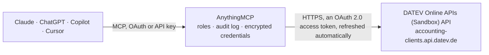

<!-- Generated by scripts/export-github-catalog.mjs in the anythingmcp-website repository. Do not edit by hand. -->

# DATEV Online APIs (Sandbox) MCP connector

Sandbox environment for the DATEV Online APIs — read accounting Mandanten (clients), document types and DUO version metadata against DATEV's test data. The AnythingMCP connector gives Claude, ChatGPT, Microsoft Copilot, Cursor and Gemini 6 MCP tools for DATEV Online APIs (Sandbox), all read-only.

**Category:** [Accounting](../accounting.md) · **Tools:** 6 · **Setup guide:** [anythingmcp.com](https://anythingmcp.com/guides/datev-sandbox-to-mcp) · [Deutsch](https://anythingmcp.com/de/guides/datev-sandbox-to-mcp) · [Italiano](https://anythingmcp.com/it/guides/datev-sandbox-to-mcp) · [Español](https://anythingmcp.com/es/guides/datev-sandbox-to-mcp) · [日本語](https://anythingmcp.com/ja/guides/datev-sandbox-to-mcp) · [Русский](https://anythingmcp.com/ru/guides/datev-sandbox-to-mcp) · [中文](https://anythingmcp.com/zh/guides/datev-sandbox-to-mcp)

## Start without code

No installation and no terminal: AnythingMCP Cloud runs the DATEV Online APIs (Sandbox) connector for you, operated by helpcode.ai in Frankfurt, Germany.

1. **Click the button above** and create an account or sign in. The DATEV Online APIs (Sandbox) connector opens, ready to install.
2. **Sign in with your DATEV Online APIs (Sandbox) account** when AnythingMCP asks. The first time, an admin creates a small app in the DATEV Online APIs (Sandbox) developer console. Every click is in the [step-by-step guide](https://anythingmcp.com/guides/datev-sandbox-to-mcp).
3. **Click Install.** AnythingMCP shows the address of your MCP server.
4. **Add that address to your assistant:** [Claude](https://anythingmcp.com/guides/connect-datev-sandbox-to-claude) · [ChatGPT](https://anythingmcp.com/guides/connect-datev-sandbox-to-chatgpt) · [Microsoft Copilot](https://anythingmcp.com/guides/connect-datev-sandbox-to-copilot) · [Cursor](https://anythingmcp.com/guides/connect-datev-sandbox-to-cursor) · [Gemini CLI](https://anythingmcp.com/guides/connect-datev-sandbox-to-gemini) · [Meta Muse](https://anythingmcp.com/guides/connect-datev-sandbox-to-muse).
5. **Ask your first question**, for example: *Show the master record for client number 47123 (Kanzlei Schmitt GmbH), I need consultant and address details.*

Prefer help with the setup? [Talk to us](https://anythingmcp.com/contact).

## How it works

- **The AI client** speaks MCP (Streamable HTTP) to AnythingMCP and only sees tool names, descriptions and results. It never gets the DATEV Online APIs (Sandbox) credentials.
- **AnythingMCP** checks the client's role, builds the call from the tool definition, adds the credentials (an OAuth 2.0 access token, refreshed automatically), calls DATEV Online APIs (Sandbox), logs the call and returns the result.
- **DATEV Online APIs (Sandbox)** sees an ordinary API client with the rights of the account the credentials belong to.

## Tools

| Tool | What it does | Access |
|---|---|---|
| [`datev_list_clients`](#datev_list_clients) | List DATEV accounting Mandanten (clients) your DATEV-Konto user is provisioned for, from the accounting-clients v2 master-data product. | read |
| [`datev_get_client`](#datev_get_client) | Get one Mandant's master data (consultant/client number, name, address) from accounting-clients v2. | read |
| [`datev_documents_list_clients`](#datev_documents_list_clients) | List the subset of Mandanten that have DATEV Unternehmen online (DUO) document access via the accounting-documents v2 product. | read |
| [`datev_get_documents_client`](#datev_get_documents_client) | Get one Mandant's basic data as exposed by the accounting-documents v2 product (the DUO view, distinct from the accounting-clients master record). | read |
| [`datev_list_document_types`](#datev_list_document_types) | List the document types (Belegtypen) configured for a Mandant on DATEV Unternehmen online — needed before uploading documents so you know which… | read |
| [`datev_get_duo_version`](#datev_get_duo_version) | Get the DATEV Unternehmen online (DUO) version and the permitted file extensions for document upload on a given Mandant. | read |

## Tool reference

Every parameter as the AI client sees it in `tools/list`. Source: [`packages/backend/src/adapters/de/datev-sandbox.json`](../../../packages/backend/src/adapters/de/datev-sandbox.json).

### `datev_list_clients`

List DATEV accounting Mandanten (clients) your DATEV-Konto user is provisioned for, from the accounting-clients v2 master-data product. Returns each client's UUID, consultant number, client number and display name. Use the returned UUID as the `clientId` parameter on all other tools.

**Access:** read · **Call:** `GET https://accounting-clients.api.datev.de/platform-sandbox/v2/clients`

| Parameter | Type | Required | Description |
|---|---|---|---|
| `skip` | integer | no | Pagination offset (>= 0). |
| `top` | integer | no | Max items per page (1-100). |

### `datev_get_client`

Get one Mandant's master data (consultant/client number, name, address) from accounting-clients v2.

**Access:** read · **Call:** `GET https://accounting-clients.api.datev.de/platform-sandbox/v2/clients/{clientId}`

| Parameter | Type | Required | Description |
|---|---|---|---|
| `clientId` | string | yes | Mandant UUID (RFC4122 8-4-4-4-12). Get this from datev_list_clients. |

### `datev_documents_list_clients`

List the subset of Mandanten that have DATEV Unternehmen online (DUO) document access via the accounting-documents v2 product. This may be smaller than datev_list_clients — only clients with active DUO subscriptions appear here.

**Access:** read · **Call:** `GET https://accounting-documents.api.datev.de/platform-sandbox/v2/clients`

No parameters.

### `datev_get_documents_client`

Get one Mandant's basic data as exposed by the accounting-documents v2 product (the DUO view, distinct from the accounting-clients master record).

**Access:** read · **Call:** `GET https://accounting-documents.api.datev.de/platform-sandbox/v2/clients/{clientId}`

| Parameter | Type | Required | Description |
|---|---|---|---|
| `clientId` | string | yes | Mandant UUID (from datev_list_clients or datev_documents_list_clients). |

### `datev_list_document_types`

List the document types (Belegtypen) configured for a Mandant on DATEV Unternehmen online — needed before uploading documents so you know which `documentType` values are accepted.

**Access:** read · **Call:** `GET https://accounting-documents.api.datev.de/platform-sandbox/v2/clients/{clientId}/document-types`

| Parameter | Type | Required | Description |
|---|---|---|---|
| `clientId` | string | yes | Mandant UUID (from datev_list_clients). |

### `datev_get_duo_version`

Get the DATEV Unternehmen online (DUO) version and the permitted file extensions for document upload on a given Mandant. Useful before generating uploads to know what file formats DUO will accept (PDF, JPG, TIFF, etc.) and any DUO-version-specific limits.

**Access:** read · **Call:** `GET https://accounting-documents.api.datev.de/platform-sandbox/v2/clients/{clientId}/duo-version`

| Parameter | Type | Required | Description |
|---|---|---|---|
| `clientId` | string | yes | Mandant UUID (from datev_list_clients). |

## Run it yourself

AnythingMCP is open source (AGPL-3.0). [Run it with Docker](../../../README.md#run-it-yourself), open **Connectors → Store**, pick **DATEV Online APIs (Sandbox)** and enter `DATEV_CLIENT_ID`, `DATEV_CLIENT_SECRET`, then add your MCP server URL to the AI client.

[← Accounting connectors](../accounting.md) · [All categories](../README.md)
