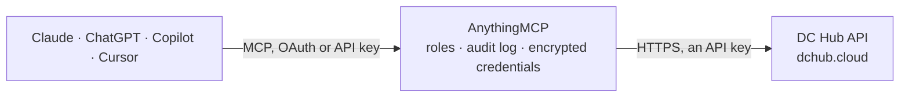

<!-- Generated by scripts/export-github-catalog.mjs in the anythingmcp-website repository. Do not edit by hand. -->

# DC Hub MCP connector

Data centre and power-grid intelligence from DC Hub: facilities worldwide, market power-readiness scores, the US interconnection queue, construction pipeline, M&A transactions, live ISO grid fuel mix … The AnythingMCP connector gives Claude, ChatGPT, Microsoft Copilot, Cursor and Gemini 20 MCP tools for DC Hub: 18 read and 2 can change data.

**Category:** [Infrastructure](../infrastructure.md) · **Tools:** 20 · **Setup guide:** [anythingmcp.com](https://anythingmcp.com/guides/dchub-to-mcp) · [Deutsch](https://anythingmcp.com/de/guides/dchub-to-mcp) · [Italiano](https://anythingmcp.com/it/guides/dchub-to-mcp) · [Español](https://anythingmcp.com/es/guides/dchub-to-mcp) · [日本語](https://anythingmcp.com/ja/guides/dchub-to-mcp) · [Русский](https://anythingmcp.com/ru/guides/dchub-to-mcp) · [中文](https://anythingmcp.com/zh/guides/dchub-to-mcp)

## Start without code

No installation and no terminal: AnythingMCP Cloud runs the DC Hub connector for you, operated by helpcode.ai in Frankfurt, Germany.

1. **Click the button above** and create an account or sign in. The DC Hub connector opens, ready to install.
2. **Paste the API key or token from your DC Hub account.** Every click is in the [step-by-step guide](https://anythingmcp.com/guides/dchub-to-mcp).
3. **Click Install.** AnythingMCP shows the address of your MCP server.
4. **Add that address to your assistant:** [Claude](https://anythingmcp.com/guides/connect-dchub-to-claude) · [ChatGPT](https://anythingmcp.com/guides/connect-dchub-to-chatgpt) · [Microsoft Copilot](https://anythingmcp.com/guides/connect-dchub-to-copilot) · [Cursor](https://anythingmcp.com/guides/connect-dchub-to-cursor) · [Gemini CLI](https://anythingmcp.com/guides/connect-dchub-to-gemini) · [Meta Muse](https://anythingmcp.com/guides/connect-dchub-to-muse).
5. **Ask your first question**, for example: *What is the DC Hub record for facility DFW-005 and does it list a primary contact or provider?*

Prefer help with the setup? [Talk to us](https://anythingmcp.com/contact).

## How it works

- **The AI client** speaks MCP (Streamable HTTP) to AnythingMCP and only sees tool names, descriptions and results. It never gets the DC Hub credentials.
- **AnythingMCP** checks the client's role, builds the call from the tool definition, adds the credentials (an API key), calls DC Hub, logs the call and returns the result.
- **DC Hub** sees an ordinary API client with the rights of the account the credentials belong to.

## Tools

| Tool | What it does | Access |
|---|---|---|
| [`dchub_stats`](#dchub_stats) | Platform-wide statistics: total facilities tracked, countries, providers and aggregate capacity in MW. | read |
| [`dchub_search_facilities`](#dchub_search_facilities) | Search DC Hub's data centre facilities by free text (city, provider or market name) and/or country. | read |
| [`dchub_facility_detail`](#dchub_facility_detail) | Full record for one facility: contacts, capacity detail and certifications. | read |
| [`dchub_list_markets`](#dchub_list_markets) | List every tracked data centre market with summary statistics. | read |
| [`dchub_compare_markets`](#dchub_compare_markets) | Side-by-side comparison of two or more data centre markets. | read |
| [`dchub_market_dcpi`](#dchub_market_dcpi) | DC Hub Power Index for one market: a BUILD / CAUTION / AVOID verdict plus composite_score, excess_power_score, constraint_score and time_to_power_months. | read |
| [`dchub_ai_capacity_index`](#dchub_ai_capacity_index) | Markets ranked by AI-ready deployable MW for near-term large-load siting, with a hyperscale_ready flag and an ai_ready_mw proxy. | read |
| [`dchub_interconnection_queue`](#dchub_interconnection_queue) | Filter the ~5,300-project US interconnection queue (7 ISOs) server-side, so you receive the survivors instead of the raw ~1,744 GW queue. | read |
| [`dchub_pipeline`](#dchub_pipeline) | Data centres under construction or announced — the forward supply picture for a market. | read |
| [`dchub_transactions`](#dchub_transactions) | Recent data centre M&A: acquisitions, investments, joint ventures, leases and development deals. | read |
| [`dchub_news`](#dchub_news) | Latest data centre industry news, aggregated from 40+ sources. | read |
| [`dchub_site_score`](#dchub_site_score) | Suitability score (0-100) for data centre development at one specific location. | read |
| [`dchub_grid_fuel_mix`](#dchub_grid_fuel_mix) | Real-time fuel mix of a US power grid, refreshed about every 60 seconds. | read |
| [`dchub_energy_prices`](#dchub_energy_prices) | Electricity pricing for one US state — the input to any operating-cost estimate for a site in that state. | read |
| [`dchub_analyze_parcel`](#dchub_analyze_parcel) | Structured read of a GeoJSON parcel boundary: geodesic acreage, the largest member's centroid as a representative point (never the centre of a multi-part… | write |
| [`dchub_rank_sites`](#dchub_rank_sites) | Deterministic ranking of candidate sites under hard constraints and signed weighted objectives. | write |
| [`dchub_dcpi_receipt`](#dchub_dcpi_receipt) | The evidence behind one market's DCPI answer, for citing it: per component (verdict, composite score, each sub-score, the grid operator and its… | read |
| [`dchub_queue_receipt`](#dchub_queue_receipt) | The sources behind the interconnection-queue totals, per ISO: queued GW with the ISO's own source_url, the as_of date and whether it comes from a published… | read |
| [`dchub_listings_summary`](#dchub_listings_summary) | How much data-centre capacity DC Hub's Capacity Source currently lists: number of live listings, total MW, markets, delivery types and when the listings… | read |
| [`dchub_search_listings`](#dchub_search_listings) | Search DC Hub's Capacity Source: data-centre capacity that operators offer through DC Hub (powered land, powered shells, turnkey capacity, colocation). | read |

## Tool reference

Every parameter as the AI client sees it in `tools/list`. Source: [`packages/backend/src/adapters/intl/dchub.json`](../../../packages/backend/src/adapters/intl/dchub.json).

### `dchub_stats`

Platform-wide statistics: total facilities tracked, countries, providers and aggregate capacity in MW. No API key needed. Useful as a first call to see the shape of the dataset.

**Access:** read · **Call:** `GET /api/v1/stats`

No parameters.

### `dchub_search_facilities`

Search DC Hub's data centre facilities by free text (city, provider or market name) and/or country. Returns summary records. Use dchub_facility_detail with an id from here for the full record (that one needs an API key).

**Access:** read · **Call:** `GET /api/v1/facilities`

| Parameter | Type | Required | Description |
|---|---|---|---|
| `q` | string | no | Search term: a city, a provider name or a market, e.g. 'Equinix Frankfurt'. |
| `country` | string | no | ISO 3166-1 alpha-2 country code, e.g. 'DE', 'US'. |
| `limit` | integer | no | Max results (default 25, max 100). |

### `dchub_facility_detail`

Full record for one facility: contacts, capacity detail and certifications. Without an API key (DCHUB_API_KEY) this does NOT fail — it returns 200 with a redacted record: `_gated: true`, the withheld fields named, and `coordinates_status` (`approximate_2dp` anonymously, `known` only when exact). Check `_gated` and `coordinates_status` before quoting contacts, certifications or coordinates. Get the facility_id from dchub_search_facilities.

**Access:** read · **Call:** `GET /api/v1/facilities/{facility_id}`

| Parameter | Type | Required | Description |
|---|---|---|---|
| `facility_id` | integer | yes | Numeric facility id, as returned by dchub_search_facilities. |

### `dchub_list_markets`

List every tracked data centre market with summary statistics. Call this first to learn the market slugs that dchub_market_dcpi and dchub_compare_markets expect.

**Access:** read · **Call:** `GET /api/v1/markets`

No parameters.

### `dchub_compare_markets`

Side-by-side comparison of two or more data centre markets. Pass the market names comma-separated. Without an API key (DCHUB_API_KEY) this returns 200 with the power figures (MW) withheld: check `_gated` and `_locked_fields`, and never estimate a withheld figure.

**Access:** read · **Call:** `GET /api/v1/markets/compare`

| Parameter | Type | Required | Description |
|---|---|---|---|
| `markets` | string | yes | Comma-separated market names, e.g. 'phoenix,dallas,northern-virginia'. |

### `dchub_market_dcpi`

DC Hub Power Index for one market: a BUILD / CAUTION / AVOID verdict plus composite_score, excess_power_score, constraint_score and time_to_power_months. Recomputed daily. The single most useful tool for 'should we build here?'. Without an API key (DCHUB_API_KEY) this returns 200 with the verdict kept but the component scores and time_to_power_months withheld: check `_gated` and `_locked_fields`, and never estimate a withheld figure.

**Access:** read · **Call:** `GET /api/v1/dcpi/scores/{market_slug}`

| Parameter | Type | Required | Description |
|---|---|---|---|
| `market_slug` | string | yes | Market slug, e.g. 'phoenix', 'northern-virginia', 'dallas'. Get valid slugs from dchub_list_markets. |

### `dchub_ai_capacity_index`

Markets ranked by AI-ready deployable MW for near-term large-load siting, with a hyperscale_ready flag and an ai_ready_mw proxy. Answers 'where can a big AI load actually land in the next 30/60/90 days?'. Without an API key (DCHUB_API_KEY) this returns 200 with the market list kept but its MW figures and scores withheld: check `_gated` and `_locked_fields`, and never estimate a withheld figure.

**Access:** read · **Call:** `GET /api/v1/ai-capacity-index`

| Parameter | Type | Required | Description |
|---|---|---|---|
| `horizon` | integer | no | Deployment horizon in days: 30, 60 or 90 (default 90). |

### `dchub_interconnection_queue`

Filter the ~5,300-project US interconnection queue (7 ISOs) server-side, so you receive the survivors instead of the raw ~1,744 GW queue. This is the site-sourcing tool: combine min_mw, iso, fuel and time-to-power filters, then set geocoded_only to get rows with coordinates you can pass to dchub_site_score or dchub_rank_sites. Without an API key (DCHUB_API_KEY) this returns 200 with the rows kept but capacity_mw, coordinates and time-to-power withheld: check `_gated` and `_locked_fields`, and never estimate a withheld figure.

**Access:** read · **Call:** `GET /api/v1/interconnection-queue/refined`

| Parameter | Type | Required | Description |
|---|---|---|---|
| `min_mw` | number | no | Minimum project capacity in MW, e.g. 1000 for 1 GW and above. |
| `max_ttp_months` | integer | no | Max time-to-power in months; keeps projects in ISOs at or under this average interconnection wait. |
| `iso` | string | no | One or more ISOs, comma-separated union, from PJM, ERCOT, MISO, CAISO, SPP, NYISO, ISO-NE. |
| `baseload_only` | boolean | no | Keep only firm/dispatchable fuel and drop wind, solar and storage (default false). |
| `fuel_type` | string | no | Inclusive substring match on the raw fuel label; comma or semicolon separated for a union, e.g. 'gas' matches GAS and Natural Gas. |
| `status` | string | no | Queue status filter. Default 'active' = still progressing, excluding withdrawn, cancelled, suspended and in-commercial-operation. |
| `max_fiber_km` | number | no | Keep only survivors within this many km of the nearest mapped long-haul fibre route endpoint (coarse backbone data). |
| `geocoded_only` | boolean | no | Keep only survivors carrying lat/lng (~83% of the queue) — the ones you can pipe into parcel analysis or site scoring (default false). |
| `limit` | integer | no | Max survivors returned (default 200, max 1000). |

### `dchub_pipeline`

Data centres under construction or announced — the forward supply picture for a market. REQUIRES an API key (DCHUB_API_KEY) — without one this returns 403. On DC Hub's free tier the response may be a sample record flagged `tier_signal: preview` rather than real results.

**Access:** read · **Call:** `GET /api/v1/pipeline`

No parameters.

### `dchub_transactions`

Recent data centre M&A: acquisitions, investments, joint ventures, leases and development deals.

**Access:** read · **Call:** `GET /api/v1/transactions`

| Parameter | Type | Required | Description |
|---|---|---|---|
| `limit` | integer | no | Max results (default 20). |
| `deal_type` | string | no | One of: acquisition, investment, joint_venture, lease, development. |

### `dchub_news`

Latest data centre industry news, aggregated from 40+ sources.

**Access:** read · **Call:** `GET /api/news`

| Parameter | Type | Required | Description |
|---|---|---|---|
| `limit` | integer | no | Max headlines (default 10). |

### `dchub_site_score`

Suitability score (0-100) for data centre development at one specific location. Pass coordinates; the US state abbreviation sharpens the energy side of the score. REQUIRES a paid DC Hub Pro plan key in DCHUB_API_KEY — it returns 403 `plan_required` anonymously AND with a free developer key. If the workspace has no Pro key, say so instead of retrying.

**Access:** read · **Call:** `GET /api/site-score`

| Parameter | Type | Required | Description |
|---|---|---|---|
| `lat` | number | yes | Latitude in decimal degrees. |
| `lon` | number | yes | Longitude in decimal degrees. |
| `state` | string | no | US state abbreviation, e.g. 'TX'. Optional. |

### `dchub_grid_fuel_mix`

Real-time fuel mix of a US power grid, refreshed about every 60 seconds. REQUIRES an API key (DCHUB_API_KEY) — without one this returns 403 with instructions for claiming a free developer key.

**Access:** read · **Call:** `GET /api/grid/fuel-mix`

| Parameter | Type | Required | Description |
|---|---|---|---|
| `iso` | string | no | Grid operator: ERCOT, PJM, CAISO, MISO, SPP, NYISO or ISONE. |

### `dchub_energy_prices`

Electricity pricing for one US state — the input to any operating-cost estimate for a site in that state. REQUIRES an API key (DCHUB_API_KEY) — without one this returns 403.

**Access:** read · **Call:** `GET /api/energy/prices/{state}`

| Parameter | Type | Required | Description |
|---|---|---|---|
| `state` | string | yes | US state abbreviation, e.g. 'TX', 'VA', 'AZ'. |

### `dchub_analyze_parcel`

Structured read of a GeoJSON parcel boundary: geodesic acreage, the largest member's centroid as a representative point (never the centre of a multi-part shape), a contiguity flag, a per-member breakdown and a site-evaluation handoff object you can carry into dchub_rank_sites. Computes and returns; stores nothing.

**Access:** write · **Call:** `POST /api/v1/analyze-parcel`

| Parameter | Type | Required | Description |
|---|---|---|---|
| `geometry` | object | yes | GeoJSON Polygon or MultiPolygon describing the parcel boundary. |
| `capacity_mw` | number | no | Optional target load in MW, carried into the handoff object. |

### `dchub_rank_sites`

Deterministic ranking of candidate sites under hard constraints and signed weighted objectives. Constraints fail closed: a candidate missing a constrained field is dropped. A positive objective weight maximises that field, a negative one minimises it. Computes and returns; stores nothing.

**Access:** write · **Call:** `POST /api/v1/rank-sites`

| Parameter | Type | Required | Description |
|---|---|---|---|
| `candidates` | object[] | yes | Pre-enriched candidates: [{id?, lat?, lng?, <metric fields>}]. Carry through any site_evaluation_handoff from dchub_analyze_parcel. |
| `constraints` | object | no | Hard filters as {field: {min?, max?}}. A candidate missing the field is dropped. |
| `objectives` | object | yes | {field: signedWeight} — a positive weight maximises the field, a negative one minimises it. |
| `absolute` | boolean | no | Score on a fixed 0-100 scale that is stable across runs, instead of min-max within this batch. |
| `percentile` | boolean | no | Score as a percentile against the viable-site population. Takes precedence over absolute. |
| `top_k` | integer | no | How many ranked sites to return (default 3). |

### `dchub_dcpi_receipt`

The evidence behind one market's DCPI answer, for citing it: per component (verdict, composite score, each sub-score, the grid operator and its interconnection queue) the value, the upstream source_url, the as_of date, the basis and a status (returned, stale, withheld, unavailable), plus a ready-made cite_as line. No API key needed. A withheld component belongs to a paid plan and comes back null. Use it after dchub_market_dcpi when the person needs sources.

**Access:** read · **Call:** `GET /api/v1/receipt/dcpi/{market_slug}`

| Parameter | Type | Required | Description |
|---|---|---|---|
| `market_slug` | string | yes | DCPI market slug, e.g. 'phoenix', 'dallas', 'northern-virginia' (dchub_list_markets lists them). |

### `dchub_queue_receipt`

The sources behind the interconnection-queue totals, per ISO: queued GW with the ISO's own source_url, the as_of date and whether it comes from a published report or a live feed, the basis, a status (returned, stale, withheld, unavailable) and a cite_as line. No API key needed. An unknown ISO comes back with status unavailable.

**Access:** read · **Call:** `GET /api/v1/receipt/queue`

| Parameter | Type | Required | Description |
|---|---|---|---|
| `iso` | string | no | Comma-separated ISO codes, e.g. 'pjm,caiso,ercot'. Omit for every ISO. |

### `dchub_listings_summary`

How much data-centre capacity DC Hub's Capacity Source currently lists: number of live listings, total MW, markets, delivery types and when the listings last changed. Never names a listing or a provider. No API key needed. Call it before dchub_search_listings to see whether anything matches at all.

**Access:** read · **Call:** `GET /api/v1/listings/summary`

No parameters.

### `dchub_search_listings`

Search DC Hub's Capacity Source: data-centre capacity that operators offer through DC Hub (powered land, powered shells, turnkey capacity, colocation). Size is matched against what a listing can actually deliver, not its headline total. Returns teaser cards only: the provider and the site are withheld, and many listings are locked until the person signs in on dchub.cloud. Give the person each item's `url`, not `tracked_url`. Requesting an introduction to a provider is done by the person on dchub.cloud, not through this connector. No API key needed.

**Access:** read · **Call:** `GET /api/v1/listings`

| Parameter | Type | Required | Description |
|---|---|---|---|
| `min_mw` | number | no | Capacity needed in MW. Give min_mw or min_kw, not both. |
| `min_kw` | number | no | Capacity needed in kW. |
| `region` | string | no | Comma list of north_america, latin_america, europe, asia_pacific, middle_east_africa (aliases emea, apac, latam, americas). |
| `country` | string | no | Comma list of ISO 3166-1 alpha-2 codes or country names. |
| `location` | string | no | Free text matched against region, country, state and metro. |
| `market` | string | no | Market name, e.g. 'Phoenix'. |
| `state` | string | no | Two-letter US state. |
| `delivery_type` | `land` \| `powered_shell` \| `turnkey` \| `colocation` | no | How the capacity is delivered. |
| `available_by` | string | no | Latest acceptable availability, YYYY-MM or YYYY-MM-DD. |
| `limit` | integer | no | Max listings returned (default 50, max 200). |

## Run it yourself

AnythingMCP is open source (AGPL-3.0). [Run it with Docker](../../../README.md#run-it-yourself), open **Connectors → Store**, pick **DC Hub**, then add your MCP server URL to the AI client.

[← Infrastructure connectors](../infrastructure.md) · [All categories](../README.md)
