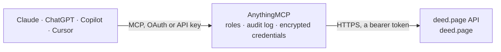

<!-- Generated by scripts/export-github-catalog.mjs in the anythingmcp-website repository. Do not edit by hand. -->

# deed.page MCP connector

Publish HTML pages and small static sites that your AI writes to a permanent public URL, update them in place, roll back versions and attach custom domains from Claude, ChatGPT or Copilot through … The AnythingMCP connector gives Claude, ChatGPT, Microsoft Copilot, Cursor and Gemini 27 MCP tools for deed.page: 10 read and 17 can change data.

**Category:** [Publishing](../publishing.md) · **Tools:** 27 · **Setup guide:** [anythingmcp.com](https://anythingmcp.com/guides/deed-page-to-mcp) · [Deutsch](https://anythingmcp.com/de/guides/deed-page-to-mcp) · [Italiano](https://anythingmcp.com/it/guides/deed-page-to-mcp) · [Español](https://anythingmcp.com/es/guides/deed-page-to-mcp) · [日本語](https://anythingmcp.com/ja/guides/deed-page-to-mcp) · [Русский](https://anythingmcp.com/ru/guides/deed-page-to-mcp) · [中文](https://anythingmcp.com/zh/guides/deed-page-to-mcp)

## Start without code

No installation and no terminal: AnythingMCP Cloud runs the deed.page connector for you, operated by helpcode.ai in Frankfurt, Germany.

1. **Click the button above** and create an account or sign in. The deed.page connector opens, ready to install.
2. **Paste the API key or token from your deed.page account.** Every click is in the [step-by-step guide](https://anythingmcp.com/guides/deed-page-to-mcp).
3. **Click Install.** AnythingMCP shows the address of your MCP server.
4. **Add that address to your assistant:** [Claude](https://anythingmcp.com/guides/connect-deed-page-to-claude) · [ChatGPT](https://anythingmcp.com/guides/connect-deed-page-to-chatgpt) · [Microsoft Copilot](https://anythingmcp.com/guides/connect-deed-page-to-copilot) · [Cursor](https://anythingmcp.com/guides/connect-deed-page-to-cursor) · [Gemini CLI](https://anythingmcp.com/guides/connect-deed-page-to-gemini) · [Meta Muse](https://anythingmcp.com/guides/connect-deed-page-to-muse).
5. **Ask your first question**, for example: *Is the public page for invoice-2026-117 live and what's its URL, version and size?*

Prefer help with the setup? [Talk to us](https://anythingmcp.com/contact).

## How it works

- **The AI client** speaks MCP (Streamable HTTP) to AnythingMCP and only sees tool names, descriptions and results. It never gets the deed.page credentials.
- **AnythingMCP** checks the client's role, builds the call from the tool definition, adds the credentials (a bearer token), calls deed.page, logs the call and returns the result.
- **deed.page** sees an ordinary API client with the rights of the account the credentials belong to.

## Tools

| Tool | What it does | Access |
|---|---|---|
| [`deed_page_publish_site`](#deed_page_publish_site) | Publishes files to a live permanent URL at a slug. | write |
| [`deed_page_update_site`](#deed_page_update_site) | Replaces the files of a slug owned by the token, or, when merge is true, adds and overwrites only the paths sent. | write |
| [`deed_page_get_site`](#deed_page_get_site) | Returns whether a slug is live, plus its URL, version, size, and timestamps. | read |
| [`deed_page_list_sites`](#deed_page_list_sites) | Returns every live site owned by the token, with URLs and versions. | read |
| [`deed_page_delete_site`](#deed_page_delete_site) | Permanently removes a slug owned by the token and detaches its custom hostnames. | write |
| [`deed_page_rotate_token`](#deed_page_rotate_token) | Issues a new token for the same principal. | write |
| [`deed_page_revoke_token`](#deed_page_revoke_token) | Revokes owner tokens. | write |
| [`deed_page_whoami`](#deed_page_whoami) | Returns the plan (plan.id is free, hobby, or pro), limits, the number of sites the token owns, and the number of custom hostnames attached. | read |
| [`deed_page_agent_seats`](#deed_page_agent_seats) | Pro only: named tokens for more agents on one account, up to 5. | write |
| [`deed_page_get_upgrade_link`](#deed_page_get_upgrade_link) | Creates a Stripe Checkout URL that upgrades this token's owner to Hobby ($3/mo) or Pro ($15/mo). | read |
| [`deed_page_claim_share_credit`](#deed_page_claim_share_credit) | Free plan only, once per token. | write |
| [`deed_page_list_versions`](#deed_page_list_versions) | Returns every retained version of a slug owned by the token, newest first. | read |
| [`deed_page_restore_version`](#deed_page_restore_version) | Creates a new version whose files equal a retained version, without uploading those files again. | write |
| [`deed_page_add_domain`](#deed_page_add_domain) | Attaches a hostname to a slug owned by the token and returns the DNS records to create: a CNAME for a subdomain, an A record or an ALIAS record for an apex… | write |
| [`deed_page_list_domains`](#deed_page_list_domains) | Returns custom hostnames on one slug, or on every site the token owns when slug is omitted. | read |
| [`deed_page_remove_domain`](#deed_page_remove_domain) | Removes a hostname so requests to that host no longer serve the site. | write |
| [`deed_page_domain_status`](#deed_page_domain_status) | Returns the verification status of a custom domain and refreshes verification, DNS config, and certificate state. | read |
| [`deed_page_plan_upload`](#deed_page_plan_upload) | Accepts a file manifest and returns which hashes are already stored, a direct upload URL for each missing hash, and a session id. | write |
| [`deed_page_finalize_upload`](#deed_page_finalize_upload) | Checks uploaded hashes, screens the new bytes, and commits one version under the slug lock. | write |
| [`deed_page_get_manifest`](#deed_page_get_manifest) | Returns the canonical manifest for a site version: paths, sha256, sizes, version, slug, and created_at, plus an Ed25519 signature. | read |
| [`deed_page_site_analytics`](#deed_page_site_analytics) | Returns owner-only cookieless counts for a slug: views per UTC day, top paths, top referrer hosts, and AI crawler counts by user-agent family. | read |
| [`deed_page_set_site_access`](#deed_page_set_site_access) | Changes the access setting stored for a slug on deed.page. | write |
| [`deed_page_set_listing`](#deed_page_set_listing) | Sets or clears the public gallery listing for a slug. | write |
| [`deed_page_set_badge`](#deed_page_set_badge) | Free-plan sites show a small 'Published with deed.page' link in the bottom-right corner; Hobby and Pro never show it. | write |
| [`deed_page_create_webhook`](#deed_page_create_webhook) | Registers an http or https URL for the events site.published, site.version_restored, site.deleted, site.taken_down, domain.active, and report.received. | write |
| [`deed_page_list_webhooks`](#deed_page_list_webhooks) | Returns the webhook URLs registered for the token. | read |
| [`deed_page_delete_webhook`](#deed_page_delete_webhook) | Deletes one webhook so it receives no further events. | write |

## Tool reference

Every parameter as the AI client sees it in `tools/list`. Source: [`packages/backend/src/adapters/intl/deed-page.json`](../../../packages/backend/src/adapters/intl/deed-page.json).

### `deed_page_publish_site`

Publishes files to a live permanent URL at a slug. Inputs: files (required), and optional slug, spa, ttl_seconds, merge, expected_version, token, listed, category, tags, title, and description. Paths are stored exactly. Returns url, path_url, slug, version, listing, and token on the first anonymous publish. On deed.page, url and path_url are both https://{slug}.deed.page/. A lost token has no recovery unless an optional recovery email was attached. When expected_version does not match the live version, the result is version_conflict and nothing is written. A racing publish of the same slug returns version_conflict even without expected_version. Malware, executables, and credential-harvesting pages return content_rejected and are not stored. .bin is blocked by file type (it often has no MZ or ELF header). A raw octet-stream body is screened as one file. listed defaults to false, so the slug stays out of the public gallery unless listed is true. Password-protected sites cannot be listed. Before calling, show the user the files and slug and wait for an explicit yes; the result is public.

**Access:** write · **Call:** `publish_site /mcp`

| Parameter | Type | Required | Description |
|---|---|---|---|
| `slug` | string | no | Exact slug matching ^[a-z0-9](?:[a-z0-9-]{0,61}[a-z0-9])?$ (lowercase letters, digits, hyphens, 1-63, no leading or trailing hyphen). Invalid slugs return slug_invalid and are not rewritten. Reserved names (hello, my-page, www, api, docs, admin, mcp, blog, app, status, and other docs examples) return slug_reserved on a new claim. A token that already owns one can still update it. Omit for a random slug. |
| `files` | object | yes | Path map, or an array of {path, content} or {path, base64}. Paths are stored exactly as given (a single top-level directory is not removed). Text as a string, binary as {"base64":"..."}. Example: {"index.html":"<!doctype html><h1>Hi</h1>","img/logo.png":{"base64":"iVBOR..."}}. Any other array is rejected. |
| `spa` | boolean | no | Serve index.html for unknown paths (single-page apps). |
| `ttl_seconds` | integer | no | Opt-in expiry in seconds. Omit for a permanent site. |
| `merge` | boolean | no | Add or overwrite only these exact paths on the existing site. Paths omitted from this call are left unchanged. Nothing is moved to the site root. |
| `expected_version` | string | no | Live version this write is based on, such as "v3". If the slug is no longer at that version, the result is version_conflict and nothing is written. A racing publish of the same slug returns version_conflict even when this is omitted. |
| `listed` | boolean | no | Opt into the public gallery. Default false. false removes the slug immediately. Password-protected sites cannot be listed. |
| `category` | `Apps & tools` \| `Games` \| `Business` \| `Portfolio` \| `Docs & guides` \| `Education` \| `Events` \| `Other` | no | Gallery category. Required when listed is true. |
| `tags` | string[] | no | Up to 5 tags. Each tag is lowercase letters, digits, and hyphens, at most 32 characters. |
| `title` | string | no | Gallery title, at most 80 characters. Required when listed is true. |
| `description` | string | no | Gallery description, at most 300 characters. Required when listed is true. |
| `token` | string | no | Bearer token returned by your first publish (deed_tok_...). Optional if the MCP client sends Authorization: Bearer. |

### `deed_page_update_site`

Replaces the files of a slug owned by the token, or, when merge is true, adds and overwrites only the paths sent. Inputs: slug, files, and optional spa, merge, expected_version, token, listed, category, tags, title, and description. Returns url, path_url, slug, listing, and a new version. When expected_version does not match the live version, the result is version_conflict and nothing is written. Two racing updates return version_conflict even without expected_version. listed defaults to false. Password-protected sites cannot be listed. A new version of a listed slug runs the gallery checks again. Before calling, show the user the files and slug and wait for an explicit yes; the result is public.

**Access:** write · **Call:** `update_site /mcp`

| Parameter | Type | Required | Description |
|---|---|---|---|
| `slug` | string | yes | Slug you own. Must match ^[a-z0-9](?:[a-z0-9-]{0,61}[a-z0-9])?$. Not rewritten. Reserved slugs are rejected. |
| `files` | object | yes | Path map, or an array of {path, content} or {path, base64}. Paths are stored exactly as given (a single top-level directory is not removed). Text as a string, binary as {"base64":"..."}. Example: {"index.html":"<!doctype html><h1>Hi</h1>","img/logo.png":{"base64":"iVBOR..."}}. Any other array is rejected. |
| `spa` | boolean | no | Serve index.html for unknown paths. |
| `merge` | boolean | no | Keep every path you do not send, and add or overwrite only these exact paths. |
| `expected_version` | string | no | Live version this update is based on, such as "v3". If the site has moved on, the call returns version_conflict with no write. Omit it and a concurrent update still returns version_conflict rather than dropping files. |
| `listed` | boolean | no | Opt into the public gallery. Default false. false removes the slug immediately. Password-protected sites cannot be listed. |
| `category` | `Apps & tools` \| `Games` \| `Business` \| `Portfolio` \| `Docs & guides` \| `Education` \| `Events` \| `Other` | no | Gallery category. Required when listed is true. |
| `tags` | string[] | no | Up to 5 tags. Each tag is lowercase letters, digits, and hyphens, at most 32 characters. |
| `title` | string | no | Gallery title, at most 80 characters. Required when listed is true. |
| `description` | string | no | Gallery description, at most 300 characters. Required when listed is true. |
| `token` | string | no | Bearer token returned by your first publish (deed_tok_...). Optional if the MCP client sends Authorization: Bearer. |

### `deed_page_get_site`

Returns whether a slug is live, plus its URL, version, size, and timestamps. Input: slug. No token is required.

**Access:** read · **Call:** `get_site /mcp`

| Parameter | Type | Required | Description |
|---|---|---|---|
| `slug` | string | yes | Slug to look up. |

### `deed_page_list_sites`

Returns every live site owned by the token, with URLs and versions. Input: token, or an Authorization bearer header.

**Access:** read · **Call:** `list_sites /mcp`

| Parameter | Type | Required | Description |
|---|---|---|---|
| `token` | string | no | Bearer token returned by your first publish (deed_tok_...). Optional if the MCP client sends Authorization: Bearer. |

### `deed_page_delete_site`

Permanently removes a slug owned by the token and detaches its custom hostnames. The slug becomes available again. Inputs: slug and token.

**Access:** write · **Call:** `delete_site /mcp`

| Parameter | Type | Required | Description |
|---|---|---|---|
| `slug` | string | yes | Slug you own. |
| `token` | string | no | Bearer token returned by your first publish (deed_tok_...). Optional if the MCP client sends Authorization: Bearer. |

### `deed_page_rotate_token`

Issues a new token for the same principal. Every site carries over. Inputs: token, and optional overlap_seconds from 0 to 300. The previous token stops working immediately when overlap_seconds is omitted or 0. During a non-zero overlap window both tokens work. After that window the previous token returns 401 token_revoked. The new token is returned once.

**Access:** write · **Call:** `rotate_token /mcp`

| Parameter | Type | Required | Description |
|---|---|---|---|
| `overlap_seconds` | integer | no | Seconds the previous token keeps working so an in-flight deploy can finish. Omit or 0 to invalidate it immediately. Maximum 300. |
| `token` | string | no | Bearer token returned by your first publish (deed_tok_...). Optional if the MCP client sends Authorization: Bearer. |

### `deed_page_revoke_token`

Revokes owner tokens. Inputs: token, and optional scope. Scope "current" (the default) revokes the token that was sent. Scope "all" revokes every token for that principal, including any overlap window. A later request with a revoked token returns 401 token_revoked, which is distinct from 403 suspended. Sites stay online. Without a recovery email, a revoked token cannot update them.

**Access:** write · **Call:** `revoke_token /mcp`

| Parameter | Type | Required | Description |
|---|---|---|---|
| `scope` | `current` \| `all` | no | current revokes only this token. all revokes every token for the principal. Default current. |
| `token` | string | no | Bearer token returned by your first publish (deed_tok_...). Optional if the MCP client sends Authorization: Bearer. |

### `deed_page_whoami`

Returns the plan (plan.id is free, hobby, or pro), limits, the number of sites the token owns, and the number of custom hostnames attached. Use it to confirm a plan change after payment. Input: token.

**Access:** read · **Call:** `whoami /mcp`

| Parameter | Type | Required | Description |
|---|---|---|---|
| `token` | string | no | Bearer token returned by your first publish (deed_tok_...). Optional if the MCP client sends Authorization: Bearer. |

### `deed_page_agent_seats`

Pro only: named tokens for more agents on one account, up to 5. Each seat has a label and its own token, shares the owner's sites, and can be revoked without touching the others. action "list" shows seats (any token). action "create" needs the owner token and a label; the new seat token is returned once. action "revoke" needs seat_id; the owner token revokes any seat, a seat token only itself. Seat tokens cannot rotate, revoke all tokens, manage seats, change the recovery email or open billing. Free and Hobby get plan_required with a Pro upgrade link to show your human.

**Access:** write · **Call:** `agent_seats /mcp`

| Parameter | Type | Required | Description |
|---|---|---|---|
| `action` | `list` \| `create` \| `revoke` | no | list (default), create, or revoke. |
| `label` | string | no | create only: a name for the agent that gets this seat, like "design agent". Unique among active seats. |
| `seat_id` | string | no | revoke only: the seat id (seat_…) from list or create. |
| `token` | string | no | Bearer token returned by your first publish (deed_tok_...). Optional if the MCP client sends Authorization: Bearer. |

### `deed_page_get_upgrade_link`

Creates a Stripe Checkout URL that upgrades this token's owner to Hobby ($3/mo) or Pro ($15/mo). Call it only when the user asks for an upgrade link. Show the returned checkout_url and the price to the user; the user opens it and decides whether to pay. When payment completes the same token gets the higher limits automatically, and the token's plan (plan.id) then reads hobby or pro. Inputs: plan (hobby or pro; omitted means the next plan up), token and optional upgrade_trigger (the limit field from the error, custom_domain_limit, or manual). A token already on a paid plan gets portal_url instead. The call itself does not charge.

**Access:** read · **Call:** `get_upgrade_link /mcp`

| Parameter | Type | Required | Description |
|---|---|---|---|
| `plan` | `hobby` \| `pro` | no | Plan to buy. Omit for the next plan above the current one (Free -> hobby, Hobby -> pro). |
| `upgrade_trigger` | `manual` \| `custom_domain_limit` \| `quota_sites` \| `quota_bytes` \| `publish_rate` \| `quota_domains` \| `webhook_limit` \| `plan_required` \| `share_credit` \| `size_warning` | no | The limit field of the plan-limit error that sent you here (for example publish_rate or quota_sites), custom_domain_limit, or manual. |
| `token` | string | no | Bearer token returned by your first publish (deed_tok_...). Optional if the MCP client sends Authorization: Bearer. |

### `deed_page_claim_share_credit`

Free plan only, once per token. If the user posted publicly about deed.page on X or Reddit, pass that post's URL. The server checks that the post is public, mentions deed.page or links to a deed.page site, is from the last 30 days, and was not claimed before, then raises this token's Free limits by 25 sites and to 50 MB per site. Never post on the user's behalf; only send a URL the user gives you. Hobby ($3/mo) is still the bigger upgrade: show the returned user_message, which includes the Hobby link. Inputs: url and token.

**Access:** write · **Call:** `claim_share_credit /mcp`

| Parameter | Type | Required | Description |
|---|---|---|---|
| `url` | string | yes | Public post URL: https://x.com/{user}/status/{id} or https://www.reddit.com/r/{sub}/comments/{id}/... |
| `token` | string | no | Bearer token returned by your first publish (deed_tok_...). Optional if the MCP client sends Authorization: Bearer. |

### `deed_page_list_versions`

Returns every retained version of a slug owned by the token, newest first. Inputs: slug and token. Each entry includes version, created_at, file_count, bytes, kind (publish, merge, or restore), restored_from, and a public permalink. Free keeps 10 versions, Hobby 50, Pro unlimited.

**Access:** read · **Call:** `list_versions /mcp`

| Parameter | Type | Required | Description |
|---|---|---|---|
| `slug` | string | yes | Slug you own. |
| `token` | string | no | Bearer token returned by your first publish (deed_tok_...). Optional if the MCP client sends Authorization: Bearer. |

### `deed_page_restore_version`

Creates a new version whose files equal a retained version, without uploading those files again. Inputs: slug, version, optional expected_version, and token. When expected_version does not match the live version, the result is version_conflict and nothing is written. The previous permalink keeps serving until retention drops it.

**Access:** write · **Call:** `restore_version /mcp`

| Parameter | Type | Required | Description |
|---|---|---|---|
| `slug` | string | yes | Slug you own. |
| `version` | string | yes | Version to copy forward, such as "v2". |
| `expected_version` | string | no | Live version this restore is based on, such as "v4". A mismatch returns version_conflict. |
| `token` | string | no | Bearer token returned by your first publish (deed_tok_...). Optional if the MCP client sends Authorization: Bearer. |

### `deed_page_add_domain`

Attaches a hostname to a slug owned by the token and returns the DNS records to create: a CNAME for a subdomain, an A record or an ALIAS record for an apex (one of those, not both), and every TXT record. Inputs: slug, domain, and token. Status starts at pending_dns until DNS and the certificate are ready. Free allows 1 hostname, Hobby 3, Pro 20. deed.page names are rejected.

**Access:** write · **Call:** `add_domain /mcp`

| Parameter | Type | Required | Description |
|---|---|---|---|
| `slug` | string | yes | Slug you own. |
| `domain` | string | yes | Hostname to attach, such as docs.example.com or example.com. No scheme or path. |
| `token` | string | no | Bearer token returned by your first publish (deed_tok_...). Optional if the MCP client sends Authorization: Bearer. |

### `deed_page_list_domains`

Returns custom hostnames on one slug, or on every site the token owns when slug is omitted. Inputs: token, and optional slug. Status is the last checked value.

**Access:** read · **Call:** `list_domains /mcp`

| Parameter | Type | Required | Description |
|---|---|---|---|
| `slug` | string | no | Optional slug you own. Omit to list every hostname on this token. |
| `token` | string | no | Bearer token returned by your first publish (deed_tok_...). Optional if the MCP client sends Authorization: Bearer. |

### `deed_page_remove_domain`

Removes a hostname so requests to that host no longer serve the site. Inputs: domain, optional slug, and token. When slug is set, the hostname must already be attached to that slug.

**Access:** write · **Call:** `remove_domain /mcp`

| Parameter | Type | Required | Description |
|---|---|---|---|
| `domain` | string | yes | Hostname to remove. |
| `slug` | string | no | Optional slug. When set, the hostname must be attached to that slug. |
| `token` | string | no | Bearer token returned by your first publish (deed_tok_...). Optional if the MCP client sends Authorization: Bearer. |

### `deed_page_domain_status`

Returns the verification status of a custom domain and refreshes verification, DNS config, and certificate state. Inputs: slug, domain, and token. status is pending_dns, verifying, issuing_cert, active, or error. dns_records are the records to create. An error includes the reason.

**Access:** read · **Call:** `domain_status /mcp`

| Parameter | Type | Required | Description |
|---|---|---|---|
| `slug` | string | yes | Slug the hostname is attached to. |
| `domain` | string | yes | Hostname to check. |
| `token` | string | no | Bearer token returned by your first publish (deed_tok_...). Optional if the MCP client sends Authorization: Bearer. |

### `deed_page_plan_upload`

Accepts a file manifest and returns which hashes are already stored, a direct upload URL for each missing hash, and a session id. Inputs: files as {path, sha256, size, content_type?}, and optional slug, spa, merge, ttl_seconds, expected_version, and token. Applies when the files are larger than about 4 MB, or when each sha256 is already known. Does not publish by itself. Per-site size limits are unchanged.

**Access:** write · **Call:** `plan_upload /mcp`

| Parameter | Type | Required | Description |
|---|---|---|---|
| `slug` | string | no | Exact slug, or omit for a random one. |
| `files` | object[] | yes | Manifest entries. sha256 is 64 lowercase hex characters. size is the byte length. |
| `spa` | boolean | no | Serve index.html for unknown paths (single-page apps). |
| `merge` | boolean | no | Overlay these paths on the live site. |
| `ttl_seconds` | integer | no | Opt-in expiry in seconds for the site this upload creates. Omit for a permanent site. |
| `expected_version` | string | no | Live version this upload must match, such as "v3". |
| `token` | string | no | Bearer token returned by your first publish (deed_tok_...). Optional if the MCP client sends Authorization: Bearer. |

### `deed_page_finalize_upload`

Checks uploaded hashes, screens the new bytes, and commits one version under the slug lock. Inputs: session (upl_...), optional expected_version, and token. A stale expected_version returns version_conflict and writes nothing. A bad hash returns hash_mismatch. An expired session returns session_expired.

**Access:** write · **Call:** `finalize_upload /mcp`

| Parameter | Type | Required | Description |
|---|---|---|---|
| `session` | string | yes | Upload session id (upl_...). |
| `expected_version` | string | no | Version the caller expects to be live. When it does not match, the result is version_conflict and nothing is written. |
| `token` | string | no | Bearer token returned by your first publish (deed_tok_...). Optional if the MCP client sends Authorization: Bearer. |

### `deed_page_get_manifest`

Returns the canonical manifest for a site version: paths, sha256, sizes, version, slug, and created_at, plus an Ed25519 signature. signature is null when the server has no signing key. Inputs: slug, and optional version. When version is omitted, the result is the live site. Public keys are published at /.well-known/deed-signing-keys.json. No token is required.

**Access:** read · **Call:** `get_manifest /mcp`

| Parameter | Type | Required | Description |
|---|---|---|---|
| `slug` | string | yes | Slug of the site whose manifest to return, for example quarterly-report. |
| `version` | string | no | Optional retained version, such as "v2". Omit for the live version. |

### `deed_page_site_analytics`

Returns owner-only cookieless counts for a slug: views per UTC day, top paths, top referrer hosts, and AI crawler counts by user-agent family. Inputs: slug, optional from and to as YYYY-MM-DD (default the last 7 days, maximum 90), and token. The accuracy field describes under-counting. No raw IP or full user agent is stored.

**Access:** read · **Call:** `site_analytics /mcp`

| Parameter | Type | Required | Description |
|---|---|---|---|
| `slug` | string | yes | Slug you own. |
| `from` | string | no | First UTC day, YYYY-MM-DD. Default is 6 days before to. |
| `to` | string | no | Last UTC day, YYYY-MM-DD. Default is today. |
| `token` | string | no | Bearer token returned by your first publish (deed_tok_...). Optional if the MCP client sends Authorization: Bearer. |

### `deed_page_set_site_access`

Changes the access setting stored for a slug on deed.page. Inputs: slug, password, and token. password is 8 to 200 characters, or an empty string (or null) to clear the password. The call writes a scrypt hash into the site record on deed.page, or removes that hash, and contacts no outside system. Setting a password is available on Hobby and Pro; Free returns plan_required. Clearing is allowed on every plan.

**Access:** write · **Call:** `set_site_access /mcp`

| Parameter | Type | Required | Description |
|---|---|---|---|
| `slug` | string | yes | Slug you own. |
| `password` | string | yes | New password, 8 to 200 characters. Pass an empty string (or null) to clear the password and make the site public. |
| `token` | string | no | Bearer token returned by your first publish (deed_tok_...). Optional if the MCP client sends Authorization: Bearer. |

### `deed_page_set_listing`

Sets or clears the public gallery listing for a slug. Inputs: slug, listed, and when listed is true a category, title, description, and optional tags (at most 5), plus token. Returns listed, status, category, tags, title, and description. listed false removes the slug from the gallery immediately. Password-protected sites cannot be listed. A new version of the site runs the gallery checks again. Text is checked on deed.page, and also with the OpenAI moderation API when OPENAI_API_KEY is set.

**Access:** write · **Call:** `set_listing /mcp`

| Parameter | Type | Required | Description |
|---|---|---|---|
| `slug` | string | yes | Slug you own. |
| `listed` | boolean | yes | Opt into the public gallery. Default false. false removes the slug immediately. Password-protected sites cannot be listed. |
| `category` | `Apps & tools` \| `Games` \| `Business` \| `Portfolio` \| `Docs & guides` \| `Education` \| `Events` \| `Other` | no | Gallery category. Required when listed is true. |
| `tags` | string[] | no | Up to 5 tags. Each tag is lowercase letters, digits, and hyphens, at most 32 characters. |
| `title` | string | no | Gallery title, at most 80 characters. Required when listed is true. |
| `description` | string | no | Gallery description, at most 300 characters. Required when listed is true. |
| `token` | string | no | Bearer token returned by your first publish (deed_tok_...). Optional if the MCP client sends Authorization: Bearer. |

### `deed_page_set_badge`

Free-plan sites show a small 'Published with deed.page' link in the bottom-right corner; Hobby and Pro never show it. Inputs: show (boolean), optional slug, and token. With slug, the setting applies to that site; without slug, it applies to every site of the token. Only a paid plan removes the badge: on Free, show false returns plan_required with the Hobby price and a signed upgrade_url in message and user_message (show user_message to your human, do not retry), except where the badge was already off before 2026-10-25 (kept); on Hobby and Pro it changes nothing because those plans never show it. show true shows it again. Returns the stored setting and whether the badge is shown. Writes only the setting on deed.page and contacts no outside system.

**Access:** write · **Call:** `set_badge /mcp`

| Parameter | Type | Required | Description |
|---|---|---|---|
| `show` | boolean | yes | true shows the badge again. false is refused on Free (paid-plan perk) and is a no-op on Hobby and Pro. |
| `slug` | string | no | Slug you own. Omit to apply to every site of this token. |
| `token` | string | no | Bearer token returned by your first publish (deed_tok_...). Optional if the MCP client sends Authorization: Bearer. |

### `deed_page_create_webhook`

Registers an http or https URL for the events site.published, site.version_restored, site.deleted, site.taken_down, domain.active, and report.received. Inputs: url, optional events, and token. Returns the webhook id and an HMAC secret once. Free allows 1 webhook, Hobby 5, Pro 20. Private, internal, and localhost targets are rejected. Delivery is best-effort, with up to 3 attempts. API documentation: https://deed.page/docs.

**Access:** write · **Call:** `create_webhook /mcp`

| Parameter | Type | Required | Description |
|---|---|---|---|
| `url` | string | yes | Public http or https URL on port 80 or 443. |
| `events` | `site.published` \| `site.version_restored` \| `site.deleted` \| `site.taken_down` \| `domain.active` \| `report.received`[] | no | Events to send. Omit for all of them. |
| `token` | string | no | Bearer token returned by your first publish (deed_tok_...). Optional if the MCP client sends Authorization: Bearer. |

### `deed_page_list_webhooks`

Returns the webhook URLs registered for the token. Secrets are not included. Input: token.

**Access:** read · **Call:** `list_webhooks /mcp`

| Parameter | Type | Required | Description |
|---|---|---|---|
| `token` | string | no | Bearer token returned by your first publish (deed_tok_...). Optional if the MCP client sends Authorization: Bearer. |

### `deed_page_delete_webhook`

Deletes one webhook so it receives no further events. Inputs: id (whk_...) and token.

**Access:** write · **Call:** `delete_webhook /mcp`

| Parameter | Type | Required | Description |
|---|---|---|---|
| `id` | string | yes | Webhook id (whk_...). |
| `token` | string | no | Bearer token returned by your first publish (deed_tok_...). Optional if the MCP client sends Authorization: Bearer. |

## Run it yourself

AnythingMCP is open source (AGPL-3.0). [Run it with Docker](../../../README.md#run-it-yourself), open **Connectors → Store**, pick **deed.page** and enter `DEED_PAGE_TOKEN`, then add your MCP server URL to the AI client.

[← Publishing connectors](../publishing.md) · [All categories](../README.md)
