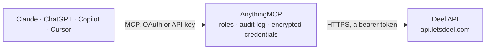

<!-- Generated by scripts/export-github-catalog.mjs in the anythingmcp-website repository. Do not edit by hand. -->

# Deel MCP connector

Manage Deel (global EOR / contractor platform: people, contracts, invoices, payments, organizations) from any AI agent. 10 tools, Bearer token. The AnythingMCP connector gives Claude, ChatGPT, Microsoft Copilot, Cursor and Gemini 10 MCP tools for Deel: 8 read and 2 can change data.

**Category:** [HR](../hr.md) · **Tools:** 10 · **Setup guide:** [anythingmcp.com](https://anythingmcp.com/guides/deel-to-mcp) · [Deutsch](https://anythingmcp.com/de/guides/deel-to-mcp) · [Italiano](https://anythingmcp.com/it/guides/deel-to-mcp) · [Español](https://anythingmcp.com/es/guides/deel-to-mcp) · [日本語](https://anythingmcp.com/ja/guides/deel-to-mcp) · [Русский](https://anythingmcp.com/ru/guides/deel-to-mcp) · [中文](https://anythingmcp.com/zh/guides/deel-to-mcp)

## Start without code

No installation and no terminal: AnythingMCP Cloud runs the Deel connector for you, operated by helpcode.ai in Frankfurt, Germany.

1. **Click the button above** and create an account or sign in. The Deel connector opens, ready to install.
2. **Paste the API key or token from your Deel account.** Every click is in the [step-by-step guide](https://anythingmcp.com/guides/deel-to-mcp).
3. **Click Install.** AnythingMCP shows the address of your MCP server.
4. **Add that address to your assistant:** [Claude](https://anythingmcp.com/guides/connect-deel-to-claude) · [ChatGPT](https://anythingmcp.com/guides/connect-deel-to-chatgpt) · [Microsoft Copilot](https://anythingmcp.com/guides/connect-deel-to-copilot) · [Cursor](https://anythingmcp.com/guides/connect-deel-to-cursor) · [Gemini CLI](https://anythingmcp.com/guides/connect-deel-to-gemini) · [Meta Muse](https://anythingmcp.com/guides/connect-deel-to-muse).
5. **Ask your first question**, for example: *Show current unpaid invoices for contractor Rafael Santos between 2026-08-01 and 2026-08-31*

Prefer help with the setup? [Talk to us](https://anythingmcp.com/contact).

## How it works

- **The AI client** speaks MCP (Streamable HTTP) to AnythingMCP and only sees tool names, descriptions and results. It never gets the Deel credentials.
- **AnythingMCP** checks the client's role, builds the call from the tool definition, adds the credentials (a bearer token), calls Deel, logs the call and returns the result.
- **Deel** sees an ordinary API client with the rights of the account the credentials belong to.

## Tools

| Tool | What it does | Access |
|---|---|---|
| [`deel_list_organizations`](#deel_list_organizations) | List organizations the token can access. | read |
| [`deel_list_people`](#deel_list_people) | List people (workers). | read |
| [`deel_get_person`](#deel_get_person) | Get one person with full profile. | read |
| [`deel_list_contracts`](#deel_list_contracts) | List contracts. | read |
| [`deel_get_contract`](#deel_get_contract) | Get one contract with full terms. | read |
| [`deel_terminate_contract`](#deel_terminate_contract) | Terminate a contract. | write |
| [`deel_list_invoices`](#deel_list_invoices) | List invoices (per-contract pay period). | read |
| [`deel_list_payments`](#deel_list_payments) | List payments (disbursements to workers). | read |
| [`deel_list_time_offs`](#deel_list_time_offs) | List time-off requests (for direct employees and EOR workers). | read |
| [`deel_add_adjustment`](#deel_add_adjustment) | Add a one-off pay adjustment to a contract's invoice cycle (e.g. bonus, commission, deduction). | write |

## Tool reference

Every parameter as the AI client sees it in `tools/list`. Source: [`packages/backend/src/adapters/intl/deel.json`](../../../packages/backend/src/adapters/intl/deel.json).

### `deel_list_organizations`

List organizations the token can access.

**Access:** read · **Call:** `GET /organizations`

No parameters.

### `deel_list_people`

List people (workers).

**Access:** read · **Call:** `GET /people`

| Parameter | Type | Required | Description |
|---|---|---|---|
| `limit` | integer | no | Max 250. |
| `offset` | integer | no | 0-based. |
| `name` | string | no | Name filter. |
| `email` | string | no | Email filter. |
| `hiring_status` | string | no | active, inactive. |

### `deel_get_person`

Get one person with full profile.

**Access:** read · **Call:** `GET /people/{person_id}`

| Parameter | Type | Required | Description |
|---|---|---|---|
| `person_id` | string | yes | Person hris_id (Deel public ID). |

### `deel_list_contracts`

List contracts. Filter by status (in_progress, terminated, draft), type (eor, contractor, direct_employee).

**Access:** read · **Call:** `GET /contracts`

| Parameter | Type | Required | Description |
|---|---|---|---|
| `after_cursor` | string | no | Cursor pagination. |
| `limit` | integer | no | Max 250. |
| `types` | string | no | Comma-separated contract types. |
| `statuses` | string | no | Comma-separated statuses. |

### `deel_get_contract`

Get one contract with full terms.

**Access:** read · **Call:** `GET /contracts/{contract_id}`

| Parameter | Type | Required | Description |
|---|---|---|---|
| `contract_id` | string | yes | Contract ID. |

### `deel_terminate_contract`

Terminate a contract.

**Access:** write · **Call:** `POST /contracts/{contract_id}/terminations`

| Parameter | Type | Required | Description |
|---|---|---|---|
| `contract_id` | string | yes | Contract ID. |
| `termination_date` | string | yes | YYYY-MM-DD. |
| `reason` | string | no | Free-text termination reason. |
| `additional_information` | string | no | Optional notes. |

### `deel_list_invoices`

List invoices (per-contract pay period). Filter by date range, status (paid, awaiting_payment).

**Access:** read · **Call:** `GET /invoices`

| Parameter | Type | Required | Description |
|---|---|---|---|
| `from` | string | no | Issued from (YYYY-MM-DD). |
| `to` | string | no | Issued to. |
| `status` | string | no | paid, awaiting_payment, overdue. |
| `limit` | integer | no | Max 250. |
| `offset` | integer | no | 0-based. |

### `deel_list_payments`

List payments (disbursements to workers).

**Access:** read · **Call:** `GET /payments`

| Parameter | Type | Required | Description |
|---|---|---|---|
| `from` | string | no | YYYY-MM-DD. |
| `to` | string | no | YYYY-MM-DD. |
| `limit` | integer | no | Max 250. |
| `offset` | integer | no | 0-based. |

### `deel_list_time_offs`

List time-off requests (for direct employees and EOR workers).

**Access:** read · **Call:** `GET /time-offs`

| Parameter | Type | Required | Description |
|---|---|---|---|
| `from` | string | no | YYYY-MM-DD. |
| `to` | string | no | YYYY-MM-DD. |
| `type` | string | no | Time off type. |
| `status` | string | no | approved, pending, rejected. |
| `limit` | integer | no | Max 250. |
| `offset` | integer | no | 0-based. |

### `deel_add_adjustment`

Add a one-off pay adjustment to a contract's invoice cycle (e.g. bonus, commission, deduction).

**Access:** write · **Call:** `POST /contracts/{contract_id}/adjustments`

| Parameter | Type | Required | Description |
|---|---|---|---|
| `contract_id` | string | yes | Contract ID. |
| `amount` | number | yes | Amount (positive=add, negative=deduct). |
| `description` | string | yes | What it's for. |
| `date` | string | yes | Apply on (YYYY-MM-DD). |
| `category` | string | no | bonus, commission, overtime, expense, deduction, ... |

## Run it yourself

AnythingMCP is open source (AGPL-3.0). [Run it with Docker](../../../README.md#run-it-yourself), open **Connectors → Store**, pick **Deel** and enter `DEEL_API_TOKEN`, then add your MCP server URL to the AI client.

[← HR connectors](../hr.md) · [All categories](../README.md)
