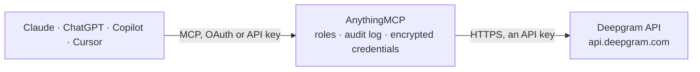

<!-- Generated by scripts/export-github-catalog.mjs in the anythingmcp-website repository. Do not edit by hand. -->

# Deepgram MCP connector

Deepgram speech AI with your own API key: transcribe recordings from a URL with speaker labels, summaries, topics and sentiment, analyze text, turn text into speech with Aura voices, and check … The AnythingMCP connector gives Claude, ChatGPT, Microsoft Copilot, Cursor and Gemini 18 MCP tools for Deepgram, all read-only.

**Category:** [Public Data](../data.md) · **Tools:** 18 · **Setup guide:** [anythingmcp.com](https://anythingmcp.com/guides/deepgram-to-mcp) · [Deutsch](https://anythingmcp.com/de/guides/deepgram-to-mcp) · [Italiano](https://anythingmcp.com/it/guides/deepgram-to-mcp) · [Español](https://anythingmcp.com/es/guides/deepgram-to-mcp) · [日本語](https://anythingmcp.com/ja/guides/deepgram-to-mcp) · [Русский](https://anythingmcp.com/ru/guides/deepgram-to-mcp) · [中文](https://anythingmcp.com/zh/guides/deepgram-to-mcp)

## Start without code

No installation and no terminal: AnythingMCP Cloud runs the Deepgram connector for you, operated by helpcode.ai in Frankfurt, Germany.

1. **Click the button above** and create an account or sign in. The Deepgram connector opens, ready to install.
2. **Paste the API key or token from your Deepgram account.** Every click is in the [step-by-step guide](https://anythingmcp.com/guides/deepgram-to-mcp).
3. **Click Install.** AnythingMCP shows the address of your MCP server.
4. **Add that address to your assistant:** [Claude](https://anythingmcp.com/guides/connect-deepgram-to-claude) · [ChatGPT](https://anythingmcp.com/guides/connect-deepgram-to-chatgpt) · [Microsoft Copilot](https://anythingmcp.com/guides/connect-deepgram-to-copilot) · [Cursor](https://anythingmcp.com/guides/connect-deepgram-to-cursor) · [Gemini CLI](https://anythingmcp.com/guides/connect-deepgram-to-gemini) · [Meta Muse](https://anythingmcp.com/guides/connect-deepgram-to-muse).
5. **Ask your first question**, for example: *Show me the transcription request for audio file order_2026-045, I need duration, cost and status.*

Prefer help with the setup? [Talk to us](https://anythingmcp.com/contact).

## How it works

- **The AI client** speaks MCP (Streamable HTTP) to AnythingMCP and only sees tool names, descriptions and results. It never gets the Deepgram credentials.
- **AnythingMCP** checks the client's role, builds the call from the tool definition, adds the credentials (an API key), calls Deepgram, logs the call and returns the result.
- **Deepgram** sees an ordinary API client with the rights of the account the credentials belong to.

## Tools

| Tool | What it does | Access |
|---|---|---|
| [`deepgram_transcribe_url`](#deepgram_transcribe_url) | Transcribe a pre-recorded audio or video file from a public URL with Deepgram speech to text (POST /v1/listen). | read |
| [`deepgram_analyze_text`](#deepgram_analyze_text) | Analyze English text with Deepgram text intelligence (POST /v1/read): a summary, topics, intents and sentiment per segment, without audio. | read |
| [`deepgram_text_to_speech`](#deepgram_text_to_speech) | Turn up to 2,000 characters of text into speech with a Deepgram Aura voice (POST /v1/speak). | read |
| [`deepgram_list_models`](#deepgram_list_models) | List the public Deepgram models: speech-to-text models under stt (name, version, uuid, languages, batch and streaming support) and text-to-speech voices… | read |
| [`deepgram_get_model`](#deepgram_get_model) | Get one public Deepgram model or voice by its uuid: name, canonical name, architecture, languages, version and capabilities. | read |
| [`deepgram_list_projects`](#deepgram_list_projects) | List the Deepgram projects the API key can reach, with their project_id and name. | read |
| [`deepgram_get_project`](#deepgram_get_project) | Get one Deepgram project: its name and whether it opted out of the Model Improvement Program (mip_opt_out). | read |
| [`deepgram_list_project_models`](#deepgram_list_project_models) | List the models a Deepgram project can use, including custom or early-access models it has been given, split into stt and tts. | read |
| [`deepgram_list_keys`](#deepgram_list_keys) | List the API keys of a Deepgram project: api_key_id, comment, scopes, creation date and the member who owns each key. | read |
| [`deepgram_list_members`](#deepgram_list_members) | List the members of a Deepgram project with member_id, email, first and last name and their scopes (role). | read |
| [`deepgram_list_requests`](#deepgram_list_requests) | List the API requests of a Deepgram project, newest first: request_id, time, endpoint path, API key id, HTTP status code, deployment and the request details… | read |
| [`deepgram_get_request`](#deepgram_get_request) | Get one logged Deepgram API request by id: when it ran, the endpoint, the key used, the status code, and the details Deepgram keeps (audio duration, cost in… | read |
| [`deepgram_get_usage_breakdown`](#deepgram_get_usage_breakdown) | Usage of a Deepgram project for a date range: hours of audio, total hours, agent hours, tokens in and out, TTS characters and request count. | read |
| [`deepgram_list_usage_fields`](#deepgram_list_usage_fields) | List the values that occur in a Deepgram project's usage for a date range: the models (with name and uuid), tags, features and processing methods. | read |
| [`deepgram_list_balances`](#deepgram_list_balances) | List the credit balances of a Deepgram project: balance_id, remaining amount, units (usually usd) and the purchase order it came from. | read |
| [`deepgram_get_balance`](#deepgram_get_balance) | Get one credit balance of a Deepgram project: remaining amount, units and purchase order id. | read |
| [`deepgram_get_billing_breakdown`](#deepgram_get_billing_breakdown) | Spend of a Deepgram project in US dollars for a date range, optionally grouped by API key, deployment, line item (such as streaming::nova-3) or tag. | read |
| [`deepgram_list_purchases`](#deepgram_list_purchases) | List the purchases (credit top-ups and orders) of a Deepgram project with amount, units and date. | read |

## Tool reference

Every parameter as the AI client sees it in `tools/list`. Source: [`packages/backend/src/adapters/intl/deepgram.json`](../../../packages/backend/src/adapters/intl/deepgram.json).

### `deepgram_transcribe_url`

Transcribe a pre-recorded audio or video file from a public URL with Deepgram speech to text (POST /v1/listen). Options add speaker labels, utterances, paragraphs, smart formatting, language detection, a summary, topics, intents, sentiment, entities, key terms and redaction. Returns the transcript with confidence; per-word timings are left out to keep the answer small. Billed per audio minute.

**Access:** read · **Call:** `POST /listen`

| Parameter | Type | Required | Description |
|---|---|---|---|
| `url` | string | yes | Public URL of the audio or video file (mp3, wav, m4a, mp4, ogg, flac, webm and most other formats). Deepgram downloads it itself, so the link must be reachable without sign-in; a presigned storage link works. |
| `model` | string | no | Speech model: nova-3 (default choice, best accuracy, many languages; use language multi for mixed languages), nova-3-medical, nova-2 and its variants (nova-2-meeting, nova-2-phonecall, nova-2-finance, ...) for languages nova-3 does not cover, or a custom model id. deepgram_list_models lists them with their languages. Deepgram uses its default model when omitted. |
| `language` | string | no | BCP-47 language of the audio, such as en, en-US, de, fr, es, it, pt-BR, ja, hi; multi for multilingual code-switching on nova-3. Default en. Leave it out and set detect_language when the language is unknown. |
| `detect_language` | boolean | no | Detect the dominant language and return it as detected_language with a confidence. Use instead of language when the language is unknown. |
| `smart_format` | boolean | no | Readable formatting: punctuation, paragraphs, numbers, dates, currency, emails and URLs written out properly. Recommended for transcripts read by people. |
| `punctuate` | boolean | no | Add punctuation and capitalization (already included in smart_format). |
| `diarize` | boolean | no | Tell speakers apart: every utterance and paragraph gets a speaker number starting at 0. |
| `utterances` | boolean | no | Split the transcript into utterances (a speaker turn or phrase) with start and end times in seconds and, with diarize, the speaker. |
| `utt_split` | number | no | Seconds of silence that end an utterance (default 0.8). Only with utterances. |
| `paragraphs` | boolean | no | Group the transcript into paragraphs (with diarize, by speaker) and return a formatted paragraphs.transcript. |
| `summarize` | `v2` | no | Set to v2 for a short summary of the audio in results.summary.short (English audio only). |
| `topics` | boolean | no | Detect topics per segment of the transcript (English only). |
| `intents` | boolean | no | Detect speaker intents per segment of the transcript (English only). |
| `sentiment` | boolean | no | Sentiment (positive, neutral, negative with a score) per segment and on average (English only). |
| `custom_topic` | string[] | no | Topics to look for in addition to the detected ones (up to 100). Only with topics. |
| `custom_intent` | string[] | no | Intents to look for in addition to the detected ones (up to 100). Only with intents. |
| `detect_entities` | boolean | no | Find entities such as names, organizations, locations, dates and amounts in the transcript. |
| `keyterm` | string[] | no | Terms to recognize better: product names, brands, jargon, names (nova-3 only, up to about 100 terms). Example: ["AnythingMCP", "Kubernetes"]. |
| `keywords` | string[] | no | Older keyword boosting for nova-2 and earlier models, each as word:intensifier, e.g. "Deepgram:2". Not supported on nova-3; use keyterm there. |
| `search` | string[] | no | Words or phrases to search for in the audio; the hits with their times are returned under results.channels[].search. |
| `replace` | string[] | no | Find-and-replace on the transcript, each as find:replacement, e.g. "acme:ACME". |
| `redact` | `pci` \| `pii` \| `numbers`[] | no | Redact sensitive content from the transcript: pci (card numbers), pii (personal data), numbers. |
| `numerals` | boolean | no | Write spoken numbers as digits ("nine hundred" becomes "900"). |
| `measurements` | boolean | no | Write spoken measurements as abbreviations ("ten kilograms" becomes "10 kg"). |
| `filler_words` | boolean | no | Keep filler words such as uh and um in the transcript. |
| `profanity_filter` | boolean | no | Replace recognized profanity in the transcript. |
| `dictation` | boolean | no | Dictation mode: spoken punctuation commands ("comma", "period") become punctuation. Needs punctuate. |
| `multichannel` | boolean | no | Transcribe each audio channel separately (for example agent and caller on a stereo call recording). |
| `tag` | string[] | no | Labels attached to this request for usage reporting (they show in deepgram_list_requests and usage filters). |

### `deepgram_analyze_text`

Analyze English text with Deepgram text intelligence (POST /v1/read): a summary, topics, intents and sentiment per segment, without audio. Turn on at least one of summarize, topics, intents or sentiment. Billed per token.

**Access:** read · **Call:** `POST /read`

| Parameter | Type | Required | Description |
|---|---|---|---|
| `text` | string | yes | The text to analyze, in English. Up to 150K tokens of input; longer text fails with TOKEN_LIMIT_EXCEEDED. |
| `language` | `en` | no | Language of the text. Text intelligence currently supports English only: en. |
| `summarize` | boolean | no | Return a summary of the text in results.summary.text. |
| `topics` | boolean | no | Detect topics per text segment. |
| `intents` | boolean | no | Detect intents per text segment. |
| `sentiment` | boolean | no | Sentiment per segment and on average. |
| `custom_topic` | string[] | no | Topics to look for in addition to the detected ones (up to 100). Only with topics. |
| `custom_intent` | string[] | no | Intents to look for in addition to the detected ones (up to 100). Only with intents. |

### `deepgram_text_to_speech`

Turn up to 2,000 characters of text into speech with a Deepgram Aura voice (POST /v1/speak). The audio file (MP3 by default) is attached to the result as an embedded audio resource, up to 8 MiB. Billed per character.

**Access:** read · **Call:** `POST /speak`

| Parameter | Type | Required | Description |
|---|---|---|---|
| `text` | string | yes | The text to speak, at most 2,000 characters per call (longer text is refused with 413). Split longer text into several calls at sentence boundaries. |
| `model` | string | no | Voice model, as aura-2-<voice>-<language>: for example aura-2-thalia-en, aura-2-andromeda-en, aura-2-apollo-en (English), aura-2-celeste-es (Spanish), aura-2-julius-de (German), aura-2-agathe-fr (French), aura-2-livia-it (Italian), aura-2-rhea-nl (Dutch), aura-2-fujin-ja (Japanese). deepgram_list_models lists every voice under tts with its language, accent and a sample. Default aura-asteria-en. |
| `encoding` | `mp3` \| `linear16` \| `flac` \| `opus` \| `aac` \| `mulaw` \| `alaw` | no | Audio encoding: mp3 (default, smallest file), linear16 (PCM, with container wav), flac, opus, aac, mulaw or alaw (telephony). |
| `container` | `none` \| `wav` \| `ogg` | no | File wrapper: wav for linear16, mulaw and alaw; ogg for opus; none for raw audio. Leave empty for the default of the encoding. |
| `sample_rate` | `8000` \| `16000` \| `22050` \| `24000` \| `32000` \| `48000` | no | Sample rate in Hz: 8000, 16000, 24000, 32000 or 48000 for linear16 (default 24000); 8000 or 16000 for mulaw and alaw; fixed for mp3, opus and aac. |
| `bit_rate` | integer | no | Bit rate in bits per second: 32000 or 48000 for mp3 (default 48000), 4000-650000 for opus, 4000-192000 for aac. Ignored for the other encodings. |
| `speed` | number | no | Speaking rate multiplier, 0.7 to 1.5 (default 1). Not available for every voice and language. |

### `deepgram_list_models`

List the public Deepgram models: speech-to-text models under stt (name, version, uuid, languages, batch and streaming support) and text-to-speech voices under tts (name, language, accent, age, use cases and a sample link).

**Access:** read · **Call:** `GET /models`

| Parameter | Type | Required | Description |
|---|---|---|---|
| `include_outdated` | boolean | no | Also list older versions of each model. |

### `deepgram_get_model`

Get one public Deepgram model or voice by its uuid: name, canonical name, architecture, languages, version and capabilities.

**Access:** read · **Call:** `GET /models/{model_id}`

| Parameter | Type | Required | Description |
|---|---|---|---|
| `model_id` | string | yes | Model uuid, from deepgram_list_models. |

### `deepgram_list_projects`

List the Deepgram projects the API key can reach, with their project_id and name. Start here: every account, usage and billing tool needs a project_id.

**Access:** read · **Call:** `GET /projects`

No parameters.

### `deepgram_get_project`

Get one Deepgram project: its name and whether it opted out of the Model Improvement Program (mip_opt_out).

**Access:** read · **Call:** `GET /projects/{project_id}`

| Parameter | Type | Required | Description |
|---|---|---|---|
| `project_id` | string | yes | Project id (UUID), from deepgram_list_projects. |

### `deepgram_list_project_models`

List the models a Deepgram project can use, including custom or early-access models it has been given, split into stt and tts.

**Access:** read · **Call:** `GET /projects/{project_id}/models`

| Parameter | Type | Required | Description |
|---|---|---|---|
| `project_id` | string | yes | Project id (UUID), from deepgram_list_projects. |
| `include_outdated` | boolean | no | Also list older versions of each model. |

### `deepgram_list_keys`

List the API keys of a Deepgram project: api_key_id, comment, scopes, creation date and the member who owns each key. The secret itself is never returned. Owners see all keys, other roles only their own.

**Access:** read · **Call:** `GET /projects/{project_id}/keys`

| Parameter | Type | Required | Description |
|---|---|---|---|
| `project_id` | string | yes | Project id (UUID), from deepgram_list_projects. |
| `status` | `active` \| `expired` | no | Only active or only expired keys. |

### `deepgram_list_members`

List the members of a Deepgram project with member_id, email, first and last name and their scopes (role). Needs an Admin or Owner key.

**Access:** read · **Call:** `GET /projects/{project_id}/members`

| Parameter | Type | Required | Description |
|---|---|---|---|
| `project_id` | string | yes | Project id (UUID), from deepgram_list_projects. |

### `deepgram_list_requests`

List the API requests of a Deepgram project, newest first: request_id, time, endpoint path, API key id, HTTP status code, deployment and the request details (duration, cost, models, features used). Filter by date range, endpoint, method, status or key. Transcripts are not stored by Deepgram and are not part of the log.

**Access:** read · **Call:** `GET /projects/{project_id}/requests`

| Parameter | Type | Required | Description |
|---|---|---|---|
| `project_id` | string | yes | Project id (UUID), from deepgram_list_projects. |
| `start` | string | no | Start of the range: YYYY-MM-DD, YYYY-MM-DDTHH:MM:SS or with an offset (+HH:MM). Defaults to the start of the current billing period. |
| `end` | string | no | End of the range, same formats as start. Defaults to now. |
| `limit` | integer | no | Requests per page, 1-1000 (default 10). |
| `page` | integer | no | Page number, starting at 0. |
| `accessor` | string | no | Only requests made with this API key id (api_key_id from deepgram_list_keys). |
| `request_id` | string | no | Only this request id. |
| `deployment` | `hosted` \| `beta` \| `self-hosted` | no | Only requests on this deployment. |
| `endpoint` | `listen` \| `read` \| `speak` \| `agent` | no | Only requests to this endpoint: listen (speech to text), speak (text to speech), read (text intelligence) or agent (voice agent). |
| `method` | `sync` \| `async` \| `streaming` | no | Only requests of this kind: sync (pre-recorded), async (with callback) or streaming. |
| `status` | `succeeded` \| `failed` | no | Only succeeded (HTTP status below 300) or failed (400 and above) requests. |

### `deepgram_get_request`

Get one logged Deepgram API request by id: when it ran, the endpoint, the key used, the status code, and the details Deepgram keeps (audio duration, cost in USD, models, options and features).

**Access:** read · **Call:** `GET /projects/{project_id}/requests/{request_id}`

| Parameter | Type | Required | Description |
|---|---|---|---|
| `project_id` | string | yes | Project id (UUID), from deepgram_list_projects. |
| `request_id` | string | yes | Request id, from deepgram_list_requests or from metadata.request_id of a transcription. |

### `deepgram_get_usage_breakdown`

Usage of a Deepgram project for a date range: hours of audio, total hours, agent hours, tokens in and out, TTS characters and request count. Without grouping one row per period; with grouping one row per endpoint, model, API key, method, feature set, tag or deployment. Filters narrow it to one endpoint, method, model, key, deployment or tag.

**Access:** read · **Call:** `GET /projects/{project_id}/usage/breakdown`

| Parameter | Type | Required | Description |
|---|---|---|---|
| `project_id` | string | yes | Project id (UUID), from deepgram_list_projects. |
| `start` | string | no | Start of the range, YYYY-MM-DD (UTC). Defaults to the start of the current billing period. |
| `end` | string | no | End of the range, YYYY-MM-DD (UTC). Defaults to today. |
| `grouping` | `accessor` \| `endpoint` \| `feature_set` \| `models` \| `method` \| `tags` \| `deployment` | no | Dimension to group by. Without it the result has one row per period of the range. |
| `endpoint` | `listen` \| `read` \| `speak` \| `agent` | no | Only requests to this endpoint: listen (speech to text), speak (text to speech), read (text intelligence) or agent (voice agent). |
| `method` | `sync` \| `async` \| `streaming` | no | Only requests of this kind: sync (pre-recorded), async (with callback) or streaming. |
| `model` | string | no | Only requests that used this model, by its uuid (from deepgram_list_models). |
| `accessor` | string | no | Only requests made with this API key id (api_key_id from deepgram_list_keys). |
| `deployment` | `hosted` \| `beta` \| `self-hosted` | no | Only requests on this deployment. |
| `tag` | string | no | Only requests labelled with this tag (the tag parameter sent with the request). |

### `deepgram_list_usage_fields`

List the values that occur in a Deepgram project's usage for a date range: the models (with name and uuid), tags, features and processing methods. Use it to find the model uuid and tag values for the usage filters.

**Access:** read · **Call:** `GET /projects/{project_id}/usage/fields`

| Parameter | Type | Required | Description |
|---|---|---|---|
| `project_id` | string | yes | Project id (UUID), from deepgram_list_projects. |
| `start` | string | no | Start of the range, YYYY-MM-DD (UTC). Defaults to the start of the current billing period. |
| `end` | string | no | End of the range, YYYY-MM-DD (UTC). Defaults to today. |

### `deepgram_list_balances`

List the credit balances of a Deepgram project: balance_id, remaining amount, units (usually usd) and the purchase order it came from. Needs an Admin or Owner key (billing:read).

**Access:** read · **Call:** `GET /projects/{project_id}/balances`

| Parameter | Type | Required | Description |
|---|---|---|---|
| `project_id` | string | yes | Project id (UUID), from deepgram_list_projects. |

### `deepgram_get_balance`

Get one credit balance of a Deepgram project: remaining amount, units and purchase order id. Needs billing:read (Admin or Owner).

**Access:** read · **Call:** `GET /projects/{project_id}/balances/{balance_id}`

| Parameter | Type | Required | Description |
|---|---|---|---|
| `project_id` | string | yes | Project id (UUID), from deepgram_list_projects. |
| `balance_id` | string | yes | Balance id, from deepgram_list_balances. |

### `deepgram_get_billing_breakdown`

Spend of a Deepgram project in US dollars for a date range, optionally grouped by API key, deployment, line item (such as streaming::nova-3) or tag. Needs billing:read (Admin or Owner).

**Access:** read · **Call:** `GET /projects/{project_id}/billing/breakdown`

| Parameter | Type | Required | Description |
|---|---|---|---|
| `project_id` | string | yes | Project id (UUID), from deepgram_list_projects. |
| `start` | string | no | Start of the range, YYYY-MM-DD (UTC). Defaults to the start of the current billing period. |
| `end` | string | no | End of the range, YYYY-MM-DD (UTC). Defaults to today. |
| `grouping` | `accessor` \| `deployment` \| `line_item` \| `tags`[] | no | Dimensions to group by, one or more. |
| `accessor` | string | no | Only requests made with this API key id (api_key_id from deepgram_list_keys). |
| `deployment` | `hosted` \| `beta` \| `self-hosted` | no | Only requests on this deployment. |
| `tag` | string | no | Only requests labelled with this tag (the tag parameter sent with the request). |
| `line_item` | string | no | Only this line item, for example streaming::nova-3 or batch::nova-3. |

### `deepgram_list_purchases`

List the purchases (credit top-ups and orders) of a Deepgram project with amount, units and date. Needs billing:read (Admin or Owner).

**Access:** read · **Call:** `GET /projects/{project_id}/purchases`

| Parameter | Type | Required | Description |
|---|---|---|---|
| `project_id` | string | yes | Project id (UUID), from deepgram_list_projects. |
| `limit` | integer | no | Purchases to return, 1-1000 (default 10). |

## Run it yourself

AnythingMCP is open source (AGPL-3.0). [Run it with Docker](../../../README.md#run-it-yourself), open **Connectors → Store**, pick **Deepgram** and enter `DEEPGRAM_API_KEY`, then add your MCP server URL to the AI client.

[← Public Data connectors](../data.md) · [All categories](../README.md)
