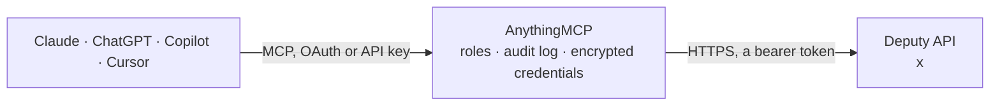

<!-- Generated by scripts/export-github-catalog.mjs in the anythingmcp-website repository. Do not edit by hand. -->

# Deputy MCP connector

Deputy workforce management: employees, locations and areas, rosters (shifts) and publishing, timesheets with clock on and off and approval, leave and unavailability, memos and the resource query API. The AnythingMCP connector gives Claude, ChatGPT, Microsoft Copilot, Cursor and Gemini 45 MCP tools for Deputy: 24 read and 21 can change data.

**Category:** [HR](../hr.md) · **Tools:** 45 · **Setup guide:** [anythingmcp.com](https://anythingmcp.com/guides/deputy-to-mcp) · [Deutsch](https://anythingmcp.com/de/guides/deputy-to-mcp) · [Italiano](https://anythingmcp.com/it/guides/deputy-to-mcp) · [Español](https://anythingmcp.com/es/guides/deputy-to-mcp) · [日本語](https://anythingmcp.com/ja/guides/deputy-to-mcp) · [Русский](https://anythingmcp.com/ru/guides/deputy-to-mcp) · [中文](https://anythingmcp.com/zh/guides/deputy-to-mcp)

## Start without code

No installation and no terminal: AnythingMCP Cloud runs the Deputy connector for you, operated by helpcode.ai in Frankfurt, Germany.

1. **Click the button above** and create an account or sign in. The Deputy connector opens, ready to install.
2. **Paste the API key or token from your Deputy account.** Every click is in the [step-by-step guide](https://anythingmcp.com/guides/deputy-to-mcp).
3. **Click Install.** AnythingMCP shows the address of your MCP server.
4. **Add that address to your assistant:** [Claude](https://anythingmcp.com/guides/connect-deputy-to-claude) · [ChatGPT](https://anythingmcp.com/guides/connect-deputy-to-chatgpt) · [Microsoft Copilot](https://anythingmcp.com/guides/connect-deputy-to-copilot) · [Cursor](https://anythingmcp.com/guides/connect-deputy-to-cursor) · [Gemini CLI](https://anythingmcp.com/guides/connect-deputy-to-gemini) · [Meta Muse](https://anythingmcp.com/guides/connect-deputy-to-muse).
5. **Ask your first question**, for example: *Show current payroll id and main location for employee Marta Kovač, employee number 2742*

Prefer help with the setup? [Talk to us](https://anythingmcp.com/contact).

## How it works

- **The AI client** speaks MCP (Streamable HTTP) to AnythingMCP and only sees tool names, descriptions and results. It never gets the Deputy credentials.
- **AnythingMCP** checks the client's role, builds the call from the tool definition, adds the credentials (a bearer token), calls Deputy, logs the call and returns the result.
- **Deputy** sees an ordinary API client with the rights of the account the credentials belong to.

## Tools

| Tool | What it does | Access |
|---|---|---|
| [`deputy_get_me`](#deputy_get_me) | Who the token belongs to: user and employee id, name, company (location) ids, permissions and the install's settings. | read |
| [`deputy_get_my_rosters`](#deputy_get_my_rosters) | Upcoming shifts of the token's own user (when am I next working), with times, area and location. | read |
| [`deputy_get_my_timesheets`](#deputy_get_my_timesheets) | Timesheets of the token's own user, newest first, with start and end times, breaks and approval state. | read |
| [`deputy_get_my_leave`](#deputy_get_my_leave) | Leave requests of the token's own user, with dates, leave type, hours and status. | read |
| [`deputy_get_my_unavailability`](#deputy_get_my_unavailability) | Unavailability periods the token's own user has entered (when am I unavailable). | read |
| [`deputy_get_my_locations`](#deputy_get_my_locations) | Locations (workplaces) the token's own user can work in, with their areas. | read |
| [`deputy_get_my_colleagues`](#deputy_get_my_colleagues) | Colleagues of the token's own user (who do I work with): names, photos and contact details shared in Deputy. | read |
| [`deputy_list_employees`](#deputy_list_employees) | All employees the token may see, with id, name, main location (Company), role, active flag, start date, contact and payroll id. | read |
| [`deputy_get_employee`](#deputy_get_employee) | One employee by id: name, locations, role, contact details, start and termination date, payroll id. | read |
| [`deputy_query_employees`](#deputy_query_employees) | Search employees with filters, sorting and paging, e.g. active staff of one location: search… | read |
| [`deputy_get_employee_shift_status`](#deputy_get_employee_shift_status) | Whether an employee is working right now: current or next shift, open timesheet and break state. | read |
| [`deputy_list_locations`](#deputy_list_locations) | All locations (Deputy calls them Company records: workplaces with name, code, address id, time zone and active flag). | read |
| [`deputy_list_areas`](#deputy_list_areas) | All areas (operational units / departments) with name, location (Company), colour and active flag. | read |
| [`deputy_list_rosters`](#deputy_list_rosters) | Shifts (rosters) from 12 hours ago to 36 hours ahead across the install: employee, area, start and end (Unix seconds), published flag. | read |
| [`deputy_query_rosters`](#deputy_query_rosters) | Search shifts (rosters) for any period, employee or area, e.g. one day: search {"s1":{"field":"Date","type":"eq","data":"2026-11-03"}}; a week: Date ge and… | read |
| [`deputy_query_timesheets`](#deputy_query_timesheets) | Search timesheets (actual worked time): employee, area, start and end (Unix seconds), total hours, cost, TimeApproved, PayRuleApproved, Discarded, IsInProgress. | read |
| [`deputy_get_timesheet`](#deputy_get_timesheet) | One timesheet with its full details: slots, breaks, pay lines, comments and approval state. | read |
| [`deputy_query_leave`](#deputy_query_leave) | Search leave requests: employee, leave rule (type), location, DateStart, DateEnd, Days, TotalHours, Status (0 awaiting approval, 1 approved, 2 declined, 3… | read |
| [`deputy_get_employee_leave`](#deputy_get_employee_leave) | Leave requests of one employee with dates, type, hours and status. | read |
| [`deputy_get_employee_unavailability`](#deputy_get_employee_unavailability) | Unavailability periods of one employee (one-off and recurring), with start, end and comment. | read |
| [`deputy_query_availability`](#deputy_query_availability) | Search availability and unavailability records of employees (EmployeeAvailability): employee, start and end (Unix seconds), type and recurrence. | read |
| [`deputy_query_resource`](#deputy_query_resource) | Search any other Deputy resource with the same filter body as the other query tools: leave rules, teams, public holidays, events, memos, training, custom… | read |
| [`deputy_get_resource`](#deputy_get_resource) | Read one record of any Deputy resource by id, e.g. a Roster, Leave, LeaveRules or Company record. | read |
| [`deputy_get_resource_info`](#deputy_get_resource_info) | Field list of a Deputy resource: field names and types, and the joinable related objects. | read |
| [`deputy_add_employee`](#deputy_add_employee) | Add an employee to a location. | write |
| [`deputy_update_employee`](#deputy_update_employee) | Change fields of an employee record through the resource API. | write |
| [`deputy_invite_employee`](#deputy_invite_employee) | Email the employee an invitation to log in to Deputy and use the app (sends a message). | write |
| [`deputy_terminate_employee`](#deputy_terminate_employee) | Terminate an employee: they can no longer log in or be rostered. | write |
| [`deputy_reactivate_employee`](#deputy_reactivate_employee) | Re-activate a terminated employee so they can be rostered again. | write |
| [`deputy_delete_employee`](#deputy_delete_employee) | Delete an employee's account and data from Deputy. | write |
| [`deputy_post_journal`](#deputy_post_journal) | Add a journal entry (a private manager note) to an employee's profile. | write |
| [`deputy_add_leave`](#deputy_add_leave) | Create a leave request for an employee. | write |
| [`deputy_update_leave`](#deputy_update_leave) | Approve, decline or cancel a leave request (Status), or change its dates and comment. | write |
| [`deputy_add_unavailability`](#deputy_add_unavailability) | Record when an employee cannot work, once or repeating (e.g. every second Monday). | write |
| [`deputy_save_shift`](#deputy_save_shift) | Add a shift, or update one when roster_id is given. | write |
| [`deputy_publish_rosters`](#deputy_publish_rosters) | Publish shifts so employees see them, with the chosen notification. | write |
| [`deputy_copy_rosters`](#deputy_copy_rosters) | Copy the shifts of a date range of some areas forward (e.g. last week to this week). | write |
| [`deputy_discard_rosters`](#deputy_discard_rosters) | Discard (remove) shifts from the schedule. | write |
| [`deputy_start_timesheet`](#deputy_start_timesheet) | Clock an employee on in an area now: starts a running timesheet for them. | write |
| [`deputy_end_timesheet`](#deputy_end_timesheet) | Clock an employee off (ends a running timesheet), with an optional unscheduled meal break. | write |
| [`deputy_pause_timesheet`](#deputy_pause_timesheet) | Start or end a break on a running timesheet (calling it again ends the break). | write |
| [`deputy_save_timesheet`](#deputy_save_timesheet) | Create a finished timesheet, or update one when timesheet_id is given: times, area, breaks and comment, optionally approved at once. | write |
| [`deputy_approve_timesheet`](#deputy_approve_timesheet) | Approve a timesheet (time approval) so it can be exported to payroll. | write |
| [`deputy_discard_timesheet`](#deputy_discard_timesheet) | Discard a timesheet so it is not paid. | write |
| [`deputy_post_memo`](#deputy_post_memo) | Post a memo to the news feed of a location, optionally to selected locations or users, and optionally asking them to confirm they read it. | write |

## Tool reference

Every parameter as the AI client sees it in `tools/list`. Source: [`packages/backend/src/adapters/intl/deputy.json`](../../../packages/backend/src/adapters/intl/deputy.json).

### `deputy_get_me`

Who the token belongs to: user and employee id, name, company (location) ids, permissions and the install's settings. The install check.

**Access:** read · **Call:** `GET /me`

No parameters.

### `deputy_get_my_rosters`

Upcoming shifts of the token's own user (when am I next working), with times, area and location.

**Access:** read · **Call:** `GET /my/roster`

No parameters.

### `deputy_get_my_timesheets`

Timesheets of the token's own user, newest first, with start and end times, breaks and approval state.

**Access:** read · **Call:** `GET /my/timesheets`

No parameters.

### `deputy_get_my_leave`

Leave requests of the token's own user, with dates, leave type, hours and status.

**Access:** read · **Call:** `GET /my/leave`

No parameters.

### `deputy_get_my_unavailability`

Unavailability periods the token's own user has entered (when am I unavailable).

**Access:** read · **Call:** `GET /my/unavail`

No parameters.

### `deputy_get_my_locations`

Locations (workplaces) the token's own user can work in, with their areas.

**Access:** read · **Call:** `GET /my/location`

No parameters.

### `deputy_get_my_colleagues`

Colleagues of the token's own user (who do I work with): names, photos and contact details shared in Deputy.

**Access:** read · **Call:** `GET /my/colleague`

No parameters.

### `deputy_list_employees`

All employees the token may see, with id, name, main location (Company), role, active flag, start date, contact and payroll id. Contains personal data.

**Access:** read · **Call:** `GET /supervise/employee`

No parameters.

### `deputy_get_employee`

One employee by id: name, locations, role, contact details, start and termination date, payroll id.

**Access:** read · **Call:** `GET /supervise/employee/{employee_id}`

| Parameter | Type | Required | Description |
|---|---|---|---|
| `employee_id` | integer | yes | Employee id (Id from deputy_list_employees, not the user id). |

### `deputy_query_employees`

Search employees with filters, sorting and paging, e.g. active staff of one location: search {"s1":{"field":"Active","type":"eq","data":true},"s2":{"field":"Company","type":"eq","data":1}}. A read: it sends POST but changes nothing.

**Access:** read · **Call:** `POST /resource/Employee/QUERY`

| Parameter | Type | Required | Description |
|---|---|---|---|
| `search` | object | no | Filter clauses keyed by any label: {"s1":{"field":"Date","type":"ge","data":"2026-11-01"},"s2":{"field":"Employee","type":"eq","data":12}}. Operators: eq, ne, gt, ge, lt, le, in, not in, starts, contains, is, is not (for null); field names are the resource's (see deputy_get_resource_info). All clauses must match. Omit for no filter. |
| `sort` | object | no | Sort, field name to asc or desc, e.g. {"Date":"desc"}. |
| `start` | integer | no | Offset of the first record (0 based) for the next page: the previous start plus max. |
| `max` | integer | no | Records per call, 1 to 500 (Deputy's cap). |
| `join` | string[] | no | Related objects to embed, e.g. ["EmployeeObject","OperationalUnitObject"]. Names end in Object. |

### `deputy_get_employee_shift_status`

Whether an employee is working right now: current or next shift, open timesheet and break state.

**Access:** read · **Call:** `GET /supervise/empshiftinfo/{employee_id}`

| Parameter | Type | Required | Description |
|---|---|---|---|
| `employee_id` | integer | yes | Employee id. |

### `deputy_list_locations`

All locations (Deputy calls them Company records: workplaces with name, code, address id, time zone and active flag). The id is the location id used everywhere else.

**Access:** read · **Call:** `GET /resource/Company`

No parameters.

### `deputy_list_areas`

All areas (operational units / departments) with name, location (Company), colour and active flag. Shifts and timesheets belong to an area.

**Access:** read · **Call:** `GET /resource/OperationalUnit`

No parameters.

### `deputy_list_rosters`

Shifts (rosters) from 12 hours ago to 36 hours ahead across the install: employee, area, start and end (Unix seconds), published flag. For other ranges use deputy_query_rosters.

**Access:** read · **Call:** `GET /supervise/roster`

No parameters.

### `deputy_query_rosters`

Search shifts (rosters) for any period, employee or area, e.g. one day: search {"s1":{"field":"Date","type":"eq","data":"2026-11-03"}}; a week: Date ge and Date le. Open shifts have Employee 0. A read: POST that changes nothing.

**Access:** read · **Call:** `POST /resource/Roster/QUERY`

| Parameter | Type | Required | Description |
|---|---|---|---|
| `search` | object | no | Filter clauses keyed by any label: {"s1":{"field":"Date","type":"ge","data":"2026-11-01"},"s2":{"field":"Employee","type":"eq","data":12}}. Operators: eq, ne, gt, ge, lt, le, in, not in, starts, contains, is, is not (for null); field names are the resource's (see deputy_get_resource_info). All clauses must match. Omit for no filter. |
| `sort` | object | no | Sort, field name to asc or desc, e.g. {"Date":"desc"}. |
| `start` | integer | no | Offset of the first record (0 based) for the next page: the previous start plus max. |
| `max` | integer | no | Records per call, 1 to 500 (Deputy's cap). |
| `join` | string[] | no | Related objects to embed, e.g. ["EmployeeObject","OperationalUnitObject"]. Names end in Object. |

### `deputy_query_timesheets`

Search timesheets (actual worked time): employee, area, start and end (Unix seconds), total hours, cost, TimeApproved, PayRuleApproved, Discarded, IsInProgress. Filter e.g. {"s1":{"field":"Date","type":"ge","data":"2026-10-01"}}. A read: POST that changes nothing.

**Access:** read · **Call:** `POST /resource/Timesheet/QUERY`

| Parameter | Type | Required | Description |
|---|---|---|---|
| `search` | object | no | Filter clauses keyed by any label: {"s1":{"field":"Date","type":"ge","data":"2026-11-01"},"s2":{"field":"Employee","type":"eq","data":12}}. Operators: eq, ne, gt, ge, lt, le, in, not in, starts, contains, is, is not (for null); field names are the resource's (see deputy_get_resource_info). All clauses must match. Omit for no filter. |
| `sort` | object | no | Sort, field name to asc or desc, e.g. {"Date":"desc"}. |
| `start` | integer | no | Offset of the first record (0 based) for the next page: the previous start plus max. |
| `max` | integer | no | Records per call, 1 to 500 (Deputy's cap). |
| `join` | string[] | no | Related objects to embed, e.g. ["EmployeeObject","OperationalUnitObject"]. Names end in Object. |

### `deputy_get_timesheet`

One timesheet with its full details: slots, breaks, pay lines, comments and approval state.

**Access:** read · **Call:** `GET /supervise/timesheet/{timesheet_id}/details`

| Parameter | Type | Required | Description |
|---|---|---|---|
| `timesheet_id` | integer | yes | Timesheet id. |

### `deputy_query_leave`

Search leave requests: employee, leave rule (type), location, DateStart, DateEnd, Days, TotalHours, Status (0 awaiting approval, 1 approved, 2 declined, 3 cancelled, 4 pay approved), comments. A read: POST that changes nothing.

**Access:** read · **Call:** `POST /resource/Leave/QUERY`

| Parameter | Type | Required | Description |
|---|---|---|---|
| `search` | object | no | Filter clauses keyed by any label: {"s1":{"field":"Date","type":"ge","data":"2026-11-01"},"s2":{"field":"Employee","type":"eq","data":12}}. Operators: eq, ne, gt, ge, lt, le, in, not in, starts, contains, is, is not (for null); field names are the resource's (see deputy_get_resource_info). All clauses must match. Omit for no filter. |
| `sort` | object | no | Sort, field name to asc or desc, e.g. {"Date":"desc"}. |
| `start` | integer | no | Offset of the first record (0 based) for the next page: the previous start plus max. |
| `max` | integer | no | Records per call, 1 to 500 (Deputy's cap). |
| `join` | string[] | no | Related objects to embed, e.g. ["EmployeeObject","OperationalUnitObject"]. Names end in Object. |

### `deputy_get_employee_leave`

Leave requests of one employee with dates, type, hours and status.

**Access:** read · **Call:** `GET /supervise/leave/{employee_id}`

| Parameter | Type | Required | Description |
|---|---|---|---|
| `employee_id` | integer | yes | Employee id. |

### `deputy_get_employee_unavailability`

Unavailability periods of one employee (one-off and recurring), with start, end and comment.

**Access:** read · **Call:** `GET /supervise/unavail/{employee_id}`

| Parameter | Type | Required | Description |
|---|---|---|---|
| `employee_id` | integer | yes | Employee id. |

### `deputy_query_availability`

Search availability and unavailability records of employees (EmployeeAvailability): employee, start and end (Unix seconds), type and recurrence. A read: POST that changes nothing.

**Access:** read · **Call:** `POST /resource/EmployeeAvailability/QUERY`

| Parameter | Type | Required | Description |
|---|---|---|---|
| `search` | object | no | Filter clauses keyed by any label: {"s1":{"field":"Date","type":"ge","data":"2026-11-01"},"s2":{"field":"Employee","type":"eq","data":12}}. Operators: eq, ne, gt, ge, lt, le, in, not in, starts, contains, is, is not (for null); field names are the resource's (see deputy_get_resource_info). All clauses must match. Omit for no filter. |
| `sort` | object | no | Sort, field name to asc or desc, e.g. {"Date":"desc"}. |
| `start` | integer | no | Offset of the first record (0 based) for the next page: the previous start plus max. |
| `max` | integer | no | Records per call, 1 to 500 (Deputy's cap). |
| `join` | string[] | no | Related objects to embed, e.g. ["EmployeeObject","OperationalUnitObject"]. Names end in Object. |

### `deputy_query_resource`

Search any other Deputy resource with the same filter body as the other query tools: leave rules, teams, public holidays, events, memos, training, custom field data, sales data, pay periods and more. A read: POST that changes nothing.

**Access:** read · **Call:** `POST /resource/{object}/QUERY`

| Parameter | Type | Required | Description |
|---|---|---|---|
| `object` | `Employee` \| `Company` \| `OperationalUnit` \| `Roster` \| `RosterOpen` \| `RosterSwap` \| `Timesheet` \| `TimesheetPayReturn` \| `Leave` \| `LeaveRules` \| `LeaveAccrual` \| `EmployeeAvailability` \| `EmployeeAgreement` \| `EmploymentContract` \| `EmployeeRole` \| `Team` \| `PublicHoliday` \| `Event` \| `Memo` \| `Journal` \| `Task` \| `TrainingModule` \| `TrainingRecord` \| `CustomField` \| `CustomFieldData` \| `Contact` \| `Address` \| `SalesData` \| `Schedule` \| `PayRules` \| `PayPeriod` \| `Category` \| `Country` | yes | Resource name (case sensitive). |
| `search` | object | no | Filter clauses keyed by any label: {"s1":{"field":"Date","type":"ge","data":"2026-11-01"},"s2":{"field":"Employee","type":"eq","data":12}}. Operators: eq, ne, gt, ge, lt, le, in, not in, starts, contains, is, is not (for null); field names are the resource's (see deputy_get_resource_info). All clauses must match. Omit for no filter. |
| `sort` | object | no | Sort, field name to asc or desc, e.g. {"Date":"desc"}. |
| `start` | integer | no | Offset of the first record (0 based) for the next page: the previous start plus max. |
| `max` | integer | no | Records per call, 1 to 500 (Deputy's cap). |
| `join` | string[] | no | Related objects to embed, e.g. ["EmployeeObject","OperationalUnitObject"]. Names end in Object. |

### `deputy_get_resource`

Read one record of any Deputy resource by id, e.g. a Roster, Leave, LeaveRules or Company record.

**Access:** read · **Call:** `GET /resource/{object}/{id}`

| Parameter | Type | Required | Description |
|---|---|---|---|
| `object` | `Employee` \| `Company` \| `OperationalUnit` \| `Roster` \| `RosterOpen` \| `RosterSwap` \| `Timesheet` \| `TimesheetPayReturn` \| `Leave` \| `LeaveRules` \| `LeaveAccrual` \| `EmployeeAvailability` \| `EmployeeAgreement` \| `EmploymentContract` \| `EmployeeRole` \| `Team` \| `PublicHoliday` \| `Event` \| `Memo` \| `Journal` \| `Task` \| `TrainingModule` \| `TrainingRecord` \| `CustomField` \| `CustomFieldData` \| `Contact` \| `Address` \| `SalesData` \| `Schedule` \| `PayRules` \| `PayPeriod` \| `Category` \| `Country` | yes | Resource name (case sensitive). |
| `id` | integer | yes | Record id. |

### `deputy_get_resource_info`

Field list of a Deputy resource: field names and types, and the joinable related objects. Use it to write search filters.

**Access:** read · **Call:** `GET /resource/{object}/INFO`

| Parameter | Type | Required | Description |
|---|---|---|---|
| `object` | `Employee` \| `Company` \| `OperationalUnit` \| `Roster` \| `RosterOpen` \| `RosterSwap` \| `Timesheet` \| `TimesheetPayReturn` \| `Leave` \| `LeaveRules` \| `LeaveAccrual` \| `EmployeeAvailability` \| `EmployeeAgreement` \| `EmploymentContract` \| `EmployeeRole` \| `Team` \| `PublicHoliday` \| `Event` \| `Memo` \| `Journal` \| `Task` \| `TrainingModule` \| `TrainingRecord` \| `CustomField` \| `CustomFieldData` \| `Contact` \| `Address` \| `SalesData` \| `Schedule` \| `PayRules` \| `PayPeriod` \| `Category` \| `Country` | yes | Resource name (case sensitive). |

### `deputy_add_employee`

Add an employee to a location. Returns the new employee record; invite them with deputy_invite_employee.

**Access:** write · **Call:** `POST /supervise/employee`

| Parameter | Type | Required | Description |
|---|---|---|---|
| `first_name` | string | yes | First name. |
| `last_name` | string | yes | Last name. |
| `location_id` | integer | yes | Location (Company) id the employee joins. |
| `gender` | `0` \| `1` \| `2` \| `3` | no | 0 prefer not to say, 1 male, 2 female, 3 non-binary. |
| `country_code` | string | no | Country code for the address, e.g. AU, GB, US. |
| `date_of_birth` | string | no | Date of birth, YYYY-MM-DD. |
| `start_date` | string | no | Start date, YYYY-MM-DD. |
| `mobile_phone` | string | no | Mobile phone number. |
| `payroll_id` | string | no | Payroll id. |
| `weekday_rate` | number | no | Base weekday hourly rate. |

### `deputy_update_employee`

Change fields of an employee record through the resource API. Only the fields sent change.

**Access:** write · **Call:** `POST /resource/Employee/{employee_id}`

| Parameter | Type | Required | Description |
|---|---|---|---|
| `employee_id` | integer | yes | Employee id. |
| `fields` | object | yes | Employee fields to set, named as in deputy_get_resource_info for Employee, e.g. {"FirstName":"Ana","DisplayName":"Ana P","Company":2,"Role":50,"StartDate":"2026-11-01"}. |

### `deputy_invite_employee`

Email the employee an invitation to log in to Deputy and use the app (sends a message).

**Access:** write · **Call:** `POST /supervise/employee/{employee_id}/invite`

| Parameter | Type | Required | Description |
|---|---|---|---|
| `employee_id` | integer | yes | Employee id. |

### `deputy_terminate_employee`

Terminate an employee: they can no longer log in or be rostered. Reversible with deputy_reactivate_employee.

**Access:** write · **Call:** `POST /supervise/employee/{employee_id}/terminate`

| Parameter | Type | Required | Description |
|---|---|---|---|
| `employee_id` | integer | yes | Employee id. |

### `deputy_reactivate_employee`

Re-activate a terminated employee so they can be rostered again.

**Access:** write · **Call:** `POST /supervise/employee/{employee_id}/activate`

| Parameter | Type | Required | Description |
|---|---|---|---|
| `employee_id` | integer | yes | Employee id. |

### `deputy_delete_employee`

Delete an employee's account and data from Deputy. Cannot be undone; switched off at install.

**Access:** write · **Call:** `POST /supervise/employee/{employee_id}/delete`

| Parameter | Type | Required | Description |
|---|---|---|---|
| `employee_id` | integer | yes | Employee id. |

### `deputy_post_journal`

Add a journal entry (a private manager note) to an employee's profile.

**Access:** write · **Call:** `POST /supervise/journal`

| Parameter | Type | Required | Description |
|---|---|---|---|
| `employee_id` | integer | yes | Employee id. |
| `comment` | string | yes | Text of the journal entry. |

### `deputy_add_leave`

Create a leave request for an employee. Status 0 waits for manager approval; 1 records leave that is already approved and affects timesheets and balances.

**Access:** write · **Call:** `POST /resource/Leave`

| Parameter | Type | Required | Description |
|---|---|---|---|
| `employee_id` | integer | yes | Employee id. |
| `leave_rule_id` | integer | yes | Leave rule (leave type) id from deputy_query_resource with object LeaveRules. |
| `location_id` | integer | yes | Location (Company) id the leave applies to. |
| `date_start` | string | yes | First day, YYYY-MM-DD. |
| `date_end` | string | yes | Last day, YYYY-MM-DD. |
| `start` | integer | no | Start as Unix timestamp in seconds. |
| `end` | integer | no | End as Unix timestamp in seconds. |
| `comment` | string | yes | Comment from the employee. |
| `status` | `0` \| `1` | no | 0 awaiting approval (default), 1 approved. |
| `approval_comment` | string | no | Manager comment, for approved leave. |

### `deputy_update_leave`

Approve, decline or cancel a leave request (Status), or change its dates and comment. Only the fields sent change.

**Access:** write · **Call:** `POST /resource/Leave/{leave_id}`

| Parameter | Type | Required | Description |
|---|---|---|---|
| `leave_id` | integer | yes | Leave id. |
| `status` | `0` \| `1` \| `2` \| `3` | no | 0 awaiting approval, 1 approved, 2 declined, 3 cancelled. |
| `approval_comment` | string | no | Manager comment. |
| `date_start` | string | no | New first day, YYYY-MM-DD. |
| `date_end` | string | no | New last day, YYYY-MM-DD. |
| `comment` | string | no | New employee comment. |

### `deputy_add_unavailability`

Record when an employee cannot work, once or repeating (e.g. every second Monday).

**Access:** write · **Call:** `POST /supervise/unavail`

| Parameter | Type | Required | Description |
|---|---|---|---|
| `employee_id` | integer | yes | Employee id. |
| `start` | integer | yes | Start as Unix timestamp in seconds. |
| `end` | integer | yes | End as Unix timestamp in seconds. |
| `comment` | string | no | Note, e.g. the reason. |
| `recurrence` | object | no | Repeat rule, e.g. {"FREQ":"WEEKLY","INTERVAL":2,"BYDAY":"MO"}. Omit for a one-off period. |

### `deputy_save_shift`

Add a shift, or update one when roster_id is given. Publishing (publish true) can notify the employee. The answer body is empty on success.

**Access:** write · **Call:** `POST /supervise/roster`

| Parameter | Type | Required | Description |
|---|---|---|---|
| `roster_id` | integer | no | Roster (shift) id to update; omit to add a new shift. |
| `area_id` | integer | yes | Area (operational unit) id. |
| `start` | integer | yes | Start as Unix timestamp in seconds. |
| `end` | integer | yes | End as Unix timestamp in seconds. |
| `employee_id` | integer | no | Employee id to assign; 0 or omitted with open 1 for an open shift. |
| `meal_break_minutes` | integer | no | Meal break in minutes. |
| `publish` | boolean | no | true publishes the shift (may notify the employee). |
| `open` | `0` \| `1` | no | 1 shows the shift as open for anyone to claim, 0 not. |
| `force_overwrite` | `0` \| `1` | no | 1 overwrites a clashing existing shift, 0 (default) does not. |
| `confirm_status` | `0` \| `1` | no | 1 marks the shift as confirmed, 0 not. |
| `comment` | string | no | Comment on the shift. |

### `deputy_publish_rosters`

Publish shifts so employees see them, with the chosen notification.

**Access:** write · **Call:** `POST /supervise/roster/publish`

| Parameter | Type | Required | Description |
|---|---|---|---|
| `roster_ids` | integer[] | yes | Roster (shift) ids to publish. |
| `notify` | `1` \| `2` \| `3` \| `4` \| `5` | yes | 1 SMS and email, 2 SMS, 3 email, 4 none, 5 ask employees to confirm. |
| `all_locations` | `0` \| `1` | no | 1 publishes across all locations in this request, 0 only the given shifts' location. |

### `deputy_copy_rosters`

Copy the shifts of a date range of some areas forward (e.g. last week to this week).

**Access:** write · **Call:** `POST /supervise/roster/copy`

| Parameter | Type | Required | Description |
|---|---|---|---|
| `from_date` | string | yes | Start of the source range, YYYY-MM-DD. |
| `to_date` | string | yes | End of the source range, YYYY-MM-DD. |
| `area_ids` | integer[] | yes | Area (operational unit) ids whose shifts are copied. |
| `error_details` | `0` \| `1` | no | 1 returns details about shifts that could not be copied. |

### `deputy_discard_rosters`

Discard (remove) shifts from the schedule. Cannot be undone; switched off at install.

**Access:** write · **Call:** `POST /supervise/roster/discard`

| Parameter | Type | Required | Description |
|---|---|---|---|
| `roster_ids` | integer[] | yes | Roster (shift) ids to discard. |

### `deputy_start_timesheet`

Clock an employee on in an area now: starts a running timesheet for them.

**Access:** write · **Call:** `POST /supervise/timesheet/start`

| Parameter | Type | Required | Description |
|---|---|---|---|
| `employee_id` | integer | yes | Employee id. |
| `area_id` | integer | yes | Area (operational unit) id. |

### `deputy_end_timesheet`

Clock an employee off (ends a running timesheet), with an optional unscheduled meal break.

**Access:** write · **Call:** `POST /supervise/timesheet/end`

| Parameter | Type | Required | Description |
|---|---|---|---|
| `timesheet_id` | integer | yes | Running timesheet id. |
| `meal_break_minutes` | integer | yes | Meal break minutes taken; 0 when none. |

### `deputy_pause_timesheet`

Start or end a break on a running timesheet (calling it again ends the break).

**Access:** write · **Call:** `POST /supervise/timesheet/pause`

| Parameter | Type | Required | Description |
|---|---|---|---|
| `timesheet_id` | integer | yes | Running timesheet id. |

### `deputy_save_timesheet`

Create a finished timesheet, or update one when timesheet_id is given: times, area, breaks and comment, optionally approved at once.

**Access:** write · **Call:** `POST /supervise/timesheet/update`

| Parameter | Type | Required | Description |
|---|---|---|---|
| `timesheet_id` | integer | no | Timesheet id to update; omit to create. |
| `employee_id` | integer | no | Employee id (needed to create). |
| `area_id` | integer | no | Area (operational unit) id. |
| `start` | integer | no | Start as Unix timestamp in seconds. |
| `end` | integer | no | End as Unix timestamp in seconds. |
| `meal_break_minutes` | integer | no | Unscheduled meal break in minutes. |
| `slots` | object[] | no | Breaks with times, as Deputy's Slots, e.g. [{"blnEmptySlot":false,"strType":"B","intUnixStart":1616367600,"intUnixEnd":1616369400,"mixedActivity":{"intState":2,"blnCanStartEarly":1,"blnCanEndEarly":1,"blnIsMandatory":1,"strBreakType":"M"}}]. |
| `roster_id` | integer | no | Shift (roster) id the timesheet belongs to. |
| `comment` | string | no | Comment on the timesheet. |
| `approve` | boolean | no | true also approves the timesheet. |

### `deputy_approve_timesheet`

Approve a timesheet (time approval) so it can be exported to payroll.

**Access:** write · **Call:** `POST /supervise/timesheet/approve`

| Parameter | Type | Required | Description |
|---|---|---|---|
| `timesheet_id` | integer | yes | Timesheet id. |

### `deputy_discard_timesheet`

Discard a timesheet so it is not paid. Cannot be undone; switched off at install.

**Access:** write · **Call:** `POST /supervise/timesheet/discard`

| Parameter | Type | Required | Description |
|---|---|---|---|
| `timesheet_id` | integer | yes | Timesheet id. |

### `deputy_post_memo`

Post a memo to the news feed of a location, optionally to selected locations or users, and optionally asking them to confirm they read it.

**Access:** write · **Call:** `PUT /supervise/memo`

| Parameter | Type | Required | Description |
|---|---|---|---|
| `content` | string | yes | Memo text. |
| `location_id` | integer | yes | Location (Company) id that posts the memo. |
| `require_confirm` | `0` \| `1` | no | 1 asks readers to confirm, 0 not. |
| `location_ids` | integer[] | no | Location ids that receive the memo. |
| `user_ids` | integer[] | no | User ids (not employee ids) that receive the memo. |

## Run it yourself

AnythingMCP is open source (AGPL-3.0). [Run it with Docker](../../../README.md#run-it-yourself), open **Connectors → Store**, pick **Deputy** and enter `DEPUTY_HOST`, `DEPUTY_ACCESS_TOKEN`, then add your MCP server URL to the AI client.

[← HR connectors](../hr.md) · [All categories](../README.md)
