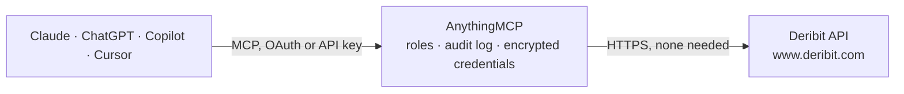

<!-- Generated by scripts/export-github-catalog.mjs in the anythingmcp-website repository. Do not edit by hand. -->

# Deribit MCP connector

Let your AI read Deribit's public crypto derivatives data: options and futures with open interest, implied volatility and mark prices, the DVOL volatility index, historical volatility, tickers with … The AnythingMCP connector gives Claude, ChatGPT, Microsoft Copilot, Cursor and Gemini 16 MCP tools for Deribit, all read-only.

**Category:** [Finance](../finance.md) · **Tools:** 16 · **Setup guide:** [anythingmcp.com](https://anythingmcp.com/guides/deribit-to-mcp) · [Deutsch](https://anythingmcp.com/de/guides/deribit-to-mcp) · [Italiano](https://anythingmcp.com/it/guides/deribit-to-mcp) · [Español](https://anythingmcp.com/es/guides/deribit-to-mcp) · [日本語](https://anythingmcp.com/ja/guides/deribit-to-mcp) · [Русский](https://anythingmcp.com/ru/guides/deribit-to-mcp) · [中文](https://anythingmcp.com/zh/guides/deribit-to-mcp)

## Start without code

No installation and no terminal: AnythingMCP Cloud runs the Deribit connector for you, operated by helpcode.ai in Frankfurt, Germany.

1. **Click the button above** and create an account or sign in. The Deribit connector opens, ready to install.
2. **Nothing to enter:** this connector needs no credentials. Every click is in the [step-by-step guide](https://anythingmcp.com/guides/deribit-to-mcp).
3. **Click Install.** AnythingMCP shows the address of your MCP server.
4. **Add that address to your assistant:** [Claude](https://anythingmcp.com/guides/connect-deribit-to-claude) · [ChatGPT](https://anythingmcp.com/guides/connect-deribit-to-chatgpt) · [Microsoft Copilot](https://anythingmcp.com/guides/connect-deribit-to-copilot) · [Cursor](https://anythingmcp.com/guides/connect-deribit-to-cursor) · [Gemini CLI](https://anythingmcp.com/guides/connect-deribit-to-gemini) · [Meta Muse](https://anythingmcp.com/guides/connect-deribit-to-muse).
5. **Ask your first question**, for example: *Give me the current ticker for BTC-PERPETUAL (best bid/ask, mark, last, open interest, 8h funding).*

Prefer help with the setup? [Talk to us](https://anythingmcp.com/contact).

## How it works

- **The AI client** speaks MCP (Streamable HTTP) to AnythingMCP and only sees tool names, descriptions and results. It never gets the Deribit credentials.
- **AnythingMCP** checks the client's role, builds the call from the tool definition, adds the credentials (none needed), calls Deribit, logs the call and returns the result.
- **Deribit** sees an ordinary API client with the rights of the account the credentials belong to.

## Tools

| Tool | What it does | Access |
|---|---|---|
| [`deribit_get_book_summary_by_currency`](#deribit_get_book_summary_by_currency) | Summary of every instrument of one currency in one call: instrument name, open interest, 24 hour volume, bid, ask, mark and last price, 24 hour price… | read |
| [`deribit_get_book_summary_by_instrument`](#deribit_get_book_summary_by_instrument) | Summary of one instrument: open interest, 24 hour volume, bid, ask, mark and last price, price change, and for options mark implied volatility and… | read |
| [`deribit_get_volatility_index_data`](#deribit_get_volatility_index_data) | History of the DVOL implied volatility index of a currency as candles: result.data is a list of [timestamp_ms, open, high, low, close]. | read |
| [`deribit_get_historical_volatility`](#deribit_get_historical_volatility) | Realised (historical) volatility of a currency: a list of [timestamp_ms, volatility_percent] points, hourly, covering about the last 16 days. | read |
| [`deribit_get_instruments`](#deribit_get_instruments) | List the tradable instruments of a currency: name, kind, expiry (expiration_timestamp), strike and option type for options, contract size, tick size,… | read |
| [`deribit_get_ticker`](#deribit_get_ticker) | Current ticker of one instrument: last, mark and index price, best bid and ask with amounts, 24 hour stats, open interest, settlement price; for perpetuals… | read |
| [`deribit_get_order_book`](#deribit_get_order_book) | Order book of one instrument: bids and asks as [price, amount], plus the ticker fields (mark price, open interest, funding or greeks). | read |
| [`deribit_get_tradingview_chart_data`](#deribit_get_tradingview_chart_data) | OHLCV candles of one instrument between two times: parallel arrays ticks (timestamps ms), open, high, low, close, volume and cost. | read |
| [`deribit_get_last_trades_by_instrument`](#deribit_get_last_trades_by_instrument) | Recent trades of one instrument: time, price, amount, direction, index and mark price, implied volatility for options, and flags for block trades and… | read |
| [`deribit_get_last_trades_by_currency`](#deribit_get_last_trades_by_currency) | Recent trades across all instruments of a currency, optionally of one kind (e.g. all BTC options): instrument, time, price, amount, direction, implied… | read |
| [`deribit_get_funding_rate_history`](#deribit_get_funding_rate_history) | Hourly funding of a perpetual between two times: for each hour the index price, interest_1h and interest_8h (fractions, 0.0001 = 0.01%). | read |
| [`deribit_get_funding_rate_value`](#deribit_get_funding_rate_value) | Total funding rate of a perpetual accumulated over a period, as one fraction (0.001 = 0.1%). | read |
| [`deribit_get_index_price`](#deribit_get_index_price) | Current price of a Deribit index (e.g. btc_usd) and its estimated delivery price. | read |
| [`deribit_get_index_price_names`](#deribit_get_index_price_names) | List the names of all Deribit price indexes (btc_usd, eth_usdc, ...), the values deribit_get_index_price and deribit_get_delivery_prices take. | read |
| [`deribit_get_delivery_prices`](#deribit_get_delivery_prices) | Daily delivery (settlement) prices of an index, newest first: date and delivery_price, with records_total for paging. | read |
| [`deribit_get_currencies`](#deribit_get_currencies) | List the currencies Deribit supports, with their long name, decimals and withdrawal fee. | read |

## Tool reference

Every parameter as the AI client sees it in `tools/list`. Source: [`packages/backend/src/adapters/intl/deribit.json`](../../../packages/backend/src/adapters/intl/deribit.json).

### `deribit_get_book_summary_by_currency`

Summary of every instrument of one currency in one call: instrument name, open interest, 24 hour volume, bid, ask, mark and last price, 24 hour price change, and for options the mark implied volatility and underlying price; for futures and perpetuals also funding. Use it for options skew, open interest by strike and expiry, and max pain.

**Access:** read · **Call:** `GET /public/get_book_summary_by_currency`

| Parameter | Type | Required | Description |
|---|---|---|---|
| `currency` | string | yes | Currency, e.g. BTC, ETH, USDC, USDT. |
| `kind` | `future` \| `option` \| `spot` \| `future_combo` \| `option_combo` | no | Instrument kind. Leave empty for all kinds. |

### `deribit_get_book_summary_by_instrument`

Summary of one instrument: open interest, 24 hour volume, bid, ask, mark and last price, price change, and for options mark implied volatility and underlying price.

**Access:** read · **Call:** `GET /public/get_book_summary_by_instrument`

| Parameter | Type | Required | Description |
|---|---|---|---|
| `instrument_name` | string | yes | Instrument name, e.g. BTC-PERPETUAL or BTC-27DEC26-100000-C. |

### `deribit_get_volatility_index_data`

History of the DVOL implied volatility index of a currency as candles: result.data is a list of [timestamp_ms, open, high, low, close]. If result.continuation is set, call again with end_timestamp = continuation for older data.

**Access:** read · **Call:** `GET /public/get_volatility_index_data`

| Parameter | Type | Required | Description |
|---|---|---|---|
| `currency` | string | yes | Currency with a DVOL index, e.g. BTC or ETH. |
| `start_timestamp` | integer | yes | Start of the range, Unix milliseconds. |
| `end_timestamp` | integer | yes | End of the range, Unix milliseconds. |
| `resolution` | `1` \| `60` \| `3600` \| `43200` \| `1D` | yes | Candle size in seconds (1, 60, 3600, 43200) or 1D for daily. |

### `deribit_get_historical_volatility`

Realised (historical) volatility of a currency: a list of [timestamp_ms, volatility_percent] points, hourly, covering about the last 16 days.

**Access:** read · **Call:** `GET /public/get_historical_volatility`

| Parameter | Type | Required | Description |
|---|---|---|---|
| `currency` | string | yes | Currency, e.g. BTC or ETH. |

### `deribit_get_instruments`

List the tradable instruments of a currency: name, kind, expiry (expiration_timestamp), strike and option type for options, contract size, tick size, minimum trade amount, settlement period and whether it is active.

**Access:** read · **Call:** `GET /public/get_instruments`

| Parameter | Type | Required | Description |
|---|---|---|---|
| `currency` | string | yes | Currency, e.g. BTC, ETH, USDC, or any for all. |
| `kind` | `future` \| `option` \| `spot` \| `future_combo` \| `option_combo` \| `combo` \| `any` | no | Instrument kind. Leave empty for all kinds. |
| `expired` | boolean | no | true lists recently expired instruments instead of live ones. Default false. |

### `deribit_get_ticker`

Current ticker of one instrument: last, mark and index price, best bid and ask with amounts, 24 hour stats, open interest, settlement price; for perpetuals current and 8 hour funding; for options greeks (delta, gamma, vega, theta, rho), bid, ask and mark implied volatility and the underlying price.

**Access:** read · **Call:** `GET /public/ticker`

| Parameter | Type | Required | Description |
|---|---|---|---|
| `instrument_name` | string | yes | Instrument name, e.g. BTC-PERPETUAL or ETH-27DEC26-4000-P. |

### `deribit_get_order_book`

Order book of one instrument: bids and asks as [price, amount], plus the ticker fields (mark price, open interest, funding or greeks).

**Access:** read · **Call:** `GET /public/get_order_book`

| Parameter | Type | Required | Description |
|---|---|---|---|
| `instrument_name` | string | yes | Instrument name, e.g. BTC-PERPETUAL. |
| `depth` | `1` \| `5` \| `10` \| `20` \| `50` \| `100` \| `1000` \| `10000` | no | Price levels per side. Keep it small (e.g. 20) unless the full book is needed. |

### `deribit_get_tradingview_chart_data`

OHLCV candles of one instrument between two times: parallel arrays ticks (timestamps ms), open, high, low, close, volume and cost. status no_data means nothing in the range.

**Access:** read · **Call:** `GET /public/get_tradingview_chart_data`

| Parameter | Type | Required | Description |
|---|---|---|---|
| `instrument_name` | string | yes | Instrument name, e.g. BTC-PERPETUAL. |
| `start_timestamp` | integer | yes | Start of the range, Unix milliseconds. |
| `end_timestamp` | integer | yes | End of the range, Unix milliseconds. |
| `resolution` | `1` \| `3` \| `5` \| `10` \| `15` \| `30` \| `60` \| `120` \| `180` \| `360` \| `720` \| `1D` | yes | Candle size in minutes, or 1D for daily. |

### `deribit_get_last_trades_by_instrument`

Recent trades of one instrument: time, price, amount, direction, index and mark price, implied volatility for options, and flags for block trades and liquidations. has_more tells whether older trades exist.

**Access:** read · **Call:** `GET /public/get_last_trades_by_instrument`

| Parameter | Type | Required | Description |
|---|---|---|---|
| `instrument_name` | string | yes | Instrument name, e.g. BTC-PERPETUAL. |
| `start_timestamp` | integer | no | Earliest trade time, Unix milliseconds. |
| `end_timestamp` | integer | no | Latest trade time, Unix milliseconds. |
| `start_seq` | integer | no | Trade sequence number to start from. |
| `end_seq` | integer | no | Trade sequence number to end at. |
| `count` | integer | no | Number of trades, default 10, maximum 1000. |
| `sorting` | `asc` \| `desc` \| `default` | no | Sort direction by time. |

### `deribit_get_last_trades_by_currency`

Recent trades across all instruments of a currency, optionally of one kind (e.g. all BTC options): instrument, time, price, amount, direction, implied volatility, block trade and liquidation flags.

**Access:** read · **Call:** `GET /public/get_last_trades_by_currency`

| Parameter | Type | Required | Description |
|---|---|---|---|
| `currency` | string | yes | Currency, e.g. BTC or ETH. |
| `kind` | `future` \| `option` \| `spot` \| `future_combo` \| `option_combo` \| `combo` \| `any` | no | Instrument kind. Leave empty for all kinds. |
| `start_timestamp` | integer | no | Earliest trade time, Unix milliseconds. |
| `end_timestamp` | integer | no | Latest trade time, Unix milliseconds. |
| `count` | integer | no | Number of trades, default 10, maximum 1000. |
| `sorting` | `asc` \| `desc` \| `default` | no | Sort direction by time. |

### `deribit_get_funding_rate_history`

Hourly funding of a perpetual between two times: for each hour the index price, interest_1h and interest_8h (fractions, 0.0001 = 0.01%).

**Access:** read · **Call:** `GET /public/get_funding_rate_history`

| Parameter | Type | Required | Description |
|---|---|---|---|
| `instrument_name` | string | yes | Perpetual instrument, e.g. BTC-PERPETUAL or ETH-PERPETUAL. |
| `start_timestamp` | integer | yes | Start of the range, Unix milliseconds. |
| `end_timestamp` | integer | yes | End of the range, Unix milliseconds. |

### `deribit_get_funding_rate_value`

Total funding rate of a perpetual accumulated over a period, as one fraction (0.001 = 0.1%).

**Access:** read · **Call:** `GET /public/get_funding_rate_value`

| Parameter | Type | Required | Description |
|---|---|---|---|
| `instrument_name` | string | yes | Perpetual instrument, e.g. BTC-PERPETUAL. |
| `start_timestamp` | integer | yes | Start of the period, Unix milliseconds. |
| `end_timestamp` | integer | yes | End of the period, Unix milliseconds. |

### `deribit_get_index_price`

Current price of a Deribit index (e.g. btc_usd) and its estimated delivery price.

**Access:** read · **Call:** `GET /public/get_index_price`

| Parameter | Type | Required | Description |
|---|---|---|---|
| `index_name` | string | yes | Index name, e.g. btc_usd, eth_usd, sol_usdc. deribit_get_index_price_names lists them. |

### `deribit_get_index_price_names`

List the names of all Deribit price indexes (btc_usd, eth_usdc, ...), the values deribit_get_index_price and deribit_get_delivery_prices take.

**Access:** read · **Call:** `GET /public/get_index_price_names`

No parameters.

### `deribit_get_delivery_prices`

Daily delivery (settlement) prices of an index, newest first: date and delivery_price, with records_total for paging.

**Access:** read · **Call:** `GET /public/get_delivery_prices`

| Parameter | Type | Required | Description |
|---|---|---|---|
| `index_name` | string | yes | Index name, e.g. btc_usd. |
| `count` | integer | no | Number of days, default 10, maximum 1000. |
| `offset` | integer | no | Days to skip for paging, default 0. |

### `deribit_get_currencies`

List the currencies Deribit supports, with their long name, decimals and withdrawal fee. The currency codes are what the other tools take as currency.

**Access:** read · **Call:** `GET /public/get_currencies`

No parameters.

## Run it yourself

AnythingMCP is open source (AGPL-3.0). [Run it with Docker](../../../README.md#run-it-yourself), open **Connectors → Store**, pick **Deribit**, then add your MCP server URL to the AI client.

[← Finance connectors](../finance.md) · [All categories](../README.md)
