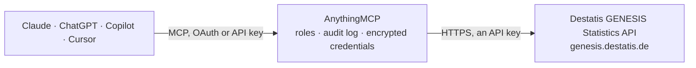

<!-- Generated by scripts/export-github-catalog.mjs in the anythingmcp-website repository. Do not edit by hand. -->

# Destatis GENESIS Statistics MCP connector

Access official German federal statistics from Destatis (Statistisches Bundesamt) via the GENESIS API. The AnythingMCP connector gives Claude, ChatGPT, Microsoft Copilot, Cursor and Gemini 5 MCP tools for Destatis GENESIS Statistics: 4 read and 1 can change data.

**Category:** [Government](../government.md) · **Tools:** 5 · **Setup guide:** [anythingmcp.com](https://anythingmcp.com/guides/destatis-genesis-to-mcp) · [Deutsch](https://anythingmcp.com/de/guides/destatis-genesis-to-mcp) · [Italiano](https://anythingmcp.com/it/guides/destatis-genesis-to-mcp) · [Español](https://anythingmcp.com/es/guides/destatis-genesis-to-mcp) · [日本語](https://anythingmcp.com/ja/guides/destatis-genesis-to-mcp) · [Русский](https://anythingmcp.com/ru/guides/destatis-genesis-to-mcp) · [中文](https://anythingmcp.com/zh/guides/destatis-genesis-to-mcp)

## Start without code

No installation and no terminal: AnythingMCP Cloud runs the Destatis GENESIS Statistics connector for you, operated by helpcode.ai in Frankfurt, Germany.

1. **Click the button above** and create an account or sign in. The Destatis GENESIS Statistics connector opens, ready to install.
2. **Paste the API key or token from your Destatis GENESIS Statistics account.** Every click is in the [step-by-step guide](https://anythingmcp.com/guides/destatis-genesis-to-mcp).
3. **Click Install.** AnythingMCP shows the address of your MCP server.
4. **Add that address to your assistant:** [Claude](https://anythingmcp.com/guides/connect-destatis-genesis-to-claude) · [ChatGPT](https://anythingmcp.com/guides/connect-destatis-genesis-to-chatgpt) · [Microsoft Copilot](https://anythingmcp.com/guides/connect-destatis-genesis-to-copilot) · [Cursor](https://anythingmcp.com/guides/connect-destatis-genesis-to-cursor) · [Gemini CLI](https://anythingmcp.com/guides/connect-destatis-genesis-to-gemini) · [Meta Muse](https://anythingmcp.com/guides/connect-destatis-genesis-to-muse).
5. **Ask your first question**, for example: *What was the population of München (Landkreis) on 31.12.2025 according to Destatis?*

Prefer help with the setup? [Talk to us](https://anythingmcp.com/contact).

## How it works

- **The AI client** speaks MCP (Streamable HTTP) to AnythingMCP and only sees tool names, descriptions and results. It never gets the Destatis GENESIS Statistics credentials.
- **AnythingMCP** checks the client's role, builds the call from the tool definition, adds the credentials (an API key), calls Destatis GENESIS Statistics, logs the call and returns the result.
- **Destatis GENESIS Statistics** sees an ordinary API client with the rights of the account the credentials belong to.

## Tools

| Tool | What it does | Access |
|---|---|---|
| [`destatis_login_check`](#destatis_login_check) | Verify that the configured GENESIS credentials work and report which account the API sees. | write |
| [`destatis_search_tables`](#destatis_search_tables) | Search for statistical tables in the Destatis GENESIS database by keyword. | read |
| [`destatis_get_table`](#destatis_get_table) | Retrieve data from a specific Destatis GENESIS table by its code. | read |
| [`destatis_get_table_metadata`](#destatis_get_table_metadata) | Get metadata and structure of a Destatis GENESIS table, including available dimensions, time ranges, and variable descriptions. | read |
| [`destatis_list_statistics`](#destatis_list_statistics) | List available statistics categories in the Destatis GENESIS database. | read |

## Tool reference

Every parameter as the AI client sees it in `tools/list`. Source: [`packages/backend/src/adapters/de/destatis-genesis.json`](../../../packages/backend/src/adapters/de/destatis-genesis.json).

### `destatis_login_check`

Verify that the configured GENESIS credentials work and report which account the API sees. Use this first when results look wrong — if the returned Username is 'GAST' the credentials did not resolve and you are getting guest-level data.

**Access:** write · **Call:** `POST /helloworld/logincheck`

| Parameter | Type | Required | Description |
|---|---|---|---|
| `language` | string | no | Language for status messages: 'de' for German or 'en' for English. Default: 'de' |

### `destatis_search_tables`

Search for statistical tables in the Destatis GENESIS database by keyword. Returns table codes, titles, and metadata. Use this to find the right table before retrieving data.

**Access:** read · **Call:** `POST /find/find`

| Parameter | Type | Required | Description |
|---|---|---|---|
| `searchterm` | string | yes | Search keyword (e.g. 'Bevölkerung', 'Inflation', 'Arbeitsmarkt', 'BIP') |
| `language` | string | no | Language: 'de' for German or 'en' for English. Default: 'de' |

### `destatis_get_table`

Retrieve data from a specific Destatis GENESIS table by its code. Use destatis_search_tables first to find the table code.

**Access:** read · **Call:** `POST /data/table`

| Parameter | Type | Required | Description |
|---|---|---|---|
| `name` | string | yes | GENESIS table code (e.g. '12411-0001' for population data, '61111-0001' for consumer price index) |
| `startyear` | string | no | Start year (e.g. '2020') |
| `endyear` | string | no | End year (e.g. '2024') |
| `language` | string | no | Language: 'de' or 'en'. Default: 'de' |

### `destatis_get_table_metadata`

Get metadata and structure of a Destatis GENESIS table, including available dimensions, time ranges, and variable descriptions.

**Access:** read · **Call:** `POST /metadata/table`

| Parameter | Type | Required | Description |
|---|---|---|---|
| `name` | string | yes | GENESIS table code (e.g. '12411-0001') |
| `language` | string | no | Language: 'de' or 'en'. Default: 'de' |

### `destatis_list_statistics`

List available statistics categories in the Destatis GENESIS database. Returns statistic codes and descriptions that can be used to browse available data.

**Access:** read · **Call:** `POST /catalogue/statistics`

| Parameter | Type | Required | Description |
|---|---|---|---|
| `selection` | string | no | Statistic code pattern with '*' as wildcard, e.g. '12*' or '122*'. This filters by CODE, not by keyword: a word like 'Bevoelkerung' returns Code 104 and an empty list. Use destatis_search_tables to search by keyword. Omit to list everything. |
| `language` | string | no | Language: 'de' or 'en'. Default: 'de' |

## Run it yourself

AnythingMCP is open source (AGPL-3.0). [Run it with Docker](../../../README.md#run-it-yourself), open **Connectors → Store**, pick **Destatis GENESIS Statistics** and enter `DESTATIS_USERNAME_OR_TOKEN`, then add your MCP server URL to the AI client.

[← Government connectors](../government.md) · [All categories](../README.md)
