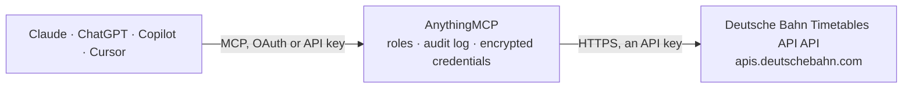

<!-- Generated by scripts/export-github-catalog.mjs in the anythingmcp-website repository. Do not edit by hand. -->

# Deutsche Bahn Timetables API MCP connector

Deutsche Bahn's official station-board API (DB API Marketplace, CC BY 4.0): find stations by name or EVA number, read the planned hourly timetable of any station, and pull the live change feed — … The AnythingMCP connector gives Claude, ChatGPT, Microsoft Copilot, Cursor and Gemini 4 MCP tools for Deutsche Bahn Timetables API, all read-only.

**Category:** [Transport](../transport.md) · **Tools:** 4 · **Setup guide:** [anythingmcp.com](https://anythingmcp.com/guides/deutsche-bahn-timetables-to-mcp) · [Deutsch](https://anythingmcp.com/de/guides/deutsche-bahn-timetables-to-mcp) · [Italiano](https://anythingmcp.com/it/guides/deutsche-bahn-timetables-to-mcp) · [Español](https://anythingmcp.com/es/guides/deutsche-bahn-timetables-to-mcp) · [日本語](https://anythingmcp.com/ja/guides/deutsche-bahn-timetables-to-mcp) · [Русский](https://anythingmcp.com/ru/guides/deutsche-bahn-timetables-to-mcp) · [中文](https://anythingmcp.com/zh/guides/deutsche-bahn-timetables-to-mcp)

## Start without code

No installation and no terminal: AnythingMCP Cloud runs the Deutsche Bahn Timetables API connector for you, operated by helpcode.ai in Frankfurt, Germany.

1. **Click the button above** and create an account or sign in. The Deutsche Bahn Timetables API connector opens, ready to install.
2. **Paste the API key or token from your Deutsche Bahn Timetables API account.** Every click is in the [step-by-step guide](https://anythingmcp.com/guides/deutsche-bahn-timetables-to-mcp).
3. **Click Install.** AnythingMCP shows the address of your MCP server.
4. **Add that address to your assistant:** [Claude](https://anythingmcp.com/guides/connect-deutsche-bahn-timetables-to-claude) · [ChatGPT](https://anythingmcp.com/guides/connect-deutsche-bahn-timetables-to-chatgpt) · [Microsoft Copilot](https://anythingmcp.com/guides/connect-deutsche-bahn-timetables-to-copilot) · [Cursor](https://anythingmcp.com/guides/connect-deutsche-bahn-timetables-to-cursor) · [Gemini CLI](https://anythingmcp.com/guides/connect-deutsche-bahn-timetables-to-gemini) · [Meta Muse](https://anythingmcp.com/guides/connect-deutsche-bahn-timetables-to-muse).
5. **Ask your first question**, for example: *What's the planned departure time and platform for ICE 1452 at Muenchen Hbf between 09:00 and 10:00 today (2026-11-01)?*

Prefer help with the setup? [Talk to us](https://anythingmcp.com/contact).

## How it works

- **The AI client** speaks MCP (Streamable HTTP) to AnythingMCP and only sees tool names, descriptions and results. It never gets the Deutsche Bahn Timetables API credentials.
- **AnythingMCP** checks the client's role, builds the call from the tool definition, adds the credentials (an API key), calls Deutsche Bahn Timetables API, logs the call and returns the result.
- **Deutsche Bahn Timetables API** sees an ordinary API client with the rights of the account the credentials belong to.

## Tools

| Tool | What it does | Access |
|---|---|---|
| [`dbt_search_stations`](#dbt_search_stations) | Find Deutsche Bahn stations by name prefix, DS100 code or EVA number. | read |
| [`dbt_get_station_board`](#dbt_get_station_board) | Planned timetable of a station for one hour: every train with `id` (match it against dbt_get_changes), `category` (ICE, IC, EC, RE, RB, S …), `number`,… | read |
| [`dbt_get_changes`](#dbt_get_changes) | All currently known changes at a station, straight from Deutsche Bahn (refreshed every 30 s): per train `id` (matches dbt_get_station_board), `arrival` /… | read |
| [`dbt_get_recent_changes`](#dbt_get_recent_changes) | Changes at a station from the last two minutes only — the same shape as dbt_get_changes, for polling a station you are watching without re-reading the full… | read |

## Tool reference

Every parameter as the AI client sees it in `tools/list`. Source: [`packages/backend/src/adapters/de/deutsche-bahn-timetables.json`](../../../packages/backend/src/adapters/de/deutsche-bahn-timetables.json).

### `dbt_search_stations`

Find Deutsche Bahn stations by name prefix, DS100 code or EVA number. Returns `name`, `eva` (the station number every other tool takes) and `ds100`. Prefix search: 'Freiburg' lists every station starting with Freiburg; 'Freiburg Hbf' narrows it. A trailing '*' widens the match. Umlauts are unreliable in prefixes — try 'Munchen' as well as 'München'.

**Access:** read · **Call:** `GET /station/{pattern}`

| Parameter | Type | Required | Description |
|---|---|---|---|
| `pattern` | string | yes | Station name prefix (e.g. 'Freiburg Hbf', 'Berlin Hbf'), DS100 code (e.g. 'RF') or EVA number (e.g. '8000107'). |

### `dbt_get_station_board`

Planned timetable of a station for one hour: every train with `id` (match it against dbt_get_changes), `category` (ICE, IC, EC, RE, RB, S …), `number`, `line`, planned `arrival` / `departure` (yyMMddHHmm, local time) and platforms, `from` (previous stops, '|'-separated, origin first) and `to` (next stops, destination last). `date` is yyMMdd and `hour` is HH, both local German time. This is the schedule; live delays and cancellations come from dbt_get_changes.

**Access:** read · **Call:** `GET /plan/{eva}/{date}/{hour}`

| Parameter | Type | Required | Description |
|---|---|---|---|
| `eva` | string | yes | Station EVA number from dbt_search_stations, e.g. '8000107'. |
| `date` | string | yes | Date as yyMMdd in local German time, e.g. '260915' for 15 September 2026. |
| `hour` | string | yes | Hour as HH (00–23) in local German time, e.g. '14'. |

### `dbt_get_changes`

All currently known changes at a station, straight from Deutsche Bahn (refreshed every 30 s): per train `id` (matches dbt_get_station_board), `arrival` / `departure` with `changedTime` (yyMMddHHmm local — compare with the planned time for the delay), `changedPlatform`, `status` ('c' = cancelled, 'a' = added, 'p' = planned), `changedPath`, and `messages` (disruptions and information with `category`, validity `from` / `to` and a priority). Covers every hour, so entries may refer to trains outside the plan you fetched.

**Access:** read · **Call:** `GET /fchg/{eva}`

| Parameter | Type | Required | Description |
|---|---|---|---|
| `eva` | string | yes | Station EVA number from dbt_search_stations. |

### `dbt_get_recent_changes`

Changes at a station from the last two minutes only — the same shape as dbt_get_changes, for polling a station you are watching without re-reading the full change feed each time.

**Access:** read · **Call:** `GET /rchg/{eva}`

| Parameter | Type | Required | Description |
|---|---|---|---|
| `eva` | string | yes | Station EVA number from dbt_search_stations. |

## Run it yourself

AnythingMCP is open source (AGPL-3.0). [Run it with Docker](../../../README.md#run-it-yourself), open **Connectors → Store**, pick **Deutsche Bahn Timetables API** and enter `DB_CLIENT_ID`, `DB_API_KEY`, then add your MCP server URL to the AI client.

[← Transport connectors](../transport.md) · [All categories](../README.md)
