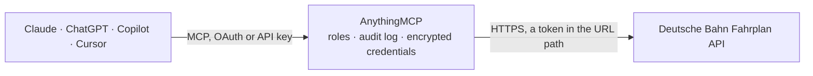

<!-- Generated by scripts/export-github-catalog.mjs in the anythingmcp-website repository. Do not edit by hand. -->

# Deutsche Bahn Fahrplan MCP connector

German train timetable with live delays: search stations, list departures and arrivals with real-time delay, track and cancellation status, and plan journeys between any two stations. The AnythingMCP connector gives Claude, ChatGPT, Microsoft Copilot, Cursor and Gemini 5 MCP tools for Deutsche Bahn Fahrplan, all read-only.

**Category:** [Transport](../transport.md) · **Tools:** 5 · **Setup guide:** [anythingmcp.com](https://anythingmcp.com/guides/deutsche-bahn-to-mcp) · [Deutsch](https://anythingmcp.com/de/guides/deutsche-bahn-to-mcp) · [Italiano](https://anythingmcp.com/it/guides/deutsche-bahn-to-mcp) · [Español](https://anythingmcp.com/es/guides/deutsche-bahn-to-mcp) · [日本語](https://anythingmcp.com/ja/guides/deutsche-bahn-to-mcp) · [Русский](https://anythingmcp.com/ru/guides/deutsche-bahn-to-mcp) · [中文](https://anythingmcp.com/zh/guides/deutsche-bahn-to-mcp)

## Start without code

No installation and no terminal: AnythingMCP Cloud runs the Deutsche Bahn Fahrplan connector for you, operated by helpcode.ai in Frankfurt, Germany.

1. **Click the button above** and create an account or sign in. The Deutsche Bahn Fahrplan connector opens, ready to install.
2. **Paste the API key or token from your Deutsche Bahn Fahrplan account.** Every click is in the [step-by-step guide](https://anythingmcp.com/guides/deutsche-bahn-to-mcp).
3. **Click Install.** AnythingMCP shows the address of your MCP server.
4. **Add that address to your assistant:** [Claude](https://anythingmcp.com/guides/connect-deutsche-bahn-to-claude) · [ChatGPT](https://anythingmcp.com/guides/connect-deutsche-bahn-to-chatgpt) · [Microsoft Copilot](https://anythingmcp.com/guides/connect-deutsche-bahn-to-copilot) · [Cursor](https://anythingmcp.com/guides/connect-deutsche-bahn-to-cursor) · [Gemini CLI](https://anythingmcp.com/guides/connect-deutsche-bahn-to-gemini) · [Meta Muse](https://anythingmcp.com/guides/connect-deutsche-bahn-to-muse).
5. **Ask your first question**, for example: *Is ICE 43 to Berlin leaving Munich Hbf now and which platform is shown?*

Prefer help with the setup? [Talk to us](https://anythingmcp.com/contact).

## How it works

- **The AI client** speaks MCP (Streamable HTTP) to AnythingMCP and only sees tool names, descriptions and results. It never gets the Deutsche Bahn Fahrplan credentials.
- **AnythingMCP** checks the client's role, builds the call from the tool definition, adds the credentials (a token in the URL path), calls Deutsche Bahn Fahrplan, logs the call and returns the result.
- **Deutsche Bahn Fahrplan** sees an ordinary API client with the rights of the account the credentials belong to.

## Tools

| Tool | What it does | Access |
|---|---|---|
| [`db_search_locations`](#db_search_locations) | Search German train stations by name. | read |
| [`db_get_stop`](#db_get_stop) | Details of one station by its `id` from db_search_locations: `name`, `lat`, `lon` and the `modes` served there. | read |
| [`db_get_departures`](#db_get_departures) | Live departure board for a station: the next `n` trains with `line` (e.g. 'ICE 43', 'RE 7', 'S1'), `headsign` (where the train is going),… | read |
| [`db_get_arrivals`](#db_get_arrivals) | Live arrival board for a station: the next `n` arriving trains with `line`, `origin` (where the train started), `headsign`, `scheduledArrival` and live… | read |
| [`db_get_journeys`](#db_get_journeys) | Plan train journeys between two stations. | read |

## Tool reference

Every parameter as the AI client sees it in `tools/list`. Source: [`packages/backend/src/adapters/de/deutsche-bahn.json`](../../../packages/backend/src/adapters/de/deutsche-bahn.json).

### `db_search_locations`

Search German train stations by name. Returns up to 10 matches with `id` (use it as `id` in db_get_departures / db_get_arrivals / db_get_stop and as `from` / `to` in db_get_journeys), `name`, `lat`, `lon` and `modes`. Ids change when the timetable is refreshed, so resolve the name each session. Search the way a German timetable spells it: 'Freiburg Hbf', 'Berlin Hbf', 'Frankfurt (Main) Hauptbahnhof', 'München Hbf'.

**Access:** read · **Call:** `GET /api/v1/geocode`

| Parameter | Type | Required | Description |
|---|---|---|---|
| `query` | string | yes | Station name or fragment, e.g. 'Freiburg Hbf', 'Hamburg Altona', 'Köln Messe/Deutz'. |

### `db_get_stop`

Details of one station by its `id` from db_search_locations: `name`, `lat`, `lon` and the `modes` served there. Use when you already hold an id and need to confirm which station it is.

**Access:** read · **Call:** `GET /api/v1/stoptimes`

| Parameter | Type | Required | Description |
|---|---|---|---|
| `id` | string | yes | Stop id from db_search_locations, e.g. 'fv_384020'. |

### `db_get_departures`

Live departure board for a station: the next `n` trains with `line` (e.g. 'ICE 43', 'RE 7', 'S1'), `headsign` (where the train is going), `scheduledDeparture` and live `departure` (both ISO 8601 UTC — the difference is the delay), `scheduledTrack` / `track`, `realTime` (true = live data), `cancelled` and `tripCancelled`. Omit `when` for departures from now.

**Access:** read · **Call:** `GET /api/v1/stoptimes`

| Parameter | Type | Required | Description |
|---|---|---|---|
| `id` | string | yes | Stop id from db_search_locations. |
| `when` | string | no | Optional start of the board as ISO 8601 with timezone or 'Z', e.g. '2026-09-15T08:30:00+02:00'. Omit for now. |
| `n` | number | no | Number of departures to return (default 12, max 100). Raise it at big stations when looking for a specific long-distance train among many S-Bahn rows. |

### `db_get_arrivals`

Live arrival board for a station: the next `n` arriving trains with `line`, `origin` (where the train started), `headsign`, `scheduledArrival` and live `arrival` (ISO 8601 UTC — the difference is the delay), `scheduledTrack` / `track`, `realTime`, `cancelled` and `tripCancelled`. Omit `when` for arrivals from now.

**Access:** read · **Call:** `GET /api/v1/stoptimes`

| Parameter | Type | Required | Description |
|---|---|---|---|
| `id` | string | yes | Stop id from db_search_locations. |
| `when` | string | no | Optional start of the board as ISO 8601 with timezone or 'Z'. Omit for now. |
| `n` | number | no | Number of arrivals to return (default 12, max 100). |

### `db_get_journeys`

Plan train journeys between two stations. Returns itineraries with `departure`, `arrival` (ISO 8601 UTC), `durationMinutes`, `transfers` and `legs[]` — each leg has `mode` (`WALK` = transfer on foot), `line`, `headsign`, `from` / `to` with scheduled and live times and tracks, `realTime` and `cancelled`. Both ends must be stop ids from db_search_locations (station to station — no street routing). `time` is the departure time unless `arrive_by` is true; omit both for now.

**Access:** read · **Call:** `GET /api/v1/plan`

| Parameter | Type | Required | Description |
|---|---|---|---|
| `from` | string | yes | Origin stop id from db_search_locations, e.g. 'fv_384020'. |
| `to` | string | yes | Destination stop id from db_search_locations. |
| `time` | string | no | ISO 8601 with timezone or 'Z', e.g. '2026-09-15T08:00:00+02:00'. Departure time, or arrival time when arrive_by is true. Omit for now. |
| `arrive_by` | boolean | no | true = `time` is the latest arrival; false/omitted = `time` is the earliest departure. |
| `results` | number | no | Maximum number of itineraries (default 4). |
| `bike` | boolean | no | true = only trains that carry bicycles. |

## Run it yourself

AnythingMCP is open source (AGPL-3.0). [Run it with Docker](../../../README.md#run-it-yourself), open **Connectors → Store**, pick **Deutsche Bahn Fahrplan** and enter `MOTIS_URL`, then add your MCP server URL to the AI client.

[← Transport connectors](../transport.md) · [All categories](../README.md)
