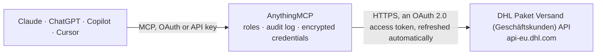

<!-- Generated by scripts/export-github-catalog.mjs in the anythingmcp-website repository. Do not edit by hand. -->

# DHL Paket Versand (Geschäftskunden) MCP connector

Create DHL Paket shipping labels on your own DHL business customer contract (Geschäftskundenkonto) with the official Parcel DE Shipping API of Deutsche Post DHL: validate and book shipments, download … The AnythingMCP connector gives Claude, ChatGPT, Microsoft Copilot, Cursor and Gemini 6 MCP tools for DHL Paket Versand (Geschäftskunden): 3 read and 3 can change data.

**Category:** [Logistics](../logistics.md) · **Tools:** 6 · **Setup guide:** [anythingmcp.com](https://anythingmcp.com/guides/dhl-parcel-de-to-mcp) · [Deutsch](https://anythingmcp.com/de/guides/dhl-parcel-de-to-mcp) · [Italiano](https://anythingmcp.com/it/guides/dhl-parcel-de-to-mcp) · [Español](https://anythingmcp.com/es/guides/dhl-parcel-de-to-mcp) · [日本語](https://anythingmcp.com/ja/guides/dhl-parcel-de-to-mcp) · [Русский](https://anythingmcp.com/ru/guides/dhl-parcel-de-to-mcp) · [中文](https://anythingmcp.com/zh/guides/dhl-parcel-de-to-mcp)

## Start without code

No installation and no terminal: AnythingMCP Cloud runs the DHL Paket Versand (Geschäftskunden) connector for you, operated by helpcode.ai in Frankfurt, Germany.

1. **Click the button above** and create an account or sign in. The DHL Paket Versand (Geschäftskunden) connector opens, ready to install.
2. **Sign in with your DHL Paket Versand (Geschäftskunden) account** when AnythingMCP asks. The first time, an admin creates a small app in the DHL Paket Versand (Geschäftskunden) developer console. Every click is in the [step-by-step guide](https://anythingmcp.com/guides/dhl-parcel-de-to-mcp).
3. **Click Install.** AnythingMCP shows the address of your MCP server.
4. **Add that address to your assistant:** [Claude](https://anythingmcp.com/guides/connect-dhl-parcel-de-to-claude) · [ChatGPT](https://anythingmcp.com/guides/connect-dhl-parcel-de-to-chatgpt) · [Microsoft Copilot](https://anythingmcp.com/guides/connect-dhl-parcel-de-to-copilot) · [Cursor](https://anythingmcp.com/guides/connect-dhl-parcel-de-to-cursor) · [Gemini CLI](https://anythingmcp.com/guides/connect-dhl-parcel-de-to-gemini) · [Meta Muse](https://anythingmcp.com/guides/connect-dhl-parcel-de-to-muse).
5. **Ask your first question**, for example: *Get the manifest PDF for billing number built from EKP 1234567890 and product V01PAK for 2026-11-01*

Prefer help with the setup? [Talk to us](https://anythingmcp.com/contact).

## How it works

- **The AI client** speaks MCP (Streamable HTTP) to AnythingMCP and only sees tool names, descriptions and results. It never gets the DHL Paket Versand (Geschäftskunden) credentials.
- **AnythingMCP** checks the client's role, builds the call from the tool definition, adds the credentials (an OAuth 2.0 access token, refreshed automatically), calls DHL Paket Versand (Geschäftskunden), logs the call and returns the result.
- **DHL Paket Versand (Geschäftskunden)** sees an ordinary API client with the rights of the account the credentials belong to.

## Tools

| Tool | What it does | Access |
|---|---|---|
| [`dhl_parcel_de_validate_shipments`](#dhl_parcel_de_validate_shipments) | Check shipments without booking them: DHL validates addresses, product, services and billing number and returns the same messages a real booking would. | read |
| [`dhl_parcel_de_create_shipments`](#dhl_parcel_de_create_shipments) | Book up to 30 DHL shipments on the business contract and get their shipment numbers (tracking numbers) and labels. | write |
| [`dhl_parcel_de_get_labels`](#dhl_parcel_de_get_labels) | Download the labels (and customs documents) of shipments already booked, for up to 30 shipment numbers. | read |
| [`dhl_parcel_de_cancel_shipments`](#dhl_parcel_de_cancel_shipments) | Cancel (storno) booked shipments that have not been closed out yet, so they are not billed. | write |
| [`dhl_parcel_de_close_out`](#dhl_parcel_de_close_out) | Close out (Tagesabschluss) shipments now instead of waiting for the automatic close-out in the evening. | write |
| [`dhl_parcel_de_get_manifest`](#dhl_parcel_de_get_manifest) | Get the manifest (Einlieferungsliste) of a day: the PDF listing the closed-out shipments by billing number, plus which shipment is on which sheet. | read |

## Tool reference

Every parameter as the AI client sees it in `tools/list`. Source: [`packages/backend/src/adapters/de/dhl-parcel-de.json`](../../../packages/backend/src/adapters/de/dhl-parcel-de.json).

### `dhl_parcel_de_validate_shipments`

Check shipments without booking them: DHL validates addresses, product, services and billing number and returns the same messages a real booking would. Nothing is created or billed.

**Access:** read · **Call:** `POST /orders`

| Parameter | Type | Required | Description |
|---|---|---|---|
| `profile` | string | no | User group profile in the Geschäftskundenportal that may use the billing numbers. STANDARD_GRUPPENPROFIL unless your account uses another one. |
| `shipments` | object[] | yes | Up to 30 shipments. Each one: {"product": "V01PAK", "billingNumber": "33333333330102", "refNo": "Order 1234", "shipper": {"name1": "My Shop GmbH", "addressStreet": "Sträßchensweg 10", "postalCode": "53113", "city": "Bonn", "country": "DEU", "email": "shop@example.com"}, "consignee": {"name1": "Maria Musterfrau", "addressStreet": "Kurt-Schumacher-Str. 20", "postalCode": "53113", "city": "Bonn", "country": "DEU", "email": "maria@example.com"}, "details": {"weight": {"uom": "g", "value": 500}, "dim": {"uom": "cm", "length": 30, "width": 20, "height": 10}}, "services": {"preferredNeighbour": "Nachbar Nr. 5"}}. Countries are ISO 3166-1 alpha-3 (DEU, AUT, FRA). Instead of shipper, {"shipperRef": "..."} uses a sender address saved in the Geschäftskundenportal. A Packstation consignee is {"name": "...", "lockerID": 123, "postNumber": "12345678", "postalCode": "53113", "city": "Bonn", "country": "DEU"}. International shipments outside the EU need "customs". |

### `dhl_parcel_de_create_shipments`

Book up to 30 DHL shipments on the business contract and get their shipment numbers (tracking numbers) and labels. Each booked shipment is billed by DHL unless it is cancelled the same day.

**Access:** write · **Call:** `POST /orders`

| Parameter | Type | Required | Description |
|---|---|---|---|
| `profile` | string | no | User group profile in the Geschäftskundenportal that may use the billing numbers. STANDARD_GRUPPENPROFIL unless your account uses another one. |
| `shipments` | object[] | yes | Up to 30 shipments. Each one: {"product": "V01PAK", "billingNumber": "33333333330102", "refNo": "Order 1234", "shipper": {"name1": "My Shop GmbH", "addressStreet": "Sträßchensweg 10", "postalCode": "53113", "city": "Bonn", "country": "DEU", "email": "shop@example.com"}, "consignee": {"name1": "Maria Musterfrau", "addressStreet": "Kurt-Schumacher-Str. 20", "postalCode": "53113", "city": "Bonn", "country": "DEU", "email": "maria@example.com"}, "details": {"weight": {"uom": "g", "value": 500}, "dim": {"uom": "cm", "length": 30, "width": 20, "height": 10}}, "services": {"preferredNeighbour": "Nachbar Nr. 5"}}. Countries are ISO 3166-1 alpha-3 (DEU, AUT, FRA). Instead of shipper, {"shipperRef": "..."} uses a sender address saved in the Geschäftskundenportal. A Packstation consignee is {"name": "...", "lockerID": 123, "postNumber": "12345678", "postalCode": "53113", "city": "Bonn", "country": "DEU"}. International shipments outside the EU need "customs". |
| `mustEncode` | boolean | no | Only create labels for addresses DHL can encode (Leitcodierung); refuse the others instead of booking them with a warning |
| `docFormat` | `PDF` \| `ZPL2` | no | Label format: PDF (default) or ZPL2 for thermal printers |
| `printFormat` | string | no | Label size: A4 (default from the account), 910-300-600, 910-300-610, 910-300-700, 910-300-700-oz, 910-300-710, 910-300-300, 910-300-300-oz, 910-300-400, 910-300-410, 100x70mm |
| `includeDocs` | `URL` \| `include` | no | URL (default here) returns a download link for each label; include returns the PDF as base64 inside the response, which is large |
| `combine` | boolean | no | Print a shipment's label and its return label as one document (default true) |

### `dhl_parcel_de_get_labels`

Download the labels (and customs documents) of shipments already booked, for up to 30 shipment numbers.

**Access:** read · **Call:** `GET /orders`

| Parameter | Type | Required | Description |
|---|---|---|---|
| `shipment` | string[] | yes | Shipment numbers, up to 30 |
| `docFormat` | `PDF` \| `ZPL2` | no | Label format: PDF (default) or ZPL2 for thermal printers |
| `printFormat` | string | no | Label size: A4 (default from the account), 910-300-600, 910-300-610, 910-300-700, 910-300-700-oz, 910-300-710, 910-300-300, 910-300-300-oz, 910-300-400, 910-300-410, 100x70mm |
| `includeDocs` | `URL` \| `include` | no | URL (default here) returns a download link for each label; include returns the PDF as base64 inside the response, which is large |

### `dhl_parcel_de_cancel_shipments`

Cancel (storno) booked shipments that have not been closed out yet, so they are not billed. Their labels become invalid.

**Access:** write · **Call:** `DELETE /orders`

| Parameter | Type | Required | Description |
|---|---|---|---|
| `profile` | string | no | User group profile in the Geschäftskundenportal that may use the billing numbers. STANDARD_GRUPPENPROFIL unless your account uses another one. |
| `shipment` | string[] | yes | Shipment numbers to cancel, up to 30 |

### `dhl_parcel_de_close_out`

Close out (Tagesabschluss) shipments now instead of waiting for the automatic close-out in the evening. Closed-out shipments can no longer be cancelled.

**Access:** write · **Call:** `POST /manifests`

| Parameter | Type | Required | Description |
|---|---|---|---|
| `profile` | string | no | User group profile in the Geschäftskundenportal that may use the billing numbers. STANDARD_GRUPPENPROFIL unless your account uses another one. |
| `shipmentNumbers` | string[] | no | Shipment numbers to close out, up to 30. Leave out together with all=true to close out every open shipment. |
| `billingNumber` | string | no | Only close out shipments of this billing number |
| `all` | boolean | no | Close out all open shipments of the profile |

### `dhl_parcel_de_get_manifest`

Get the manifest (Einlieferungsliste) of a day: the PDF listing the closed-out shipments by billing number, plus which shipment is on which sheet.

**Access:** read · **Call:** `GET /manifests`

| Parameter | Type | Required | Description |
|---|---|---|---|
| `date` | string | no | Day of the manifest, YYYY-MM-DD. Defaults to today. |
| `billingNumber` | string | no | Only this billing number |
| `includeDocs` | `URL` \| `include` | no | URL (default here) returns a download link for each label; include returns the PDF as base64 inside the response, which is large |

## Run it yourself

AnythingMCP is open source (AGPL-3.0). [Run it with Docker](../../../README.md#run-it-yourself), open **Connectors → Store**, pick **DHL Paket Versand (Geschäftskunden)** and enter `DHL_API_KEY`, `DHL_API_SECRET`, `DHL_GKP_USERNAME`, `DHL_GKP_PASSWORD`, then add your MCP server URL to the AI client.

[← Logistics connectors](../logistics.md) · [All categories](../README.md)
