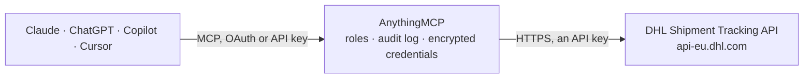

<!-- Generated by scripts/export-github-catalog.mjs in the anythingmcp-website repository. Do not edit by hand. -->

# DHL Shipment Tracking MCP connector

Track DHL shipments worldwide using the official DHL Unified Tracking API. The AnythingMCP connector gives Claude, ChatGPT, Microsoft Copilot, Cursor and Gemini 2 MCP tools for DHL Shipment Tracking, all read-only.

**Category:** [Logistics](../logistics.md) · **Tools:** 2 · **Setup guide:** [anythingmcp.com](https://anythingmcp.com/guides/dhl-tracking-to-mcp) · [Deutsch](https://anythingmcp.com/de/guides/dhl-tracking-to-mcp) · [Italiano](https://anythingmcp.com/it/guides/dhl-tracking-to-mcp) · [Español](https://anythingmcp.com/es/guides/dhl-tracking-to-mcp) · [日本語](https://anythingmcp.com/ja/guides/dhl-tracking-to-mcp) · [Русский](https://anythingmcp.com/ru/guides/dhl-tracking-to-mcp) · [中文](https://anythingmcp.com/zh/guides/dhl-tracking-to-mcp)

## Start without code

No installation and no terminal: AnythingMCP Cloud runs the DHL Shipment Tracking connector for you, operated by helpcode.ai in Frankfurt, Germany.

1. **Click the button above** and create an account or sign in. The DHL Shipment Tracking connector opens, ready to install.
2. **Paste the API key or token from your DHL Shipment Tracking account.** Every click is in the [step-by-step guide](https://anythingmcp.com/guides/dhl-tracking-to-mcp).
3. **Click Install.** AnythingMCP shows the address of your MCP server.
4. **Add that address to your assistant:** [Claude](https://anythingmcp.com/guides/connect-dhl-tracking-to-claude) · [ChatGPT](https://anythingmcp.com/guides/connect-dhl-tracking-to-chatgpt) · [Microsoft Copilot](https://anythingmcp.com/guides/connect-dhl-tracking-to-copilot) · [Cursor](https://anythingmcp.com/guides/connect-dhl-tracking-to-cursor) · [Gemini CLI](https://anythingmcp.com/guides/connect-dhl-tracking-to-gemini) · [Meta Muse](https://anythingmcp.com/guides/connect-dhl-tracking-to-muse).
5. **Ask your first question**, for example: *Track DHL number JD0146000067890123 for Novatek GmbH shipment status and last event*

Prefer help with the setup? [Talk to us](https://anythingmcp.com/contact).

## How it works

- **The AI client** speaks MCP (Streamable HTTP) to AnythingMCP and only sees tool names, descriptions and results. It never gets the DHL Shipment Tracking credentials.
- **AnythingMCP** checks the client's role, builds the call from the tool definition, adds the credentials (an API key), calls DHL Shipment Tracking, logs the call and returns the result.
- **DHL Shipment Tracking** sees an ordinary API client with the rights of the account the credentials belong to.

## Tools

| Tool | What it does | Access |
|---|---|---|
| [`dhl_track_shipment`](#dhl_track_shipment) | Track a DHL shipment by its tracking number. | read |
| [`dhl_track_multiple_shipments`](#dhl_track_multiple_shipments) | Track multiple DHL shipments at once by providing a comma-separated list of tracking numbers. | read |

## Tool reference

Every parameter as the AI client sees it in `tools/list`. Source: [`packages/backend/src/adapters/de/dhl-tracking.json`](../../../packages/backend/src/adapters/de/dhl-tracking.json).

### `dhl_track_shipment`

Track a DHL shipment by its tracking number. Returns the current status, all tracking events, and estimated delivery time. Supports DHL Express, DHL Parcel, DHL eCommerce, DHL Freight, and other DHL business units.

**Access:** read · **Call:** `GET /track/shipments`

| Parameter | Type | Required | Description |
|---|---|---|---|
| `trackingNumber` | string | yes | The DHL tracking number (e.g. 7777777770 for DHL Parcel DE, 1234567890 for DHL Express) |
| `language` | string | no | ISO 639-1 language code for event descriptions (e.g. 'en', 'de'). Defaults to 'en'. |

### `dhl_track_multiple_shipments`

Track multiple DHL shipments at once by providing a comma-separated list of tracking numbers. Returns status and events for all shipments. Maximum 20 tracking numbers per request.

**Access:** read · **Call:** `GET /track/shipments`

| Parameter | Type | Required | Description |
|---|---|---|---|
| `trackingNumbers` | string | yes | Comma-separated list of DHL tracking numbers (max 20) |
| `language` | string | no | ISO 639-1 language code for event descriptions. Defaults to 'en'. |

## Run it yourself

AnythingMCP is open source (AGPL-3.0). [Run it with Docker](../../../README.md#run-it-yourself), open **Connectors → Store**, pick **DHL Shipment Tracking** and enter `DHL_API_KEY`, then add your MCP server URL to the AI client.

[← Logistics connectors](../logistics.md) · [All categories](../README.md)
