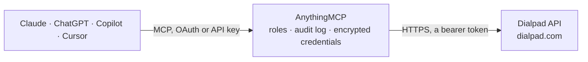

<!-- Generated by scripts/export-github-catalog.mjs in the anythingmcp-website repository. Do not edit by hand. -->

# Dialpad MCP connector

Let your AI work with Dialpad: look up users, offices and call centers, review calls, recordings and Dialpad Ai transcripts, check queues live, start calls, send text messages, manage contacts and export call statistics. The AnythingMCP connector gives Claude, ChatGPT, Microsoft Copilot, Cursor and Gemini 24 MCP tools for Dialpad: 20 read and 4 can change data.

**Category:** [Messaging](../messaging.md) · **Tools:** 24 · **Setup guide:** [anythingmcp.com](https://anythingmcp.com/guides/dialpad-to-mcp) · [Deutsch](https://anythingmcp.com/de/guides/dialpad-to-mcp) · [Italiano](https://anythingmcp.com/it/guides/dialpad-to-mcp) · [Español](https://anythingmcp.com/es/guides/dialpad-to-mcp) · [日本語](https://anythingmcp.com/ja/guides/dialpad-to-mcp) · [Русский](https://anythingmcp.com/ru/guides/dialpad-to-mcp) · [中文](https://anythingmcp.com/zh/guides/dialpad-to-mcp)

## Start without code

No installation and no terminal: AnythingMCP Cloud runs the Dialpad connector for you, operated by helpcode.ai in Frankfurt, Germany.

1. **Click the button above** and create an account or sign in. The Dialpad connector opens, ready to install.
2. **Paste the API key or token from your Dialpad account.** Every click is in the [step-by-step guide](https://anythingmcp.com/guides/dialpad-to-mcp).
3. **Click Install.** AnythingMCP shows the address of your MCP server.
4. **Add that address to your assistant:** [Claude](https://anythingmcp.com/guides/connect-dialpad-to-claude) · [ChatGPT](https://anythingmcp.com/guides/connect-dialpad-to-chatgpt) · [Microsoft Copilot](https://anythingmcp.com/guides/connect-dialpad-to-copilot) · [Cursor](https://anythingmcp.com/guides/connect-dialpad-to-cursor) · [Gemini CLI](https://anythingmcp.com/guides/connect-dialpad-to-gemini) · [Meta Muse](https://anythingmcp.com/guides/connect-dialpad-to-muse).
5. **Ask your first question**, for example: *Show Dialpad user for finance@verdesolar.de and their main phone and extension*

Prefer help with the setup? [Talk to us](https://anythingmcp.com/contact).

## How it works

- **The AI client** speaks MCP (Streamable HTTP) to AnythingMCP and only sees tool names, descriptions and results. It never gets the Dialpad credentials.
- **AnythingMCP** checks the client's role, builds the call from the tool definition, adds the credentials (a bearer token), calls Dialpad, logs the call and returns the result.
- **Dialpad** sees an ordinary API client with the rights of the account the credentials belong to.

## Tools

| Tool | What it does | Access |
|---|---|---|
| [`dialpad_get_company`](#dialpad_get_company) | Read the Dialpad company: name, domain, country, pricing tier (account_type), admin email, state and number of offices. | read |
| [`dialpad_list_users`](#dialpad_list_users) | List Dialpad users with id, names, emails, phone numbers, extension, office, license, admin flag and live presence (online, available, on duty, do not disturb). | read |
| [`dialpad_get_user`](#dialpad_get_user) | Read one Dialpad user by id: names, emails, phone numbers, extension, office, job title, license, time zone and live presence. | read |
| [`dialpad_list_offices`](#dialpad_list_offices) | List the Dialpad offices this API key can reach with id, name, country, time zone, main phone numbers and whether the office is open. | read |
| [`dialpad_get_office`](#dialpad_get_office) | Read one office by id: name, country, time zone, phone numbers, availability, ring time and routing basics. | read |
| [`dialpad_list_call_centers`](#dialpad_list_call_centers) | List the call centers (support and sales queues) of the company with id, name, office, phone numbers, time zone and availability. | read |
| [`dialpad_get_call_center`](#dialpad_get_call_center) | Read one call center by id: name, office, phone numbers, time zone, opening hours flag, ring time and description. | read |
| [`dialpad_get_call_center_status`](#dialpad_get_call_center_status) | Read the live state of a call center queue: availability, capacity, operators on duty, calls waiting (pending) and the longest current wait time. | read |
| [`dialpad_list_departments`](#dialpad_list_departments) | List the departments of the company with id, name, office, phone numbers, time zone and availability. | read |
| [`dialpad_get_department`](#dialpad_get_department) | Read one department by id: name, office, phone numbers, time zone, opening hours flag, ring time and description. | read |
| [`dialpad_list_numbers`](#dialpad_list_numbers) | List the company's Dialpad phone numbers: number, area code, type, status and the user, office, department or call center it is assigned to. | read |
| [`dialpad_list_calls`](#dialpad_list_calls) | List ended calls, newest first, with direction, state, start, connect and end times (Unix milliseconds), duration in milliseconds, the external and internal… | read |
| [`dialpad_get_call`](#dialpad_get_call) | Read one call by id: state, direction, times, duration, contact and target, labels, CSAT, the recording details with their URLs, recording and voicemail… | read |
| [`dialpad_get_call_transcript`](#dialpad_get_call_transcript) | Read the Dialpad Ai transcript of a call: each line with speaker name, user_id or contact_id, time and text, plus Ai moments (type moment) such as action… | read |
| [`dialpad_get_call_transcript_url`](#dialpad_get_call_transcript_url) | Get the link to a call's transcript page in Dialpad (the Dialpad Ai call review), to open it in a browser instead of reading the whole text here. | read |
| [`dialpad_initiate_call`](#dialpad_initiate_call) | Start a real outbound phone call for a Dialpad user: all of the user's devices ring (or only device_id) and, when the user picks up, Dialpad dials the number. | write |
| [`dialpad_send_sms`](#dialpad_send_sms) | Send a text message (SMS) on behalf of a Dialpad user to up to 10 phone numbers. | write |
| [`dialpad_list_contacts`](#dialpad_list_contacts) | List the company's shared Dialpad contacts, or the local contacts of one user with owner_id: names, company, job title, phone numbers and email addresses. | read |
| [`dialpad_get_contact`](#dialpad_get_contact) | Read one shared or local contact by id: names, company, job title, phone numbers, email addresses, websites and owner. | read |
| [`dialpad_create_contact`](#dialpad_create_contact) | Create a contact shared with the company, or a local contact of one user when owner_id is set. | write |
| [`dialpad_start_stats_export`](#dialpad_start_stats_export) | Start a statistics export (calls, texts, voicemails, recordings, on-duty time, CSAT or dispositions) for the company, one office or one target over the last… | read |
| [`dialpad_get_stats_export`](#dialpad_get_stats_export) | Check a statistics export started with dialpad_start_stats_export: status (processing or complete), file_type and download_url of the finished CSV file. | read |
| [`dialpad_create_recording_share_link`](#dialpad_create_recording_share_link) | Create a share link for a call recording or voicemail (recording id from dialpad_get_call recording_details). | write |
| [`dialpad_get_recording_share_link`](#dialpad_get_recording_share_link) | Read a recording share link by id: the access link, its privacy, the recording type and id, the call id and who created it. | read |

## Tool reference

Every parameter as the AI client sees it in `tools/list`. Source: [`packages/backend/src/adapters/intl/dialpad.json`](../../../packages/backend/src/adapters/intl/dialpad.json).

### `dialpad_get_company`

Read the Dialpad company: name, domain, country, pricing tier (account_type), admin email, state and number of offices. Needs an API key created by a company admin.

**Access:** read · **Call:** `GET /company`

No parameters.

### `dialpad_list_users`

List Dialpad users with id, names, emails, phone numbers, extension, office, license, admin flag and live presence (online, available, on duty, do not disturb). Filter by email, phone number, state or admin role. Paged with cursor.

**Access:** read · **Call:** `GET /users`

| Parameter | Type | Required | Description |
|---|---|---|---|
| `email` | string | no | Only the user with this email address. |
| `number` | string | no | Only the user with this phone number (E.164, e.g. +14155550123). |
| `state` | `active` \| `all` \| `cancelled` \| `deleted` \| `pending` \| `suspended` | no | User state, e.g. active (default all non-deleted users when left out). |
| `company_admin` | boolean | no | true for company admins only, false for everyone else. |
| `cursor` | string | no | The cursor from the previous answer, for the next page. The last page has no cursor. |

### `dialpad_get_user`

Read one Dialpad user by id: names, emails, phone numbers, extension, office, job title, license, time zone and live presence. Use "me" with a user-level API key.

**Access:** read · **Call:** `GET /users/{user_id}`

| Parameter | Type | Required | Description |
|---|---|---|---|
| `user_id` | string | yes | The user id from dialpad_list_users, or "me" for the owner of a user-level key. |

### `dialpad_list_offices`

List the Dialpad offices this API key can reach with id, name, country, time zone, main phone numbers and whether the office is open. Paged with cursor.

**Access:** read · **Call:** `GET /offices`

| Parameter | Type | Required | Description |
|---|---|---|---|
| `active_only` | boolean | no | true to list only active offices. |
| `cursor` | string | no | The cursor from the previous answer, for the next page. The last page has no cursor. |

### `dialpad_get_office`

Read one office by id: name, country, time zone, phone numbers, availability, ring time and routing basics.

**Access:** read · **Call:** `GET /offices/{office_id}`

| Parameter | Type | Required | Description |
|---|---|---|---|
| `office_id` | string | yes | The office id from dialpad_list_offices. |

### `dialpad_list_call_centers`

List the call centers (support and sales queues) of the company with id, name, office, phone numbers, time zone and availability. Filter by office or by part of the name. Paged with cursor.

**Access:** read · **Call:** `GET /callcenters`

| Parameter | Type | Required | Description |
|---|---|---|---|
| `office_id` | integer | no | Only call centers of this office. |
| `name_search` | string | no | Only call centers whose name contains this text. |
| `cursor` | string | no | The cursor from the previous answer, for the next page. The last page has no cursor. |

### `dialpad_get_call_center`

Read one call center by id: name, office, phone numbers, time zone, opening hours flag, ring time and description.

**Access:** read · **Call:** `GET /callcenters/{call_center_id}`

| Parameter | Type | Required | Description |
|---|---|---|---|
| `call_center_id` | string | yes | The call center id from dialpad_list_call_centers. |

### `dialpad_get_call_center_status`

Read the live state of a call center queue: availability, capacity, operators on duty, calls waiting (pending) and the longest current wait time.

**Access:** read · **Call:** `GET /callcenters/{call_center_id}/status`

| Parameter | Type | Required | Description |
|---|---|---|---|
| `call_center_id` | string | yes | The call center id from dialpad_list_call_centers. |

### `dialpad_list_departments`

List the departments of the company with id, name, office, phone numbers, time zone and availability. Filter by office or by part of the name. Paged with cursor.

**Access:** read · **Call:** `GET /departments`

| Parameter | Type | Required | Description |
|---|---|---|---|
| `office_id` | integer | no | Only departments of this office. |
| `name_search` | string | no | Only departments whose name contains this text. |
| `cursor` | string | no | The cursor from the previous answer, for the next page. The last page has no cursor. |

### `dialpad_get_department`

Read one department by id: name, office, phone numbers, time zone, opening hours flag, ring time and description.

**Access:** read · **Call:** `GET /departments/{department_id}`

| Parameter | Type | Required | Description |
|---|---|---|---|
| `department_id` | string | yes | The department id from dialpad_list_departments. |

### `dialpad_list_numbers`

List the company's Dialpad phone numbers: number, area code, type, status and the user, office, department or call center it is assigned to. Needs a company admin API key. Paged with cursor.

**Access:** read · **Call:** `GET /numbers`

| Parameter | Type | Required | Description |
|---|---|---|---|
| `status` | string | no | Only numbers with this assignment status, e.g. assigned or available. |
| `cursor` | string | no | The cursor from the previous answer, for the next page. The last page has no cursor. |

### `dialpad_list_calls`

List ended calls, newest first, with direction, state, start, connect and end times (Unix milliseconds), duration in milliseconds, the external and internal number, contact and target, labels and recording links. Filter by time and by one user, office, department or call center. Needs a company admin API key with the calls:list scope. Calls and recordings are personal data. Paged with cursor.

**Access:** read · **Call:** `GET /call`

| Parameter | Type | Required | Description |
|---|---|---|---|
| `started_after` | integer | no | Only calls that started after this time, as Unix milliseconds (e.g. 1760486400000). |
| `started_before` | integer | no | Only calls that started before this time, as Unix milliseconds. |
| `target_id` | integer | no | Only calls of this user, office, department or call center id (set target_type too). |
| `target_type` | `callcenter` \| `callrouter` \| `channel` \| `coachinggroup` \| `coachingteam` \| `department` \| `office` \| `room` \| `staffgroup` \| `unknown` \| `user` | no | Type of target_id. |
| `cursor` | string | no | The cursor from the previous answer, for the next page. The last page has no cursor. |

### `dialpad_get_call`

Read one call by id: state, direction, times, duration, contact and target, labels, CSAT, the recording details with their URLs, recording and voicemail share links and the transcription text when Dialpad Ai transcribed it. Limited by Dialpad to 10 requests per minute. Recordings and transcripts are personal data.

**Access:** read · **Call:** `GET /call/{call_id}`

| Parameter | Type | Required | Description |
|---|---|---|---|
| `call_id` | string | yes | The call id (call_id from dialpad_list_calls), e.g. 6219523485581312. |

### `dialpad_get_call_transcript`

Read the Dialpad Ai transcript of a call: each line with speaker name, user_id or contact_id, time and text, plus Ai moments (type moment) such as action items or questions. Needs Dialpad Ai on the call's line. Transcripts are personal data: read them only when the user needs them.

**Access:** read · **Call:** `GET /transcripts/{call_id}`

| Parameter | Type | Required | Description |
|---|---|---|---|
| `call_id` | string | yes | The call id (call_id from dialpad_list_calls), e.g. 6219523485581312. |

### `dialpad_get_call_transcript_url`

Get the link to a call's transcript page in Dialpad (the Dialpad Ai call review), to open it in a browser instead of reading the whole text here.

**Access:** read · **Call:** `GET /transcripts/{call_id}/url`

| Parameter | Type | Required | Description |
|---|---|---|---|
| `call_id` | string | yes | The call id (call_id from dialpad_list_calls), e.g. 6219523485581312. |

### `dialpad_initiate_call`

Start a real outbound phone call for a Dialpad user: all of the user's devices ring (or only device_id) and, when the user picks up, Dialpad dials the number. This reaches a real person and can cost money (international and premium destinations are billed), so show the user who calls whom with which caller id and call only after the user confirms. Limited to 5 requests per minute. Returns call_id.

**Access:** write · **Call:** `POST /call`

| Parameter | Type | Required | Description |
|---|---|---|---|
| `user_id` | integer | yes | The Dialpad user who makes the call (id from dialpad_list_users). |
| `phone_number` | string | yes | The number to call in E.164 format, e.g. +14155550123. |
| `outbound_caller_id` | string | no | Number shown to the person called (E.164, one the user may use), or "blocked" to hide it. |
| `group_id` | integer | no | Call on behalf of this office, department or call center id (set group_type too). |
| `group_type` | `callcenter` \| `department` \| `office` | no | Type of the group in group_id: office, department or callcenter. |
| `device_id` | string | no | Ring only this one device of the user instead of all of them. |
| `custom_data` | string | no | Your own text attached to the call and passed to call event subscriptions. |

### `dialpad_send_sms`

Send a text message (SMS) on behalf of a Dialpad user to up to 10 phone numbers. This reaches real people and can cost money (international texts are billed per message), and US recipients must have agreed to texts, so show the user the sender, recipients and exact text and call only after the user confirms. Returns the message with id, message_status and message_delivery_result.

**Access:** write · **Call:** `POST /sms`

| Parameter | Type | Required | Description |
|---|---|---|---|
| `user_id` | integer | yes | The Dialpad user who sends the message (id from dialpad_list_users). |
| `to_numbers` | string[] | yes | Recipients in E.164 format, at most 10, e.g. ["+14155550123"]. |
| `text` | string | yes | The message text. |
| `from_number` | string | no | Send from this number (E.164) assigned to the user or a group, instead of the user's default. |
| `sender_group_id` | integer | no | Send on behalf of this office, department or call center id (set sender_group_type too). |
| `sender_group_type` | `callcenter` \| `department` \| `office` | no | Type of the group in group_id: office, department or callcenter. |
| `infer_country_code` | boolean | no | true to accept numbers without country code, read in the user's country. |

### `dialpad_list_contacts`

List the company's shared Dialpad contacts, or the local contacts of one user with owner_id: names, company, job title, phone numbers and email addresses. Contacts are personal data. Paged with cursor.

**Access:** read · **Call:** `GET /contacts`

| Parameter | Type | Required | Description |
|---|---|---|---|
| `owner_id` | string | no | Only the local contacts of this user id. |
| `include_local` | boolean | no | true to include users' local contacts in the company list. |
| `cursor` | string | no | The cursor from the previous answer, for the next page. The last page has no cursor. |

### `dialpad_get_contact`

Read one shared or local contact by id: names, company, job title, phone numbers, email addresses, websites and owner.

**Access:** read · **Call:** `GET /contacts/{contact_id}`

| Parameter | Type | Required | Description |
|---|---|---|---|
| `contact_id` | string | yes | The contact id from dialpad_list_contacts. |

### `dialpad_create_contact`

Create a contact shared with the company, or a local contact of one user when owner_id is set. First and last name are required. Show the user the contact and create it only after the user confirms; check with dialpad_list_contacts first to avoid duplicates.

**Access:** write · **Call:** `POST /contacts`

| Parameter | Type | Required | Description |
|---|---|---|---|
| `first_name` | string | yes | First name. |
| `last_name` | string | yes | Last name. |
| `phones` | string[] | no | Phone numbers in E.164 format; the first is the primary one. |
| `emails` | string[] | no | Email addresses; the first is the primary one. |
| `company_name` | string | no | Company name. |
| `job_title` | string | no | Job title. |
| `extension` | string | no | Extension number. |
| `urls` | string[] | no | Websites of the contact. |
| `owner_id` | string | no | Create a local contact for this user id instead of a shared one. |

### `dialpad_start_stats_export`

Start a statistics export (calls, texts, voicemails, recordings, on-duty time, CSAT or dispositions) for the company, one office or one target over the last days. It only reads data, but runs in the background: it returns request_id; then call dialpad_get_stats_export until status is complete and read the CSV at download_url. Limited to 200 per hour.

**Access:** read · **Call:** `POST /stats`

| Parameter | Type | Required | Description |
|---|---|---|---|
| `stat_type` | `calls` \| `csat` \| `dispositions` \| `onduty` \| `recordings` \| `screenshare` \| `texts` \| `voicemails` | yes | What to export. |
| `export_type` | `records` \| `stats` | yes | stats for totals, records for one row per call or message (csat and dispositions only support records). |
| `days_ago_start` | integer | no | Start of the range in days before today, e.g. 7. |
| `days_ago_end` | integer | no | End of the range in days before today, e.g. 0 for today. |
| `is_today` | boolean | no | true for today only (days_ago_start and days_ago_end are then ignored). |
| `timezone` | string | no | Time zone of the day boundaries, a tz name such as Europe/Berlin. |
| `office_id` | integer | no | Only this office. |
| `target_id` | integer | no | Only this target id (set target_type too; required for csat and dispositions). |
| `target_type` | `callcenter` \| `coachinggroup` \| `coachingteam` \| `department` \| `office` \| `room` \| `staffgroup` \| `unknown` \| `user` | no | Type of target_id. |
| `group_by` | `date` \| `group` \| `user` | no | For calls with export_type stats: per user and day (default), per date, or per group. |

### `dialpad_get_stats_export`

Check a statistics export started with dialpad_start_stats_export: status (processing or complete), file_type and download_url of the finished CSV file. The file can hold personal data such as phone numbers.

**Access:** read · **Call:** `GET /stats/{request_id}`

| Parameter | Type | Required | Description |
|---|---|---|---|
| `request_id` | string | yes | The request_id returned by dialpad_start_stats_export. |

### `dialpad_create_recording_share_link`

Create a share link for a call recording or voicemail (recording id from dialpad_get_call recording_details). Recordings are personal data: a public link lets anyone with it listen, so ask the user which privacy to use (owner, company, admin or public) and call only after the user confirms.

**Access:** write · **Call:** `POST /recordingsharelink`

| Parameter | Type | Required | Description |
|---|---|---|---|
| `recording_id` | string | yes | The recording id (recording_details[].id from dialpad_get_call). |
| `recording_type` | `admincallrecording` \| `callrecording` \| `voicemail` | yes | callrecording for a user's recording, admincallrecording for an admin recording, voicemail for a voicemail. |
| `privacy` | `admin` \| `company` \| `owner` \| `public` | no | Who can open the link: owner, company, admin or public. |

### `dialpad_get_recording_share_link`

Read a recording share link by id: the access link, its privacy, the recording type and id, the call id and who created it.

**Access:** read · **Call:** `GET /recordingsharelink/{link_id}`

| Parameter | Type | Required | Description |
|---|---|---|---|
| `link_id` | string | yes | The share link id returned by dialpad_create_recording_share_link. |

## Run it yourself

AnythingMCP is open source (AGPL-3.0). [Run it with Docker](../../../README.md#run-it-yourself), open **Connectors → Store**, pick **Dialpad** and enter `DIALPAD_API_KEY`, then add your MCP server URL to the AI client.

[← Messaging connectors](../messaging.md) · [All categories](../README.md)
