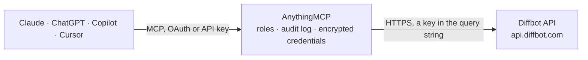

<!-- Generated by scripts/export-github-catalog.mjs in the anythingmcp-website repository. Do not edit by hand. -->

# Diffbot MCP connector

Turn web pages into structured data with Diffbot from your AI: classify and extract articles, products, discussions, images and videos, search the Diffbot Knowledge Graph with DQL, enrich people and … The AnythingMCP connector gives Claude, ChatGPT, Microsoft Copilot, Cursor and Gemini 11 MCP tools for Diffbot, all read-only.

**Category:** [Public Data](../data.md) · **Tools:** 11 · **Setup guide:** [anythingmcp.com](https://anythingmcp.com/guides/diffbot-to-mcp) · [Deutsch](https://anythingmcp.com/de/guides/diffbot-to-mcp) · [Italiano](https://anythingmcp.com/it/guides/diffbot-to-mcp) · [Español](https://anythingmcp.com/es/guides/diffbot-to-mcp) · [日本語](https://anythingmcp.com/ja/guides/diffbot-to-mcp) · [Русский](https://anythingmcp.com/ru/guides/diffbot-to-mcp) · [中文](https://anythingmcp.com/zh/guides/diffbot-to-mcp)

## Start without code

No installation and no terminal: AnythingMCP Cloud runs the Diffbot connector for you, operated by helpcode.ai in Frankfurt, Germany.

1. **Click the button above** and create an account or sign in. The Diffbot connector opens, ready to install.
2. **Paste the API key or token from your Diffbot account.** Every click is in the [step-by-step guide](https://anythingmcp.com/guides/diffbot-to-mcp).
3. **Click Install.** AnythingMCP shows the address of your MCP server.
4. **Add that address to your assistant:** [Claude](https://anythingmcp.com/guides/connect-diffbot-to-claude) · [ChatGPT](https://anythingmcp.com/guides/connect-diffbot-to-chatgpt) · [Microsoft Copilot](https://anythingmcp.com/guides/connect-diffbot-to-copilot) · [Cursor](https://anythingmcp.com/guides/connect-diffbot-to-cursor) · [Gemini CLI](https://anythingmcp.com/guides/connect-diffbot-to-gemini) · [Meta Muse](https://anythingmcp.com/guides/connect-diffbot-to-muse).
5. **Ask your first question**, for example: *Extract product details from https://store.novatek-solar.com/products/NTK-M300-Solar-Inverter*

Prefer help with the setup? [Talk to us](https://anythingmcp.com/contact).

## How it works

- **The AI client** speaks MCP (Streamable HTTP) to AnythingMCP and only sees tool names, descriptions and results. It never gets the Diffbot credentials.
- **AnythingMCP** checks the client's role, builds the call from the tool definition, adds the credentials (a key in the query string), calls Diffbot, logs the call and returns the result.
- **Diffbot** sees an ordinary API client with the rights of the account the credentials belong to.

## Tools

| Tool | What it does | Access |
|---|---|---|
| [`diffbot_get_account`](#diffbot_get_account) | Read the Diffbot account behind the token: name, plan, monthly plan credits, status and daily usage (credits, extractions, Natural Language calls, Knowledge… | read |
| [`diffbot_analyze`](#diffbot_analyze) | PAID (1 credit, 2 with proxy): read any web page, classify it (article, product, discussion, image, video, list, event or other) and return its content as… | read |
| [`diffbot_extract_article`](#diffbot_extract_article) | PAID (1 credit, 2 with proxy): extract a news or blog article: title, text, author, date, site, language, tags with Knowledge Graph links, categories,… | read |
| [`diffbot_extract_product`](#diffbot_extract_product) | PAID (1 credit, 2 with proxy): extract a shop product page: title, brand, offer and regular price, availability, SKU, GTIN, specifications, images,… | read |
| [`diffbot_extract_discussion`](#diffbot_extract_discussion) | PAID (1 credit per page, 2 with proxy): extract a forum thread, comment section or review page: posts with author, date, text, votes and sentiment. | read |
| [`diffbot_extract_image`](#diffbot_extract_image) | PAID (1 credit, 2 with proxy): extract the main images of a page with URL, title, size, caption and alt text, or describe an image URL directly. | read |
| [`diffbot_extract_video`](#diffbot_extract_video) | PAID (1 credit, 2 with proxy): extract a video page: title, description, author, date, duration, view count, embed and thumbnail URLs. | read |
| [`diffbot_search_kg`](#diffbot_search_kg) | PAID (25 credits per entity returned, 100 per facet query, nothing when no match): search the Diffbot Knowledge Graph with DQL, e.g. 'type:Organization… | read |
| [`diffbot_enhance`](#diffbot_enhance) | PAID (25 credits per match, 100 with refresh, nothing when no match): find the Knowledge Graph record of one organization or person from what you know (name… | read |
| [`diffbot_analyze_text`](#diffbot_analyze_text) | PAID (1 credit per 10,000 characters): run Diffbot Natural Language on a text: entities with Knowledge Graph ids and salience, sentiment from -1 to 1, and… | read |
| [`diffbot_search_web`](#diffbot_search_web) | PAID: search Diffbot's web index and get ranked pages (URL, title, date, score) with content chunks for citation. | read |

## Tool reference

Every parameter as the AI client sees it in `tools/list`. Source: [`packages/backend/src/adapters/intl/diffbot.json`](../../../packages/backend/src/adapters/intl/diffbot.json).

### `diffbot_get_account`

Read the Diffbot account behind the token: name, plan, monthly plan credits, status and daily usage (credits, extractions, Natural Language calls, Knowledge Graph entities, proxies). Free. The token itself is removed from the answer.

**Access:** read · **Call:** `GET /v4/account`

| Parameter | Type | Required | Description |
|---|---|---|---|
| `days` | integer | no | Days of usage history to return (default 31). |

### `diffbot_analyze`

PAID (1 credit, 2 with proxy): read any web page, classify it (article, product, discussion, image, video, list, event or other) and return its content as typed JSON in objects[]. mode llm returns markdown of the main content instead; a page type as mode forces that extraction. Capped at about 100 KB, page HTML removed.

**Access:** read · **Call:** `GET /v3/analyze`

| Parameter | Type | Required | Description |
|---|---|---|---|
| `url` | string | yes | Page URL with http or https. |
| `mode` | `llm` \| `article` \| `product` \| `discussion` \| `image` \| `video` \| `list` \| `event` | no | llm returns markdown of the main content; a page type extracts only pages of that type. |
| `fallback` | `article` \| `product` \| `discussion` \| `image` \| `video` \| `list` \| `event` | no | Extraction to use when the page is classified as other. |
| `fields` | string | no | Optional extra fields, comma-separated: links, extlinks, meta, querystring, breadcrumb. |
| `discussion` | boolean | no | false skips extracting comments and reviews on articles and products. |
| `use_proxy` | `default` \| `none` | no | default fetches through Diffbot's proxy (2 credits), for pages that block direct access. |
| `timeout` | integer | no | Milliseconds to wait for the page (default 30000). |

### `diffbot_extract_article`

PAID (1 credit, 2 with proxy): extract a news or blog article: title, text, author, date, site, language, tags with Knowledge Graph links, categories, sentiment, images; optionally summary, entities and facts via natural_language. Capped at about 100 KB, page HTML removed.

**Access:** read · **Call:** `GET /v3/article`

| Parameter | Type | Required | Description |
|---|---|---|---|
| `url` | string | yes | Article URL. |
| `fields` | string | no | Optional extra fields, comma-separated: links, extlinks, meta, querystring, breadcrumb, quotes. |
| `paging` | boolean | no | true joins multi-page articles into one (each page costs a credit). |
| `max_tags` | integer | no | Maximum tags to return (default 10). |
| `tag_confidence` | number | no | Minimum tag relevance 0 to 1 (default 0.5). |
| `natural_language` | string | no | Also run Natural Language on the text, comma-separated: entities, sentiment, summary, facts, categories, sentences, language. |
| `summary_num_sentences` | integer | no | Sentences in the summary when natural_language includes summary (default 3). |
| `discussion` | boolean | no | false skips extracting the comments. |
| `use_proxy` | `default` \| `none` | no | default fetches through Diffbot's proxy (2 credits). |
| `timeout` | integer | no | Milliseconds to wait for the page (default 30000). |

### `diffbot_extract_product`

PAID (1 credit, 2 with proxy): extract a shop product page: title, brand, offer and regular price, availability, SKU, GTIN, specifications, images, categories and reviews. Capped at about 100 KB, page HTML removed.

**Access:** read · **Call:** `GET /v3/product`

| Parameter | Type | Required | Description |
|---|---|---|---|
| `url` | string | yes | Product page URL. |
| `fields` | string | no | Optional extra fields, comma-separated: links, extlinks, meta, querystring, breadcrumb. |
| `discussion` | boolean | no | false skips extracting product reviews. |
| `use_proxy` | `default` \| `none` | no | default fetches through Diffbot's proxy (2 credits). |
| `timeout` | integer | no | Milliseconds to wait for the page (default 30000). |

### `diffbot_extract_discussion`

PAID (1 credit per page, 2 with proxy): extract a forum thread, comment section or review page: posts with author, date, text, votes and sentiment. paging joins further pages of the thread, each billed. Capped at about 100 KB.

**Access:** read · **Call:** `GET /v3/discussion`

| Parameter | Type | Required | Description |
|---|---|---|---|
| `url` | string | yes | Discussion or review page URL. |
| `fields` | string | no | Optional extra fields, comma-separated: links, extlinks, meta, querystring, breadcrumb, sentiment. |
| `paging` | boolean | no | true follows the thread's next pages (each page costs a credit). |
| `max_pages` | string | no | With paging: maximum pages to join, a number or 'all' (default 20). |
| `use_proxy` | `default` \| `none` | no | default fetches through Diffbot's proxy (2 credits). |
| `timeout` | integer | no | Milliseconds to wait for the page (default 30000). |

### `diffbot_extract_image`

PAID (1 credit, 2 with proxy): extract the main images of a page with URL, title, size, caption and alt text, or describe an image URL directly.

**Access:** read · **Call:** `GET /v3/image`

| Parameter | Type | Required | Description |
|---|---|---|---|
| `url` | string | yes | Page or image URL. |
| `fields` | string | no | Optional extra fields, comma-separated: links, extlinks, meta, querystring, breadcrumb, displayHeight, displayWidth. |
| `use_proxy` | `default` \| `none` | no | default fetches through Diffbot's proxy (2 credits). |
| `timeout` | integer | no | Milliseconds to wait for the page (default 30000). |

### `diffbot_extract_video`

PAID (1 credit, 2 with proxy): extract a video page: title, description, author, date, duration, view count, embed and thumbnail URLs.

**Access:** read · **Call:** `GET /v3/video`

| Parameter | Type | Required | Description |
|---|---|---|---|
| `url` | string | yes | Video page URL. |
| `fields` | string | no | Optional extra fields, comma-separated: links, extlinks, meta, querystring, breadcrumb. |
| `use_proxy` | `default` \| `none` | no | default fetches through Diffbot's proxy (2 credits). |
| `timeout` | integer | no | Milliseconds to wait for the page (default 30000). |

### `diffbot_search_kg`

PAID (25 credits per entity returned, 100 per facet query, nothing when no match): search the Diffbot Knowledge Graph with DQL, e.g. 'type:Organization name:"Diffbot"' or 'type:Person employments.employer.name:"Diffbot" employments.isCurrent:true'. Keep size small and use filter to return only needed fields. Capped at about 100 KB.

**Access:** read · **Call:** `GET https://kg.diffbot.com/kg/v3/dql`

| Parameter | Type | Required | Description |
|---|---|---|---|
| `query` | string | yes | DQL query starting with type:, e.g. 'type:Organization location.country.name:"Germany" industries:"Software Companies" sortBy:nbEmployees'. |
| `size` | integer | no | Entities to return (default here 5; each costs 25 credits). |
| `from` | integer | no | Offset of the first result, for paging (not for Article queries). |
| `filter` | string | no | Only these fields, ';'-separated, e.g. 'name;homepageUri;nbEmployees;location.city.name'. |
| `filter_exclude` | string | no | Leave out these fields, ';'-separated, e.g. 'description;descriptors'. |
| `cluster` | `all` \| `best` \| `dedupe` | no | Articles only: group (all), keep one per topic (best) or remove near-duplicates (dedupe). |

### `diffbot_enhance`

PAID (25 credits per match, 100 with refresh, nothing when no match): find the Knowledge Graph record of one organization or person from what you know (name plus url, location, employer, email, phone) and return the best match with its score. Capped at about 100 KB.

**Access:** read · **Call:** `GET https://kg.diffbot.com/kg/v3/enhance`

| Parameter | Type | Required | Description |
|---|---|---|---|
| `type` | `Organization` \| `Person` | yes | Entity type. |
| `name` | string | no | Name of the company or person. |
| `url` | string | no | Homepage or profile URL, e.g. 'diffbot.com' or a LinkedIn URL. |
| `location` | string | no | City, region or address, e.g. 'Menlo Park, CA'. |
| `phone` | string | no | Phone number. |
| `email` | string | no | Email address (Person only). |
| `employer` | string | no | Employer name (Person only). |
| `title` | string | no | Job title (Person only). |
| `school` | string | no | School (Person only). |
| `id` | string | no | Diffbot entity id, when already known. |
| `size` | integer | no | Maximum matches to return (default 1; each costs 25 credits). |
| `threshold` | number | no | Minimum match score 0 to 1. |
| `refresh` | boolean | no | Re-crawl the entity's sources for fresh data (100 credits). |
| `filter` | string | no | Only these fields, ';'-separated, e.g. 'name;homepageUri;nbEmployees'. |

### `diffbot_analyze_text`

PAID (1 credit per 10,000 characters): run Diffbot Natural Language on a text: entities with Knowledge Graph ids and salience, sentiment from -1 to 1, and on request facts, records, categories, sentences and a summary.

**Access:** read · **Call:** `POST https://nl.diffbot.com/v1/`

| Parameter | Type | Required | Description |
|---|---|---|---|
| `content` | string | yes | The text to analyze (1 to 100,000 characters). |
| `lang` | string | no | ISO 639-1 language code, e.g. 'en', or 'auto' (default). |
| `format` | `plain text` \| `plain text with title` | no | 'plain text with title' treats the part before the first blank line as the title. |
| `fields` | string | no | What to return, comma-separated: entities, sentiment, facts, records, categories, sentences, summary (default entities,sentiment). |

### `diffbot_search_web`

PAID: search Diffbot's web index and get ranked pages (URL, title, date, score) with content chunks for citation. Operators inside text: site:example.com, url:, after:2026-06-10, before:2026-05-10. Capped at about 100 KB.

**Access:** read · **Call:** `GET https://llm.diffbot.com/api/v1/web_search`

| Parameter | Type | Required | Description |
|---|---|---|---|
| `text` | string | yes | Search query, operators allowed, e.g. 'knowledge graph site:diffbot.com after:2026-01-01'. |
| `size` | integer | no | Results to return (default 10). |
| `max_tokens` | integer | no | Cap the answer at about this many tokens; content chunks are shortened evenly. |

## Run it yourself

AnythingMCP is open source (AGPL-3.0). [Run it with Docker](../../../README.md#run-it-yourself), open **Connectors → Store**, pick **Diffbot** and enter `DIFFBOT_TOKEN`, then add your MCP server URL to the AI client.

[← Public Data connectors](../data.md) · [All categories](../README.md)
