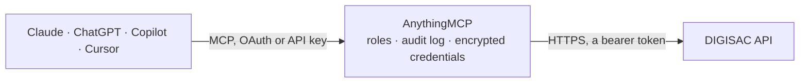

<!-- Generated by scripts/export-github-catalog.mjs in the anythingmcp-website repository. Do not edit by hand. -->

# DIGISAC MCP connector

Let your AI work in your DIGISAC omnichannel inbox: find contacts, read message history, tickets, departments, agents, tags and WhatsApp templates, follow sales funnels and kanban boards and get live … The AnythingMCP connector gives Claude, ChatGPT, Microsoft Copilot, Cursor and Gemini 34 MCP tools for DIGISAC: 26 read and 8 can change data.

**Category:** [Messaging](../messaging.md) · **Tools:** 34 · **Setup guide:** [anythingmcp.com](https://anythingmcp.com/guides/digisac-to-mcp) · [Deutsch](https://anythingmcp.com/de/guides/digisac-to-mcp) · [Italiano](https://anythingmcp.com/it/guides/digisac-to-mcp) · [Español](https://anythingmcp.com/es/guides/digisac-to-mcp) · [日本語](https://anythingmcp.com/ja/guides/digisac-to-mcp) · [Русский](https://anythingmcp.com/ru/guides/digisac-to-mcp) · [中文](https://anythingmcp.com/zh/guides/digisac-to-mcp)

## Start without code

No installation and no terminal: AnythingMCP Cloud runs the DIGISAC connector for you, operated by helpcode.ai in Frankfurt, Germany.

1. **Click the button above** and create an account or sign in. The DIGISAC connector opens, ready to install.
2. **Paste the API key or token from your DIGISAC account.** Every click is in the [step-by-step guide](https://anythingmcp.com/guides/digisac-to-mcp).
3. **Click Install.** AnythingMCP shows the address of your MCP server.
4. **Add that address to your assistant:** [Claude](https://anythingmcp.com/guides/connect-digisac-to-claude) · [ChatGPT](https://anythingmcp.com/guides/connect-digisac-to-chatgpt) · [Microsoft Copilot](https://anythingmcp.com/guides/connect-digisac-to-copilot) · [Cursor](https://anythingmcp.com/guides/connect-digisac-to-cursor) · [Gemini CLI](https://anythingmcp.com/guides/connect-digisac-to-gemini) · [Meta Muse](https://anythingmcp.com/guides/connect-digisac-to-muse).
5. **Ask your first question**, for example: *Find contact with number 5511987654321 on our WhatsApp Comercial connection (service 101).*

Prefer help with the setup? [Talk to us](https://anythingmcp.com/contact).

## How it works

- **The AI client** speaks MCP (Streamable HTTP) to AnythingMCP and only sees tool names, descriptions and results. It never gets the DIGISAC credentials.
- **AnythingMCP** checks the client's role, builds the call from the tool definition, adds the credentials (a bearer token), calls DIGISAC, logs the call and returns the result.
- **DIGISAC** sees an ordinary API client with the rights of the account the credentials belong to.

## Tools

| Tool | What it does | Access |
|---|---|---|
| [`digisac_get_me`](#digisac_get_me) | Read the DIGISAC user the API token belongs to: id, name, email, account, roles and departments. | read |
| [`digisac_list_connections`](#digisac_list_connections) | List the account's connections (services): each WhatsApp number, WhatsApp Business API line, Instagram, Messenger, Telegram, e-mail or webchat channel, with… | read |
| [`digisac_list_departments`](#digisac_list_departments) | List departments (filas): id and name. | read |
| [`digisac_list_users`](#digisac_list_users) | List users (atendentes, agents): id, name, email, status and whether they are online. | read |
| [`digisac_list_tags`](#digisac_list_tags) | List contact tags (etiquetas): id, label and color. | read |
| [`digisac_list_contacts`](#digisac_list_contacts) | List contacts, newest first unless query orders them: id, name, internalName, data.number (the phone or handle), serviceId, unread, lastMessageAt, tags. | read |
| [`digisac_find_contact_by_number`](#digisac_find_contact_by_number) | Find contacts by phone number (or part of it) on one connection: matches data.number with a contains search. | read |
| [`digisac_get_contact`](#digisac_get_contact) | Read one contact by id, with its tags: name, internalName, number, connection, default department and user, note, unread count, last message time. | read |
| [`digisac_list_tickets`](#digisac_list_tickets) | List tickets (chamados, conversations): id, protocol, isOpen, contactId, departmentId, userId, startedAt, endedAt. | read |
| [`digisac_list_contact_tickets`](#digisac_list_contact_tickets) | List the tickets of one contact, newest first: protocol, isOpen, department, user, start and end. | read |
| [`digisac_get_ticket`](#digisac_get_ticket) | Read one ticket by id with its contact, department, user and topics. | read |
| [`digisac_list_contact_messages`](#digisac_list_contact_messages) | Read the message history of one contact, newest first: id, type (chat is text; image, audio, ptt, video, document; ticket and comment are internal events),… | read |
| [`digisac_list_messages`](#digisac_list_messages) | List messages across the account with a filter, e.g. recent media received on one connection: query… | read |
| [`digisac_get_message`](#digisac_get_message) | Read one message by id including its file (media): type, text, timestamp, sender and file name, mimetype and a temporary download url. | read |
| [`digisac_list_whatsapp_templates`](#digisac_list_whatsapp_templates) | List the WhatsApp Business API templates (HSM) of the account: id, name, language, category, status and components with their {{1}} placeholders. | read |
| [`digisac_list_quick_replies`](#digisac_list_quick_replies) | List quick replies (respostas rapidas): saved texts agents insert into chats. | read |
| [`digisac_list_ticket_topics`](#digisac_list_ticket_topics) | List ticket topics (assuntos), the reasons agents attach when closing a ticket. | read |
| [`digisac_list_schedules`](#digisac_list_schedules) | List scheduled messages (agendamentos): contact, department, user, message, scheduledAt and status. | read |
| [`digisac_list_pipelines`](#digisac_list_pipelines) | List sales funnels (pipelines) with their stages. | read |
| [`digisac_list_pipeline_cards`](#digisac_list_pipeline_cards) | List the opportunities (cards) of one sales funnel: title, stage, contact, value and dates. | read |
| [`digisac_list_kanban_boards`](#digisac_list_kanban_boards) | List the service kanban boards (quadros de atendimento): id and name. | read |
| [`digisac_list_kanban_columns`](#digisac_list_kanban_columns) | List the columns of one kanban board in order: id, name, role and position. | read |
| [`digisac_list_kanban_cards`](#digisac_list_kanban_cards) | List the cards of one kanban column with their ticket and contact, a page at a time. | read |
| [`digisac_get_service_stats`](#digisac_get_service_stats) | Service statistics for a period (dashboard): tickets opened and closed, waiting and service times, messages sent and received, by department or user. | read |
| [`digisac_get_live_overview`](#digisac_get_live_overview) | Real-time overview of the service desk right now: open and waiting tickets, agents online, per department and agent. | read |
| [`digisac_get_departments_live`](#digisac_get_departments_live) | Real-time load per department right now: open, waiting and in-service tickets. | read |
| [`digisac_create_contact`](#digisac_create_contact) | Create a contact on a connection. | write |
| [`digisac_update_contact`](#digisac_update_contact) | Update a contact's name, note, default department or tags. | write |
| [`digisac_send_message`](#digisac_send_message) | Send a text message to an existing contact on WhatsApp or the contact's channel. | write |
| [`digisac_send_template`](#digisac_send_template) | Send an approved WhatsApp Business template (HSM) to a number on a WhatsApp Business API connection; works outside the 24-hour window and Meta charges the… | write |
| [`digisac_transfer_ticket`](#digisac_transfer_ticket) | Open or transfer a contact's ticket to a department and optionally an agent, with a comment. | write |
| [`digisac_close_ticket`](#digisac_close_ticket) | Close a contact's open ticket, optionally with ticket topics. | write |
| [`digisac_schedule_message`](#digisac_schedule_message) | Schedule a message to a contact at a date and time; it is sent automatically. | write |
| [`digisac_cancel_schedule`](#digisac_cancel_schedule) | Cancel (delete) a pending scheduled message. | write |

## Tool reference

Every parameter as the AI client sees it in `tools/list`. Source: [`packages/backend/src/adapters/br/digisac.json`](../../../packages/backend/src/adapters/br/digisac.json).

### `digisac_get_me`

Read the DIGISAC user the API token belongs to: id, name, email, account, roles and departments. Checks the token. Read-only.

**Access:** read · **Call:** `GET /me`

No parameters.

### `digisac_list_connections`

List the account's connections (services): each WhatsApp number, WhatsApp Business API line, Instagram, Messenger, Telegram, e-mail or webchat channel, with id, name, type and status. Contacts, messages and templates belong to one connection (serviceId). Read-only.

**Access:** read · **Call:** `GET /services`

| Parameter | Type | Required | Description |
|---|---|---|---|
| `query` | string | no | Optional DIGISAC filter as JSON text: {"where": {...}, "include": [...], "order": [["updatedAt","DESC"]], "attributes": [...]}. Operators: $iLike (with % wildcards), $in, $eq, $gt, $gte, $lt, $lte, $and, $or. Active ones only: {"where":{"archivedAt":{"$eq":null}}}. |
| `perPage` | integer | no | Rows per page, default 20. A perPage inside query wins. |
| `page` | integer | no | Page number, starting at 1. The answer carries currentPage and lastPage. |

### `digisac_list_departments`

List departments (filas): id and name. Tickets are routed to a department. Read-only.

**Access:** read · **Call:** `GET /departments`

| Parameter | Type | Required | Description |
|---|---|---|---|
| `query` | string | no | Optional DIGISAC filter as JSON text: {"where": {...}, "include": [...], "order": [["updatedAt","DESC"]], "attributes": [...]}. Operators: $iLike (with % wildcards), $in, $eq, $gt, $gte, $lt, $lte, $and, $or. |
| `perPage` | integer | no | Rows per page, default 20. A perPage inside query wins. |
| `page` | integer | no | Page number, starting at 1. The answer carries currentPage and lastPage. |

### `digisac_list_users`

List users (atendentes, agents): id, name, email, status and whether they are online. Add departments with query {"include":[{"model":"departments","attributes":["id","name"]}]}. Read-only.

**Access:** read · **Call:** `GET /users`

| Parameter | Type | Required | Description |
|---|---|---|---|
| `query` | string | no | Optional DIGISAC filter as JSON text: {"where": {...}, "include": [...], "order": [["updatedAt","DESC"]], "attributes": [...]}. Operators: $iLike (with % wildcards), $in, $eq, $gt, $gte, $lt, $lte, $and, $or. |
| `perPage` | integer | no | Rows per page, default 20. A perPage inside query wins. |
| `page` | integer | no | Page number, starting at 1. The answer carries currentPage and lastPage. |

### `digisac_list_tags`

List contact tags (etiquetas): id, label and color. Read-only.

**Access:** read · **Call:** `GET /tags`

| Parameter | Type | Required | Description |
|---|---|---|---|
| `query` | string | no | Optional DIGISAC filter as JSON text: {"where": {...}, "include": [...], "order": [["updatedAt","DESC"]], "attributes": [...]}. Operators: $iLike (with % wildcards), $in, $eq, $gt, $gte, $lt, $lte, $and, $or. |
| `perPage` | integer | no | Rows per page, default 20. A perPage inside query wins. |
| `page` | integer | no | Page number, starting at 1. The answer carries currentPage and lastPage. |

### `digisac_list_contacts`

List contacts, newest first unless query orders them: id, name, internalName, data.number (the phone or handle), serviceId, unread, lastMessageAt, tags. Search by name with query {"where":{"name":{"$iLike":"%maria%"}}}; by number use digisac_find_contact_by_number. Read-only.

**Access:** read · **Call:** `GET /contacts`

| Parameter | Type | Required | Description |
|---|---|---|---|
| `query` | string | no | Optional DIGISAC filter as JSON text: {"where": {...}, "include": [...], "order": [["updatedAt","DESC"]], "attributes": [...]}. Operators: $iLike (with % wildcards), $in, $eq, $gt, $gte, $lt, $lte, $and, $or. |
| `perPage` | integer | no | Rows per page, default 20. A perPage inside query wins. |
| `page` | integer | no | Page number, starting at 1. The answer carries currentPage and lastPage. |

### `digisac_find_contact_by_number`

Find contacts by phone number (or part of it) on one connection: matches data.number with a contains search. Numbers are stored with country code and no + (5511987654321). Read-only.

**Access:** read · **Call:** `GET /contacts`

| Parameter | Type | Required | Description |
|---|---|---|---|
| `number` | string | yes | Digits only, e.g. 5511987654321 or the last 8 digits. |
| `service_id` | string | no | Connection id from digisac_list_connections. Leave out to search every connection. |
| `perPage` | integer | no | Rows per page, default 20. |

### `digisac_get_contact`

Read one contact by id, with its tags: name, internalName, number, connection, default department and user, note, unread count, last message time. Read-only.

**Access:** read · **Call:** `GET /contacts/{contact_id}`

| Parameter | Type | Required | Description |
|---|---|---|---|
| `contact_id` | string | yes | Contact id (UUID) from digisac_list_contacts or digisac_find_contact_by_number. |

### `digisac_list_tickets`

List tickets (chamados, conversations): id, protocol, isOpen, contactId, departmentId, userId, startedAt, endedAt. Open tickets of a department: query {"where":{"isOpen":true,"departmentId":"<id>"},"include":["contact"],"order":[["updatedAt","DESC"]]}. startPeriod and endPeriod filter by date. Read-only.

**Access:** read · **Call:** `GET /tickets`

| Parameter | Type | Required | Description |
|---|---|---|---|
| `query` | string | no | Optional DIGISAC filter as JSON text: {"where": {...}, "include": [...], "order": [["updatedAt","DESC"]], "attributes": [...]}. Operators: $iLike (with % wildcards), $in, $eq, $gt, $gte, $lt, $lte, $and, $or. Columns of an included contact are limited to real ones: id, name, internalName, serviceId, data, unread, lastMessageAt; an unknown column is a 500. |
| `perPage` | integer | no | Rows per page, default 20. A perPage inside query wins. |
| `page` | integer | no | Page number, starting at 1. The answer carries currentPage and lastPage. |
| `startPeriod` | string | no | Optional start, ISO 8601 (2026-10-01T00:00:00.000Z). |
| `endPeriod` | string | no | Optional end, ISO 8601. |

### `digisac_list_contact_tickets`

List the tickets of one contact, newest first: protocol, isOpen, department, user, start and end. Read-only.

**Access:** read · **Call:** `GET /tickets`

| Parameter | Type | Required | Description |
|---|---|---|---|
| `contact_id` | string | yes | Contact id. |
| `perPage` | integer | no | Rows per page, default 20. |
| `page` | integer | no | Page, from 1. |

### `digisac_get_ticket`

Read one ticket by id with its contact, department, user and topics. Read-only.

**Access:** read · **Call:** `GET /tickets/{ticket_id}`

| Parameter | Type | Required | Description |
|---|---|---|---|
| `ticket_id` | string | yes | Ticket id (UUID). |

### `digisac_list_contact_messages`

Read the message history of one contact, newest first: id, type (chat is text; image, audio, ptt, video, document; ticket and comment are internal events), text, isFromMe, timestamp, ticketId, userId. Media details: digisac_get_message. Read-only.

**Access:** read · **Call:** `GET /messages`

| Parameter | Type | Required | Description |
|---|---|---|---|
| `contact_id` | string | yes | Contact id. |
| `perPage` | integer | no | Messages per page, default 30. |
| `page` | integer | no | Page, from 1 (newest). |

### `digisac_list_messages`

List messages across the account with a filter, e.g. recent media received on one connection: query {"where":{"serviceId":"<id>","isFromMe":false,"type":{"$in":["image","document"]}},"include":["file"],"order":[["timestamp","DESC"]]}. Read-only.

**Access:** read · **Call:** `GET /messages`

| Parameter | Type | Required | Description |
|---|---|---|---|
| `query` | string | no | Optional DIGISAC filter as JSON text: {"where": {...}, "include": [...], "order": [["updatedAt","DESC"]], "attributes": [...]}. Operators: $iLike (with % wildcards), $in, $eq, $gt, $gte, $lt, $lte, $and, $or. |
| `perPage` | integer | no | Rows per page, default 20. A perPage inside query wins. |
| `page` | integer | no | Page number, starting at 1. The answer carries currentPage and lastPage. |

### `digisac_get_message`

Read one message by id including its file (media): type, text, timestamp, sender and file name, mimetype and a temporary download url. Read-only.

**Access:** read · **Call:** `GET /messages/{message_id}`

| Parameter | Type | Required | Description |
|---|---|---|---|
| `message_id` | string | yes | Message id (UUID). |

### `digisac_list_whatsapp_templates`

List the WhatsApp Business API templates (HSM) of the account: id, name, language, category, status and components with their {{1}} placeholders. Read-only.

**Access:** read · **Call:** `GET /whatsapp-business-templates`

| Parameter | Type | Required | Description |
|---|---|---|---|
| `query` | string | no | Optional DIGISAC filter as JSON text: {"where": {...}, "include": [...], "order": [["updatedAt","DESC"]], "attributes": [...]}. Operators: $iLike (with % wildcards), $in, $eq, $gt, $gte, $lt, $lte, $and, $or. |
| `perPage` | integer | no | Rows per page, default 20. A perPage inside query wins. |
| `page` | integer | no | Page number, starting at 1. The answer carries currentPage and lastPage. |

### `digisac_list_quick_replies`

List quick replies (respostas rapidas): saved texts agents insert into chats. Read-only.

**Access:** read · **Call:** `GET /quick-replies`

| Parameter | Type | Required | Description |
|---|---|---|---|
| `query` | string | no | Optional DIGISAC filter as JSON text: {"where": {...}, "include": [...], "order": [["updatedAt","DESC"]], "attributes": [...]}. Operators: $iLike (with % wildcards), $in, $eq, $gt, $gte, $lt, $lte, $and, $or. |
| `perPage` | integer | no | Rows per page, default 20. A perPage inside query wins. |
| `page` | integer | no | Page number, starting at 1. The answer carries currentPage and lastPage. |

### `digisac_list_ticket_topics`

List ticket topics (assuntos), the reasons agents attach when closing a ticket. Read-only.

**Access:** read · **Call:** `GET /ticket-topics`

| Parameter | Type | Required | Description |
|---|---|---|---|
| `query` | string | no | Optional DIGISAC filter as JSON text: {"where": {...}, "include": [...], "order": [["updatedAt","DESC"]], "attributes": [...]}. Operators: $iLike (with % wildcards), $in, $eq, $gt, $gte, $lt, $lte, $and, $or. |
| `perPage` | integer | no | Rows per page, default 20. A perPage inside query wins. |
| `page` | integer | no | Page number, starting at 1. The answer carries currentPage and lastPage. |

### `digisac_list_schedules`

List scheduled messages (agendamentos): contact, department, user, message, scheduledAt and status. Read-only.

**Access:** read · **Call:** `GET /schedule`

| Parameter | Type | Required | Description |
|---|---|---|---|
| `query` | string | no | Optional DIGISAC filter as JSON text: {"where": {...}, "include": [...], "order": [["updatedAt","DESC"]], "attributes": [...]}. Operators: $iLike (with % wildcards), $in, $eq, $gt, $gte, $lt, $lte, $and, $or. |
| `perPage` | integer | no | Rows per page, default 20. A perPage inside query wins. |
| `page` | integer | no | Page number, starting at 1. The answer carries currentPage and lastPage. |

### `digisac_list_pipelines`

List sales funnels (pipelines) with their stages. Read-only.

**Access:** read · **Call:** `GET /pipelines`

| Parameter | Type | Required | Description |
|---|---|---|---|
| `query` | string | no | Optional DIGISAC filter as JSON text: {"where": {...}, "include": [...], "order": [["updatedAt","DESC"]], "attributes": [...]}. Operators: $iLike (with % wildcards), $in, $eq, $gt, $gte, $lt, $lte, $and, $or. |
| `perPage` | integer | no | Rows per page, default 20. A perPage inside query wins. |
| `page` | integer | no | Page number, starting at 1. The answer carries currentPage and lastPage. |

### `digisac_list_pipeline_cards`

List the opportunities (cards) of one sales funnel: title, stage, contact, value and dates. Each card comes with its pipeline stage. Read-only.

**Access:** read · **Call:** `GET /cards`

| Parameter | Type | Required | Description |
|---|---|---|---|
| `pipeline_id` | string | yes | Pipeline id from digisac_list_pipelines. |
| `perPage` | integer | no | Cards per page, default 30. |
| `page` | integer | no | Page, from 1. |

### `digisac_list_kanban_boards`

List the service kanban boards (quadros de atendimento): id and name. Read-only.

**Access:** read · **Call:** `GET /kanban-boards`

No parameters.

### `digisac_list_kanban_columns`

List the columns of one kanban board in order: id, name, role and position. Read the cards of a column with digisac_list_kanban_cards. Read-only.

**Access:** read · **Call:** `GET /kanban-columns`

| Parameter | Type | Required | Description |
|---|---|---|---|
| `board_id` | string | yes | Kanban board id from digisac_list_kanban_boards. |

### `digisac_list_kanban_cards`

List the cards of one kanban column with their ticket and contact, a page at a time. Read-only.

**Access:** read · **Call:** `GET /kanban-cards`

| Parameter | Type | Required | Description |
|---|---|---|---|
| `column_id` | string | yes | Column id from digisac_list_kanban_columns. |
| `perPage` | integer | no | Cards per page, default 20. |
| `page` | integer | no | Page, from 1. |

### `digisac_get_service_stats`

Service statistics for a period (dashboard): tickets opened and closed, waiting and service times, messages sent and received, by department or user. Read-only.

**Access:** read · **Call:** `GET /dashboard/general`

| Parameter | Type | Required | Description |
|---|---|---|---|
| `startPeriod` | string | yes | Start, ISO 8601 (2026-10-01T00:00:00.000Z). |
| `endPeriod` | string | yes | End, ISO 8601 (2026-10-31T23:59:59.999Z). |
| `departmentId` | string | no | A department id, or all (default). |
| `userId` | string | no | A user id, or all (default). |
| `serviceId` | string | no | Optional connection id. |
| `periodType` | `openDate` \| `closeDate` | no | Count tickets by opening or closing date. |
| `status` | `all` \| `open` \| `close` | no | Ticket status, default all. |

### `digisac_get_live_overview`

Real-time overview of the service desk right now: open and waiting tickets, agents online, per department and agent. Read-only.

**Access:** read · **Call:** `GET /now/resume`

No parameters.

### `digisac_get_departments_live`

Real-time load per department right now: open, waiting and in-service tickets. Read-only.

**Access:** read · **Call:** `GET /now/departments-resume`

No parameters.

### `digisac_create_contact`

Create a contact on a connection. DIGISAC accepts an invalid number and marks it data.valid false. Changes the CRM: confirm with the user first.

**Access:** write · **Call:** `POST /contacts`

| Parameter | Type | Required | Description |
|---|---|---|---|
| `name` | string | yes | Contact name (internalName). |
| `number` | string | yes | Number with country code, digits only, e.g. 5511987654321. |
| `service_id` | string | yes | Connection id. |
| `default_department_id` | string | no | Optional default department id. |
| `tag_ids` | string[] | no | Optional tag ids. |

### `digisac_update_contact`

Update a contact's name, note, default department or tags. tag_ids replaces all the contact's tags: read the contact first and send the full list. Confirm with the user first.

**Access:** write · **Call:** `PUT /contacts/{contact_id}`

| Parameter | Type | Required | Description |
|---|---|---|---|
| `contact_id` | string | yes | Contact id. |
| `name` | string | no | New internal name. |
| `note` | string | no | New note. |
| `default_department_id` | string | no | New default department id. |
| `tag_ids` | string[] | no | The complete new list of tag ids. |

### `digisac_send_message`

Send a text message to an existing contact on WhatsApp or the contact's channel. It reaches the customer at once and, unless dont_open_ticket, opens a ticket. On WhatsApp Business API lines free text only works within 24 hours of the customer's last message. Installed switched off. Show the text and the contact and confirm with the user first.

**Access:** write · **Call:** `POST /messages`

| Parameter | Type | Required | Description |
|---|---|---|---|
| `contact_id` | string | yes | Contact id. |
| `text` | string | yes | Message text. |
| `user_id` | string | no | Optional agent (user id) the message is sent as. |
| `dont_open_ticket` | boolean | no | true to send without opening a ticket. |

### `digisac_send_template`

Send an approved WhatsApp Business template (HSM) to a number on a WhatsApp Business API connection; works outside the 24-hour window and Meta charges the conversation. Installed switched off. Show the template, number and values and confirm with the user first.

**Access:** write · **Call:** `POST /messages`

| Parameter | Type | Required | Description |
|---|---|---|---|
| `number` | string | yes | Number with country code, digits only. |
| `service_id` | string | yes | WhatsApp Business API connection id. |
| `hsm_id` | string | yes | Template id from digisac_list_whatsapp_templates. |
| `parameters` | object[] | no | Template values: [{"type":"body","parameters":[{"type":"text","text":"Maria"}]}], one entry per {{n}} in order. |

### `digisac_transfer_ticket`

Open or transfer a contact's ticket to a department and optionally an agent, with a comment. Installed switched off. Confirm with the user first.

**Access:** write · **Call:** `POST /contacts/{contact_id}/ticket/transfer`

| Parameter | Type | Required | Description |
|---|---|---|---|
| `contact_id` | string | yes | Contact id. |
| `department_id` | string | yes | Target department id. |
| `user_id` | string | no | Optional target agent id. |
| `comments` | string | no | Optional internal comment. |

### `digisac_close_ticket`

Close a contact's open ticket, optionally with ticket topics. The customer may get the closing message and satisfaction survey. Installed switched off. Confirm with the user first.

**Access:** write · **Call:** `POST /contacts/{contact_id}/ticket/close`

| Parameter | Type | Required | Description |
|---|---|---|---|
| `contact_id` | string | yes | Contact id. |
| `ticket_topic_ids` | string[] | no | Optional topic ids from digisac_list_ticket_topics. |

### `digisac_schedule_message`

Schedule a message to a contact at a date and time; it is sent automatically. Installed switched off. Confirm the text, contact and time with the user first.

**Access:** write · **Call:** `POST /schedule`

| Parameter | Type | Required | Description |
|---|---|---|---|
| `contact_id` | string | yes | Contact id. |
| `department_id` | string | yes | Department id. |
| `user_id` | string | yes | Agent id. |
| `message` | string | yes | Message text. |
| `scheduled_at` | string | yes | Local date and time, YYYY-MM-DD HH:mm:ss. |
| `notes` | string | no | Internal note. |
| `open_ticket` | boolean | no | Open a ticket when sending. Default false. |
| `notify_user` | boolean | no | Notify the agent. Default false. |

### `digisac_cancel_schedule`

Cancel (delete) a pending scheduled message. Installed switched off. Confirm with the user first.

**Access:** write · **Call:** `DELETE /schedule/{schedule_id}`

| Parameter | Type | Required | Description |
|---|---|---|---|
| `schedule_id` | string | yes | Schedule id from digisac_list_schedules. |

## Run it yourself

AnythingMCP is open source (AGPL-3.0). [Run it with Docker](../../../README.md#run-it-yourself), open **Connectors → Store**, pick **DIGISAC** and enter `DIGISAC_URL`, `DIGISAC_API_TOKEN`, then add your MCP server URL to the AI client.

[← Messaging connectors](../messaging.md) · [All categories](../README.md)
