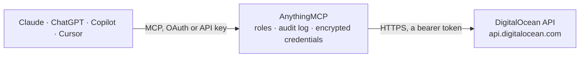

<!-- Generated by scripts/export-github-catalog.mjs in the anythingmcp-website repository. Do not edit by hand. -->

# DigitalOcean MCP connector

Let your AI keep an eye on DigitalOcean: Droplets with CPU and bandwidth metrics, App Platform deployments and logs, managed databases, Kubernetes clusters, volumes, DNS, firewalls, load balancers, balance and invoices. The AnythingMCP connector gives Claude, ChatGPT, Microsoft Copilot, Cursor and Gemini 33 MCP tools for DigitalOcean: 27 read and 6 can change data.

**Category:** [Infrastructure](../infrastructure.md) · **Tools:** 33 · **Setup guide:** [anythingmcp.com](https://anythingmcp.com/guides/digitalocean-to-mcp) · [Deutsch](https://anythingmcp.com/de/guides/digitalocean-to-mcp) · [Italiano](https://anythingmcp.com/it/guides/digitalocean-to-mcp) · [Español](https://anythingmcp.com/es/guides/digitalocean-to-mcp) · [日本語](https://anythingmcp.com/ja/guides/digitalocean-to-mcp) · [Русский](https://anythingmcp.com/ru/guides/digitalocean-to-mcp) · [中文](https://anythingmcp.com/zh/guides/digitalocean-to-mcp)

## Start without code

No installation and no terminal: AnythingMCP Cloud runs the DigitalOcean connector for you, operated by helpcode.ai in Frankfurt, Germany.

1. **Click the button above** and create an account or sign in. The DigitalOcean connector opens, ready to install.
2. **Paste the API key or token from your DigitalOcean account.** Every click is in the [step-by-step guide](https://anythingmcp.com/guides/digitalocean-to-mcp).
3. **Click Install.** AnythingMCP shows the address of your MCP server.
4. **Add that address to your assistant:** [Claude](https://anythingmcp.com/guides/connect-digitalocean-to-claude) · [ChatGPT](https://anythingmcp.com/guides/connect-digitalocean-to-chatgpt) · [Microsoft Copilot](https://anythingmcp.com/guides/connect-digitalocean-to-copilot) · [Cursor](https://anythingmcp.com/guides/connect-digitalocean-to-cursor) · [Gemini CLI](https://anythingmcp.com/guides/connect-digitalocean-to-gemini) · [Meta Muse](https://anythingmcp.com/guides/connect-digitalocean-to-muse).
5. **Ask your first question**, for example: *Show invoices for 2026-09 and the amounts, newest first*

Prefer help with the setup? [Talk to us](https://anythingmcp.com/contact).

## How it works

- **The AI client** speaks MCP (Streamable HTTP) to AnythingMCP and only sees tool names, descriptions and results. It never gets the DigitalOcean credentials.
- **AnythingMCP** checks the client's role, builds the call from the tool definition, adds the credentials (a bearer token), calls DigitalOcean, logs the call and returns the result.
- **DigitalOcean** sees an ordinary API client with the rights of the account the credentials belong to.

## Tools

| Tool | What it does | Access |
|---|---|---|
| [`digitalocean_get_account`](#digitalocean_get_account) | Read the DigitalOcean account behind the token: email, name, uuid, status, whether the email is verified, the Droplet and reserved IP limits and the team. | read |
| [`digitalocean_get_balance`](#digitalocean_get_balance) | Read the billing balance: the balance at the start of the month, usage so far this month, month-to-date balance (what is owed now) and when it was computed,… | read |
| [`digitalocean_list_invoices`](#digitalocean_list_invoices) | List past invoices, newest first, with uuid, amount in US dollars, billing period (YYYY-MM) and date, plus a preview of the current month. | read |
| [`digitalocean_list_droplets`](#digitalocean_list_droplets) | List Droplets (virtual machines): id, name, status (new, active, off, archive), region, size, vCPUs, memory, disk, image, public and private IP addresses,… | read |
| [`digitalocean_get_droplet`](#digitalocean_get_droplet) | Read one Droplet: status, region, size, vCPUs, memory, disk, image, IP addresses, tags, attached volumes, enabled features (backups, monitoring, ipv6), lock… | read |
| [`digitalocean_power_droplet`](#digitalocean_power_droplet) | Change a Droplet's power state. | write |
| [`digitalocean_snapshot_droplet`](#digitalocean_snapshot_droplet) | Take a snapshot (a full disk image) of a Droplet. | write |
| [`digitalocean_get_action`](#digitalocean_get_action) | Read the progress of an action (power change, snapshot and so on): status (in-progress, completed, errored), type, start and end time and the resource it… | read |
| [`digitalocean_list_droplet_snapshots`](#digitalocean_list_droplet_snapshots) | List the snapshots of a Droplet: id, name, size in GB, minimum disk size, regions and creation date. | read |
| [`digitalocean_list_apps`](#digitalocean_list_apps) | List App Platform apps: id, name, region, live URL, tier, project, the active deployment (id, phase, cause) and any deployment in progress. | read |
| [`digitalocean_get_app`](#digitalocean_get_app) | Read one App Platform app: name, region, live URL and domains, the active, in-progress and pending deployments, and its components (services, workers, jobs,… | read |
| [`digitalocean_list_app_deployments`](#digitalocean_list_app_deployments) | List the deployments of an app, newest first: id, phase (PENDING_BUILD, BUILDING, PENDING_DEPLOY, DEPLOYING, ACTIVE, SUPERSEDED, ERROR, CANCELED), cause,… | read |
| [`digitalocean_get_app_deployment`](#digitalocean_get_app_deployment) | Read one app deployment: phase, cause, progress and each step with its status and the reason it failed, for finding out why a build or deploy broke. | read |
| [`digitalocean_create_app_deployment`](#digitalocean_create_app_deployment) | Deploy an app again from its current settings and source: App Platform builds (with force_build even when nothing changed) and replaces the running version,… | write |
| [`digitalocean_get_app_logs_url`](#digitalocean_get_app_logs_url) | Get links to the logs of an app's active deployment: historic_urls are files with past log lines, live_url streams new lines. | read |
| [`digitalocean_get_app_deployment_logs_url`](#digitalocean_get_app_deployment_logs_url) | Get links to the build, deploy or run logs of one deployment of an app (for example a failed one): historic_urls are files with the log lines, live_url… | read |
| [`digitalocean_list_databases`](#digitalocean_list_databases) | List managed database clusters: id, name, engine (pg, mysql, valkey, mongodb, kafka, opensearch), version, status, region, size, nodes, storage, database… | read |
| [`digitalocean_get_database`](#digitalocean_get_database) | Read one managed database cluster: engine, version, status, region, size, nodes, storage, database names, host and port, the database users (names and roles… | read |
| [`digitalocean_list_database_replicas`](#digitalocean_list_database_replicas) | List the read-only replicas of a database cluster: id, name, region, size, status, storage, host and creation date. | read |
| [`digitalocean_list_kubernetes_clusters`](#digitalocean_list_kubernetes_clusters) | List Kubernetes (DOKS) clusters: id, name, region, Kubernetes version, state (running, provisioning, degraded, error...), API endpoint, high availability,… | read |
| [`digitalocean_get_kubernetes_cluster`](#digitalocean_get_kubernetes_cluster) | Read one Kubernetes cluster: version, state and message, endpoint, node pools with each node's name and status, maintenance window, high availability and… | read |
| [`digitalocean_list_volumes`](#digitalocean_list_volumes) | List block storage volumes: id, name, size in GB, region, the Droplets they are attached to, filesystem, tags and creation date. | read |
| [`digitalocean_list_domains`](#digitalocean_list_domains) | List the domains managed in DigitalOcean DNS: name and default TTL. | read |
| [`digitalocean_list_domain_records`](#digitalocean_list_domain_records) | List the DNS records of a domain: id, type (A, AAAA, CNAME, MX, TXT, NS, SRV, CAA), name (@ for the domain itself), data, priority, port, TTL, weight, flags… | read |
| [`digitalocean_create_domain_record`](#digitalocean_create_domain_record) | Add a DNS record to a domain. | write |
| [`digitalocean_update_domain_record`](#digitalocean_update_domain_record) | Change an existing DNS record: only the fields you pass change, and the record type must be given and stay the same. | write |
| [`digitalocean_delete_domain_record`](#digitalocean_delete_domain_record) | Delete a DNS record. | write |
| [`digitalocean_list_firewalls`](#digitalocean_list_firewalls) | List cloud firewalls: id, name, status, inbound rules (protocol, ports, allowed sources), outbound rules, the Droplets and tags they apply to and pending… | read |
| [`digitalocean_get_firewall`](#digitalocean_get_firewall) | Read one cloud firewall: its inbound and outbound rules, the Droplets and tags it applies to, status and pending changes. | read |
| [`digitalocean_list_load_balancers`](#digitalocean_list_load_balancers) | List load balancers: id, name, public IP, status, region, size, forwarding rules (ports and protocols), health check, target Droplets or tag and HTTPS redirect. | read |
| [`digitalocean_get_load_balancer`](#digitalocean_get_load_balancer) | Read one load balancer: IP, status, region, size, forwarding rules, health check, sticky sessions, target Droplets or tag and HTTPS redirect. | read |
| [`digitalocean_get_droplet_cpu_metrics`](#digitalocean_get_droplet_cpu_metrics) | Read CPU metrics of a Droplet for a time window: one series per CPU mode (user, system, idle, iowait...) with [unix time, value] pairs. | read |
| [`digitalocean_get_droplet_bandwidth_metrics`](#digitalocean_get_droplet_bandwidth_metrics) | Read network bandwidth of a Droplet for a time window, in megabits per second, as [unix time, value] pairs, for the public or private interface and inbound… | read |

## Tool reference

Every parameter as the AI client sees it in `tools/list`. Source: [`packages/backend/src/adapters/intl/digitalocean.json`](../../../packages/backend/src/adapters/intl/digitalocean.json).

### `digitalocean_get_account`

Read the DigitalOcean account behind the token: email, name, uuid, status, whether the email is verified, the Droplet and reserved IP limits and the team. A quick check that the token works. Read-only.

**Access:** read · **Call:** `GET /account`

No parameters.

### `digitalocean_get_balance`

Read the billing balance: the balance at the start of the month, usage so far this month, month-to-date balance (what is owed now) and when it was computed, in US dollars. Needs the billing:read scope. Read-only.

**Access:** read · **Call:** `GET /customers/my/balance`

No parameters.

### `digitalocean_list_invoices`

List past invoices, newest first, with uuid, amount in US dollars, billing period (YYYY-MM) and date, plus a preview of the current month. Needs the billing:read scope. Read-only.

**Access:** read · **Call:** `GET /customers/my/invoices`

| Parameter | Type | Required | Description |
|---|---|---|---|
| `per_page` | integer | no | Results per page (default 20, up to 200). |
| `page` | integer | no | Page number from 1. meta.total is the number of results; links.pages.next is present while there are more. |

### `digitalocean_list_droplets`

List Droplets (virtual machines): id, name, status (new, active, off, archive), region, size, vCPUs, memory, disk, image, public and private IP addresses, tags and creation date. Read-only.

**Access:** read · **Call:** `GET /droplets`

| Parameter | Type | Required | Description |
|---|---|---|---|
| `tag_name` | string | no | Only Droplets with this tag. |
| `name` | string | no | Only the Droplet with exactly this name. |
| `per_page` | integer | no | Results per page (default 20, up to 200). |
| `page` | integer | no | Page number from 1. meta.total is the number of results; links.pages.next is present while there are more. |

### `digitalocean_get_droplet`

Read one Droplet: status, region, size, vCPUs, memory, disk, image, IP addresses, tags, attached volumes, enabled features (backups, monitoring, ipv6), lock state and creation date. Read-only.

**Access:** read · **Call:** `GET /droplets/{droplet_id}`

| Parameter | Type | Required | Description |
|---|---|---|---|
| `droplet_id` | integer | yes | Droplet id (a number) from digitalocean_list_droplets. |

### `digitalocean_power_droplet`

Change a Droplet's power state. power_on starts it; shutdown asks the operating system to shut down cleanly; power_off cuts the power at once like pulling the plug (unsaved data can be lost); reboot restarts it cleanly; power_cycle switches it off and on hard. Everything running on the Droplet is unavailable meanwhile. A Droplet that is off is still billed. Before calling, tell the user the Droplet (name and id) and the action and wait for their yes. Returns an action; follow it with digitalocean_get_action until status is completed.

**Access:** write · **Call:** `POST /droplets/{droplet_id}/actions`

| Parameter | Type | Required | Description |
|---|---|---|---|
| `droplet_id` | integer | yes | Droplet id (a number) from digitalocean_list_droplets. |
| `type` | `power_on` \| `shutdown` \| `power_off` \| `reboot` \| `power_cycle` | yes | power_on, shutdown (clean), power_off (hard), reboot (clean) or power_cycle (hard). |

### `digitalocean_snapshot_droplet`

Take a snapshot (a full disk image) of a Droplet. DigitalOcean recommends powering the Droplet off first for a consistent image; a snapshot of a running Droplet may miss data being written. Snapshots are billed per GB per month until deleted. Before calling, tell the user the Droplet and the snapshot name and wait for their yes. Returns an action; follow it with digitalocean_get_action, then find the image with digitalocean_list_droplet_snapshots.

**Access:** write · **Call:** `POST /droplets/{droplet_id}/actions`

| Parameter | Type | Required | Description |
|---|---|---|---|
| `droplet_id` | integer | yes | Droplet id (a number) from digitalocean_list_droplets. |
| `name` | string | yes | Name for the snapshot, e.g. web-1 before upgrade 2026-10-15. |

### `digitalocean_get_action`

Read the progress of an action (power change, snapshot and so on): status (in-progress, completed, errored), type, start and end time and the resource it acts on. Read-only.

**Access:** read · **Call:** `GET /actions/{action_id}`

| Parameter | Type | Required | Description |
|---|---|---|---|
| `action_id` | integer | yes | Action id returned by digitalocean_power_droplet or digitalocean_snapshot_droplet. |

### `digitalocean_list_droplet_snapshots`

List the snapshots of a Droplet: id, name, size in GB, minimum disk size, regions and creation date. Read-only.

**Access:** read · **Call:** `GET /droplets/{droplet_id}/snapshots`

| Parameter | Type | Required | Description |
|---|---|---|---|
| `droplet_id` | integer | yes | Droplet id (a number) from digitalocean_list_droplets. |
| `per_page` | integer | no | Results per page (default 20, up to 200). |
| `page` | integer | no | Page number from 1. meta.total is the number of results; links.pages.next is present while there are more. |

### `digitalocean_list_apps`

List App Platform apps: id, name, region, live URL, tier, project, the active deployment (id, phase, cause) and any deployment in progress. App settings and environment variables are left out. Read-only.

**Access:** read · **Call:** `GET /apps`

| Parameter | Type | Required | Description |
|---|---|---|---|
| `with_projects` | boolean | no | Also return the project each app belongs to. |
| `per_page` | integer | no | Results per page (default 20, up to 200). |
| `page` | integer | no | Page number from 1. meta.total is the number of results; links.pages.next is present while there are more. |

### `digitalocean_get_app`

Read one App Platform app: name, region, live URL and domains, the active, in-progress and pending deployments, and its components (services, workers, jobs, static sites) with instance size, count and source repository or image. Environment variables are left out because they can hold secrets. Read-only.

**Access:** read · **Call:** `GET /apps/{app_id}`

| Parameter | Type | Required | Description |
|---|---|---|---|
| `app_id` | string | yes | App id (a UUID) from digitalocean_list_apps. |

### `digitalocean_list_app_deployments`

List the deployments of an app, newest first: id, phase (PENDING_BUILD, BUILDING, PENDING_DEPLOY, DEPLOYING, ACTIVE, SUPERSEDED, ERROR, CANCELED), cause, progress (steps done, failed, total) and dates. Read-only.

**Access:** read · **Call:** `GET /apps/{app_id}/deployments`

| Parameter | Type | Required | Description |
|---|---|---|---|
| `app_id` | string | yes | App id (a UUID) from digitalocean_list_apps. |
| `per_page` | integer | no | Results per page (default 20, up to 200). |
| `page` | integer | no | Page number from 1. meta.total is the number of results; links.pages.next is present while there are more. |

### `digitalocean_get_app_deployment`

Read one app deployment: phase, cause, progress and each step with its status and the reason it failed, for finding out why a build or deploy broke. Read-only.

**Access:** read · **Call:** `GET /apps/{app_id}/deployments/{deployment_id}`

| Parameter | Type | Required | Description |
|---|---|---|---|
| `app_id` | string | yes | App id (a UUID) from digitalocean_list_apps. |
| `deployment_id` | string | yes | Deployment id from digitalocean_list_app_deployments. |

### `digitalocean_create_app_deployment`

Deploy an app again from its current settings and source: App Platform builds (with force_build even when nothing changed) and replaces the running version, which can briefly affect the app and uses build minutes. Before calling, tell the user the app and wait for their yes. Returns the new deployment's id and phase; follow it with digitalocean_get_app_deployment.

**Access:** write · **Call:** `POST /apps/{app_id}/deployments`

| Parameter | Type | Required | Description |
|---|---|---|---|
| `app_id` | string | yes | App id (a UUID) from digitalocean_list_apps. |
| `force_build` | boolean | no | Build again even if the source did not change. |

### `digitalocean_get_app_logs_url`

Get links to the logs of an app's active deployment: historic_urls are files with past log lines, live_url streams new lines. The links are temporary and give read access to the logs to whoever has them; this tool does not read the lines itself. Read-only.

**Access:** read · **Call:** `GET /apps/{app_id}/logs`

| Parameter | Type | Required | Description |
|---|---|---|---|
| `app_id` | string | yes | App id (a UUID) from digitalocean_list_apps. |
| `type` | `BUILD` \| `DEPLOY` \| `RUN` \| `RUN_RESTARTED` | yes | BUILD for build output, DEPLOY for the deploy step, RUN for the running app, RUN_RESTARTED for the instance before its last restart. |
| `component_name` | string | no | Only this component (service, worker or job name from digitalocean_get_app). Omit for all components. |

### `digitalocean_get_app_deployment_logs_url`

Get links to the build, deploy or run logs of one deployment of an app (for example a failed one): historic_urls are files with the log lines, live_url streams new lines. The links are temporary and give read access to the logs to whoever has them. Read-only.

**Access:** read · **Call:** `GET /apps/{app_id}/deployments/{deployment_id}/logs`

| Parameter | Type | Required | Description |
|---|---|---|---|
| `app_id` | string | yes | App id (a UUID) from digitalocean_list_apps. |
| `deployment_id` | string | yes | Deployment id from digitalocean_list_app_deployments. |
| `type` | `BUILD` \| `DEPLOY` \| `RUN` \| `RUN_RESTARTED` | yes | BUILD for build output, DEPLOY for the deploy step, RUN for the running app, RUN_RESTARTED for the instance before its last restart. |
| `component_name` | string | no | Only this component (service, worker or job name from digitalocean_get_app). Omit for all components. |

### `digitalocean_list_databases`

List managed database clusters: id, name, engine (pg, mysql, valkey, mongodb, kafka, opensearch), version, status, region, size, nodes, storage, database names, host and port, tags and maintenance window. Passwords and connection strings are never returned. Read-only.

**Access:** read · **Call:** `GET /databases`

| Parameter | Type | Required | Description |
|---|---|---|---|
| `tag_name` | string | no | Only clusters with this tag. |

### `digitalocean_get_database`

Read one managed database cluster: engine, version, status, region, size, nodes, storage, database names, host and port, the database users (names and roles only), trusted sources and maintenance window. Passwords, connection strings and certificates are never returned. Read-only.

**Access:** read · **Call:** `GET /databases/{database_id}`

| Parameter | Type | Required | Description |
|---|---|---|---|
| `database_id` | string | yes | Database cluster id (a UUID) from digitalocean_list_databases. |

### `digitalocean_list_database_replicas`

List the read-only replicas of a database cluster: id, name, region, size, status, storage, host and creation date. Passwords and connection strings are never returned. Read-only.

**Access:** read · **Call:** `GET /databases/{database_id}/replicas`

| Parameter | Type | Required | Description |
|---|---|---|---|
| `database_id` | string | yes | Database cluster id (a UUID) from digitalocean_list_databases. |

### `digitalocean_list_kubernetes_clusters`

List Kubernetes (DOKS) clusters: id, name, region, Kubernetes version, state (running, provisioning, degraded, error...), API endpoint, high availability, auto upgrade, node pools with size and node count, and tags. No kubeconfig or credentials. Read-only.

**Access:** read · **Call:** `GET /kubernetes/clusters`

| Parameter | Type | Required | Description |
|---|---|---|---|
| `per_page` | integer | no | Results per page (default 20, up to 200). |
| `page` | integer | no | Page number from 1. meta.total is the number of results; links.pages.next is present while there are more. |

### `digitalocean_get_kubernetes_cluster`

Read one Kubernetes cluster: version, state and message, endpoint, node pools with each node's name and status, maintenance window, high availability and auto upgrade. No kubeconfig or credentials. Read-only.

**Access:** read · **Call:** `GET /kubernetes/clusters/{cluster_id}`

| Parameter | Type | Required | Description |
|---|---|---|---|
| `cluster_id` | string | yes | Cluster id (a UUID) from digitalocean_list_kubernetes_clusters. |

### `digitalocean_list_volumes`

List block storage volumes: id, name, size in GB, region, the Droplets they are attached to, filesystem, tags and creation date. Read-only.

**Access:** read · **Call:** `GET /volumes`

| Parameter | Type | Required | Description |
|---|---|---|---|
| `name` | string | no | Only volumes with this name (with region when names repeat). |
| `region` | string | no | Only volumes in this region slug, e.g. fra1. |
| `per_page` | integer | no | Results per page (default 20, up to 200). |
| `page` | integer | no | Page number from 1. meta.total is the number of results; links.pages.next is present while there are more. |

### `digitalocean_list_domains`

List the domains managed in DigitalOcean DNS: name and default TTL. Records are read with digitalocean_list_domain_records. Read-only.

**Access:** read · **Call:** `GET /domains`

| Parameter | Type | Required | Description |
|---|---|---|---|
| `per_page` | integer | no | Results per page (default 20, up to 200). |
| `page` | integer | no | Page number from 1. meta.total is the number of results; links.pages.next is present while there are more. |

### `digitalocean_list_domain_records`

List the DNS records of a domain: id, type (A, AAAA, CNAME, MX, TXT, NS, SRV, CAA), name (@ for the domain itself), data, priority, port, TTL, weight, flags and tag. Filter by type, or by name (the full name, e.g. www.example.com). Read-only.

**Access:** read · **Call:** `GET /domains/{domain_name}/records`

| Parameter | Type | Required | Description |
|---|---|---|---|
| `domain_name` | string | yes | Domain name as listed by digitalocean_list_domains, e.g. example.com. |
| `type` | `A` \| `AAAA` \| `CAA` \| `CNAME` \| `MX` \| `NS` \| `SOA` \| `SRV` \| `TXT` | no | Only records of this type. |
| `name` | string | no | Only records with this fully qualified name, e.g. www.example.com (use with type). |
| `per_page` | integer | no | Results per page (default 50, up to 200). |
| `page` | integer | no | Page number from 1. meta.total is the number of results; links.pages.next is present while there are more. |

### `digitalocean_create_domain_record`

Add a DNS record to a domain. It goes live on DigitalOcean's name servers within seconds and can redirect traffic or email for that name, so a wrong value can take a website or mail offline. Before calling, show the user the full record (type, name, value, TTL) and wait for their yes. Returns the new record with its id.

**Access:** write · **Call:** `POST /domains/{domain_name}/records`

| Parameter | Type | Required | Description |
|---|---|---|---|
| `domain_name` | string | yes | Domain name as listed by digitalocean_list_domains, e.g. example.com. |
| `type` | `A` \| `AAAA` \| `CAA` \| `CNAME` \| `MX` \| `NS` \| `SRV` \| `TXT` | yes | Record type. |
| `name` | string | yes | Host name relative to the domain: @ for the domain itself, www for www.example.com. |
| `data` | string | yes | Value: an IP address for A and AAAA, a host name for CNAME, MX and NS (ending in a dot for a name outside the domain), the text for TXT. |
| `priority` | integer | no | Priority for MX and SRV records. |
| `port` | integer | no | Port for SRV records. |
| `ttl` | integer | no | Time to live in seconds (default 1800). |
| `weight` | integer | no | Weight for SRV records. |
| `flags` | integer | no | Flags for CAA records (0 to 255). |
| `tag` | string | no | Tag for CAA records: issue, issuewild or iodef. |

### `digitalocean_update_domain_record`

Change an existing DNS record: only the fields you pass change, and the record type must be given and stay the same. The change is live within seconds and can redirect or break traffic or email for that name. Before calling, show the user the record now and the new values and wait for their yes. Returns the updated record.

**Access:** write · **Call:** `PATCH /domains/{domain_name}/records/{record_id}`

| Parameter | Type | Required | Description |
|---|---|---|---|
| `domain_name` | string | yes | Domain name as listed by digitalocean_list_domains, e.g. example.com. |
| `record_id` | integer | yes | Record id from digitalocean_list_domain_records. |
| `type` | `A` \| `AAAA` \| `CAA` \| `CNAME` \| `MX` \| `NS` \| `SRV` \| `TXT` | yes | The record's current type (required by the API, cannot be changed). |
| `name` | string | no | Host name relative to the domain: @ for the domain itself, www for www.example.com. |
| `data` | string | no | Value: an IP address for A and AAAA, a host name for CNAME, MX and NS (ending in a dot for a name outside the domain), the text for TXT. |
| `priority` | integer | no | Priority for MX and SRV records. |
| `port` | integer | no | Port for SRV records. |
| `ttl` | integer | no | Time to live in seconds (default 1800). |
| `weight` | integer | no | Weight for SRV records. |
| `flags` | integer | no | Flags for CAA records (0 to 255). |
| `tag` | string | no | Tag for CAA records: issue, issuewild or iodef. |

### `digitalocean_delete_domain_record`

Delete a DNS record. The name stops resolving to that value within seconds, which can take a website or mail offline, and the record cannot be restored. Installed switched off; an administrator turns it on deliberately. Before calling, show the user the record and wait for their yes. Returns an empty answer on success.

**Access:** write · **Call:** `DELETE /domains/{domain_name}/records/{record_id}`

| Parameter | Type | Required | Description |
|---|---|---|---|
| `domain_name` | string | yes | Domain name as listed by digitalocean_list_domains, e.g. example.com. |
| `record_id` | integer | yes | Record id from digitalocean_list_domain_records. |

### `digitalocean_list_firewalls`

List cloud firewalls: id, name, status, inbound rules (protocol, ports, allowed sources), outbound rules, the Droplets and tags they apply to and pending changes. Read-only.

**Access:** read · **Call:** `GET /firewalls`

| Parameter | Type | Required | Description |
|---|---|---|---|
| `per_page` | integer | no | Results per page (default 20, up to 200). |
| `page` | integer | no | Page number from 1. meta.total is the number of results; links.pages.next is present while there are more. |

### `digitalocean_get_firewall`

Read one cloud firewall: its inbound and outbound rules, the Droplets and tags it applies to, status and pending changes. Read-only.

**Access:** read · **Call:** `GET /firewalls/{firewall_id}`

| Parameter | Type | Required | Description |
|---|---|---|---|
| `firewall_id` | string | yes | Firewall id (a UUID) from digitalocean_list_firewalls. |

### `digitalocean_list_load_balancers`

List load balancers: id, name, public IP, status, region, size, forwarding rules (ports and protocols), health check, target Droplets or tag and HTTPS redirect. Read-only.

**Access:** read · **Call:** `GET /load_balancers`

| Parameter | Type | Required | Description |
|---|---|---|---|
| `per_page` | integer | no | Results per page (default 20, up to 200). |
| `page` | integer | no | Page number from 1. meta.total is the number of results; links.pages.next is present while there are more. |

### `digitalocean_get_load_balancer`

Read one load balancer: IP, status, region, size, forwarding rules, health check, sticky sessions, target Droplets or tag and HTTPS redirect. Read-only.

**Access:** read · **Call:** `GET /load_balancers/{lb_id}`

| Parameter | Type | Required | Description |
|---|---|---|---|
| `lb_id` | string | yes | Load balancer id (a UUID) from digitalocean_list_load_balancers. |

### `digitalocean_get_droplet_cpu_metrics`

Read CPU metrics of a Droplet for a time window: one series per CPU mode (user, system, idle, iowait...) with [unix time, value] pairs. The values are cumulative CPU seconds, so usage is the change between two points: busy share = 1 - (idle change / total change of all modes). Needs the metrics agent on the Droplet (monitoring enabled). Read-only.

**Access:** read · **Call:** `GET /monitoring/metrics/droplet/cpu`

| Parameter | Type | Required | Description |
|---|---|---|---|
| `host_id` | string | yes | Droplet id as text, from digitalocean_list_droplets. |
| `start` | string | yes | Start of the window, Unix time in seconds, e.g. 1760486400. |
| `end` | string | yes | End of the window, Unix time in seconds. Keep windows short (hours) for fine detail. |

### `digitalocean_get_droplet_bandwidth_metrics`

Read network bandwidth of a Droplet for a time window, in megabits per second, as [unix time, value] pairs, for the public or private interface and inbound or outbound traffic. Read-only.

**Access:** read · **Call:** `GET /monitoring/metrics/droplet/bandwidth`

| Parameter | Type | Required | Description |
|---|---|---|---|
| `host_id` | string | yes | Droplet id as text, from digitalocean_list_droplets. |
| `interface` | `public` \| `private` | yes | public or private network interface. |
| `direction` | `inbound` \| `outbound` | yes | inbound or outbound traffic. |
| `start` | string | yes | Start of the window, Unix time in seconds, e.g. 1760486400. |
| `end` | string | yes | End of the window, Unix time in seconds. Keep windows short (hours) for fine detail. |

## Run it yourself

AnythingMCP is open source (AGPL-3.0). [Run it with Docker](../../../README.md#run-it-yourself), open **Connectors → Store**, pick **DigitalOcean** and enter `DIGITALOCEAN_TOKEN`, then add your MCP server URL to the AI client.

[← Infrastructure connectors](../infrastructure.md) · [All categories](../README.md)
