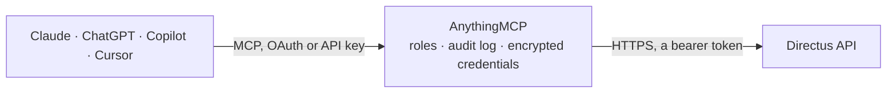

<!-- Generated by scripts/export-github-catalog.mjs in the anythingmcp-website repository. Do not edit by hand. -->

# Directus MCP connector

Connect to a Directus instance (self-hosted or Directus Cloud) to discover collections and fields, query items, and retrieve individual records through the read-only REST API. The AnythingMCP connector gives Claude, ChatGPT, Microsoft Copilot, Cursor and Gemini 5 MCP tools for Directus, all read-only.

**Category:** [CMS](../cms.md) · **Tools:** 5 · **Setup guide:** [anythingmcp.com](https://anythingmcp.com/guides/directus-to-mcp) · [Deutsch](https://anythingmcp.com/de/guides/directus-to-mcp) · [Italiano](https://anythingmcp.com/it/guides/directus-to-mcp) · [Español](https://anythingmcp.com/es/guides/directus-to-mcp) · [日本語](https://anythingmcp.com/ja/guides/directus-to-mcp) · [Русский](https://anythingmcp.com/ru/guides/directus-to-mcp) · [中文](https://anythingmcp.com/zh/guides/directus-to-mcp)

## Start without code

No installation and no terminal: AnythingMCP Cloud runs the Directus connector for you, operated by helpcode.ai in Frankfurt, Germany.

1. **Click the button above** and create an account or sign in. The Directus connector opens, ready to install.
2. **Paste the API key or token from your Directus account.** Every click is in the [step-by-step guide](https://anythingmcp.com/guides/directus-to-mcp).
3. **Click Install.** AnythingMCP shows the address of your MCP server.
4. **Add that address to your assistant:** [Claude](https://anythingmcp.com/guides/connect-directus-to-claude) · [ChatGPT](https://anythingmcp.com/guides/connect-directus-to-chatgpt) · [Microsoft Copilot](https://anythingmcp.com/guides/connect-directus-to-copilot) · [Cursor](https://anythingmcp.com/guides/connect-directus-to-cursor) · [Gemini CLI](https://anythingmcp.com/guides/connect-directus-to-gemini) · [Meta Muse](https://anythingmcp.com/guides/connect-directus-to-muse).
5. **Ask your first question**, for example: *Show invoice INV-2026-0412 for customer Borealis GmbH, I need amount, due date and payment status*

Prefer help with the setup? [Talk to us](https://anythingmcp.com/contact).

## How it works

- **The AI client** speaks MCP (Streamable HTTP) to AnythingMCP and only sees tool names, descriptions and results. It never gets the Directus credentials.
- **AnythingMCP** checks the client's role, builds the call from the tool definition, adds the credentials (a bearer token), calls Directus, logs the call and returns the result.
- **Directus** sees an ordinary API client with the rights of the account the credentials belong to.

## Tools

| Tool | What it does | Access |
|---|---|---|
| [`directus_list_collections`](#directus_list_collections) | List the collections visible to the configured Directus token. | read |
| [`directus_list_fields`](#directus_list_fields) | List the fields defined in a Directus collection. | read |
| [`directus_list_items`](#directus_list_items) | List, filter, search, sort, paginate, or aggregate items in a Directus collection. | read |
| [`directus_get_item`](#directus_get_item) | Retrieve one item from a Directus collection by its primary key. | read |
| [`directus_server_info`](#directus_server_info) | Retrieve information about the connected Directus server. | read |

## Tool reference

Every parameter as the AI client sees it in `tools/list`. Source: [`packages/backend/src/adapters/intl/directus.json`](../../../packages/backend/src/adapters/intl/directus.json).

### `directus_list_collections`

List the collections visible to the configured Directus token. Call this first to discover valid collection names before querying fields or items.

**Access:** read · **Call:** `GET /collections`

No parameters.

### `directus_list_fields`

List the fields defined in a Directus collection. Call this before filtering, sorting, aggregating, or selecting fields so later requests use real field names.

**Access:** read · **Call:** `GET /fields/{collection}`

| Parameter | Type | Required | Description |
|---|---|---|---|
| `collection` | string | yes | Name of the Directus collection, as returned by directus_list_collections. Example: articles. |

### `directus_list_items`

List, filter, search, sort, paginate, or aggregate items in a Directus collection. Use directus_list_collections and directus_list_fields first to discover valid collection and field names.

**Access:** read · **Call:** `GET /items/{collection}`

| Parameter | Type | Required | Description |
|---|---|---|---|
| `collection` | string | yes | Name of the Directus collection to query, as returned by directus_list_collections. Example: articles. |
| `fields` | string | no | Comma-separated list of fields to return. Request only the fields needed to reduce response size. Example: id,title,status. |
| `filter` | string | no | Directus JSON filter object. Use field names returned by directus_list_fields and Directus operators rather than SQL. Common operators include _eq, _neq, _gt, _gte, _lt, _lte, _in, _nin, _contains, and _icontains. Example: {"status":{"_eq":"published"}}. |
| `sort` | string | no | Comma-separated fields used to sort the results. Prefix a field with - for descending order. Example: -date_created,title. |
| `limit` | integer | no | Maximum number of items to return. Use a small value unless more results are explicitly needed. |
| `offset` | integer | no | Number of items to skip before returning results. Use this for offset-based pagination. |
| `page` | integer | no | Page number for page-based pagination. The first page is 1. Usually used together with limit. |
| `search` | string | no | Search term matched against searchable string and text fields in the collection. |
| `meta` | string | no | Optional metadata to request. Common values include total_count and filter_count. |
| `aggregate` | string | no | Directus aggregate request. Supported functions include count, countDistinct, sum, avg, min, and max. Example: {"count":"*"} counts items, while {"avg":"price"} calculates the average price. |

### `directus_get_item`

Retrieve one item from a Directus collection by its primary key. Use directus_list_fields first if the collection structure is unknown.

**Access:** read · **Call:** `GET /items/{collection}/{id}`

| Parameter | Type | Required | Description |
|---|---|---|---|
| `collection` | string | yes | Name of the Directus collection containing the item. Example: articles. |
| `id` | string | yes | Primary key of the item to retrieve. It may be a number, UUID, or another string value depending on the collection. |
| `fields` | string | no | Optional comma-separated list of fields to return. Example: id,title,status. |

### `directus_server_info`

Retrieve information about the connected Directus server. This tool is also used to verify that the configured URL and token can reach the Directus instance.

**Access:** read · **Call:** `GET /server/info`

No parameters.

## Run it yourself

AnythingMCP is open source (AGPL-3.0). [Run it with Docker](../../../README.md#run-it-yourself), open **Connectors → Store**, pick **Directus** and enter `DIRECTUS_URL`, `DIRECTUS_TOKEN`, then add your MCP server URL to the AI client.

[← CMS connectors](../cms.md) · [All categories](../README.md)
