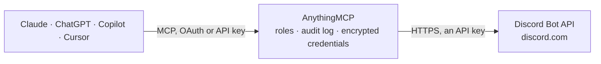

<!-- Generated by scripts/export-github-catalog.mjs in the anythingmcp-website repository. Do not edit by hand. -->

# Discord Bot MCP connector

Send messages, embeds, files and reactions to Discord channels and DMs from any AI agent via the Discord REST API. 13 tools, Bot Token auth. The AnythingMCP connector gives Claude, ChatGPT, Microsoft Copilot, Cursor and Gemini 13 MCP tools for Discord Bot: 7 read and 6 can change data.

**Category:** [Messaging](../messaging.md) · **Tools:** 13 · **Setup guide:** [anythingmcp.com](https://anythingmcp.com/guides/discord-bot-to-mcp) · [Deutsch](https://anythingmcp.com/de/guides/discord-bot-to-mcp) · [Italiano](https://anythingmcp.com/it/guides/discord-bot-to-mcp) · [Español](https://anythingmcp.com/es/guides/discord-bot-to-mcp) · [日本語](https://anythingmcp.com/ja/guides/discord-bot-to-mcp) · [Русский](https://anythingmcp.com/ru/guides/discord-bot-to-mcp) · [中文](https://anythingmcp.com/zh/guides/discord-bot-to-mcp)

## Start without code

No installation and no terminal: AnythingMCP Cloud runs the Discord Bot connector for you, operated by helpcode.ai in Frankfurt, Germany.

1. **Click the button above** and create an account or sign in. The Discord Bot connector opens, ready to install.
2. **Paste the API key or token from your Discord Bot account.** Every click is in the [step-by-step guide](https://anythingmcp.com/guides/discord-bot-to-mcp).
3. **Click Install.** AnythingMCP shows the address of your MCP server.
4. **Add that address to your assistant:** [Claude](https://anythingmcp.com/guides/connect-discord-bot-to-claude) · [ChatGPT](https://anythingmcp.com/guides/connect-discord-bot-to-chatgpt) · [Microsoft Copilot](https://anythingmcp.com/guides/connect-discord-bot-to-copilot) · [Cursor](https://anythingmcp.com/guides/connect-discord-bot-to-cursor) · [Gemini CLI](https://anythingmcp.com/guides/connect-discord-bot-to-gemini) · [Meta Muse](https://anythingmcp.com/guides/connect-discord-bot-to-muse).
5. **Ask your first question**, for example: *Find the message with invoice INV-2026-114 for Brenta Solar GmbH in the Finance channel of the Sunrise Energy GmbH server.*

Prefer help with the setup? [Talk to us](https://anythingmcp.com/contact).

## How it works

- **The AI client** speaks MCP (Streamable HTTP) to AnythingMCP and only sees tool names, descriptions and results. It never gets the Discord Bot credentials.
- **AnythingMCP** checks the client's role, builds the call from the tool definition, adds the credentials (an API key), calls Discord Bot, logs the call and returns the result.
- **Discord Bot** sees an ordinary API client with the rights of the account the credentials belong to.

## Tools

| Tool | What it does | Access |
|---|---|---|
| [`discord_bot_get_current_user`](#discord_bot_get_current_user) | Return the bot's own user object (id, username, discriminator, avatar). | read |
| [`discord_bot_list_guilds`](#discord_bot_list_guilds) | List the servers (guilds) the bot is a member of. | read |
| [`discord_bot_get_guild`](#discord_bot_get_guild) | Fetch a single guild by ID. | read |
| [`discord_bot_list_guild_channels`](#discord_bot_list_guild_channels) | List all channels (text, voice, category, threads' parents) in a guild. | read |
| [`discord_bot_get_channel`](#discord_bot_get_channel) | Fetch a single channel by ID. | read |
| [`discord_bot_send_message`](#discord_bot_send_message) | Send a message to a channel or thread. | write |
| [`discord_bot_edit_message`](#discord_bot_edit_message) | Edit a message the bot previously sent. | write |
| [`discord_bot_delete_message`](#discord_bot_delete_message) | Delete a message. | write |
| [`discord_bot_list_messages`](#discord_bot_list_messages) | Fetch recent messages from a channel. | read |
| [`discord_bot_add_reaction`](#discord_bot_add_reaction) | Add a reaction emoji to a message as the bot. | write |
| [`discord_bot_create_dm_channel`](#discord_bot_create_dm_channel) | Open a DM channel with a user. | write |
| [`discord_bot_create_thread_from_message`](#discord_bot_create_thread_from_message) | Start a public thread anchored to an existing message. | write |
| [`discord_bot_get_guild_member`](#discord_bot_get_guild_member) | Fetch a guild member by user_id. | read |

## Tool reference

Every parameter as the AI client sees it in `tools/list`. Source: [`packages/backend/src/adapters/intl/discord-bot.json`](../../../packages/backend/src/adapters/intl/discord-bot.json).

### `discord_bot_get_current_user`

Return the bot's own user object (id, username, discriminator, avatar). Health check + whoami.

**Access:** read · **Call:** `GET /users/@me`

No parameters.

### `discord_bot_list_guilds`

List the servers (guilds) the bot is a member of. Returns id, name, icon, owner flag, permissions bitfield. Bot must be installed in a server to see it here.

**Access:** read · **Call:** `GET /users/@me/guilds`

| Parameter | Type | Required | Description |
|---|---|---|---|
| `limit` | integer | no | Max 1-200 (default 200). |
| `before` | string | no | Snowflake ID — return guilds before this ID (pagination). |
| `after` | string | no | Snowflake ID — return guilds after this ID (pagination). |

### `discord_bot_get_guild`

Fetch a single guild by ID. Returns name, icon, splash, owner_id, region, afk_channel, system_channel, features, member_count (if with_counts=true).

**Access:** read · **Call:** `GET /guilds/{guildId}`

| Parameter | Type | Required | Description |
|---|---|---|---|
| `guildId` | string | yes | Guild snowflake ID. |
| `with_counts` | boolean | no | If true, include approximate_member_count and approximate_presence_count. |

### `discord_bot_list_guild_channels`

List all channels (text, voice, category, threads' parents) in a guild. Use to discover channel_id values to send messages into.

**Access:** read · **Call:** `GET /guilds/{guildId}/channels`

| Parameter | Type | Required | Description |
|---|---|---|---|
| `guildId` | string | yes | Guild snowflake ID. |

### `discord_bot_get_channel`

Fetch a single channel by ID. Returns type, name, topic, parent_id, position, permission_overwrites, last_message_id.

**Access:** read · **Call:** `GET /channels/{channelId}`

| Parameter | Type | Required | Description |
|---|---|---|---|
| `channelId` | string | yes | Channel snowflake. |

### `discord_bot_send_message`

Send a message to a channel or thread. Provide `content` (text) OR `embeds` OR both. For DMs, first open a DM channel with discord_bot_create_dm_channel.

**Access:** write · **Call:** `POST /channels/{channelId}/messages`

| Parameter | Type | Required | Description |
|---|---|---|---|
| `channelId` | string | yes | Channel snowflake (text channel, thread, or DM channel ID). |
| `content` | string | no | Text content ≤2000 chars. Supports Discord Markdown. |
| `embeds` | any[] | no | Array of up to 10 embed objects. Each: {title, description, url, color (decimal RGB), timestamp ISO 8601, footer{text,icon_url}, image{url}, thumbnail{url}, author{name,url,icon_url}, fields[{name,value,inline?}]}. Total ≤6000 chars. |
| `tts` | boolean | no | If true, send as text-to-speech (rarely useful). |
| `allowed_mentions` | object | no | Control which mentions trigger notifications: {parse:['users','roles','everyone'], users:[id], roles:[id], replied_user:bool}. Use {parse:[]} to suppress all pings. |
| `message_reference` | object | no | Reply to an existing message: {message_id, channel_id?, guild_id?, fail_if_not_exists?}. |

### `discord_bot_edit_message`

Edit a message the bot previously sent. Cannot edit messages from other users.

**Access:** write · **Call:** `PATCH /channels/{channelId}/messages/{messageId}`

| Parameter | Type | Required | Description |
|---|---|---|---|
| `channelId` | string | yes | Channel snowflake. |
| `messageId` | string | yes | Message snowflake to edit. |
| `content` | string | no | New text content (or null to clear). |
| `embeds` | any[] | no | New embeds array (or [] to clear). |

### `discord_bot_delete_message`

Delete a message. Bot needs Manage Messages permission to delete others' messages; can always delete its own.

**Access:** write · **Call:** `DELETE /channels/{channelId}/messages/{messageId}`

| Parameter | Type | Required | Description |
|---|---|---|---|
| `channelId` | string | yes | Channel snowflake. |
| `messageId` | string | yes | Message snowflake to delete. |

### `discord_bot_list_messages`

Fetch recent messages from a channel. Bot needs Read Message History. Default 50; max 100. Use `before` for older history (paginate backwards).

**Access:** read · **Call:** `GET /channels/{channelId}/messages`

| Parameter | Type | Required | Description |
|---|---|---|---|
| `channelId` | string | yes | Channel snowflake. |
| `limit` | integer | no | Max messages 1-100 (default 50). |
| `before` | string | no | Snowflake — return messages with ID less than this (older). |
| `after` | string | no | Snowflake — return messages with ID greater than this (newer). |
| `around` | string | no | Snowflake — return messages centered around this ID. |

### `discord_bot_add_reaction`

Add a reaction emoji to a message as the bot. For unicode emoji pass the literal char (e.g. '👍'). For custom guild emoji pass 'name:id'.

**Access:** write · **Call:** `PUT /channels/{channelId}/messages/{messageId}/reactions/{emoji}/@me`

| Parameter | Type | Required | Description |
|---|---|---|---|
| `channelId` | string | yes | Channel snowflake. |
| `messageId` | string | yes | Message snowflake. |
| `emoji` | string | yes | URL-encoded emoji. Unicode like '%F0%9F%91%8D' for 👍, or 'name:id' for custom emoji. |

### `discord_bot_create_dm_channel`

Open a DM channel with a user. Returns a channel object with `id` — use that channel_id in discord_bot_send_message to actually DM them. The user must share at least one server with the bot.

**Access:** write · **Call:** `POST /users/@me/channels`

| Parameter | Type | Required | Description |
|---|---|---|---|
| `recipient_id` | string | yes | User snowflake to DM. |

### `discord_bot_create_thread_from_message`

Start a public thread anchored to an existing message. Useful for spawning discussion threads from bot announcements.

**Access:** write · **Call:** `POST /channels/{channelId}/messages/{messageId}/threads`

| Parameter | Type | Required | Description |
|---|---|---|---|
| `channelId` | string | yes | Parent channel snowflake. |
| `messageId` | string | yes | Message to anchor the thread to. |
| `name` | string | yes | Thread name (1-100 chars). |
| `auto_archive_duration` | integer | no | Auto-archive minutes: 60, 1440, 4320, or 10080. |

### `discord_bot_get_guild_member`

Fetch a guild member by user_id. Returns user object, nick, roles[], joined_at, premium_since, permissions in the guild.

**Access:** read · **Call:** `GET /guilds/{guildId}/members/{userId}`

| Parameter | Type | Required | Description |
|---|---|---|---|
| `guildId` | string | yes | Guild snowflake. |
| `userId` | string | yes | User snowflake. |

## Run it yourself

AnythingMCP is open source (AGPL-3.0). [Run it with Docker](../../../README.md#run-it-yourself), open **Connectors → Store**, pick **Discord Bot** and enter `DISCORD_BOT_TOKEN`, then add your MCP server URL to the AI client.

[← Messaging connectors](../messaging.md) · [All categories](../README.md)
