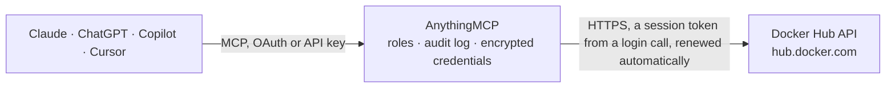

<!-- Generated by scripts/export-github-catalog.mjs in the anythingmcp-website repository. Do not edit by hand. -->

# Docker Hub MCP connector

Let your AI look up container images on Docker Hub: search repositories, read an image's description and pull count, list tags with their digests, sizes and push dates, compare the platforms of a … The AnythingMCP connector gives Claude, ChatGPT, Microsoft Copilot, Cursor and Gemini 9 MCP tools for Docker Hub, all read-only.

**Category:** [Infrastructure](../infrastructure.md) · **Tools:** 9 · **Setup guide:** [anythingmcp.com](https://anythingmcp.com/guides/dockerhub-to-mcp) · [Deutsch](https://anythingmcp.com/de/guides/dockerhub-to-mcp) · [Italiano](https://anythingmcp.com/it/guides/dockerhub-to-mcp) · [Español](https://anythingmcp.com/es/guides/dockerhub-to-mcp) · [日本語](https://anythingmcp.com/ja/guides/dockerhub-to-mcp) · [Русский](https://anythingmcp.com/ru/guides/dockerhub-to-mcp) · [中文](https://anythingmcp.com/zh/guides/dockerhub-to-mcp)

## Start without code

No installation and no terminal: AnythingMCP Cloud runs the Docker Hub connector for you, operated by helpcode.ai in Frankfurt, Germany.

1. **Click the button above** and create an account or sign in. The Docker Hub connector opens, ready to install.
2. **Paste the API key or token from your Docker Hub account.** Every click is in the [step-by-step guide](https://anythingmcp.com/guides/dockerhub-to-mcp).
3. **Click Install.** AnythingMCP shows the address of your MCP server.
4. **Add that address to your assistant:** [Claude](https://anythingmcp.com/guides/connect-dockerhub-to-claude) · [ChatGPT](https://anythingmcp.com/guides/connect-dockerhub-to-chatgpt) · [Microsoft Copilot](https://anythingmcp.com/guides/connect-dockerhub-to-copilot) · [Cursor](https://anythingmcp.com/guides/connect-dockerhub-to-cursor) · [Gemini CLI](https://anythingmcp.com/guides/connect-dockerhub-to-gemini) · [Meta Muse](https://anythingmcp.com/guides/connect-dockerhub-to-muse).
5. **Ask your first question**, for example: *What's the pull count and last update date for the Postgres image we use (postgres:14-alpine)?*

Prefer help with the setup? [Talk to us](https://anythingmcp.com/contact).

## How it works

- **The AI client** speaks MCP (Streamable HTTP) to AnythingMCP and only sees tool names, descriptions and results. It never gets the Docker Hub credentials.
- **AnythingMCP** checks the client's role, builds the call from the tool definition, adds the credentials (a session token from a login call, renewed automatically), calls Docker Hub, logs the call and returns the result.
- **Docker Hub** sees an ordinary API client with the rights of the account the credentials belong to.

## Tools

| Tool | What it does | Access |
|---|---|---|
| [`dockerhub_get_user`](#dockerhub_get_user) | Show the Docker Hub account the token belongs to: Docker ID, full name, company, location, account type and join date. | read |
| [`dockerhub_list_my_orgs`](#dockerhub_list_my_orgs) | List the Docker Hub organizations the user belongs to, with organization name, full name, company and join date. | read |
| [`dockerhub_get_org`](#dockerhub_get_org) | Read a Docker Hub organization's public profile: full name, company, location, website, badge (e.g. verified_publisher or open_source) and join date. | read |
| [`dockerhub_search_repositories`](#dockerhub_search_repositories) | Search public Docker Hub repositories (container images) by name or keyword, most relevant first. | read |
| [`dockerhub_list_repositories`](#dockerhub_list_repositories) | List the repositories of a Docker Hub user or organization (namespace), including private ones the token can read, with description, pull and star counts,… | read |
| [`dockerhub_get_repository`](#dockerhub_get_repository) | Read one Docker Hub repository: description, README (full description), pull and star counts, privacy, last update, registration date, categories, storage… | read |
| [`dockerhub_list_tags`](#dockerhub_list_tags) | List the tags of a Docker Hub repository, most recently updated first, optionally only tags containing some text (e.g. 'alpine'). | read |
| [`dockerhub_get_tag`](#dockerhub_get_tag) | Read one tag of a Docker Hub repository with the image built for each platform: os, architecture and variant (e.g. linux/arm64/v8), the platform digest,… | read |
| [`dockerhub_pull_limits`](#dockerhub_pull_limits) | Explain Docker Hub's image pull limits (anonymous, Personal, Pro, Team, Business) and how the user can check how many pulls they have left from their own… | read |

## Tool reference

Every parameter as the AI client sees it in `tools/list`. Source: [`packages/backend/src/adapters/intl/dockerhub.json`](../../../packages/backend/src/adapters/intl/dockerhub.json).

### `dockerhub_get_user`

Show the Docker Hub account the token belongs to: Docker ID, full name, company, location, account type and join date. Read-only.

**Access:** read · **Call:** `GET /v2/user/`

No parameters.

### `dockerhub_list_my_orgs`

List the Docker Hub organizations the user belongs to, with organization name, full name, company and join date. Use an orgname as namespace in dockerhub_list_repositories. Read-only.

**Access:** read · **Call:** `GET /v2/user/orgs/`

| Parameter | Type | Required | Description |
|---|---|---|---|
| `page` | integer | no | Page number, starting at 1. |
| `page_size` | integer | no | Organizations per page, 1 to 100. Default 50. |

### `dockerhub_get_org`

Read a Docker Hub organization's public profile: full name, company, location, website, badge (e.g. verified_publisher or open_source) and join date. Read-only.

**Access:** read · **Call:** `GET /v2/orgs/{org_name}`

| Parameter | Type | Required | Description |
|---|---|---|---|
| `org_name` | string | yes | Organization name, e.g. 'docker' or 'bitnami'. |

### `dockerhub_search_repositories`

Search public Docker Hub repositories (container images) by name or keyword, most relevant first. Returns the repository name (official images have no namespace, e.g. 'nginx' means library/nginx), short description, pull and star counts and whether it is a Docker Official Image. Read-only.

**Access:** read · **Call:** `GET /v2/search/repositories/`

| Parameter | Type | Required | Description |
|---|---|---|---|
| `query` | string | yes | Name or keyword, e.g. 'postgres' or 'node alpine'. |
| `page` | integer | no | Page number, starting at 1. |
| `page_size` | integer | no | Results per page, 1 to 100. Default 25. |

### `dockerhub_list_repositories`

List the repositories of a Docker Hub user or organization (namespace), including private ones the token can read, with description, pull and star counts, privacy and last update. Filter by part of the name and sort by name, last update or pulls. Read-only.

**Access:** read · **Call:** `GET /v2/namespaces/{namespace}/repositories`

| Parameter | Type | Required | Description |
|---|---|---|---|
| `namespace` | string | yes | User or organization, e.g. 'bitnami', your own Docker ID, or 'library' for Docker Official Images. |
| `name` | string | no | Only repositories whose name contains this text. |
| `ordering` | `name` \| `-name` \| `last_updated` \| `-last_updated` \| `pull_count` \| `-pull_count` | no | Sort field; a leading minus sorts descending, e.g. -pull_count for the most pulled first. |
| `page` | integer | no | Page number, starting at 1. |
| `page_size` | integer | no | Repositories per page, 1 to 100. Default 25. |

### `dockerhub_get_repository`

Read one Docker Hub repository: description, README (full description), pull and star counts, privacy, last update, registration date, categories, storage size and your permissions on it. For official images use namespace 'library', e.g. library/nginx. Read-only.

**Access:** read · **Call:** `GET /v2/namespaces/{namespace}/repositories/{repository}`

| Parameter | Type | Required | Description |
|---|---|---|---|
| `namespace` | string | yes | User or organization, or 'library' for Docker Official Images. |
| `repository` | string | yes | Repository name, e.g. 'nginx'. |

### `dockerhub_list_tags`

List the tags of a Docker Hub repository, most recently updated first, optionally only tags containing some text (e.g. 'alpine'). Returns tag name, digest, compressed size in bytes, last push and pull, status and the platforms (os/architecture) it is built for. Page with page and page_size. Read-only.

**Access:** read · **Call:** `GET /v2/namespaces/{namespace}/repositories/{repository}/tags`

| Parameter | Type | Required | Description |
|---|---|---|---|
| `namespace` | string | yes | User or organization, or 'library' for Docker Official Images. |
| `repository` | string | yes | Repository name, e.g. 'nginx'. |
| `name` | string | no | Only tags whose name contains this text, e.g. 'alpine' or '1.27'. |
| `page` | integer | no | Page number, starting at 1. |
| `page_size` | integer | no | Tags per page, 1 to 100. Default 25. |

### `dockerhub_get_tag`

Read one tag of a Docker Hub repository with the image built for each platform: os, architecture and variant (e.g. linux/arm64/v8), the platform digest, compressed size in bytes and last push and pull, plus the tag's own (index) digest. Use it to check platform support or compare digests. Read-only.

**Access:** read · **Call:** `GET /v2/namespaces/{namespace}/repositories/{repository}/tags/{tag}`

| Parameter | Type | Required | Description |
|---|---|---|---|
| `namespace` | string | yes | User or organization, or 'library' for Docker Official Images. |
| `repository` | string | yes | Repository name, e.g. 'nginx'. |
| `tag` | string | yes | Tag name, e.g. 'latest' or '1.27-alpine'. |

### `dockerhub_pull_limits`

Explain Docker Hub's image pull limits (anonymous, Personal, Pro, Team, Business) and how the user can check how many pulls they have left from their own machine. No call to Docker Hub. Read-only.

**Access:** read

No parameters.

## Run it yourself

AnythingMCP is open source (AGPL-3.0). [Run it with Docker](../../../README.md#run-it-yourself), open **Connectors → Store**, pick **Docker Hub** and enter `DOCKERHUB_USERNAME`, `DOCKERHUB_TOKEN`, then add your MCP server URL to the AI client.

[← Infrastructure connectors](../infrastructure.md) · [All categories](../README.md)
