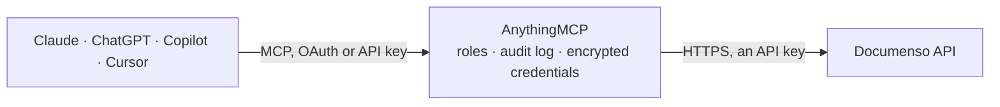

<!-- Generated by scripts/export-github-catalog.mjs in the anythingmcp-website repository. Do not edit by hand. -->

# Documenso MCP connector

Let your AI work with Documenso, the open-source e-signature platform (Cloud or self-hosted): find documents and templates, check who has signed, read recipients, fields and audit logs, download … The AnythingMCP connector gives Claude, ChatGPT, Microsoft Copilot, Cursor and Gemini 22 MCP tools for Documenso: 9 read and 13 can change data.

**Category:** [E-Signature](../e-signature.md) · **Tools:** 22 · **Setup guide:** [anythingmcp.com](https://anythingmcp.com/guides/documenso-to-mcp) · [Deutsch](https://anythingmcp.com/de/guides/documenso-to-mcp) · [Italiano](https://anythingmcp.com/it/guides/documenso-to-mcp) · [Español](https://anythingmcp.com/es/guides/documenso-to-mcp) · [日本語](https://anythingmcp.com/ja/guides/documenso-to-mcp) · [Русский](https://anythingmcp.com/ru/guides/documenso-to-mcp) · [中文](https://anythingmcp.com/zh/guides/documenso-to-mcp)

## Start without code

No installation and no terminal: AnythingMCP Cloud runs the Documenso connector for you, operated by helpcode.ai in Frankfurt, Germany.

1. **Click the button above** and create an account or sign in. The Documenso connector opens, ready to install.
2. **Paste the API key or token from your Documenso account.** Every click is in the [step-by-step guide](https://anythingmcp.com/guides/documenso-to-mcp).
3. **Click Install.** AnythingMCP shows the address of your MCP server.
4. **Add that address to your assistant:** [Claude](https://anythingmcp.com/guides/connect-documenso-to-claude) · [ChatGPT](https://anythingmcp.com/guides/connect-documenso-to-chatgpt) · [Microsoft Copilot](https://anythingmcp.com/guides/connect-documenso-to-copilot) · [Cursor](https://anythingmcp.com/guides/connect-documenso-to-cursor) · [Gemini CLI](https://anythingmcp.com/guides/connect-documenso-to-gemini) · [Meta Muse](https://anythingmcp.com/guides/connect-documenso-to-muse).
5. **Ask your first question**, for example: *Show the document sent to Nordic Solar AS with external ID INV-2026-044; status and who has signed?*

Prefer help with the setup? [Talk to us](https://anythingmcp.com/contact).

## How it works

- **The AI client** speaks MCP (Streamable HTTP) to AnythingMCP and only sees tool names, descriptions and results. It never gets the Documenso credentials.
- **AnythingMCP** checks the client's role, builds the call from the tool definition, adds the credentials (an API key), calls Documenso, logs the call and returns the result.
- **Documenso** sees an ordinary API client with the rights of the account the credentials belong to.

## Tools

| Tool | What it does | Access |
|---|---|---|
| [`documenso_list_envelopes`](#documenso_list_envelopes) | List documents and templates (envelopes), newest first: id, title, type (DOCUMENT or TEMPLATE), status, source, externalId, folder, created and completed… | read |
| [`documenso_get_envelope`](#documenso_get_envelope) | Read one document or template in full: title, status, settings (subject, message, signing order, language, expiry), recipients (id, name, email, role,… | read |
| [`documenso_get_envelope_audit_log`](#documenso_get_envelope_audit_log) | Audit trail of an envelope as data, newest first: each event (created, sent, opened, signed, rejected, completed and more) with time, user or recipient, IP… | read |
| [`documenso_download_document`](#documenso_download_document) | Download one PDF of an envelope (an envelope item). | read |
| [`documenso_download_audit_log_pdf`](#documenso_download_audit_log_pdf) | Download the audit log of an envelope as a PDF: every event with time, actor, IP address and user agent. | read |
| [`documenso_download_certificate`](#documenso_download_certificate) | Download the signing certificate of a completed document as a PDF. | read |
| [`documenso_get_recipient`](#documenso_get_recipient) | Read one recipient: name, email, role, signing order, readStatus, signingStatus, sendStatus, signedAt, rejectionReason, link expiry and the fields assigned… | read |
| [`documenso_get_field`](#documenso_get_field) | Read one field: type, recipient, page, position and size (percent of the page), whether it was filled (inserted) and its value (customText) and settings. | read |
| [`documenso_list_folders`](#documenso_list_folders) | List folders for documents or templates: id, name, parent folder, pinned, visibility. | read |
| [`documenso_create_envelope`](#documenso_create_envelope) | Create a draft document (or a template) from a PDF at a public URL, optionally with recipients and their fields. | write |
| [`documenso_use_template`](#documenso_use_template) | Create a document from a template and, with distribute true, send it at once. | write |
| [`documenso_distribute_envelope`](#documenso_distribute_envelope) | Send a draft document to its recipients (status DRAFT becomes PENDING). | write |
| [`documenso_redistribute_envelope`](#documenso_redistribute_envelope) | Send the signing request again (a reminder) to recipients who have not acted yet, and renew their expired signing links. | write |
| [`documenso_cancel_envelope`](#documenso_cancel_envelope) | Cancel a pending document: signing stops and recipients can no longer sign. | write |
| [`documenso_delete_envelope`](#documenso_delete_envelope) | Delete a document or template. | write |
| [`documenso_update_envelope`](#documenso_update_envelope) | Change a draft document or a template: title, external id, folder, visibility and email or signing settings. | write |
| [`documenso_duplicate_envelope`](#documenso_duplicate_envelope) | Copy a document or template with its settings, optionally with recipients and fields. | write |
| [`documenso_add_recipients`](#documenso_add_recipients) | Add recipients to a draft document or a template. | write |
| [`documenso_update_recipients`](#documenso_update_recipients) | Change recipients of a draft document or a template (name, email, role, signing order). | write |
| [`documenso_delete_recipient`](#documenso_delete_recipient) | Remove a recipient (and their fields) from a draft document or a template. | write |
| [`documenso_add_fields`](#documenso_add_fields) | Place fields (signature, name, date, text and more) for recipients on a draft document or a template, by position or by a placeholder text found in the PDF. | write |
| [`documenso_delete_field`](#documenso_delete_field) | Remove a field (signature, text, date and others) from a draft document or a template. | write |

## Tool reference

Every parameter as the AI client sees it in `tools/list`. Source: [`packages/backend/src/adapters/intl/documenso.json`](../../../packages/backend/src/adapters/intl/documenso.json).

### `documenso_list_envelopes`

List documents and templates (envelopes), newest first: id, title, type (DOCUMENT or TEMPLATE), status, source, externalId, folder, created and completed time, owner and recipients with their signing status. Filter by text, type, status, template or folder.

**Access:** read · **Call:** `GET /envelope`

| Parameter | Type | Required | Description |
|---|---|---|---|
| `query` | string | no | Only envelopes whose title or recipient matches this text. |
| `type` | `DOCUMENT` \| `TEMPLATE` | no | DOCUMENT for documents sent or to send, TEMPLATE for templates. |
| `status` | `DRAFT` \| `PENDING` \| `COMPLETED` \| `REJECTED` \| `CANCELLED` | no | Only envelopes in this state. |
| `template_id` | integer | no | Only documents created from this template (numeric templateId, as in the templateId of an envelope). |
| `source` | `DOCUMENT` \| `TEMPLATE` \| `TEMPLATE_DIRECT_LINK` | no | How the document was created. |
| `has_expired_recipients` | `true` \| `false` | no | "true" for envelopes with at least one recipient whose signing link expired. |
| `folder_id` | string | no | Only envelopes in this folder (id from documenso_list_folders). |
| `order_direction` | `asc` \| `desc` | no | Sort by creation date: desc (default, newest first) or asc. |
| `page` | integer | no | Page number, starting at 1 (default 1). |
| `per_page` | integer | no | Items per page (default 10, up to 100). |

### `documenso_get_envelope`

Read one document or template in full: title, status, settings (subject, message, signing order, language, expiry), recipients (id, name, email, role, readStatus, signingStatus, sendStatus, signedAt, token), fields (id, type, recipient, page and position), envelope items (the PDFs, with their ids for downloading) and the template direct link.

**Access:** read · **Call:** `GET /envelope/{envelope_id}`

| Parameter | Type | Required | Description |
|---|---|---|---|
| `envelope_id` | string | yes | Envelope id (a string such as "envelope_abc123"), from documenso_list_envelopes. |

### `documenso_get_envelope_audit_log`

Audit trail of an envelope as data, newest first: each event (created, sent, opened, signed, rejected, completed and more) with time, user or recipient, IP address and user agent.

**Access:** read · **Call:** `GET /envelope/{envelope_id}/audit-log`

| Parameter | Type | Required | Description |
|---|---|---|---|
| `envelope_id` | string | yes | Envelope id (a string such as "envelope_abc123"), from documenso_list_envelopes. |
| `order_direction` | `asc` \| `desc` | no | Sort by time: desc (default) or asc. |
| `page` | integer | no | Page number, starting at 1 (default 1). |
| `per_page` | integer | no | Items per page (default 10, up to 100). |

### `documenso_download_document`

Download one PDF of an envelope (an envelope item). version "signed" (default for completed documents) is the final PDF with signatures and the audit trail, "original" the uploaded file, "pending" the current state while signing is in progress. The id is envelopeItems[].id from documenso_get_envelope.

**Access:** read · **Call:** `GET /envelope/item/{envelope_item_id}/download`

| Parameter | Type | Required | Description |
|---|---|---|---|
| `envelope_item_id` | string | yes | Envelope item id, from envelopeItems[].id of documenso_get_envelope. |
| `version` | `signed` \| `original` \| `pending` | no | Which version to download. |

### `documenso_download_audit_log_pdf`

Download the audit log of an envelope as a PDF: every event with time, actor, IP address and user agent.

**Access:** read · **Call:** `GET /envelope/{envelope_id}/audit-log/download`

| Parameter | Type | Required | Description |
|---|---|---|---|
| `envelope_id` | string | yes | Envelope id (a string such as "envelope_abc123"), from documenso_list_envelopes. |

### `documenso_download_certificate`

Download the signing certificate of a completed document as a PDF.

**Access:** read · **Call:** `GET /envelope/{envelope_id}/certificate/download`

| Parameter | Type | Required | Description |
|---|---|---|---|
| `envelope_id` | string | yes | Envelope id (a string such as "envelope_abc123"), from documenso_list_envelopes. |

### `documenso_get_recipient`

Read one recipient: name, email, role, signing order, readStatus, signingStatus, sendStatus, signedAt, rejectionReason, link expiry and the fields assigned to them.

**Access:** read · **Call:** `GET /envelope/recipient/{recipient_id}`

| Parameter | Type | Required | Description |
|---|---|---|---|
| `recipient_id` | integer | yes | Recipient id (number), from recipients[].id of documenso_get_envelope. |

### `documenso_get_field`

Read one field: type, recipient, page, position and size (percent of the page), whether it was filled (inserted) and its value (customText) and settings.

**Access:** read · **Call:** `GET /envelope/field/{field_id}`

| Parameter | Type | Required | Description |
|---|---|---|---|
| `field_id` | integer | yes | Field id (number), from fields[].id of documenso_get_envelope. |

### `documenso_list_folders`

List folders for documents or templates: id, name, parent folder, pinned, visibility. Use the id as folder_id elsewhere.

**Access:** read · **Call:** `GET /folder`

| Parameter | Type | Required | Description |
|---|---|---|---|
| `query` | string | no | Only folders whose name contains this text. |
| `type` | `DOCUMENT` \| `TEMPLATE` | no | DOCUMENT or TEMPLATE folders. |
| `parent_id` | string | no | Only the subfolders of this folder. |
| `page` | integer | no | Page number, starting at 1 (default 1). |
| `per_page` | integer | no | Items per page (default 10, up to 100). |

### `documenso_create_envelope`

Create a draft document (or a template) from a PDF at a public URL, optionally with recipients and their fields. Nothing is sent yet: call documenso_distribute_envelope to send. Returns the new envelope id.

**Access:** write · **Call:** `POST /envelope/create`

| Parameter | Type | Required | Description |
|---|---|---|---|
| `title` | string | yes | Title of the document. |
| `file_url` | string | yes | Public https URL of the PDF to upload. AnythingMCP downloads it and sends it as the file. |
| `type` | `DOCUMENT` \| `TEMPLATE` | yes | DOCUMENT for a document to send, TEMPLATE for a reusable template. |
| `recipients` | object[] | no | Recipients: [{"email", "name", "role": SIGNER, APPROVER, VIEWER, CC or ASSISTANT, "signingOrder"?, "fields"?: [{"type": "SIGNATURE", "page": 1, "positionX": 10, "positionY": 80, "width": 30, "height": 5}]}]. Positions and sizes are percent of the page; pages start at 1. |
| `external_id` | string | no | Your own reference for this document. |
| `folder_id` | string | no | Folder id, from documenso_list_folders. |
| `signing_order` | `PARALLEL` \| `SEQUENTIAL` | no | PARALLEL (default) or SEQUENTIAL by signingOrder. |
| `form_values` | object | no | Values for PDF form fields of the file, keyed by form field name. |
| `subject` | string | no | Email subject for the recipients. |
| `message` | string | no | Email message for the recipients. |
| `distribution_method` | `EMAIL` \| `NONE` | no | EMAIL (default) sends the signing emails; NONE sends nothing and you share the signingUrl yourself. |
| `redirect_url` | string | no | Address the signer is sent to after signing. |
| `language` | `de` \| `en` \| `fr` \| `es` \| `it` \| `nl` \| `pl` \| `pt-BR` \| `ja` \| `ko` \| `zh` | no | Language of the signing page and emails. |

### `documenso_use_template`

Create a document from a template and, with distribute true, send it at once. Map each template recipient (by its recipient id from documenso_get_envelope of the template) to a real person. Returns the new envelope id and each recipient with its signingUrl.

**Access:** write · **Call:** `POST /envelope/use`

| Parameter | Type | Required | Description |
|---|---|---|---|
| `template_envelope_id` | string | yes | Envelope id of the template (type TEMPLATE), from documenso_list_envelopes with type TEMPLATE. |
| `recipients` | object[] | yes | One entry per template recipient: [{"id": <template recipient id>, "email": "...", "name": "...", "signingOrder"?}]. |
| `distribute` | boolean | no | true sends the document to the recipients right away; false (default) leaves it as a draft. |
| `title` | string | no | Title of the new document (default: the template title). |
| `subject` | string | no | Email subject (overrides the template). |
| `message` | string | no | Email message (overrides the template). |
| `distribution_method` | `EMAIL` \| `NONE` | no | EMAIL (default) sends the signing emails; NONE sends nothing and you share the signingUrl yourself. |
| `redirect_url` | string | no | Address the signer is sent to after signing. |
| `language` | `de` \| `en` \| `fr` \| `es` \| `it` \| `nl` \| `pl` \| `pt-BR` \| `ja` \| `ko` \| `zh` | no | Language of the signing page and emails. |
| `prefill_fields` | object[] | no | Values for template fields before sending: [{"id": <field id>, "type": "text", "value": "..."}]. Types: text, number, radio, checkbox (value is a list), dropdown, date. |
| `external_id` | string | no | Your own reference for the new document. |
| `folder_id` | string | no | Folder for the new document. |
| `form_values` | object | no | Values for PDF form fields, keyed by form field name. |

### `documenso_distribute_envelope`

Send a draft document to its recipients (status DRAFT becomes PENDING). Every SIGNER needs at least one signature field first. Returns each recipient with its signingUrl.

**Access:** write · **Call:** `POST /envelope/distribute`

| Parameter | Type | Required | Description |
|---|---|---|---|
| `envelope_id` | string | yes | Envelope id (a string such as "envelope_abc123"), from documenso_list_envelopes. |
| `subject` | string | no | Email subject for the recipients. |
| `message` | string | no | Email message for the recipients. |
| `distribution_method` | `EMAIL` \| `NONE` | no | EMAIL (default) sends the signing emails; NONE sends nothing and you share the signingUrl yourself. |
| `redirect_url` | string | no | Address the signer is sent to after signing. |
| `language` | `de` \| `en` \| `fr` \| `es` \| `it` \| `nl` \| `pl` \| `pt-BR` \| `ja` \| `ko` \| `zh` | no | Language of the signing page and emails. |

### `documenso_redistribute_envelope`

Send the signing request again (a reminder) to recipients who have not acted yet, and renew their expired signing links.

**Access:** write · **Call:** `POST /envelope/redistribute`

| Parameter | Type | Required | Description |
|---|---|---|---|
| `envelope_id` | string | yes | Envelope id (a string such as "envelope_abc123"), from documenso_list_envelopes. |
| `recipient_ids` | integer[] | yes | Recipient ids to remind (numbers), from recipients[].id of documenso_get_envelope. |

### `documenso_cancel_envelope`

Cancel a pending document: signing stops and recipients can no longer sign. The document stays in the list with status CANCELLED.

**Access:** write · **Call:** `POST /envelope/cancel`

| Parameter | Type | Required | Description |
|---|---|---|---|
| `envelope_id` | string | yes | Envelope id (a string such as "envelope_abc123"), from documenso_list_envelopes. |
| `reason` | string | no | Reason for the cancellation. |

### `documenso_delete_envelope`

Delete a document or template. A draft is removed; a pending document is cancelled for the recipients and hidden.

**Access:** write · **Call:** `POST /envelope/delete`

| Parameter | Type | Required | Description |
|---|---|---|---|
| `envelope_id` | string | yes | Envelope id (a string such as "envelope_abc123"), from documenso_list_envelopes. |

### `documenso_update_envelope`

Change a draft document or a template: title, external id, folder, visibility and email or signing settings.

**Access:** write · **Call:** `POST /envelope/update`

| Parameter | Type | Required | Description |
|---|---|---|---|
| `envelope_id` | string | yes | Envelope id (a string such as "envelope_abc123"), from documenso_list_envelopes. |
| `title` | string | no | New title. |
| `external_id` | string | no | New external reference. |
| `folder_id` | string | no | Move to this folder. |
| `visibility` | `EVERYONE` \| `MANAGER_AND_ABOVE` \| `ADMIN` | no | Who in the team can see it. |
| `signing_order` | `PARALLEL` \| `SEQUENTIAL` | no | PARALLEL or SEQUENTIAL. |
| `timezone` | string | no | Time zone for dates, e.g. Europe/Berlin. |
| `subject` | string | no | Email subject for the recipients. |
| `message` | string | no | Email message for the recipients. |
| `distribution_method` | `EMAIL` \| `NONE` | no | EMAIL (default) sends the signing emails; NONE sends nothing and you share the signingUrl yourself. |
| `redirect_url` | string | no | Address the signer is sent to after signing. |
| `language` | `de` \| `en` \| `fr` \| `es` \| `it` \| `nl` \| `pl` \| `pt-BR` \| `ja` \| `ko` \| `zh` | no | Language of the signing page and emails. |

### `documenso_duplicate_envelope`

Copy a document or template with its settings, optionally with recipients and fields. Returns the new envelope id (a draft).

**Access:** write · **Call:** `POST /envelope/duplicate`

| Parameter | Type | Required | Description |
|---|---|---|---|
| `envelope_id` | string | yes | Envelope id (a string such as "envelope_abc123"), from documenso_list_envelopes. |
| `include_recipients` | boolean | no | Copy the recipients too. |
| `include_fields` | boolean | no | Copy the fields too (needs include_recipients). |

### `documenso_add_recipients`

Add recipients to a draft document or a template. Returns them with their ids, which documenso_add_fields needs.

**Access:** write · **Call:** `POST /envelope/recipient/create-many`

| Parameter | Type | Required | Description |
|---|---|---|---|
| `envelope_id` | string | yes | Envelope id (a string such as "envelope_abc123"), from documenso_list_envelopes. |
| `recipients` | object[] | yes | [{"email", "name", "role": SIGNER, APPROVER, VIEWER, CC or ASSISTANT, "signingOrder"?}] |

### `documenso_update_recipients`

Change recipients of a draft document or a template (name, email, role, signing order).

**Access:** write · **Call:** `POST /envelope/recipient/update-many`

| Parameter | Type | Required | Description |
|---|---|---|---|
| `envelope_id` | string | yes | Envelope id (a string such as "envelope_abc123"), from documenso_list_envelopes. |
| `recipients` | object[] | yes | [{"id": <recipient id>, "email"?, "name"?, "role"?, "signingOrder"?}] |

### `documenso_delete_recipient`

Remove a recipient (and their fields) from a draft document or a template.

**Access:** write · **Call:** `POST /envelope/recipient/delete`

| Parameter | Type | Required | Description |
|---|---|---|---|
| `recipient_id` | integer | yes | Recipient id, from recipients[].id of documenso_get_envelope. |

### `documenso_add_fields`

Place fields (signature, name, date, text and more) for recipients on a draft document or a template, by position or by a placeholder text found in the PDF.

**Access:** write · **Call:** `POST /envelope/field/create-many`

| Parameter | Type | Required | Description |
|---|---|---|---|
| `envelope_id` | string | yes | Envelope id (a string such as "envelope_abc123"), from documenso_list_envelopes. |
| `fields` | object[] | yes | By position: [{"type": "SIGNATURE", "recipientId": 12, "envelopeItemId"?: "...", "page": 1, "positionX": 10, "positionY": 80, "width": 30, "height": 5}] (percent of the page, pages from 1). By placeholder: [{"type": "SIGNATURE", "recipientId": 12, "placeholder": "{{signature}}", "matchAll"?: true}]. Types: SIGNATURE, FREE_SIGNATURE, INITIALS, NAME, EMAIL, DATE, TEXT, NUMBER, RADIO, CHECKBOX, DROPDOWN; optional "fieldMeta" holds label, required, readOnly and type-specific settings. |

### `documenso_delete_field`

Remove a field (signature, text, date and others) from a draft document or a template.

**Access:** write · **Call:** `POST /envelope/field/delete`

| Parameter | Type | Required | Description |
|---|---|---|---|
| `field_id` | integer | yes | Field id, from fields[].id of documenso_get_envelope. |

## Run it yourself

AnythingMCP is open source (AGPL-3.0). [Run it with Docker](../../../README.md#run-it-yourself), open **Connectors → Store**, pick **Documenso** and enter `DOCUMENSO_API_URL`, `DOCUMENSO_API_KEY`, then add your MCP server URL to the AI client.

[← E-Signature connectors](../e-signature.md) · [All categories](../README.md)
