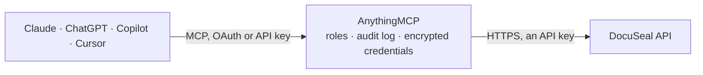

<!-- Generated by scripts/export-github-catalog.mjs in the anythingmcp-website repository. Do not edit by hand. -->

# DocuSeal MCP connector

Let your AI work with DocuSeal, the open-source e-signature platform (Cloud US or EU, or self-hosted): find templates, submissions and signers, check who has signed, get signed documents and … The AnythingMCP connector gives Claude, ChatGPT, Microsoft Copilot, Cursor and Gemini 21 MCP tools for DocuSeal: 9 read and 12 can change data.

**Category:** [E-Signature](../e-signature.md) · **Tools:** 21 · **Setup guide:** [anythingmcp.com](https://anythingmcp.com/guides/docuseal-to-mcp) · [Deutsch](https://anythingmcp.com/de/guides/docuseal-to-mcp) · [Italiano](https://anythingmcp.com/it/guides/docuseal-to-mcp) · [Español](https://anythingmcp.com/es/guides/docuseal-to-mcp) · [日本語](https://anythingmcp.com/ja/guides/docuseal-to-mcp) · [Русский](https://anythingmcp.com/ru/guides/docuseal-to-mcp) · [中文](https://anythingmcp.com/zh/guides/docuseal-to-mcp)

## Start without code

No installation and no terminal: AnythingMCP Cloud runs the DocuSeal connector for you, operated by helpcode.ai in Frankfurt, Germany.

1. **Click the button above** and create an account or sign in. The DocuSeal connector opens, ready to install.
2. **Paste the API key or token from your DocuSeal account.** Every click is in the [step-by-step guide](https://anythingmcp.com/guides/docuseal-to-mcp).
3. **Click Install.** AnythingMCP shows the address of your MCP server.
4. **Add that address to your assistant:** [Claude](https://anythingmcp.com/guides/connect-docuseal-to-claude) · [ChatGPT](https://anythingmcp.com/guides/connect-docuseal-to-chatgpt) · [Microsoft Copilot](https://anythingmcp.com/guides/connect-docuseal-to-copilot) · [Cursor](https://anythingmcp.com/guides/connect-docuseal-to-cursor) · [Gemini CLI](https://anythingmcp.com/guides/connect-docuseal-to-gemini) · [Meta Muse](https://anythingmcp.com/guides/connect-docuseal-to-muse).
5. **Ask your first question**, for example: *Show submission for invoice INV-2026-078 sent to finance@borealsolar.de*

Prefer help with the setup? [Talk to us](https://anythingmcp.com/contact).

## How it works

- **The AI client** speaks MCP (Streamable HTTP) to AnythingMCP and only sees tool names, descriptions and results. It never gets the DocuSeal credentials.
- **AnythingMCP** checks the client's role, builds the call from the tool definition, adds the credentials (an API key), calls DocuSeal, logs the call and returns the result.
- **DocuSeal** sees an ordinary API client with the rights of the account the credentials belong to.

## Tools

| Tool | What it does | Access |
|---|---|---|
| [`docuseal_list_templates`](#docuseal_list_templates) | List document templates, newest first: id, name, slug, folder_name, external_id, the roles of its submitters, its fields (name, type, role, required) and… | read |
| [`docuseal_get_template`](#docuseal_get_template) | Read one template: name, folder, roles (submitters with their uuid and name), fields (name, type, role, required, position), documents with download URLs,… | read |
| [`docuseal_list_submissions`](#docuseal_list_submissions) | List signature requests (submissions), newest first: id, name, status (pending, completed, declined, expired), template, source, created and completed time,… | read |
| [`docuseal_get_submission`](#docuseal_get_submission) | Read one submission: status, each submitter (id, email, name, role, status: awaiting, sent, opened, completed, declined; sent_at, opened_at, completed_at,… | read |
| [`docuseal_get_submission_documents`](#docuseal_get_submission_documents) | Download links of a submission's documents: the signed PDFs once completed, the partly filled ones before. | read |
| [`docuseal_list_submitters`](#docuseal_list_submitters) | List submitters (signers) across submissions, newest first: id, submission_id, email, name, phone, role, status, sent, opened and completed times, values… | read |
| [`docuseal_get_submitter`](#docuseal_get_submitter) | Read one submitter: email, name, role, status, sent, opened, completed or declined time and decline reason, the field values they entered, their documents… | read |
| [`docuseal_list_form_completed_events`](#docuseal_list_form_completed_events) | Completed-form events, newest first: one per signer who finished (event_type form.completed, timestamp, and the submitter with values, documents and audit… | read |
| [`docuseal_list_submission_completed_events`](#docuseal_list_submission_completed_events) | Completed-submission events, newest first: one per submission whose signers all finished (event_type submission.completed, timestamp, and the submission… | read |
| [`docuseal_create_submission`](#docuseal_create_submission) | Send a template for signature: creates a submission with one submitter per template role and, unless send_email is false, emails each signer their link (in… | write |
| [`docuseal_create_submissions_from_emails`](#docuseal_create_submissions_from_emails) | Quick send: one submission per email address for a single-signer template, invitations sent right away. | write |
| [`docuseal_create_submission_from_pdf`](#docuseal_create_submission_from_pdf) | Send a one-off PDF for signature without saving a template first: give the PDF (URL or Base64) with text tags or field positions, and the signers. | write |
| [`docuseal_update_submission`](#docuseal_update_submission) | Rename a submission, change its expiry date, or archive and unarchive it. | write |
| [`docuseal_archive_submission`](#docuseal_archive_submission) | Archive a submission: its signing links stop working. | write |
| [`docuseal_update_submitter`](#docuseal_update_submitter) | Change a submitter of a pending submission: correct name, email or phone, pre-fill or change field values, set metadata, re-send the invitation (send_email… | write |
| [`docuseal_create_template_from_pdf`](#docuseal_create_template_from_pdf) | Create a reusable template from one or more PDFs (URL or Base64). | write |
| [`docuseal_create_template_from_docx`](#docuseal_create_template_from_docx) | Create a reusable template from a Word DOCX file (URL or Base64), with fields from text tags such as {{Field;role=Signer;type=date}} or from positions. | write |
| [`docuseal_create_template_from_html`](#docuseal_create_template_from_html) | Create a template from HTML: DocuSeal renders it to PDF and turns <text-field>, <signature-field>, <date-field>, <checkbox-field> and similar tags into… | write |
| [`docuseal_clone_template`](#docuseal_clone_template) | Copy a template into a new one, optionally with a new name, folder and external id. | write |
| [`docuseal_update_template`](#docuseal_update_template) | Rename a template, move it to another folder, rename its roles, or archive and unarchive it. | write |
| [`docuseal_archive_template`](#docuseal_archive_template) | Archive a template so it can no longer be sent. | write |

## Tool reference

Every parameter as the AI client sees it in `tools/list`. Source: [`packages/backend/src/adapters/intl/docuseal.json`](../../../packages/backend/src/adapters/intl/docuseal.json).

### `docuseal_list_templates`

List document templates, newest first: id, name, slug, folder_name, external_id, the roles of its submitters, its fields (name, type, role, required) and documents. Filter by name (q), folder or external id.

**Access:** read · **Call:** `GET /templates`

| Parameter | Type | Required | Description |
|---|---|---|---|
| `q` | string | no | Only templates whose name contains this text. |
| `slug` | string | no | Only the template with this slug. |
| `external_id` | string | no | Only templates with this external id (set when created through the API or the embedded builder). |
| `folder` | string | no | Only templates in this folder (folder name). |
| `archived` | boolean | no | true lists archived templates instead of active ones. |
| `limit` | integer | no | Number of templates to return, 1 to 100 (default 10). |
| `after` | integer | no | Paging: pass pagination.next of the previous answer to get the next (older) page. Lists are newest first. |
| `before` | integer | no | Only templates with an id greater than this one (newer). |

### `docuseal_get_template`

Read one template: name, folder, roles (submitters with their uuid and name), fields (name, type, role, required, position), documents with download URLs, author and dates. Field names are the keys for pre-filled values.

**Access:** read · **Call:** `GET /templates/{template_id}`

| Parameter | Type | Required | Description |
|---|---|---|---|
| `template_id` | integer | yes | Template id, from docuseal_list_templates. |

### `docuseal_list_submissions`

List signature requests (submissions), newest first: id, name, status (pending, completed, declined, expired), template, source, created and completed time, audit_log_url, combined_document_url and each submitter with email, role and status. Filter by template, status, folder or signer (q).

**Access:** read · **Call:** `GET /submissions`

| Parameter | Type | Required | Description |
|---|---|---|---|
| `template_id` | integer | no | Only submissions of this template. |
| `status` | `pending` \| `completed` \| `declined` \| `expired` | no | Only submissions in this state. |
| `q` | string | no | Only submissions with a submitter whose name, email or phone contains this text. |
| `slug` | string | no | Only the submission with this slug. |
| `template_folder` | string | no | Only submissions of templates in this folder. |
| `archived` | boolean | no | true returns only archived submissions, false only active ones. |
| `limit` | integer | no | Number of submissions to return, 1 to 100 (default 10). |
| `after` | integer | no | Paging: pass pagination.next of the previous answer to get the next (older) page. Lists are newest first. |
| `before` | integer | no | Only submissions with an id greater than this one (newer). |

### `docuseal_get_submission`

Read one submission: status, each submitter (id, email, name, role, status: awaiting, sent, opened, completed, declined; sent_at, opened_at, completed_at, declined_at, the values they entered, embed_src signing link), the event history (submission_events), the signed documents and the audit log URL.

**Access:** read · **Call:** `GET /submissions/{submission_id}`

| Parameter | Type | Required | Description |
|---|---|---|---|
| `submission_id` | integer | yes | Submission id, from docuseal_list_submissions or the submission_id of a submitter. |

### `docuseal_get_submission_documents`

Download links of a submission's documents: the signed PDFs once completed, the partly filled ones before. merge=true returns one combined PDF. The links expire after a while; download them soon.

**Access:** read · **Call:** `GET /submissions/{submission_id}/documents`

| Parameter | Type | Required | Description |
|---|---|---|---|
| `submission_id` | integer | yes | Submission id, from docuseal_list_submissions or the submission_id of a submitter. |
| `merge` | boolean | no | true merges all documents into one PDF. |

### `docuseal_list_submitters`

List submitters (signers) across submissions, newest first: id, submission_id, email, name, phone, role, status, sent, opened and completed times, values and metadata. Filter by submission, signer text (q), external id or completion date.

**Access:** read · **Call:** `GET /submitters`

| Parameter | Type | Required | Description |
|---|---|---|---|
| `submission_id` | integer | no | Only submitters of this submission. |
| `q` | string | no | Only submitters whose name, email or phone contains this text. |
| `slug` | string | no | Only the submitter with this slug. |
| `external_id` | string | no | Only submitters with this external id. |
| `completed_after` | string | no | Only submitters who completed after this date and time, e.g. 2026-10-01 00:00:00 UTC. |
| `completed_before` | string | no | Only submitters who completed before this date and time. |
| `limit` | integer | no | Number of submitters to return, 1 to 100 (default 10). |
| `after` | integer | no | Paging: pass pagination.next of the previous answer to get the next (older) page. Lists are newest first. |
| `before` | integer | no | Only submitters with an id greater than this one (newer). |

### `docuseal_get_submitter`

Read one submitter: email, name, role, status, sent, opened, completed or declined time and decline reason, the field values they entered, their documents and the embed_src signing link.

**Access:** read · **Call:** `GET /submitters/{submitter_id}`

| Parameter | Type | Required | Description |
|---|---|---|---|
| `submitter_id` | integer | yes | Submitter id, from docuseal_get_submission (submitters[].id) or docuseal_list_submitters. |

### `docuseal_list_form_completed_events`

Completed-form events, newest first: one per signer who finished (event_type form.completed, timestamp, and the submitter with values, documents and audit log), the same data a form.completed webhook carries. Use it to catch up on signatures since a time. Paged by completion time: pass pagination.next as after.

**Access:** read · **Call:** `GET /events/form/completed`

| Parameter | Type | Required | Description |
|---|---|---|---|
| `limit` | integer | no | Number of events (default 10, max 100). |
| `after` | integer | no | Only events completed before this Unix time in seconds (pass pagination.next for the next, older page). |
| `before` | integer | no | Only events completed after this Unix time in seconds. |

### `docuseal_list_submission_completed_events`

Completed-submission events, newest first: one per submission whose signers all finished (event_type submission.completed, timestamp, and the submission with submitters, documents and audit log). Paged by completion time: pass pagination.next as after.

**Access:** read · **Call:** `GET /events/submission/completed`

| Parameter | Type | Required | Description |
|---|---|---|---|
| `limit` | integer | no | Number of events (default 10, max 100). |
| `after` | integer | no | Only events completed before this Unix time in seconds (pass pagination.next for the next, older page). |
| `before` | integer | no | Only events completed after this Unix time in seconds. |

### `docuseal_create_submission`

Send a template for signature: creates a submission with one submitter per template role and, unless send_email is false, emails each signer their link (in order, or all at once with order random). Pre-fill fields with values. Returns the submitters with id, status and embed_src signing link. Confirm signers and template with the user first.

**Access:** write · **Call:** `POST /submissions`

| Parameter | Type | Required | Description |
|---|---|---|---|
| `template_id` | integer | yes | Template id, from docuseal_list_templates. |
| `submitters` | object[] | yes | Signers, one per template role, e.g. [{"role": "First Party", "email": "anna@example.com", "name": "Anna", "values": {"Company": "ACME"}}]. Each may set email, phone, name, role, values (pre-filled fields by field name), external_id, metadata, send_email, send_sms, completed (true signs automatically), order, require_email_2fa, message, fields (per-field settings: readonly, required, default_value). |
| `send_email` | boolean | no | false creates the request without emailing the signers (share the embed_src links yourself). Default true. |
| `send_sms` | boolean | no | true also invites signers by SMS (phone required; paid feature). |
| `order` | `preserved` \| `random` | no | preserved (default) signs in role order, one after the other; random lets everyone sign at the same time. |
| `completed_redirect_url` | string | no | URL the signer is sent to after signing. |
| `bcc_completed` | string | no | Email address that gets a BCC of the signed documents. |
| `reply_to` | string | no | Reply-To address for the invitation emails. |
| `expire_at` | string | no | Expiry date and time after which nobody can sign, e.g. 2026-12-31 23:59:59 UTC. |
| `message` | object | no | Custom invitation email: {"subject": "...", "body": "..."}. The body may use {{submitter.link}}, {{template.name}}, {{account.name}} and other DocuSeal variables. |
| `variables` | object | no | Values for dynamic content variables of the template, e.g. {"customer_name": "ACME"}. |

### `docuseal_create_submissions_from_emails`

Quick send: one submission per email address for a single-signer template, invitations sent right away. Use docuseal_create_submission for several roles or pre-filled values.

**Access:** write · **Call:** `POST /submissions/emails`

| Parameter | Type | Required | Description |
|---|---|---|---|
| `template_id` | integer | yes | Template id, from docuseal_list_templates. |
| `emails` | string | yes | Comma-separated email addresses, e.g. anna@example.com, ben@example.com. |
| `send_email` | boolean | no | false creates the submissions without sending emails. Default true. |
| `message` | object | no | Custom invitation email: {"subject": "...", "body": "..."}. The body may use {{submitter.link}}, {{template.name}}, {{account.name}} and other DocuSeal variables. |

### `docuseal_create_submission_from_pdf`

Send a one-off PDF for signature without saving a template first: give the PDF (URL or Base64) with text tags or field positions, and the signers. Emails go out unless send_email is false. Confirm with the user first.

**Access:** write · **Call:** `POST /submissions/pdf`

| Parameter | Type | Required | Description |
|---|---|---|---|
| `name` | string | no | Name of the submission. |
| `documents` | object[] | yes | Documents, each {"name": "...", "file": "<PDF URL or Base64 content>"}; optional "fields" with exact positions. Fields can also be text tags inside the document, e.g. {{Name;role=Signer;type=text}} and {{Sign;role=Signer;type=signature}}. |
| `submitters` | object[] | yes | Signers, one per template role, e.g. [{"role": "First Party", "email": "anna@example.com", "name": "Anna", "values": {"Company": "ACME"}}]. Each may set email, phone, name, role, values (pre-filled fields by field name), external_id, metadata, send_email, send_sms, completed (true signs automatically), order, require_email_2fa, message, fields (per-field settings: readonly, required, default_value). |
| `send_email` | boolean | no | false creates the request without emailing the signers (share the embed_src links yourself). Default true. |
| `send_sms` | boolean | no | true also invites signers by SMS (phone required; paid feature). |
| `order` | `preserved` \| `random` | no | preserved (default) signs in role order, one after the other; random lets everyone sign at the same time. |
| `completed_redirect_url` | string | no | URL the signer is sent to after signing. |
| `bcc_completed` | string | no | Email address that gets a BCC of the signed documents. |
| `reply_to` | string | no | Reply-To address for the invitation emails. |
| `expire_at` | string | no | Expiry date and time after which nobody can sign, e.g. 2026-12-31 23:59:59 UTC. |
| `message` | object | no | Custom invitation email: {"subject": "...", "body": "..."}. The body may use {{submitter.link}}, {{template.name}}, {{account.name}} and other DocuSeal variables. |
| `flatten` | boolean | no | true removes PDF form fields from the documents. |
| `merge_documents` | boolean | no | true merges several documents into one PDF. |
| `remove_tags` | boolean | no | true removes the {{text tags}} from the document (default true). |

### `docuseal_update_submission`

Rename a submission, change its expiry date, or archive and unarchive it.

**Access:** write · **Call:** `PUT /submissions/{submission_id}`

| Parameter | Type | Required | Description |
|---|---|---|---|
| `submission_id` | integer | yes | Submission id, from docuseal_list_submissions or the submission_id of a submitter. |
| `name` | string | no | New name. |
| `expire_at` | string | no | New expiry date and time, e.g. 2026-12-31 23:59:59 UTC. |
| `archived` | boolean | no | true archives, false restores the submission. |

### `docuseal_archive_submission`

Archive a submission: its signing links stop working. It can be restored with docuseal_update_submission (archived false). Confirm with the user first.

**Access:** write · **Call:** `DELETE /submissions/{submission_id}`

| Parameter | Type | Required | Description |
|---|---|---|---|
| `submission_id` | integer | yes | Submission id, from docuseal_list_submissions or the submission_id of a submitter. |

### `docuseal_update_submitter`

Change a submitter of a pending submission: correct name, email or phone, pre-fill or change field values, set metadata, re-send the invitation (send_email true), or sign on their behalf (completed true). Confirm with the user first.

**Access:** write · **Call:** `PUT /submitters/{submitter_id}`

| Parameter | Type | Required | Description |
|---|---|---|---|
| `submitter_id` | integer | yes | Submitter id, from docuseal_get_submission (submitters[].id) or docuseal_list_submitters. |
| `name` | string | no | New name. |
| `email` | string | no | New email address. |
| `phone` | string | no | New phone number in international format, e.g. +491701234567. |
| `values` | object | no | Field values by field name, e.g. {"Company": "ACME"}. |
| `external_id` | string | no | Your own id for this submitter. |
| `metadata` | object | no | Your own data stored with the submitter. |
| `send_email` | boolean | no | true sends the invitation email again. |
| `send_sms` | boolean | no | true sends the invitation SMS again. |
| `reply_to` | string | no | Reply-To address for the email. |
| `completed` | boolean | no | true marks the submitter as completed and signs automatically. |
| `completed_redirect_url` | string | no | URL the signer is sent to after signing. |
| `require_email_2fa` | boolean | no | true asks the signer for a one-time code sent by email. |
| `message` | object | no | Custom invitation email: {"subject": "...", "body": "..."}. The body may use {{submitter.link}}, {{template.name}}, {{account.name}} and other DocuSeal variables. |
| `fields` | object[] | no | Per-field settings, e.g. [{"name": "Amount", "default_value": "100", "readonly": true}]. |

### `docuseal_create_template_from_pdf`

Create a reusable template from one or more PDFs (URL or Base64). Fields come from text tags in the PDF ({{Field;role=Signer;type=signature}}) or from exact field positions. Returns the template with its id, roles and fields.

**Access:** write · **Call:** `POST /templates/pdf`

| Parameter | Type | Required | Description |
|---|---|---|---|
| `name` | string | no | Template name. |
| `documents` | object[] | yes | Documents, each {"name": "...", "file": "<PDF URL or Base64 content>"}; optional "fields" with exact positions. Fields can also be text tags inside the document, e.g. {{Name;role=Signer;type=text}} and {{Sign;role=Signer;type=signature}}. |
| `folder_name` | string | no | Folder to put the template in. |
| `external_id` | string | no | Your own id for the template. An existing template with the same external id gets the new PDF instead of a new template being created. |
| `shared_link` | boolean | no | true (the default) lets anyone with the template link start a submission; false keeps it private. |
| `flatten` | boolean | no | true removes PDF form fields from the documents. |
| `remove_tags` | boolean | no | true removes the {{text tags}} from the document (default true). |

### `docuseal_create_template_from_docx`

Create a reusable template from a Word DOCX file (URL or Base64), with fields from text tags such as {{Field;role=Signer;type=date}} or from positions. Dynamic documents can use [[variables]].

**Access:** write · **Call:** `POST /templates/docx`

| Parameter | Type | Required | Description |
|---|---|---|---|
| `name` | string | no | Template name. |
| `documents` | object[] | yes | Documents, each {"name": "...", "file": "<DOCX URL or Base64 content>"}; optional "fields" with exact positions. Fields can also be text tags inside the document, e.g. {{Name;role=Signer;type=text}} and {{Sign;role=Signer;type=signature}}. |
| `folder_name` | string | no | Folder to put the template in. |
| `external_id` | string | no | Your own id for the template. |
| `shared_link` | boolean | no | true (the default) lets anyone with the template link start a submission; false keeps it private. |

### `docuseal_create_template_from_html`

Create a template from HTML: DocuSeal renders it to PDF and turns <text-field>, <signature-field>, <date-field>, <checkbox-field> and similar tags into fillable fields, e.g. <signature-field name="Signature" role="Signer"></signature-field>.

**Access:** write · **Call:** `POST /templates/html`

| Parameter | Type | Required | Description |
|---|---|---|---|
| `html` | string | yes | The HTML of the document, with field tags. |
| `name` | string | no | Template name. |
| `html_header` | string | no | HTML repeated as header on every page. |
| `html_footer` | string | no | HTML repeated as footer on every page. |
| `size` | `Letter` \| `Legal` \| `Tabloid` \| `Ledger` \| `A0` \| `A1` \| `A2` \| `A3` \| `A4` \| `A5` \| `A6` | no | Page size (default Letter). |
| `folder_name` | string | no | Folder to put the template in. |
| `external_id` | string | no | Your own id for the template. |
| `shared_link` | boolean | no | true (the default) lets anyone with the template link start a submission; false keeps it private. |

### `docuseal_clone_template`

Copy a template into a new one, optionally with a new name, folder and external id. Returns the new template.

**Access:** write · **Call:** `POST /templates/{template_id}/clone`

| Parameter | Type | Required | Description |
|---|---|---|---|
| `template_id` | integer | yes | Template id, from docuseal_list_templates. |
| `name` | string | no | Name of the copy. |
| `folder_name` | string | no | Folder for the copy. |
| `external_id` | string | no | Your own id for the copy. |

### `docuseal_update_template`

Rename a template, move it to another folder, rename its roles, or archive and unarchive it.

**Access:** write · **Call:** `PUT /templates/{template_id}`

| Parameter | Type | Required | Description |
|---|---|---|---|
| `template_id` | integer | yes | Template id, from docuseal_list_templates. |
| `name` | string | no | New name. |
| `folder_name` | string | no | Folder to move the template to (created if missing). |
| `roles` | string[] | no | New role names in the order of the template's submitters, e.g. ["Customer", "Company"]. |
| `archived` | boolean | no | true archives, false restores the template. |

### `docuseal_archive_template`

Archive a template so it can no longer be sent. Existing submissions stay. It can be restored with docuseal_update_template (archived false). Confirm with the user first.

**Access:** write · **Call:** `DELETE /templates/{template_id}`

| Parameter | Type | Required | Description |
|---|---|---|---|
| `template_id` | integer | yes | Template id, from docuseal_list_templates. |

## Run it yourself

AnythingMCP is open source (AGPL-3.0). [Run it with Docker](../../../README.md#run-it-yourself), open **Connectors → Store**, pick **DocuSeal** and enter `DOCUSEAL_API_URL`, `DOCUSEAL_API_KEY`, then add your MCP server URL to the AI client.

[← E-Signature connectors](../e-signature.md) · [All categories](../README.md)
