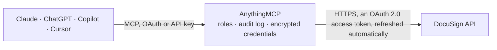

<!-- Generated by scripts/export-github-catalog.mjs in the anythingmcp-website repository. Do not edit by hand. -->

# DocuSign MCP connector

Let your AI work with DocuSign eSignature: find envelopes and check who has signed, read recipients, documents, form data and the audit trail, send documents or templates for signature, resend or … The AnythingMCP connector gives Claude, ChatGPT, Microsoft Copilot, Cursor and Gemini 17 MCP tools for DocuSign: 11 read and 6 can change data.

**Category:** [E-Signature](../e-signature.md) · **Tools:** 17 · **Setup guide:** [anythingmcp.com](https://anythingmcp.com/guides/docusign-to-mcp) · [Deutsch](https://anythingmcp.com/de/guides/docusign-to-mcp) · [Italiano](https://anythingmcp.com/it/guides/docusign-to-mcp) · [Español](https://anythingmcp.com/es/guides/docusign-to-mcp) · [日本語](https://anythingmcp.com/ja/guides/docusign-to-mcp) · [Русский](https://anythingmcp.com/ru/guides/docusign-to-mcp) · [中文](https://anythingmcp.com/zh/guides/docusign-to-mcp)

## Start without code

No installation and no terminal: AnythingMCP Cloud runs the DocuSign connector for you, operated by helpcode.ai in Frankfurt, Germany.

1. **Click the button above** and create an account or sign in. The DocuSign connector opens, ready to install.
2. **Sign in with your DocuSign account** when AnythingMCP asks. The first time, an admin creates a small app in the DocuSign developer console. Every click is in the [step-by-step guide](https://anythingmcp.com/guides/docusign-to-mcp).
3. **Click Install.** AnythingMCP shows the address of your MCP server.
4. **Add that address to your assistant:** [Claude](https://anythingmcp.com/guides/connect-docusign-to-claude) · [ChatGPT](https://anythingmcp.com/guides/connect-docusign-to-chatgpt) · [Microsoft Copilot](https://anythingmcp.com/guides/connect-docusign-to-copilot) · [Cursor](https://anythingmcp.com/guides/connect-docusign-to-cursor) · [Gemini CLI](https://anythingmcp.com/guides/connect-docusign-to-gemini) · [Meta Muse](https://anythingmcp.com/guides/connect-docusign-to-muse).
5. **Ask your first question**, for example: *What's the signing status and recipients for envelope 0142A3 sent for Invoice INV-2026-114?*

Prefer help with the setup? [Talk to us](https://anythingmcp.com/contact).

## How it works

- **The AI client** speaks MCP (Streamable HTTP) to AnythingMCP and only sees tool names, descriptions and results. It never gets the DocuSign credentials.
- **AnythingMCP** checks the client's role, builds the call from the tool definition, adds the credentials (an OAuth 2.0 access token, refreshed automatically), calls DocuSign, logs the call and returns the result.
- **DocuSign** sees an ordinary API client with the rights of the account the credentials belong to.

## Tools

| Tool | What it does | Access |
|---|---|---|
| [`docusign_get_user_info`](#docusign_get_user_info) | Read who signed in and which DocuSign accounts they can use: name, email, and for each account account_id, account_name, is_default and base_uri. | read |
| [`docusign_get_account`](#docusign_get_account) | Read the connected account: name, plan, billing period, envelopes sent this period and allowed, and the account's base URL. | read |
| [`docusign_list_envelopes`](#docusign_list_envelopes) | List envelopes changed since from_date, with id, status, subject, sender, dates and (optionally) recipients. | read |
| [`docusign_get_envelope`](#docusign_get_envelope) | Read one envelope: status, subject, sender, sent, delivered and completed times, void reason, and with include its recipients, documents and fields. | read |
| [`docusign_create_envelope_from_template`](#docusign_create_envelope_from_template) | Create an envelope from a template, filling each template role with a person. | write |
| [`docusign_create_envelope_with_document`](#docusign_create_envelope_with_document) | Create an envelope from documents passed as base64 and the recipients who must sign them. | write |
| [`docusign_send_draft_envelope`](#docusign_send_draft_envelope) | Send a draft envelope: DocuSign emails the signing request to its recipients. | write |
| [`docusign_void_envelope`](#docusign_void_envelope) | Void an envelope that is out for signature (sent or delivered): it can no longer be signed and every recipient is told why. | write |
| [`docusign_resend_envelope`](#docusign_resend_envelope) | Email the signing request again to the recipients who have not finished yet. | write |
| [`docusign_move_envelope_to_trash`](#docusign_move_envelope_to_trash) | Move envelopes to the Deleted folder (recycle bin). | write |
| [`docusign_list_recipients`](#docusign_list_recipients) | List an envelope's recipients by type (signers, carbonCopies, ...) with routing order, status (created, sent, delivered, completed, declined), signed and… | read |
| [`docusign_list_envelope_documents`](#docusign_list_envelope_documents) | List an envelope's documents: documentId, name, type, page count and order. | read |
| [`docusign_download_document`](#docusign_download_document) | Download one document of an envelope as base64 text (documentBase64): a documentId from docusign_list_envelope_documents, "combined" for all documents as… | read |
| [`docusign_list_audit_events`](#docusign_list_audit_events) | Read an envelope's audit trail: each event (created, sent, viewed, signed, voided, ...) with user, time, client IP and status. | read |
| [`docusign_get_form_data`](#docusign_get_form_data) | Read the values entered in an envelope's fields, per recipient. | read |
| [`docusign_list_templates`](#docusign_list_templates) | List templates with id, name, description, folder, owner, last used and modified dates; optionally with their recipients (roles) and documents. | read |
| [`docusign_get_template`](#docusign_get_template) | Read one template: subject, message, documents and recipients with their role names (needed for docusign_create_envelope_from_template), routing order and… | read |

## Tool reference

Every parameter as the AI client sees it in `tools/list`. Source: [`packages/backend/src/adapters/intl/docusign.json`](../../../packages/backend/src/adapters/intl/docusign.json).

### `docusign_get_user_info`

Read who signed in and which DocuSign accounts they can use: name, email, and for each account account_id, account_name, is_default and base_uri. Use it to check DOCUSIGN_ACCOUNT_ID and DOCUSIGN_BASE_URI.

**Access:** read · **Call:** `GET {DOCUSIGN_AUTH_URL}/oauth/userinfo`

No parameters.

### `docusign_get_account`

Read the connected account: name, plan, billing period, envelopes sent this period and allowed, and the account's base URL. Optionally with its settings.

**Access:** read

| Parameter | Type | Required | Description |
|---|---|---|---|
| `include_account_settings` | boolean | no | true to also return the account settings. |

### `docusign_list_envelopes`

List envelopes changed since from_date, with id, status, subject, sender, dates and (optionally) recipients. Returns envelopes, resultSetSize, totalSetSize and paging positions.

**Access:** read · **Call:** `GET /envelopes`

| Parameter | Type | Required | Description |
|---|---|---|---|
| `from_date` | string | no | Changed on or after this date, e.g. "2026-09-01" or "2026-09-01T00:00:00Z". Required unless envelope_ids is given. |
| `to_date` | string | no | Changed before this date. |
| `status` | string | no | Comma-separated: created (drafts), sent, delivered, signed, completed, declined, voided, or "any". |
| `search_text` | string | no | Free text in subject, sender or recipient names and emails. |
| `folder_ids` | string | no | Comma-separated folder ids or names: drafts, inbox, sentitems, recyclebin, awaiting_my_signature, completed, out_for_signature, waiting_for_others, expiring_soon. |
| `envelope_ids` | string | no | Comma-separated envelope ids to read instead of a date range. |
| `include` | string | no | Comma-separated extras: recipients, documents, custom_fields, folders. |
| `order_by` | string | no | Sort field, e.g. last_modified, created, sent, completed, status, subject. |
| `order` | `asc` \| `desc` | no | asc or desc. |
| `count` | integer | no | Envelopes per page (default 50 here, up to 1000). |
| `start_position` | integer | no | 0-based position of the first envelope, for paging. |

### `docusign_get_envelope`

Read one envelope: status, subject, sender, sent, delivered and completed times, void reason, and with include its recipients, documents and fields.

**Access:** read · **Call:** `GET /envelopes/{envelope_id}`

| Parameter | Type | Required | Description |
|---|---|---|---|
| `envelope_id` | string | yes | The envelope id (a GUID). |
| `include` | string | no | Comma-separated extras: recipients, documents, tabs, custom_fields, attachments, folders, workflow. |

### `docusign_create_envelope_from_template`

Create an envelope from a template, filling each template role with a person. Creates a DRAFT unless status is "sent", which emails the signers at once: confirm recipients and subject with the user before sending. Returns envelopeId and status.

**Access:** write · **Call:** `POST /envelopes`

| Parameter | Type | Required | Description |
|---|---|---|---|
| `template_id` | string | yes | The template id (docusign_list_templates). |
| `template_roles` | object[] | yes | One entry per template role, e.g. [{"roleName": "Signer", "name": "Ana Diaz", "email": "ana@example.com"}]. Role names must match the template exactly. Optional per role: routingOrder, tabs with prefilled values. |
| `email_subject` | string | no | Email subject; the template's subject is used when omitted. |
| `email_blurb` | string | no | Email message text. |
| `status` | `created` \| `sent` | no | "created" for a draft (default) or "sent" to send now. |

### `docusign_create_envelope_with_document`

Create an envelope from documents passed as base64 and the recipients who must sign them. Creates a DRAFT unless status is "sent", which emails the signers at once: confirm recipients, documents and subject with the user before sending. Returns envelopeId and status.

**Access:** write · **Call:** `POST /envelopes`

| Parameter | Type | Required | Description |
|---|---|---|---|
| `email_subject` | string | yes | Email subject, e.g. "Please sign: service agreement". |
| `email_blurb` | string | no | Email message text. |
| `documents` | object[] | yes | Documents, e.g. [{"documentId": "1", "name": "Agreement.pdf", "fileExtension": "pdf", "documentBase64": "JVBERi0..."}]. |
| `recipients` | object | yes | Recipients, e.g. {"signers": [{"recipientId": "1", "routingOrder": "1", "name": "Ana Diaz", "email": "ana@example.com", "tabs": {"signHereTabs": [{"anchorString": "/sig1/", "anchorUnits": "pixels", "anchorXOffset": "0", "anchorYOffset": "0"}]}}], "carbonCopies": [{"recipientId": "2", "routingOrder": "2", "name": "Office", "email": "office@example.com"}]}. A signer without tabs can sign anywhere (free-form). |
| `status` | `created` \| `sent` | no | "created" for a draft (default) or "sent" to send now. |

### `docusign_send_draft_envelope`

Send a draft envelope: DocuSign emails the signing request to its recipients. Confirm with the user first. Returns an update summary.

**Access:** write · **Call:** `PUT /envelopes/{envelope_id}`

| Parameter | Type | Required | Description |
|---|---|---|---|
| `envelope_id` | string | yes | The envelope id (a GUID). |

### `docusign_void_envelope`

Void an envelope that is out for signature (sent or delivered): it can no longer be signed and every recipient is told why. Cannot be undone: confirm the envelope and reason with the user first.

**Access:** write · **Call:** `PUT /envelopes/{envelope_id}`

| Parameter | Type | Required | Description |
|---|---|---|---|
| `envelope_id` | string | yes | The envelope id (a GUID). |
| `voided_reason` | string | yes | Why it is voided (sent to the recipients), up to 200 characters. |

### `docusign_resend_envelope`

Email the signing request again to the recipients who have not finished yet. Only for envelopes out for signature, not drafts, voided or completed ones. Confirm with the user first.

**Access:** write · **Call:** `PUT /envelopes/{envelope_id}`

| Parameter | Type | Required | Description |
|---|---|---|---|
| `envelope_id` | string | yes | The envelope id (a GUID). |

### `docusign_move_envelope_to_trash`

Move envelopes to the Deleted folder (recycle bin). Drafts are discarded; an envelope that was sent is VOIDED by this. Recoverable for 24 hours. Confirm with the user first.

**Access:** write · **Call:** `PUT /folders/recyclebin`

| Parameter | Type | Required | Description |
|---|---|---|---|
| `envelope_ids` | string[] | yes | Envelope ids to move. |

### `docusign_list_recipients`

List an envelope's recipients by type (signers, carbonCopies, ...) with routing order, status (created, sent, delivered, completed, declined), signed and declined times and decline reason, plus currentRoutingOrder.

**Access:** read · **Call:** `GET /envelopes/{envelope_id}/recipients`

| Parameter | Type | Required | Description |
|---|---|---|---|
| `envelope_id` | string | yes | The envelope id (a GUID). |
| `include_tabs` | boolean | no | true to include each recipient's fields and their values. |
| `include_extended` | boolean | no | true to include extended recipient details. |

### `docusign_list_envelope_documents`

List an envelope's documents: documentId, name, type, page count and order. The documentId is what docusign_download_document takes.

**Access:** read · **Call:** `GET /envelopes/{envelope_id}/documents`

| Parameter | Type | Required | Description |
|---|---|---|---|
| `envelope_id` | string | yes | The envelope id (a GUID). |

### `docusign_download_document`

Download one document of an envelope as base64 text (documentBase64): a documentId from docusign_list_envelope_documents, "combined" for all documents as one PDF, or "certificate" for the completion certificate. Large files come back truncated (about 1.5 MB); DocuSign allows only a few downloads of the same document per hour.

**Access:** read · **Call:** `GET /envelopes/{envelope_id}/documents/{document_id}`

| Parameter | Type | Required | Description |
|---|---|---|---|
| `envelope_id` | string | yes | The envelope id (a GUID). |
| `document_id` | string | yes | documentId, "combined" or "certificate". |
| `certificate` | boolean | no | With "combined": true to append the completion certificate. |

### `docusign_list_audit_events`

Read an envelope's audit trail: each event (created, sent, viewed, signed, voided, ...) with user, time, client IP and status.

**Access:** read · **Call:** `GET /envelopes/{envelope_id}/audit_events`

| Parameter | Type | Required | Description |
|---|---|---|---|
| `envelope_id` | string | yes | The envelope id (a GUID). |

### `docusign_get_form_data`

Read the values entered in an envelope's fields, per recipient. Needs the account setting that allows senders to download form data.

**Access:** read · **Call:** `GET /envelopes/{envelope_id}/form_data`

| Parameter | Type | Required | Description |
|---|---|---|---|
| `envelope_id` | string | yes | The envelope id (a GUID). |

### `docusign_list_templates`

List templates with id, name, description, folder, owner, last used and modified dates; optionally with their recipients (roles) and documents.

**Access:** read · **Call:** `GET /templates`

| Parameter | Type | Required | Description |
|---|---|---|---|
| `search_text` | string | no | Text in the template name or description (up to 48 characters). |
| `folder_ids` | string | no | Comma-separated folder ids. |
| `include` | string | no | Comma-separated extras: recipients, documents, folders, custom_fields, notifications. |
| `order_by` | `name` \| `modified` \| `used` | no | name, modified or used. |
| `order` | `asc` \| `desc` | no | asc or desc. |
| `count` | integer | no | Templates per page (default 50 here). |
| `start_position` | integer | no | 0-based position of the first template, for paging. |

### `docusign_get_template`

Read one template: subject, message, documents and recipients with their role names (needed for docusign_create_envelope_from_template), routing order and optionally fields.

**Access:** read · **Call:** `GET /templates/{template_id}`

| Parameter | Type | Required | Description |
|---|---|---|---|
| `template_id` | string | yes | The template id. |
| `include` | string | no | Comma-separated extras: tabs, documents, powerforms, favorite_template_status. |

## Run it yourself

AnythingMCP is open source (AGPL-3.0). [Run it with Docker](../../../README.md#run-it-yourself), open **Connectors → Store**, pick **DocuSign** and enter `DOCUSIGN_CLIENT_ID`, `DOCUSIGN_CLIENT_SECRET`, `DOCUSIGN_AUTH_URL`, `DOCUSIGN_BASE_URI`, `DOCUSIGN_ACCOUNT_ID`, then add your MCP server URL to the AI client.

[← E-Signature connectors](../e-signature.md) · [All categories](../README.md)
