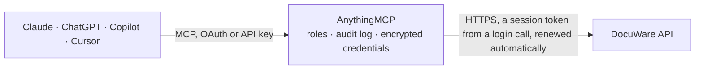

<!-- Generated by scripts/export-github-catalog.mjs in the anythingmcp-website repository. Do not edit by hand. -->

# DocuWare MCP connector

DocuWare document management: search file cabinets by field, read document metadata and index fields, list cabinets, dialogs and trays. The AnythingMCP connector gives Claude, ChatGPT, Microsoft Copilot, Cursor and Gemini 7 MCP tools for DocuWare, all read-only.

**Category:** [Document Management](../dms.md) · **Tools:** 7 · **Setup guide:** [anythingmcp.com](https://anythingmcp.com/guides/docuware-to-mcp) · [Deutsch](https://anythingmcp.com/de/guides/docuware-to-mcp) · [Italiano](https://anythingmcp.com/it/guides/docuware-to-mcp) · [Español](https://anythingmcp.com/es/guides/docuware-to-mcp) · [日本語](https://anythingmcp.com/ja/guides/docuware-to-mcp) · [Русский](https://anythingmcp.com/ru/guides/docuware-to-mcp) · [中文](https://anythingmcp.com/zh/guides/docuware-to-mcp)

## Start without code

No installation and no terminal: AnythingMCP Cloud runs the DocuWare connector for you, operated by helpcode.ai in Frankfurt, Germany.

1. **Click the button above** and create an account or sign in. The DocuWare connector opens, ready to install.
2. **Paste the API key or token from your DocuWare account.** Every click is in the [step-by-step guide](https://anythingmcp.com/guides/docuware-to-mcp).
3. **Click Install.** AnythingMCP shows the address of your MCP server.
4. **Add that address to your assistant:** [Claude](https://anythingmcp.com/guides/connect-docuware-to-claude) · [ChatGPT](https://anythingmcp.com/guides/connect-docuware-to-chatgpt) · [Microsoft Copilot](https://anythingmcp.com/guides/connect-docuware-to-copilot) · [Cursor](https://anythingmcp.com/guides/connect-docuware-to-cursor) · [Gemini CLI](https://anythingmcp.com/guides/connect-docuware-to-gemini) · [Meta Muse](https://anythingmcp.com/guides/connect-docuware-to-muse).
5. **Ask your first question**, for example: *Find invoice INV-2026-145 from SolTech Handels GmbH in our invoices cabinet and show its captured fields.*

Prefer help with the setup? [Talk to us](https://anythingmcp.com/contact).

## How it works

- **The AI client** speaks MCP (Streamable HTTP) to AnythingMCP and only sees tool names, descriptions and results. It never gets the DocuWare credentials.
- **AnythingMCP** checks the client's role, builds the call from the tool definition, adds the credentials (a session token from a login call, renewed automatically), calls DocuWare, logs the call and returns the result.
- **DocuWare** sees an ordinary API client with the rights of the account the credentials belong to.

## Tools

| Tool | What it does | Access |
|---|---|---|
| [`docuware_list_file_cabinets`](#docuware_list_file_cabinets) | List the file cabinets and document trays the logged-in user can reach, with their GUID, name and whether each is a basket. | read |
| [`docuware_get_file_cabinet`](#docuware_get_file_cabinet) | Read one file cabinet's definition: its index fields, their types and lengths, and the dialogs configured on it. | read |
| [`docuware_search_documents`](#docuware_search_documents) | Search one file cabinet by index field, e.g. `DOCUMENT_TYPE=Invoice`. | read |
| [`docuware_get_document`](#docuware_get_document) | Read one document's header: its id, store date, content type, page count and the section list. | read |
| [`docuware_get_document_fields`](#docuware_get_document_fields) | Read the index fields of one document with their values — the invoice number, supplier, amount and date DocuWare has captured for it. | read |
| [`docuware_list_dialogs`](#docuware_list_dialogs) | List the search, store and result dialogs configured on a file cabinet. | read |
| [`docuware_get_organization`](#docuware_get_organization) | Read the DocuWare organization the user belongs to: its name, GUID and the services available on this platform. | read |

## Tool reference

Every parameter as the AI client sees it in `tools/list`. Source: [`packages/backend/src/adapters/de/docuware.json`](../../../packages/backend/src/adapters/de/docuware.json).

### `docuware_list_file_cabinets`

List the file cabinets and document trays the logged-in user can reach, with their GUID, name and whether each is a basket. Start here — every other tool needs one of these ids.

**Access:** read · **Call:** `GET /FileCabinets`

No parameters.

### `docuware_get_file_cabinet`

Read one file cabinet's definition: its index fields, their types and lengths, and the dialogs configured on it. Needed before composing a search.

**Access:** read · **Call:** `GET /FileCabinets/{fileCabinetId}`

| Parameter | Type | Required | Description |
|---|---|---|---|
| `fileCabinetId` | string | yes | File cabinet GUID from docuware_list_file_cabinets. |

### `docuware_search_documents`

Search one file cabinet by index field, e.g. `DOCUMENT_TYPE=Invoice`. Full-text only works where the cabinet has a full-text index.

**Access:** read · **Call:** `GET /FileCabinets/{fileCabinetId}/Documents`

| Parameter | Type | Required | Description |
|---|---|---|---|
| `fileCabinetId` | string | yes | File cabinet GUID to search. |
| `q` | string | no | DocuWare query expression over index fields, e.g. COMPANY="Muster GmbH". |
| `count` | number | no | Maximum documents to return (DocuWare caps this at 10,000). |
| `start` | number | no | Documents to skip, for paging. |
| `sortOrder` | string | no | Field to sort by with Asc or Desc appended, e.g. `DWSTOREDATETIME Desc`. |

### `docuware_get_document`

Read one document's header: its id, store date, content type, page count and the section list.

**Access:** read · **Call:** `GET /FileCabinets/{fileCabinetId}/Documents/{docId}`

| Parameter | Type | Required | Description |
|---|---|---|---|
| `fileCabinetId` | string | yes | File cabinet GUID. |
| `docId` | number | yes | Numeric document id within that cabinet. |

### `docuware_get_document_fields`

Read the index fields of one document with their values — the invoice number, supplier, amount and date DocuWare has captured for it.

**Access:** read · **Call:** `GET /FileCabinets/{fileCabinetId}/Documents/{docId}/Fields`

| Parameter | Type | Required | Description |
|---|---|---|---|
| `fileCabinetId` | string | yes | File cabinet GUID. |
| `docId` | number | yes | Numeric document id. |

### `docuware_list_dialogs`

List the search, store and result dialogs configured on a file cabinet. Dialogs define which fields a user may search and see.

**Access:** read · **Call:** `GET /FileCabinets/{fileCabinetId}/Dialogs`

| Parameter | Type | Required | Description |
|---|---|---|---|
| `fileCabinetId` | string | yes | File cabinet GUID. |

### `docuware_get_organization`

Read the DocuWare organization the user belongs to: its name, GUID and the services available on this platform.

**Access:** read · **Call:** `GET /Organizations`

No parameters.

## Run it yourself

AnythingMCP is open source (AGPL-3.0). [Run it with Docker](../../../README.md#run-it-yourself), open **Connectors → Store**, pick **DocuWare** and enter `DOCUWARE_URL`, `DOCUWARE_USERNAME`, `DOCUWARE_PASSWORD`, `DOCUWARE_TOKEN_URL`, then add your MCP server URL to the AI client.

[← Document Management connectors](../dms.md) · [All categories](../README.md)
