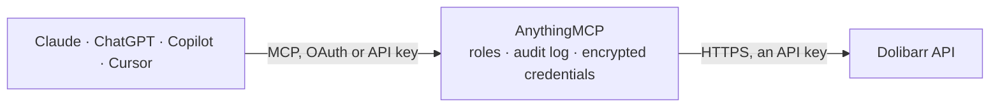

<!-- Generated by scripts/export-github-catalog.mjs in the anythingmcp-website repository. Do not edit by hand. -->

# Dolibarr MCP connector

Dolibarr open-source ERP and CRM: third parties, contacts, customer and supplier invoices, orders, proposals, products and stock. The AnythingMCP connector gives Claude, ChatGPT, Microsoft Copilot, Cursor and Gemini 10 MCP tools for Dolibarr, all read-only.

**Category:** [ERP](../erp.md) · **Tools:** 10 · **Setup guide:** [anythingmcp.com](https://anythingmcp.com/guides/dolibarr-to-mcp) · [Deutsch](https://anythingmcp.com/de/guides/dolibarr-to-mcp) · [Italiano](https://anythingmcp.com/it/guides/dolibarr-to-mcp) · [Español](https://anythingmcp.com/es/guides/dolibarr-to-mcp) · [日本語](https://anythingmcp.com/ja/guides/dolibarr-to-mcp) · [Русский](https://anythingmcp.com/ru/guides/dolibarr-to-mcp) · [中文](https://anythingmcp.com/zh/guides/dolibarr-to-mcp)

## Start without code

No installation and no terminal: AnythingMCP Cloud runs the Dolibarr connector for you, operated by helpcode.ai in Frankfurt, Germany.

1. **Click the button above** and create an account or sign in. The Dolibarr connector opens, ready to install.
2. **Paste the API key or token from your Dolibarr account.** Every click is in the [step-by-step guide](https://anythingmcp.com/guides/dolibarr-to-mcp).
3. **Click Install.** AnythingMCP shows the address of your MCP server.
4. **Add that address to your assistant:** [Claude](https://anythingmcp.com/guides/connect-dolibarr-to-claude) · [ChatGPT](https://anythingmcp.com/guides/connect-dolibarr-to-chatgpt) · [Microsoft Copilot](https://anythingmcp.com/guides/connect-dolibarr-to-copilot) · [Cursor](https://anythingmcp.com/guides/connect-dolibarr-to-cursor) · [Gemini CLI](https://anythingmcp.com/guides/connect-dolibarr-to-gemini) · [Meta Muse](https://anythingmcp.com/guides/connect-dolibarr-to-muse).
5. **Ask your first question**, for example: *Do we have customer invoice INV-2026-045 for Société Novaterra SARL and what's its status and amount?*

Prefer help with the setup? [Talk to us](https://anythingmcp.com/contact).

## How it works

- **The AI client** speaks MCP (Streamable HTTP) to AnythingMCP and only sees tool names, descriptions and results. It never gets the Dolibarr credentials.
- **AnythingMCP** checks the client's role, builds the call from the tool definition, adds the credentials (an API key), calls Dolibarr, logs the call and returns the result.
- **Dolibarr** sees an ordinary API client with the rights of the account the credentials belong to.

## Tools

| Tool | What it does | Access |
|---|---|---|
| [`dolibarr_get_status`](#dolibarr_get_status) | Read the Dolibarr version and API status of this installation. | read |
| [`dolibarr_list_thirdparties`](#dolibarr_list_thirdparties) | List third parties — Dolibarr's customers, suppliers and prospects — with their name, VAT number, address and customer/supplier flags. | read |
| [`dolibarr_get_thirdparty`](#dolibarr_get_thirdparty) | Read one third party in full: addresses, tax identifiers, payment terms, assigned sales representative and account balances. | read |
| [`dolibarr_list_invoices`](#dolibarr_list_invoices) | List customer invoices with their reference, date, third party, totals and status. | read |
| [`dolibarr_get_invoice`](#dolibarr_get_invoice) | Read one customer invoice in full: every line with quantity, unit price, discount and VAT, the totals, and the payments applied against it. | read |
| [`dolibarr_list_orders`](#dolibarr_list_orders) | List customer orders with their reference, date, third party, total and status, for the pipeline between proposal and invoice. | read |
| [`dolibarr_list_proposals`](#dolibarr_list_proposals) | List commercial proposals (devis) with their reference, date, third party, total and whether they have been signed. | read |
| [`dolibarr_list_supplier_invoices`](#dolibarr_list_supplier_invoices) | List supplier invoices with their reference, date, supplier, total and payment status — the payables side of the ledger. | read |
| [`dolibarr_list_products`](#dolibarr_list_products) | List products and services with their reference, label, sale and cost price, VAT rate and stock quantity. | read |
| [`dolibarr_get_product_stock`](#dolibarr_get_product_stock) | Read the per-warehouse stock of one product — the answer an availability question actually needs, rather than the cached total on the product record. | read |

## Tool reference

Every parameter as the AI client sees it in `tools/list`. Source: [`packages/backend/src/adapters/fr/dolibarr.json`](../../../packages/backend/src/adapters/fr/dolibarr.json).

### `dolibarr_get_status`

Read the Dolibarr version and API status of this installation. No permission needed — the fastest proof that the module is on and the key is accepted.

**Access:** read · **Call:** `GET /status`

No parameters.

### `dolibarr_list_thirdparties`

List third parties — Dolibarr's customers, suppliers and prospects — with their name, VAT number, address and customer/supplier flags.

**Access:** read · **Call:** `GET /thirdparties`

| Parameter | Type | Required | Description |
|---|---|---|---|
| `sortfield` | string | no | SQL field to sort by, e.g. t.nom. |
| `sortorder` | string | no | `ASC` or `DESC`. |
| `limit` | number | no | Rows per page (default 100). |
| `page` | number | no | Page number, starting at 0. |
| `sqlfilters` | string | no | Dolibarr filter expression, e.g. (t.nom:like:'%Dupont%'). |
| `mode` | number | no | 1 for customers only, 2 for prospects, 3 for neither, 4 for suppliers. |

### `dolibarr_get_thirdparty`

Read one third party in full: addresses, tax identifiers, payment terms, assigned sales representative and account balances.

**Access:** read · **Call:** `GET /thirdparties/{id}`

| Parameter | Type | Required | Description |
|---|---|---|---|
| `id` | number | yes | Numeric third-party id. |

### `dolibarr_list_invoices`

List customer invoices with their reference, date, third party, totals and status. Status 0 is draft, 1 validated, 2 paid, 3 abandoned.

**Access:** read · **Call:** `GET /invoices`

| Parameter | Type | Required | Description |
|---|---|---|---|
| `sortfield` | string | no | SQL field to sort by, e.g. t.datef. |
| `sortorder` | string | no | `ASC` or `DESC`. |
| `limit` | number | no | Rows per page. |
| `page` | number | no | Page number, starting at 0. |
| `thirdparty_ids` | string | no | Comma-separated third-party ids to restrict to. |
| `status` | string | no | Status filter: draft, unpaid, paid or cancelled. |
| `sqlfilters` | string | no | Dolibarr filter expression, e.g. (t.datef:>=:'2026-01-01'). |

### `dolibarr_get_invoice`

Read one customer invoice in full: every line with quantity, unit price, discount and VAT, the totals, and the payments applied against it.

**Access:** read · **Call:** `GET /invoices/{id}`

| Parameter | Type | Required | Description |
|---|---|---|---|
| `id` | number | yes | Numeric invoice id. |

### `dolibarr_list_orders`

List customer orders with their reference, date, third party, total and status, for the pipeline between proposal and invoice.

**Access:** read · **Call:** `GET /orders`

| Parameter | Type | Required | Description |
|---|---|---|---|
| `sortfield` | string | no | SQL field to sort by. |
| `sortorder` | string | no | `ASC` or `DESC`. |
| `limit` | number | no | Rows per page. |
| `page` | number | no | Page number, starting at 0. |
| `sqlfilters` | string | no | Dolibarr filter expression. |

### `dolibarr_list_proposals`

List commercial proposals (devis) with their reference, date, third party, total and whether they have been signed.

**Access:** read · **Call:** `GET /proposals`

| Parameter | Type | Required | Description |
|---|---|---|---|
| `limit` | number | no | Rows per page. |
| `page` | number | no | Page number, starting at 0. |
| `sqlfilters` | string | no | Dolibarr filter expression. |

### `dolibarr_list_supplier_invoices`

List supplier invoices with their reference, date, supplier, total and payment status — the payables side of the ledger.

**Access:** read · **Call:** `GET /supplierinvoices`

| Parameter | Type | Required | Description |
|---|---|---|---|
| `limit` | number | no | Rows per page. |
| `page` | number | no | Page number, starting at 0. |
| `sqlfilters` | string | no | Dolibarr filter expression. |

### `dolibarr_list_products`

List products and services with their reference, label, sale and cost price, VAT rate and stock quantity.

**Access:** read · **Call:** `GET /products`

| Parameter | Type | Required | Description |
|---|---|---|---|
| `limit` | number | no | Rows per page. |
| `page` | number | no | Page number, starting at 0. |
| `sqlfilters` | string | no | Dolibarr filter expression, e.g. (t.ref:like:'ART%'). |
| `mode` | number | no | 0 for all, 1 for products only, 2 for services only. |

### `dolibarr_get_product_stock`

Read the per-warehouse stock of one product — the answer an availability question actually needs, rather than the cached total on the product record.

**Access:** read · **Call:** `GET /products/{id}/stock`

| Parameter | Type | Required | Description |
|---|---|---|---|
| `id` | number | yes | Numeric product id. |

## Run it yourself

AnythingMCP is open source (AGPL-3.0). [Run it with Docker](../../../README.md#run-it-yourself), open **Connectors → Store**, pick **Dolibarr** and enter `DOLIBARR_URL`, `DOLIBARR_API_KEY`, then add your MCP server URL to the AI client.

[← ERP connectors](../erp.md) · [All categories](../README.md)
