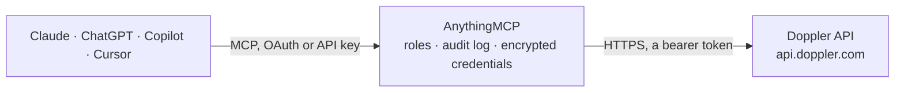

<!-- Generated by scripts/export-github-catalog.mjs in the anythingmcp-website repository. Do not edit by hand. -->

# Doppler MCP connector

Doppler secrets manager: projects, environments and configs, secret names and values (read, update, download), config change logs and rollback, workplace activity log, members, groups, service … The AnythingMCP connector gives Claude, ChatGPT, Microsoft Copilot, Cursor and Gemini 32 MCP tools for Doppler: 23 read and 9 can change data.

**Category:** [Infrastructure](../infrastructure.md) · **Tools:** 32 · **Setup guide:** [anythingmcp.com](https://anythingmcp.com/guides/doppler-to-mcp) · [Deutsch](https://anythingmcp.com/de/guides/doppler-to-mcp) · [Italiano](https://anythingmcp.com/it/guides/doppler-to-mcp) · [Español](https://anythingmcp.com/es/guides/doppler-to-mcp) · [日本語](https://anythingmcp.com/ja/guides/doppler-to-mcp) · [Русский](https://anythingmcp.com/ru/guides/doppler-to-mcp) · [中文](https://anythingmcp.com/zh/guides/doppler-to-mcp)

## Start without code

No installation and no terminal: AnythingMCP Cloud runs the Doppler connector for you, operated by helpcode.ai in Frankfurt, Germany.

1. **Click the button above** and create an account or sign in. The Doppler connector opens, ready to install.
2. **Paste the API key or token from your Doppler account.** Every click is in the [step-by-step guide](https://anythingmcp.com/guides/doppler-to-mcp).
3. **Click Install.** AnythingMCP shows the address of your MCP server.
4. **Add that address to your assistant:** [Claude](https://anythingmcp.com/guides/connect-doppler-to-claude) · [ChatGPT](https://anythingmcp.com/guides/connect-doppler-to-chatgpt) · [Microsoft Copilot](https://anythingmcp.com/guides/connect-doppler-to-copilot) · [Cursor](https://anythingmcp.com/guides/connect-doppler-to-cursor) · [Gemini CLI](https://anythingmcp.com/guides/connect-doppler-to-gemini) · [Meta Muse](https://anythingmcp.com/guides/connect-doppler-to-muse).
5. **Ask your first question**, for example: *List the secret names in project billing-project's prd root config named prd.*

Prefer help with the setup? [Talk to us](https://anythingmcp.com/contact).

## How it works

- **The AI client** speaks MCP (Streamable HTTP) to AnythingMCP and only sees tool names, descriptions and results. It never gets the Doppler credentials.
- **AnythingMCP** checks the client's role, builds the call from the tool definition, adds the credentials (a bearer token), calls Doppler, logs the call and returns the result.
- **Doppler** sees an ordinary API client with the rights of the account the credentials belong to.

## Tools

| Tool | What it does | Access |
|---|---|---|
| [`doppler_get_me`](#doppler_get_me) | Who the token belongs to: token type (personal, service, service_account, cli), name, token preview, creation and last-seen time, and the workplace slug and… | read |
| [`doppler_get_workplace`](#doppler_get_workplace) | The workplace (organisation) the token belongs to: slug, name, billing and security email. | read |
| [`doppler_list_workplace_users`](#doppler_list_workplace_users) | Members of the workplace with their user id, email, name, workplace role and access level. | read |
| [`doppler_list_groups`](#doppler_list_groups) | Groups of the workplace with their slug, name, default project role and members. | read |
| [`doppler_list_service_accounts`](#doppler_list_service_accounts) | Service accounts of the workplace: slug, name, workplace role and creation time. | read |
| [`doppler_list_projects`](#doppler_list_projects) | Projects the token can see: slug (used as `project` everywhere else), name, description and creation time. | read |
| [`doppler_get_project`](#doppler_get_project) | One project by its slug: slug, name, description and creation time, without its configs or secrets. | read |
| [`doppler_list_project_members`](#doppler_list_project_members) | Who has access to a project: members of type workplace_user, group, service_account or invite, with their project role and the environments they can reach. | read |
| [`doppler_list_environments`](#doppler_list_environments) | Environments of a project (e.g. dev, stg, prd): slug, name, whether personal configs are on, and creation time. | read |
| [`doppler_get_environment`](#doppler_get_environment) | One environment of a project by its slug: name, slug, whether personal configs are on, and creation time. | read |
| [`doppler_list_configs`](#doppler_list_configs) | Configs of a project, optionally of one environment: name, environment, whether it is a root config, locked, inheritable, and when its secrets were last… | read |
| [`doppler_get_config`](#doppler_get_config) | One config: name, environment, root or branch, locked, inheritable, the configs it inherits from, creation time and last fetch. | read |
| [`doppler_list_secret_names`](#doppler_list_secret_names) | The NAMES of the secrets in a config, without any value. | read |
| [`doppler_list_secrets`](#doppler_list_secrets) | READS SECRET VALUES: every secret of a config (or the ones named in `secrets`) with its raw value, computed value (references resolved), note and visibility. | read |
| [`doppler_get_secret`](#doppler_get_secret) | READS A SECRET VALUE: one secret of a config with its raw value, computed value, note, visibility and value type. | read |
| [`doppler_download_secrets`](#doppler_download_secrets) | READS SECRET VALUES: the computed values of a config as one file, in JSON (default, a NAME to value object), .env, YAML, Docker or .NET format. | read |
| [`doppler_list_config_logs`](#doppler_list_config_logs) | Change history of a config, newest first: log id, text, who made the change, when, and whether it was a rollback. | read |
| [`doppler_get_config_log`](#doppler_get_config_log) | One entry of a config's change history, with the list of secret names added, changed and removed. | read |
| [`doppler_list_activity_logs`](#doppler_list_activity_logs) | Workplace audit trail, newest first: who did what to which project, environment or config, and when. | read |
| [`doppler_get_activity_log`](#doppler_get_activity_log) | One workplace activity log entry by id: text, user, project, environment, config and time of the action. | read |
| [`doppler_list_integrations`](#doppler_list_integrations) | Integrations of the workplace (AWS Secrets Manager, GitHub, Vercel, Kubernetes and others): slug, name, type, kind and whether it is enabled, with its syncs. | read |
| [`doppler_get_integration`](#doppler_get_integration) | One integration with its syncs (which config is pushed where). | read |
| [`doppler_list_service_tokens`](#doppler_list_service_tokens) | Service tokens of a config: name, slug, access (read or read/write), creation and expiry time. | read |
| [`doppler_create_project`](#doppler_create_project) | Create a project. | write |
| [`doppler_update_project`](#doppler_update_project) | Rename a project or change its description. | write |
| [`doppler_create_environment`](#doppler_create_environment) | Add an environment to a project, e.g. qa. | write |
| [`doppler_create_config`](#doppler_create_config) | Create an empty branch config in an environment. | write |
| [`doppler_clone_config`](#doppler_clone_config) | Create a branch config as a copy of another config, secrets included. | write |
| [`doppler_update_secrets`](#doppler_update_secrets) | Create or overwrite secrets in a config. | write |
| [`doppler_update_secret_note`](#doppler_update_secret_note) | Set the note on a secret. | write |
| [`doppler_rollback_config_log`](#doppler_rollback_config_log) | Restore a config's secrets to the state before the change of one log entry. | write |
| [`doppler_delete_secret`](#doppler_delete_secret) | Delete one secret from a config. | write |

## Tool reference

Every parameter as the AI client sees it in `tools/list`. Source: [`packages/backend/src/adapters/intl/doppler.json`](../../../packages/backend/src/adapters/intl/doppler.json).

### `doppler_get_me`

Who the token belongs to: token type (personal, service, service_account, cli), name, token preview, creation and last-seen time, and the workplace slug and name. Works with every token type; use it to check the connection.

**Access:** read · **Call:** `GET /v3/me`

No parameters.

### `doppler_get_workplace`

The workplace (organisation) the token belongs to: slug, name, billing and security email. Needs a personal or service account token.

**Access:** read · **Call:** `GET /v3/workplace`

No parameters.

### `doppler_list_workplace_users`

Members of the workplace with their user id, email, name, workplace role and access level. 20 per page; filter by `email` to find one person.

**Access:** read · **Call:** `GET /v3/workplace/users`

| Parameter | Type | Required | Description |
|---|---|---|---|
| `page` | integer | no | Page number, starting at 1 (default 1). |
| `email` | string | no | Only the member with this email address. |

### `doppler_list_groups`

Groups of the workplace with their slug, name, default project role and members.

**Access:** read · **Call:** `GET /v3/workplace/groups`

| Parameter | Type | Required | Description |
|---|---|---|---|
| `page` | integer | no | Page number, starting at 1 (default 1). |
| `per_page` | integer | no | Items per page (default 20). |

### `doppler_list_service_accounts`

Service accounts of the workplace: slug, name, workplace role and creation time. Lists metadata only, never tokens.

**Access:** read · **Call:** `GET /v3/workplace/service_accounts`

| Parameter | Type | Required | Description |
|---|---|---|---|
| `page` | integer | no | Page number, starting at 1 (default 1). |
| `per_page` | integer | no | Items per page (default 20). |

### `doppler_list_projects`

Projects the token can see: slug (used as `project` everywhere else), name, description and creation time.

**Access:** read · **Call:** `GET /v3/projects`

| Parameter | Type | Required | Description |
|---|---|---|---|
| `page` | integer | no | Page number, starting at 1 (default 1). |
| `per_page` | integer | no | Items per page (default 20). |
| `tags` | string | no | Comma-separated tag slugs, e.g. backend,pci: only projects carrying every listed tag. |

### `doppler_get_project`

One project by its slug: slug, name, description and creation time, without its configs or secrets.

**Access:** read · **Call:** `GET /v3/projects/project`

| Parameter | Type | Required | Description |
|---|---|---|---|
| `project` | string | yes | Project slug (the `slug` from doppler_list_projects, e.g. backend). |

### `doppler_list_project_members`

Who has access to a project: members of type workplace_user, group, service_account or invite, with their project role and the environments they can reach.

**Access:** read · **Call:** `GET /v3/projects/project/members`

| Parameter | Type | Required | Description |
|---|---|---|---|
| `project` | string | yes | Project slug (the `slug` from doppler_list_projects, e.g. backend). |
| `page` | integer | no | Page number, starting at 1 (default 1). |
| `per_page` | integer | no | Items per page (default 20). |

### `doppler_list_environments`

Environments of a project (e.g. dev, stg, prd): slug, name, whether personal configs are on, and creation time.

**Access:** read · **Call:** `GET /v3/environments`

| Parameter | Type | Required | Description |
|---|---|---|---|
| `project` | string | yes | Project slug (the `slug` from doppler_list_projects, e.g. backend). |

### `doppler_get_environment`

One environment of a project by its slug: name, slug, whether personal configs are on, and creation time.

**Access:** read · **Call:** `GET /v3/environments/environment`

| Parameter | Type | Required | Description |
|---|---|---|---|
| `project` | string | yes | Project slug (the `slug` from doppler_list_projects, e.g. backend). |
| `environment` | string | yes | Environment slug, e.g. dev, stg or prd. |

### `doppler_list_configs`

Configs of a project, optionally of one environment: name, environment, whether it is a root config, locked, inheritable, and when its secrets were last fetched. Metadata only, no secret values.

**Access:** read · **Call:** `GET /v3/configs`

| Parameter | Type | Required | Description |
|---|---|---|---|
| `project` | string | yes | Project slug (the `slug` from doppler_list_projects, e.g. backend). |
| `environment` | string | no | Only configs of this environment slug. |
| `page` | integer | no | Page number, starting at 1 (default 1). |
| `per_page` | integer | no | Items per page (default 20). |

### `doppler_get_config`

One config: name, environment, root or branch, locked, inheritable, the configs it inherits from, creation time and last fetch. No secret values.

**Access:** read · **Call:** `GET /v3/configs/config`

| Parameter | Type | Required | Description |
|---|---|---|---|
| `project` | string | yes | Project slug (the `slug` from doppler_list_projects, e.g. backend). |
| `config` | string | yes | Config name, e.g. dev, stg, prd or a branch config such as dev_personal (from doppler_list_configs). |

### `doppler_list_secret_names`

The NAMES of the secrets in a config, without any value. Prefer this tool to see what a config contains.

**Access:** read · **Call:** `GET /v3/configs/config/secrets/names`

| Parameter | Type | Required | Description |
|---|---|---|---|
| `project` | string | yes | Project slug (the `slug` from doppler_list_projects, e.g. backend). |
| `config` | string | yes | Config name, e.g. dev, stg, prd or a branch config such as dev_personal (from doppler_list_configs). |
| `include_managed_secrets` | boolean | no | Include Doppler's generated DOPPLER_PROJECT, DOPPLER_ENVIRONMENT and DOPPLER_CONFIG (default true). |

### `doppler_list_secrets`

READS SECRET VALUES: every secret of a config (or the ones named in `secrets`) with its raw value, computed value (references resolved), note and visibility. The values enter the conversation; call it only when the user asked for the values, and prefer doppler_list_secret_names otherwise.

**Access:** read · **Call:** `GET /v3/configs/config/secrets`

| Parameter | Type | Required | Description |
|---|---|---|---|
| `project` | string | yes | Project slug (the `slug` from doppler_list_projects, e.g. backend). |
| `config` | string | yes | Config name, e.g. dev, stg, prd or a branch config such as dev_personal (from doppler_list_configs). |
| `secrets` | string | no | Comma-separated secret names to return, e.g. STRIPE_KEY,DATABASE_URL. Leave empty for all. |
| `include_managed_secrets` | boolean | no | Include Doppler's generated DOPPLER_* secrets (default true). |

### `doppler_get_secret`

READS A SECRET VALUE: one secret of a config with its raw value, computed value, note, visibility and value type. The value enters the conversation; call it only when the user asked for it.

**Access:** read · **Call:** `GET /v3/configs/config/secret`

| Parameter | Type | Required | Description |
|---|---|---|---|
| `project` | string | yes | Project slug (the `slug` from doppler_list_projects, e.g. backend). |
| `config` | string | yes | Config name, e.g. dev, stg, prd or a branch config such as dev_personal (from doppler_list_configs). |
| `name` | string | yes | Secret name, e.g. DATABASE_URL (case-sensitive, from doppler_list_secret_names). |

### `doppler_download_secrets`

READS SECRET VALUES: the computed values of a config as one file, in JSON (default, a NAME to value object), .env, YAML, Docker or .NET format. The values enter the conversation; call it only when the user asked for the file.

**Access:** read · **Call:** `GET /v3/configs/config/secrets/download`

| Parameter | Type | Required | Description |
|---|---|---|---|
| `project` | string | yes | Project slug (the `slug` from doppler_list_projects, e.g. backend). |
| `config` | string | yes | Config name, e.g. dev, stg, prd or a branch config such as dev_personal (from doppler_list_configs). |
| `format` | `json` \| `dotnet-json` \| `env` \| `yaml` \| `docker` \| `env-no-quotes` | no | Output format (default json). |
| `name_transformer` | `camel` \| `upper-camel` \| `lower-snake` \| `tf-var` \| `dotnet` \| `dotnet-env` \| `lower-kebab` | no | Rename the keys, e.g. lower-snake or camel. |
| `secrets` | string | no | Comma-separated secret names to include. Leave empty for all. |

### `doppler_list_config_logs`

Change history of a config, newest first: log id, text, who made the change, when, and whether it was a rollback. Values are not included.

**Access:** read · **Call:** `GET /v3/configs/config/logs`

| Parameter | Type | Required | Description |
|---|---|---|---|
| `project` | string | yes | Project slug (the `slug` from doppler_list_projects, e.g. backend). |
| `config` | string | yes | Config name, e.g. dev, stg, prd or a branch config such as dev_personal (from doppler_list_configs). |
| `page` | integer | no | Page number, starting at 1 (default 1). |
| `per_page` | integer | no | Items per page (default 20). |

### `doppler_get_config_log`

One entry of a config's change history, with the list of secret names added, changed and removed.

**Access:** read · **Call:** `GET /v3/configs/config/logs/log`

| Parameter | Type | Required | Description |
|---|---|---|---|
| `project` | string | yes | Project slug (the `slug` from doppler_list_projects, e.g. backend). |
| `config` | string | yes | Config name, e.g. dev, stg, prd or a branch config such as dev_personal (from doppler_list_configs). |
| `log` | string | yes | Log id from doppler_list_config_logs. |

### `doppler_list_activity_logs`

Workplace audit trail, newest first: who did what to which project, environment or config, and when. Needs a personal or service account token.

**Access:** read · **Call:** `GET /v3/logs`

| Parameter | Type | Required | Description |
|---|---|---|---|
| `page` | integer | no | Page number, starting at 1 (default 1). |
| `per_page` | integer | no | Items per page (default 20). |

### `doppler_get_activity_log`

One workplace activity log entry by id: text, user, project, environment, config and time of the action.

**Access:** read · **Call:** `GET /v3/logs/log`

| Parameter | Type | Required | Description |
|---|---|---|---|
| `log` | string | yes | Log id from doppler_list_activity_logs. |

### `doppler_list_integrations`

Integrations of the workplace (AWS Secrets Manager, GitHub, Vercel, Kubernetes and others): slug, name, type, kind and whether it is enabled, with its syncs.

**Access:** read · **Call:** `GET /v3/integrations`

No parameters.

### `doppler_get_integration`

One integration with its syncs (which config is pushed where).

**Access:** read · **Call:** `GET /v3/integrations/integration`

| Parameter | Type | Required | Description |
|---|---|---|---|
| `integration` | string | yes | Integration slug from doppler_list_integrations. |

### `doppler_list_service_tokens`

Service tokens of a config: name, slug, access (read or read/write), creation and expiry time. The token values are never returned.

**Access:** read · **Call:** `GET /v3/configs/config/tokens`

| Parameter | Type | Required | Description |
|---|---|---|---|
| `project` | string | yes | Project slug (the `slug` from doppler_list_projects, e.g. backend). |
| `config` | string | yes | Config name, e.g. dev, stg, prd or a branch config such as dev_personal (from doppler_list_configs). |

### `doppler_create_project`

Create a project. Doppler adds the default environments (dev, stg, prd) with their root configs.

**Access:** write · **Call:** `POST /v3/projects`

| Parameter | Type | Required | Description |
|---|---|---|---|
| `name` | string | yes | Project name, e.g. backend. Doppler derives the slug from it. |
| `description` | string | no | Description of the project. |

### `doppler_update_project`

Rename a project or change its description. Check the slug afterwards with doppler_get_project.

**Access:** write · **Call:** `POST /v3/projects/project`

| Parameter | Type | Required | Description |
|---|---|---|---|
| `project` | string | yes | Project slug (the `slug` from doppler_list_projects, e.g. backend). |
| `name` | string | yes | New name of the project (send the current name to keep it). |
| `description` | string | no | New description. |

### `doppler_create_environment`

Add an environment to a project, e.g. qa. Doppler creates its root config with the same slug.

**Access:** write · **Call:** `POST /v3/environments`

| Parameter | Type | Required | Description |
|---|---|---|---|
| `project` | string | yes | Project slug (the `slug` from doppler_list_projects, e.g. backend). |
| `name` | string | yes | Display name, e.g. QA. |
| `slug` | string | yes | Slug, e.g. qa; becomes the root config name. |
| `personal_configs` | boolean | no | Allow personal branch configs for each member. |

### `doppler_create_config`

Create an empty branch config in an environment. The name must start with the environment slug and an underscore, e.g. dev_feature_x.

**Access:** write · **Call:** `POST /v3/configs`

| Parameter | Type | Required | Description |
|---|---|---|---|
| `project` | string | yes | Project slug (the `slug` from doppler_list_projects, e.g. backend). |
| `environment` | string | yes | Environment slug, e.g. dev. |
| `name` | string | yes | Name of the new branch config, e.g. dev_feature_x. |

### `doppler_clone_config`

Create a branch config as a copy of another config, secrets included.

**Access:** write · **Call:** `POST /v3/configs/config/clone`

| Parameter | Type | Required | Description |
|---|---|---|---|
| `project` | string | yes | Project slug (the `slug` from doppler_list_projects, e.g. backend). |
| `config` | string | yes | Config to copy. |
| `name` | string | yes | Name of the new branch config, starting with the environment slug and an underscore. |

### `doppler_update_secrets`

Create or overwrite secrets in a config. `secrets` maps each NAME to its new value as a string; secrets left out stay as they are. Overwritten values can be restored with doppler_rollback_config_log. Confirm names, values and the config with the user first, above all for production configs.

**Access:** write · **Call:** `POST /v3/configs/config/secrets`

| Parameter | Type | Required | Description |
|---|---|---|---|
| `project` | string | yes | Project slug (the `slug` from doppler_list_projects, e.g. backend). |
| `config` | string | yes | Config name, e.g. dev, stg, prd or a branch config such as dev_personal (from doppler_list_configs). |
| `secrets` | object | yes | Secrets to save, as NAME to value, e.g. {"STRIPE_KEY": "sk_test_123"}. Names are upper case letters, digits and underscores. |

### `doppler_update_secret_note`

Set the note on a secret. The note applies to that secret name in every environment of the project.

**Access:** write · **Call:** `POST /v3/projects/project/note`

| Parameter | Type | Required | Description |
|---|---|---|---|
| `project` | string | yes | Project slug (the `slug` from doppler_list_projects, e.g. backend). |
| `secret` | string | yes | Secret name. |
| `note` | string | yes | The note text. |

### `doppler_rollback_config_log`

Restore a config's secrets to the state before the change of one log entry. The rollback itself becomes a new log entry, so it can be undone the same way.

**Access:** write · **Call:** `POST /v3/configs/config/logs/log/rollback`

| Parameter | Type | Required | Description |
|---|---|---|---|
| `project` | string | yes | Project slug (the `slug` from doppler_list_projects, e.g. backend). |
| `config` | string | yes | Config name, e.g. dev, stg, prd or a branch config such as dev_personal (from doppler_list_configs). |
| `log` | string | yes | Log id from doppler_list_config_logs. |

### `doppler_delete_secret`

Delete one secret from a config. Applications reading the config lose the value at their next fetch.

**Access:** write · **Call:** `DELETE /v3/configs/config/secret`

| Parameter | Type | Required | Description |
|---|---|---|---|
| `project` | string | yes | Project slug (the `slug` from doppler_list_projects, e.g. backend). |
| `config` | string | yes | Config name, e.g. dev, stg, prd or a branch config such as dev_personal (from doppler_list_configs). |
| `name` | string | yes | Secret name to delete. |

## Run it yourself

AnythingMCP is open source (AGPL-3.0). [Run it with Docker](../../../README.md#run-it-yourself), open **Connectors → Store**, pick **Doppler** and enter `DOPPLER_TOKEN`, then add your MCP server URL to the AI client.

[← Infrastructure connectors](../infrastructure.md) · [All categories](../README.md)
