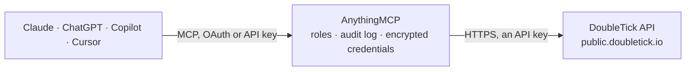

<!-- Generated by scripts/export-github-catalog.mjs in the anythingmcp-website repository. Do not edit by hand. -->

# DoubleTick MCP connector

DoubleTick WhatsApp Business inbox: connected WhatsApp numbers, chats and message history, customers with tags and custom fields, templates, broadcast groups, team, notes, quick replies and wallet … The AnythingMCP connector gives Claude, ChatGPT, Microsoft Copilot, Cursor and Gemini 25 MCP tools for DoubleTick: 14 read and 11 can change data.

**Category:** [Messaging](../messaging.md) · **Tools:** 25 · **Setup guide:** [anythingmcp.com](https://anythingmcp.com/guides/doubletick-to-mcp) · [Deutsch](https://anythingmcp.com/de/guides/doubletick-to-mcp) · [Italiano](https://anythingmcp.com/it/guides/doubletick-to-mcp) · [Español](https://anythingmcp.com/es/guides/doubletick-to-mcp) · [日本語](https://anythingmcp.com/ja/guides/doubletick-to-mcp) · [Русский](https://anythingmcp.com/ru/guides/doubletick-to-mcp) · [中文](https://anythingmcp.com/zh/guides/doubletick-to-mcp)

## Start without code

No installation and no terminal: AnythingMCP Cloud runs the DoubleTick connector for you, operated by helpcode.ai in Frankfurt, Germany.

1. **Click the button above** and create an account or sign in. The DoubleTick connector opens, ready to install.
2. **Paste the API key or token from your DoubleTick account.** Every click is in the [step-by-step guide](https://anythingmcp.com/guides/doubletick-to-mcp).
3. **Click Install.** AnythingMCP shows the address of your MCP server.
4. **Add that address to your assistant:** [Claude](https://anythingmcp.com/guides/connect-doubletick-to-claude) · [ChatGPT](https://anythingmcp.com/guides/connect-doubletick-to-chatgpt) · [Microsoft Copilot](https://anythingmcp.com/guides/connect-doubletick-to-copilot) · [Cursor](https://anythingmcp.com/guides/connect-doubletick-to-cursor) · [Gemini CLI](https://anythingmcp.com/guides/connect-doubletick-to-gemini) · [Meta Muse](https://anythingmcp.com/guides/connect-doubletick-to-muse).
5. **Ask your first question**, for example: *What's the current DoubleTick wallet balance and last top-up date for our Mumbai WABA +919876543210?*

Prefer help with the setup? [Talk to us](https://anythingmcp.com/contact).

## How it works

- **The AI client** speaks MCP (Streamable HTTP) to AnythingMCP and only sees tool names, descriptions and results. It never gets the DoubleTick credentials.
- **AnythingMCP** checks the client's role, builds the call from the tool definition, adds the credentials (an API key), calls DoubleTick, logs the call and returns the result.
- **DoubleTick** sees an ordinary API client with the rights of the account the credentials belong to.

## Tools

| Tool | What it does | Access |
|---|---|---|
| [`doubletick_list_channels`](#doubletick_list_channels) | List the WhatsApp business numbers (WABA channels) assigned to the key's user, with number, display name and profile. | read |
| [`doubletick_list_chats`](#doubletick_list_chats) | List inbox chats, most recent first, with customer, last message, status, tags and assigned agent. | read |
| [`doubletick_get_chat_messages`](#doubletick_get_chat_messages) | Get the messages exchanged between one of your WhatsApp numbers and a customer, optionally between two dates. | read |
| [`doubletick_get_chat_window_status`](#doubletick_get_chat_window_status) | Check whether the 24-hour WhatsApp customer service window with a customer is open, which decides if a free-form message can be sent or a template is required. | read |
| [`doubletick_get_customer`](#doubletick_get_customer) | Get a customer by phone number or customer id (one of the two is needed): name, assigned agent, opt-in, custom fields and, when a WhatsApp number is given,… | read |
| [`doubletick_list_templates`](#doubletick_list_templates) | List WhatsApp message templates with name, language, category, components (header, body with placeholders, footer, buttons) and approval status. | read |
| [`doubletick_list_broadcast_groups`](#doubletick_list_broadcast_groups) | List broadcast groups (contact lists for template broadcasts) with id, name, member count and creation date. | read |
| [`doubletick_list_team`](#doubletick_list_team) | List the team members of the organisation with name, phone number, role and reporting managers. | read |
| [`doubletick_get_team_member`](#doubletick_get_team_member) | Get one team member by phone number: role, reporting managers, channel access and organisation details. | read |
| [`doubletick_get_wallet_balance`](#doubletick_get_wallet_balance) | Get the organisation's DoubleTick wallet balance, from which WhatsApp conversation fees are paid. | read |
| [`doubletick_get_message_status`](#doubletick_get_message_status) | Get the delivery status of a sent message (sent, delivered, read, failed) from the messageId returned by a send tool. | read |
| [`doubletick_list_notes`](#doubletick_list_notes) | List internal notes on a customer chat (from + to) or a WhatsApp group chat (group_id), newest first, with author and mentions. | read |
| [`doubletick_list_quick_replies`](#doubletick_list_quick_replies) | List the saved quick replies (canned answers) with shortcut and text. | read |
| [`doubletick_list_webhooks`](#doubletick_list_webhooks) | List the webhooks registered for the organisation with name, URL, subscribed events and creator. | read |
| [`doubletick_send_text_message`](#doubletick_send_text_message) | Send a free-form WhatsApp text message to a customer or a WhatsApp group. | write |
| [`doubletick_send_image_message`](#doubletick_send_image_message) | Send an image by public URL, with an optional caption, to a customer or a WhatsApp group. | write |
| [`doubletick_send_document_message`](#doubletick_send_document_message) | Send a document (PDF, spreadsheet...) by public URL with an optional file name and caption, e.g. an invoice or a quote. | write |
| [`doubletick_send_template_message`](#doubletick_send_template_message) | Send an approved WhatsApp template to a customer, also outside the 24-hour window. | write |
| [`doubletick_send_broadcast`](#doubletick_send_broadcast) | Send an approved template to every member of a broadcast group. | write |
| [`doubletick_update_customer_tags`](#doubletick_update_customer_tags) | Add tags and set custom fields on a customer, and optionally its name, opt-in and assigned agent. | write |
| [`doubletick_remove_customer_tags`](#doubletick_remove_customer_tags) | Remove tags and custom field values from a customer. | write |
| [`doubletick_assign_chat`](#doubletick_assign_chat) | Assign a customer chat (customer_phone_number) or a WhatsApp group chat (group_id) to a team member. | write |
| [`doubletick_create_note`](#doubletick_create_note) | Add an internal note to a customer chat (from + to) or a WhatsApp group chat (group_id). | write |
| [`doubletick_create_broadcast_group`](#doubletick_create_broadcast_group) | Create a broadcast group with an optional first list of members. | write |
| [`doubletick_add_broadcast_group_members`](#doubletick_add_broadcast_group_members) | Add members to an existing broadcast group by group id. | write |

## Tool reference

Every parameter as the AI client sees it in `tools/list`. Source: [`packages/backend/src/adapters/in/doubletick.json`](../../../packages/backend/src/adapters/in/doubletick.json).

### `doubletick_list_channels`

List the WhatsApp business numbers (WABA channels) assigned to the key's user, with number, display name and profile. Call this first: most other tools need one of these numbers. Empty means the user has no number assigned.

**Access:** read · **Call:** `GET /organization/channel/profile`

No parameters.

### `doubletick_list_chats`

List inbox chats, most recent first, with customer, last message, status, tags and assigned agent. Filter by status, tags, agent or WhatsApp number. Cursor paging: up to 100 per call.

**Access:** read · **Call:** `GET /chats`

| Parameter | Type | Required | Description |
|---|---|---|---|
| `limit` | integer | no | Chats to return, 1-100. Default 10. |
| `status` | `all` \| `unread` \| `unresolved` \| `done` \| `waiting_for_response` \| `open` \| `open_cart` | no | Chat status filter. |
| `tags` | string | no | Comma-separated tag names. |
| `assigned_user_phone` | string | no | Phone number of the assigned agent; the text null for unassigned chats. |
| `waba_numbers` | string | no | Comma-separated WhatsApp business numbers (WhatsApp chats only). |
| `instagram_handles` | string | no | Comma-separated Instagram handles (Instagram chats only). |
| `next_chat_id` | string | no | Cursor: paginationOptions.nextChatId from the previous answer. |
| `next_chat_timestamp` | number | no | Cursor: paginationOptions.nextChatTimestamp from the previous answer (epoch ms). |

### `doubletick_get_chat_messages`

Get the messages exchanged between one of your WhatsApp numbers and a customer, optionally between two dates. Use it to read a conversation before replying or to summarise it.

**Access:** read · **Call:** `GET /chat-messages`

| Parameter | Type | Required | Description |
|---|---|---|---|
| `waba_number` | string | yes | Your WhatsApp business number, digits with country code, from doubletick_list_channels. |
| `customer_number` | string | yes | Customer phone number with country code, digits only. |
| `start_date` | string | no | First day, DD-MM-YYYY. |
| `end_date` | string | no | Last day, DD-MM-YYYY. |

### `doubletick_get_chat_window_status`

Check whether the 24-hour WhatsApp customer service window with a customer is open, which decides if a free-form message can be sent or a template is required.

**Access:** read · **Call:** `GET /chat/status`

| Parameter | Type | Required | Description |
|---|---|---|---|
| `waba_number` | string | yes | Your WhatsApp business number with country code. |
| `customer_phone_number` | string | yes | Customer phone number with country code. |

### `doubletick_get_customer`

Get a customer by phone number or customer id (one of the two is needed): name, assigned agent, opt-in, custom fields and, when a WhatsApp number is given, the tags for that number. 404 when unknown.

**Access:** read · **Call:** `GET /customer/details`

| Parameter | Type | Required | Description |
|---|---|---|---|
| `phone_number` | string | no | Customer phone number with country code. |
| `customer_id` | string | no | DoubleTick customer id, instead of the phone number. |
| `waba_number` | string | no | Your WhatsApp business number, to include the customer's tags for it. |

### `doubletick_list_templates`

List WhatsApp message templates with name, language, category, components (header, body with placeholders, footer, buttons) and approval status. Pass waba_phone_numbers, or all_waba_phone_numbers=true for the numbers assigned to the key's user.

**Access:** read · **Call:** `GET /v2/templates`

| Parameter | Type | Required | Description |
|---|---|---|---|
| `waba_phone_numbers` | string | no | Comma-separated WhatsApp business numbers, digits with country code, e.g. 919999999999. |
| `all_waba_phone_numbers` | boolean | no | true for the templates of every number the user can access, instead of waba_phone_numbers. |
| `status` | `APPROVED` \| `REJECTED` \| `PENDING` \| `PAUSED` \| `ALL` | no | Approval status. Use ALL to see every template. |
| `category` | `MARKETING` \| `UTILITY` | no | Template category. |
| `language` | string | no | Template language code, e.g. en, en_US, hi. Leave empty for all languages. |
| `name` | string | no | Template name. |

### `doubletick_list_broadcast_groups`

List broadcast groups (contact lists for template broadcasts) with id, name, member count and creation date. Search by name and page with the after_* cursors.

**Access:** read · **Call:** `GET /groups`

| Parameter | Type | Required | Description |
|---|---|---|---|
| `search_query` | string | no | Text in the group name. |
| `order_by` | `NAME` \| `DATE_CREATED` | no | Sort field. |
| `format` | `ASCENDING` \| `DESCENDING` | no | Sort direction. |
| `after_group_id` | string | no | Cursor: id of the last group of the previous page. |
| `after_group_name` | string | no | Cursor: name of the last group (when sorting by name). |
| `after_date_created` | string | no | Cursor: creation date of the last group (when sorting by date). |

### `doubletick_list_team`

List the team members of the organisation with name, phone number, role and reporting managers. Agent phone numbers are used to assign chats.

**Access:** read · **Call:** `GET /team`

No parameters.

### `doubletick_get_team_member`

Get one team member by phone number: role, reporting managers, channel access and organisation details.

**Access:** read · **Call:** `GET /team/member`

| Parameter | Type | Required | Description |
|---|---|---|---|
| `agent_number` | string | yes | Team member phone number with country code. |

### `doubletick_get_wallet_balance`

Get the organisation's DoubleTick wallet balance, from which WhatsApp conversation fees are paid. Check it before large template sends or broadcasts.

**Access:** read · **Call:** `GET /wallet/balance`

No parameters.

### `doubletick_get_message_status`

Get the delivery status of a sent message (sent, delivered, read, failed) from the messageId returned by a send tool. Limited to one call per second per organisation.

**Access:** read · **Call:** `GET /whatsapp/message/status`

| Parameter | Type | Required | Description |
|---|---|---|---|
| `message_id` | string | yes | messageId returned when the message was sent. |

### `doubletick_list_notes`

List internal notes on a customer chat (from + to) or a WhatsApp group chat (group_id), newest first, with author and mentions. Notes are visible to the team only.

**Access:** read · **Call:** `GET /notes`

| Parameter | Type | Required | Description |
|---|---|---|---|
| `from` | string | no | Your WhatsApp business number with country code. With to, for a customer chat. |
| `to` | string | no | Customer phone number with country code. |
| `group_id` | string | no | WhatsApp group id, instead of from and to. |
| `limit` | integer | no | Notes to return, up to 100. Default 30. |
| `last_note_id` | string | no | Cursor: id of the last note of the previous page. |
| `last_note_date` | string | no | Cursor: date of the last note of the previous page. |

### `doubletick_list_quick_replies`

List the saved quick replies (canned answers) with shortcut and text. Use them to answer common questions in the team's usual wording.

**Access:** read · **Call:** `GET /quick-replies`

| Parameter | Type | Required | Description |
|---|---|---|---|
| `search_term` | string | no | Text in the shortcut or message. |
| `access_to` | string | no | Restrict to quick replies shared with this audience, as defined in DoubleTick. |
| `last_quick_reply_date` | string | no | Cursor: date of the last quick reply of the previous page. |

### `doubletick_list_webhooks`

List the webhooks registered for the organisation with name, URL, subscribed events and creator. Use it to see which systems receive DoubleTick events.

**Access:** read · **Call:** `GET /v2/webhooks`

| Parameter | Type | Required | Description |
|---|---|---|---|
| `sort_by` | `name` \| `url` \| `createdBy` \| `integrationCount` | no | Sort field. |
| `sort_direction` | `ASC` \| `DESC` | no | Sort direction. |

### `doubletick_send_text_message`

Send a free-form WhatsApp text message to a customer or a WhatsApp group. Only works within 24 hours of the customer's last message; otherwise send a template.

**Access:** write · **Call:** `POST /whatsapp/message/text`

| Parameter | Type | Required | Description |
|---|---|---|---|
| `from` | string | yes | Your WhatsApp business number with country code, e.g. +919999999999. |
| `to` | string | no | Customer number with country code. Leave empty when sending to group_id. |
| `group_id` | string | no | WhatsApp group id, instead of to. |
| `text` | string | yes | Message text. WhatsApp formatting (*bold*, _italic_) is supported. |
| `message_id` | string | no | Optional UUID v4 to use as the message id (for idempotency). |

### `doubletick_send_image_message`

Send an image by public URL, with an optional caption, to a customer or a WhatsApp group. Same 24-hour window rule as text messages.

**Access:** write · **Call:** `POST /whatsapp/message/image`

| Parameter | Type | Required | Description |
|---|---|---|---|
| `from` | string | yes | Your WhatsApp business number with country code. |
| `to` | string | no | Customer number with country code. Leave empty when sending to group_id. |
| `group_id` | string | no | WhatsApp group id, instead of to. |
| `media_url` | string | yes | Public URL of the image (JPEG or PNG). |
| `caption` | string | no | Caption under the image. |
| `message_id` | string | no | Optional UUID v4 to use as the message id. |

### `doubletick_send_document_message`

Send a document (PDF, spreadsheet...) by public URL with an optional file name and caption, e.g. an invoice or a quote. Same 24-hour window rule as text messages.

**Access:** write · **Call:** `POST /whatsapp/message/document`

| Parameter | Type | Required | Description |
|---|---|---|---|
| `from` | string | yes | Your WhatsApp business number with country code. |
| `to` | string | no | Customer number with country code. Leave empty when sending to group_id. |
| `group_id` | string | no | WhatsApp group id, instead of to. |
| `media_url` | string | yes | Public URL of the document. |
| `filename` | string | no | File name shown to the customer, e.g. Invoice-1042.pdf. |
| `caption` | string | no | Caption under the document. |
| `message_id` | string | no | Optional UUID v4 to use as the message id. |

### `doubletick_send_template_message`

Send an approved WhatsApp template to a customer, also outside the 24-hour window. Body placeholders are key-value objects. Returns per-message status and messageId; charges the wallet.

**Access:** write · **Call:** `POST /v2/whatsapp/message/template`

| Parameter | Type | Required | Description |
|---|---|---|---|
| `from` | string | yes | Your WhatsApp business number with country code. |
| `to` | string | no | Customer number with country code. Leave empty when sending to group_id. |
| `group_id` | string | no | WhatsApp group id, instead of to. |
| `template_name` | string | yes | Template name from doubletick_list_templates (status APPROVED). |
| `language` | string | yes | Template language code, exactly as listed, e.g. en or en_US. |
| `template_data` | object | no | Values for the template: {"header": {"type": "IMAGE", "mediaUrl": "https://..."}, "body": {"placeholders": [{"name": "Asha"}, {"order": "1042"}]}, "buttons": [{"type": "URL", "parameter": "abc"}]}. Omit parts the template does not have. |
| `custom_data` | object | no | Optional data echoed back in DoubleTick webhooks for this message. |

### `doubletick_send_broadcast`

Send an approved template to every member of a broadcast group. Placeholders like {{Name}} are filled per member. Charges the wallet for each recipient; check the balance first.

**Access:** write · **Call:** `POST /whatsapp/message/broadcast`

| Parameter | Type | Required | Description |
|---|---|---|---|
| `group_name` | string | yes | Broadcast group name from doubletick_list_broadcast_groups. |
| `from` | string | yes | Your WhatsApp business number with country code. |
| `template_name` | string | yes | Approved template name. |
| `language` | string | yes | Template language code, e.g. en. |
| `template_data` | object | no | Template values: {"header": {...}, "body": {"placeholders": ["{{Name}}", "Diwali sale"]}, "buttons": [...]}. Broadcast body placeholders are plain strings. |

### `doubletick_update_customer_tags`

Add tags and set custom fields on a customer, and optionally its name, opt-in and assigned agent. Creates the customer if the number is new. Existing tags are kept.

**Access:** write · **Call:** `POST /customer/assign-tags-custom-fields`

| Parameter | Type | Required | Description |
|---|---|---|---|
| `phone` | string | yes | Customer phone number with country code, e.g. 919876543210. |
| `tags` | string[] | no | Tags to add. |
| `custom_fields` | object[] | no | Custom field values: [{"name": "City", "value": "Pune"}]. |
| `name` | string | no | Customer name. |
| `opt_in` | boolean | no | WhatsApp marketing opt-in. |
| `agent_phone` | string | no | Agent to assign, phone with country code. |
| `waba_number` | string | no | Your WhatsApp business number the tags belong to. |

### `doubletick_remove_customer_tags`

Remove tags and custom field values from a customer. Pass empty arrays for the part you do not want to change.

**Access:** write · **Call:** `POST /customer/remove-tags-custom-fields`

| Parameter | Type | Required | Description |
|---|---|---|---|
| `phone` | string | yes | Customer phone number with country code. |
| `tags` | string[] | yes | Tags to remove. |
| `custom_fields` | string[] | yes | Names of the custom fields to clear. |
| `waba_number` | string | no | Your WhatsApp business number the tags belong to. |

### `doubletick_assign_chat`

Assign a customer chat (customer_phone_number) or a WhatsApp group chat (group_id) to a team member. Set reassign to true to move a chat that already has an agent.

**Access:** write · **Call:** `POST /team-member/assign`

| Parameter | Type | Required | Description |
|---|---|---|---|
| `assigned_user_phone_number` | string | yes | Agent phone number from doubletick_list_team. |
| `customer_phone_number` | string | no | Customer phone number with country code. Use this or group_id. |
| `group_id` | string | no | WhatsApp group id. Use this or customer_phone_number. |
| `waba_number` | string | no | Your WhatsApp business number (customer chats only). |
| `reassign` | boolean | no | true to replace the current agent. |

### `doubletick_create_note`

Add an internal note to a customer chat (from + to) or a WhatsApp group chat (group_id). Notes are seen by the team, never by the customer.

**Access:** write · **Call:** `POST /notes`

| Parameter | Type | Required | Description |
|---|---|---|---|
| `note` | string | yes | Note text. |
| `from` | string | no | Your WhatsApp business number with country code. |
| `to` | string | no | Customer phone number with country code. |
| `group_id` | string | no | WhatsApp group id, instead of from and to. |
| `entities` | object[] | no | Mentions that notify team members: [{"type": "user", "id": "<user id>"}]. |

### `doubletick_create_broadcast_group`

Create a broadcast group with an optional first list of members. Returns the group id and any numbers rejected as invalid.

**Access:** write · **Call:** `POST /groups`

| Parameter | Type | Required | Description |
|---|---|---|---|
| `name` | string | yes | Group name, used later to send broadcasts. |
| `members` | object[] | no | Members: [{"name": "Asha", "phone": "919876543210"}]. |

### `doubletick_add_broadcast_group_members`

Add members to an existing broadcast group by group id. Returns the updated count and any numbers rejected as invalid.

**Access:** write · **Call:** `POST /groups/add-members`

| Parameter | Type | Required | Description |
|---|---|---|---|
| `group_id` | string | yes | Broadcast group id from doubletick_list_broadcast_groups. |
| `members` | object[] | yes | Members: [{"name": "Asha", "phone": "919876543210"}]. |

## Run it yourself

AnythingMCP is open source (AGPL-3.0). [Run it with Docker](../../../README.md#run-it-yourself), open **Connectors → Store**, pick **DoubleTick** and enter `DOUBLETICK_API_KEY`, then add your MCP server URL to the AI client.

[← Messaging connectors](../messaging.md) · [All categories](../README.md)
